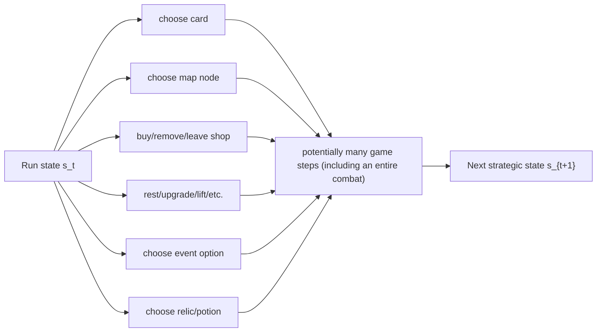
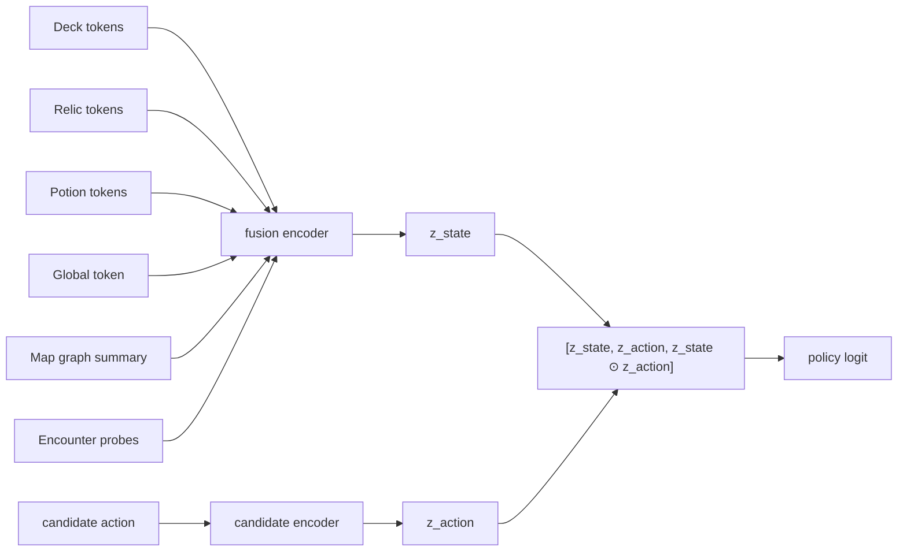
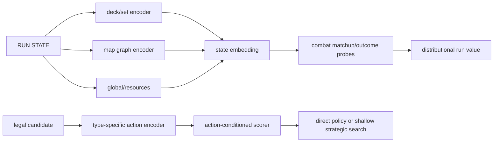

# Out-of-combat strategic action plan — August 2026

> Current status: **active working plan** for the semi-Markov run-level
> strategic agent (project Phase 5). It supersedes Phase 5 of
> [`combat-action-plan-2026-07.md`](combat-action-plan-2026-07.md); its source
> specification is the 15-section guideline attached verbatim as
> [Appendix A](#appendix-a-source-specification) and mirrored there.
> Rounds 1–3 (2026-08-02) already delivered the data pipeline, Tier-A policy
> + value net, per-screen value heads, Tier-B Q labels, and the one-ply
> Q-gate on card rewards; see [§3](#3-delivered-rounds-1-3). Dated plans in
> `docs/archive/` become historical only when a later plan supersedes them;
> check `git log` for this file before assuming it is current.

## 1. The problem

Combat is a temporally extended transition, not a per-tick action. The
strategic model acts only at run-level decision points (card reward, map
node, shop purchase, rest/upgrade/lift/toke/recall, event option, relic/
potion pick) and observes the run state *between* them:



This is a substantially easier learning problem than mixing combat and
non-combat actions in one policy. Combat stays owned by the C++ tree search
(Searcher3/PVNet work); the strategic model consumes its outcomes.

## 2. Spec of record

The full design spec — formal problem, run-state representation (global
features, deck tokens, relic/potion tokens, map DAG, decision context),
unified action-conditioned scoring, per-type candidate encoders, run-value
model, combat-outcome interface, encounter probes, architecture, training,
strategic search, search distillation, shared vs. separate heads, and the
hidden-information restrictions — is attached in
[Appendix A](#appendix-a-source-specification). It remains the design
target; the divergences already decided in this repo are listed in §4.

## 3. Delivered: rounds 1–3

| Deliverable | Round | Evidence |
| --- | --- | --- |
| `strategicgen` — logs every legal OOC action per decision with structured candidate fields + `chosen` flag; Tier-A labels (terminal `won/endFloor/endHp` on chosen rows only) | 1 | `EXPERIMENTS.md` §70, `apps/one_combat.cpp::runStrategicGenSeed`; 200 seeds → 134,832 rows / 31,870 decisions |
| `train_strategic.py` — joint policy (per-decision-group softmax on `chosen`) + run value V(s) → `10·won+endHp`; later + per-screen heads + Q head; mmap float16 group-ordered trainer for multi-GB CSVs | 1–3 | §70–§73, `train_strategic.py` |
| `export_strategic.py` + `OocStrategicNet` — `OOC_STRAT_V1/V2/V3` native formats with loader validation | 1–3 | `export_strategic.py`, `apps/ooc_strategic_net.h` |
| One-ply card-reward gate `oocOnePlyCardRewardPolicy` — successor-state scoring (V1/V2) → direct Q(s,a) scoring (V3), margin-gated by `STS_OOC_STRATEGIC_MARGIN` (default 1.0) | 1–3 | `apps/one_combat.cpp::oocOnePlyCardRewardPolicy` |
| Per-screen value heads (1..8, shared state encoder) | 2 | §71; per-screen MAE: TREASURE 0.59, REST 0.73, SHOP 0.97, BOSS_RELIC 1.42, MAP 1.64, REWARDS 2.13, CARD_SELECT 2.63, EVENT 5.21 |
| `strategicgen2` — Tier-B one-ply counterfactual labels: horizon K=3 battles + bootstrap, branch sims 150/100/50, common random numbers per decision, all-decision sampling | 3 | §73; 3,057,708 rows / 4,650 seeds / 723,851 decisions |
| Q(s,a) head + direct-Q gate | 3 | §73; held-out policy top-1 0.784, Q top-1 0.284, Q MAE 14.32 |
| V2 value-head interleave bug (heads 1–7 garbage in C++) found and fixed in the V3 exporter (block-major) | 3 | §73 correction |

Round verdicts: §70 −10.9pp at margin 1.0 (pooled head damages); §71 per-seed
neutral with per-screen heads (gate never fires); §73 non-monotone margin
curve with peak at 0.5 (+4.7pp wins, CIs span zero) and greedy margin 0
regressing −3.9pp. No strategic model is deployed by default; everything is
opt-in behind `STS_OOC_STRATEGIC_NN` (+`STS_OOC_STRATEGIC_Q` for the V3 path).

## 4. Divergences from the spec already decided

1. **Training objective.** Spec §9 proposes PPO/GAE at strategic decision
   points. The repo instead trains on Tier-A behavioral labels + Tier-B
   one-ply Q labels (round-3 user decision). Planned A/B: once the Q-gate
   shows a stable signal, compare label-trained Q vs. PPO on the same gate.
2. **Margin gate is mandatory.** The spec's argmax/softmax execution assumes
   calibrated logits; un-gated greedy NN deployment is a recorded failure
   mode (§66m, §70, §73 margin 0). Every deployed override path keeps a
   margin gate.
3. **Value head shape.** Spec §5 proposes a multi-head distributional critic
   (P(reach next act), death-floor distribution, boss-HP quantiles, …). The
   repo uses per-screen scalar heads on `10·won+endHp` (§71). Distributional
   heads are future work (Phase B/A).
4. **Heads architecture.** Spec §12 recommends one shared scorer + optional
   type-specific residual heads. Rounds 1–3 use per-screen value heads and a
   shared state/action encoder with screen+type conditioned heads; the
   unified-scorer comparison is still open.
5. **Map encoding history.** Spec §2.4 and §15 rank a map DAG-graph encoder
   as central, but §61/§62 recorded no measured gain from full-map graph
   encoders for paired card and path decisions. Phase B must re-test this on
   the new pipeline rather than assume the gain.
6. **Observation basis.** The spec assumes a token-based structured state;
   current models train on the 1,017-value rich vector
   (`vFeatCsv`/`RAW`). Token encoders are Phase B work.

## 5. Remaining work

Checkboxes are new; delivered items are marked `[x]` with evidence refs.

### Phase A: unified candidate scorer (mostly delivered, gaps remain)

- [x] All-actions datagen + Tier-A labels — §70
- [x] Tier-B one-ply counterfactual labels — §73
- [x] Shared state encoder + policy/value heads + Q head, per-screen value heads — §71, §73
- [x] Dynamic policy head across legal actions (group softmax) — §70
- [x] Native export + loader parity — §70–§73
- [x] Margin-gated one-ply card-reward gate — §70–§73
- [x] Token-based run state: global token with explicit threshold features (§2.1) — §75 (V4; opt-in)
- [x] Counted deck tokens `(cardId, upgraded, count)` (§2.2) — §75
- [x] Relic/potion entity tokens with dynamic state (Girya lifts, Omamori charges, …) (§2.3) — §75
- [x] Decision-context encoding: current screen + offer contents + legal actions (§2.5) — §75 (candidate entity embeddings)
- [x] PPO/GAE alternative (§9) — §78; **negative** (PPO-clip diverges on the behavioral data); CE+Q stays the policy objective

### Phase B: better encoders

- [x] Deck set transformer (permutation invariant, counted → instance tokens comparison) — 5.3.1; §86 held-out **neutral** (transformer lever kept)
- [x] Map DAG message-passing encoder (boss-row-backward), legal-node embeddings carry downstream route info — 5.3.2; delivered on the tierb pipeline (§100, `OOC_STRAT_V6`): reverse-DAG encoder + zero-init adapter, frozen-base isolation run, mapbatch tables (no new datagen — the tierb MAP rows already carry per-child counterfactual labels); **falsified** — offline gain (q_top1_map 0.506, val_pol_ce 0.426) with no gameplay transfer (neutral-to-negative at every probability-point margin, §62 lesson repeats); the heuristic pathing stays, V6 stays opt-in
- [x] Candidate–deck cross-attention for card rewards — 5.3.3; §88 held-out **neutral**
- [x] Distributional/multi-head value targets (§5) — §87; implemented as per-screen quantile heads on `10·won+endHp` (not the spec's act/death-floor/boss-HP targets — divergence); held-out **marginal** (best Q top-1 0.296)
- [x] Evaluate each change with paired seeds on the recorded block — held-out evals per §86–§88; the neutral rounds did not warrant paired-seed gate evals (§6 protocol applies to deployed changes)

### Phase C: combat outcome model

- [x] Collect combat outcome examples — 5.4.1; §79 inventory: the labels already existed in `distgen` rows (`won,endHp,endTurn,potionsConsumed,pUsed0–43`); **no new datagen needed**
- [x] Train `C_ψ(deck, relics, potions, HP, encounter, asc) → P(death), HP-loss quantiles, potion-use, turns` — 5.4.2; §79 (win acc 0.969; `combat_cpsi_v1` export fixed 2026-08-03)
- [x] Encounter probes — 5.4.3, spec §7; §80 (9 probe slots incl. actual upcoming fights; fed into the V4 state; held-out **neutral**)
- [x] Use C_ψ as a fast surrogate during strategic search — 5.4.4; §93: the C_ψ-surrogate map route search was delivered and benchmarked — **negative** (pool-average combat pricing + MAP V-head leaf, −3.1..−21.1pp); the surrogate alone does not beat the tuned pathing DP on the current state contract

### Phase D: one-ply post-action evaluation beyond card rewards

- [x] Card rewards: direct-Q gate (V3) — §73
- [x] Rest/shop/treasure screens — §74 (rest), §76 (shop/TREASURE/boss relic; full-stack +18.8pp @ m1, statistically established)
- [x] Events last — §74 (Tier-B labels covered events; the event gate was the round-4 main contributor, +5.5pp alone)

### Phase E: specialized search

- [x] Shop beam search (width 16–64, depth = affordable purchases, dedup states) — 5.6.1; §85 **negative** (beam-only −9.4pp; value-head leaves too weak); the one-ply shop gate stays
- [x] Short-horizon map route search (2–5 floors, sampled outcomes, V at leaf) — 5.6.2; delivered and benchmarked: the direct-Q-per-route one-ply MAP gate was **falsified** (§91: −15.6..−19.5pp at every margin; the Q head's MAP rankings are anti-predictive without downstream route info) **and the C_ψ-surrogate route search was falsified too** (§93: C_ψ pool expectation + MAP V-head leaf, −9.4..−21.1pp at m1.0/m5.0, neutral m0.5) — the heuristic pathing stays; the open lever is the map DAG encoder (5.3.2) or Tier-B-style route labels
- [x] Stochastic event evaluation via sampled RNG continuations — 5.6.3; **superseded** by the Tier-B label design (§74 decision: labels average the stochastic continuation)
- [x] Hidden-information boundary audit — 5.6.4, spec §13; delivered (decision log `2026-08-02-hidden-info-audit.md`): gates/searcher clean; rich-row future-encounter features flagged as an open design question

### Phase F: search distillation

Status: **executed and falsified on the current labels (2026-08-04, §104)** —
the soft-target objective (λ∈{0.25,0.5,1.0}, τ=1.0) does not transfer: every
distilled-policy gate arm loses to the Q-gate (~+3..+27pp, significant at
m≤0.05) and to the V3 reference (best −21.1pp [−30.5,−12.5]). The
tie-dominated `labelWon` caps the ranking signal (dist_top1 ≈ behavior's
38%). `STS_OOC_STRATEGIC_SCORE` stays opt-in; `q` stays default. K=6 deep
targets (5.7.1b) remain the open follow-up to reduce label noise/tie density.

- [x] Produce improved policy targets `π_target(a|s) ∝ exp(Q_search(s,a)/τ)` — 5.7.1 (done; diagnostic §104 Step 1: 38% argmax-vs-chosen agreement, ties dominate; K=6 deeper targets NOT run — deferred follow-up)
- [x] Train policy toward search-improved targets (CE) — 5.7.2 (done; gate A/B §104: falsified, stays opt-in)
- [ ] Iterative loop: play → search → train → repeat — 5.7.3

### Cross-cutting

- [x] Label-horizon A/B: K=1 vs K=3 — §78/§83/§84; closed: **K=3 × futures=1 is the optimal label contract** (better K=1/futures-3 calibration did not transfer to the gate)
- [x] A/B `STRATEGIC_BRANCH_FUTURES` for encounter averaging — §84; futures=3 gate +13.3pp < futures=1 +18.8pp; **futures=1 stays**
- [x] Fix or isolate the `BattleContext::executeActions` loop-guard assertion (seed 128087) — isolated (`src/combat/BattleContext.cpp`: Release-mode `assert` no-op → logged loss termination); seed completes; committed
- [x] V4 full gate stack on the 256-seed block (§81 follow-up 3) — §92: **105/256 = 41.0%** (+3.9pp vs the V3 256-stack; +18.0pp vs the 256 flags-off baseline); V4 stays the top arm, gates stay opt-in, no default flip
- [x] Q_win action-value refactor (§4 divergence 1 follow-up) — §94/§95/§96: pure win-probability Q head (BCE on `labelWon`), Q_HP/Q_floor aux heads, `OOC_STRAT_V5` artifact (both V3 and V5 loadable, legacy bit-identical); V_win bootstrap recalibration §95 (the initial "grossly miscalibrated" claim was a checker bug; true max decile 0.24 raw → 0.08 after the isotonic map on the censored labels); corrected-label desktop retrain (best epoch 40: q_brier 0.041, q_cal_max 0.065, policy top-1 0.797) + V5 export; **probability-point margin sweep and the Wave B regret gate are both negative** (§96: every Q_win margin point loses to the V3 legacy reference — only biased m0.01 at 33.6% spans zero; the regret gate `STS_OOC_STRATEGIC_GATE=regret` is ≈ baseline at every ε and stays opt-in, no default flip); Q_boss aux head deferred (needs a datagen label column)
- [x] More Tier-A data (round 1 used 200 seeds; Tier-B used ~4,650) for policy-head training — satisfied indirectly: the §94 fresh `strategicgen2` datagen (new seeds 200000–201439, 1,440 seeds / 900,916 rows) grew the shared Tier-A+Tier-B corpus (Tier-A labels ride the same rows), and the §95/§96 corrected-label retrains train the policy head on it; no dedicated Tier-A-only datagen was run

## 6. Evaluation protocol

Every deployed or gate-level change is evaluated on the recorded fair
128-seed block (seeds 126700–126827, `STS_FAIR=1`, 1,000 sims/decision, 12
threads) as a **paired** comparison against the bit-identical baseline CSV
(`EXPERIMENTS.md` §68; per-seed outputs retained in `build/`). Metrics:
full-run win rate, mean final floor, mean end HP, plus bootstrap/Wilson CIs
and discordant pairs (`paired_analysis.py`). Gate rounds sweep
`STS_OOC_STRATEGIC_MARGIN` (0.5/1.0/5.0) because the §73 margin curve is
non-monotone. Offline diagnostics: held-out policy top-1, per-screen value
MAE, Q top-1/Q MAE per screen (`_metrics.json`), export parity asserts.
All results recorded in `EXPERIMENTS.md` per the experiment-recording rules.

## 7. Key hypotheses (in expected-impact order, spec §15)

1. A strong combat controller determines the strategic policy's training
   distribution.
2. A good run-value model — the common language pricing HP, potions, gold,
   and upgrades across all screens.
3. Matchup-aware combat predictions (encounter probes) beat generic deck
   strength.
4. Proper map graph encoding — path choices are central.
5. Candidate-conditioned action scoring for variable card/relic/shop
   choices.
6. Shop sequence search beats greedy item-by-item purchase.
7. Search distillation stabilizes training vs. terminal-only supervision.

## Appendix A: source specification

> The full guideline (verbatim, math cleaned from the pasted copy). This is
> the design target for the phases above; §4 lists the divergences already
> decided in this repo.

### A.1 Framework

The out-of-combat system is a semi-Markov run-level agent: combat is treated
as a temporally extended transition, while the strategic model acts only at
meaningful decision points (see the §1 diagram). This is a substantially
easier learning problem than placing combat and non-combat actions in the
same policy.

A recent proof-of-concept built directly on STS Lightspeed used one shared
scorer over the simulator's 412-dimensional observation plus a hand-
constructed candidate descriptor. It trained all non-combat decisions with
REINFORCE while leaving combat to MCTS. On its 50-seed evaluation it
reported a large floor improvement over the stock non-combat heuristics,
although the repository explicitly notes the small evaluation and lack of
confidence intervals. That is useful evidence that the basic separation
works, but a considerably richer representation and training objective is
wanted.

### A.2 The formal problem

Let `s_t` be the complete visible run state at strategic decision `t`, and
`a_t` one of the currently legal choices.

- Policy: `π_θ(a_t | s_t)`.
- Run-value: `V_φ(s_t) = P(eventual run victory | s_t)`, or preferably a
  distribution over possible run outcomes.
- Action-value: `Q(s_t, a_t) = E[V(s_{t+1}) | s_t, a_t]`.

The transition from `s_t` to `s_{t+1}` may contain: a deterministic card
addition; a random event result; a sequence of shop purchases; a path
transition; an entire stochastic combat; a card reward after that combat.
That is why a conventional step-by-step DQN over every simulator tick is
wrong: store one transition per actual decision.

```cpp
struct StrategicTransition {
    RunObservation state;
    StrategicAction action;
    float reward;
    RunObservation next_state;
    bool terminal;
    int floors_elapsed;
};
```

`floors_elapsed` is usually zero or one, but useful for discounting
transitions consistently.

### A.3 What exactly is in the run state

The strategic model needs more than current HP, deck size, and floor number.
It needs enough information to infer: the deck's current strengths and
weaknesses; how valuable a candidate card is in this particular deck; how
dangerous upcoming encounters are; whether resources should be spent now or
conserved; how the available paths interact with the deck and boss. Five
components:

**A.3.1 Global run features.** Character, ascension, act, floor, current
room type, current HP / max HP, gold, potion slots, number of keys obtained,
current map row, known act boss, Neow bonus / initial state information.
Normalize continuous quantities but retain important thresholds explicitly:
HP fraction, missing HP, can survive known event cost?, gold ≥ removal
cost?, gold ≥ candidate item price?, free potion slot?, can take elite key?
Threshold features often make training easier than forcing the model to
infer every discrete boundary from normalized numbers.

**A.3.2 Deck representation.** Do not encode only card counts in a fixed
vector if good generalization is wanted. Represent every distinct card type
or every card instance as a token:

```
x_i^card = E_id(c_i) + E_upgrade(u_i) + E_bottle(b_i) + E_misc(m_i)
```

Relevant attributes: card identity; upgraded status; innate/bottled status;
permanent cost modifications; curse/status; duplicates; removability;
character/color.

- *Card-instance tokens*: one token per card (`Strike, Strike, Strike+,
  Bash+, Offering, Burning Pact, …`). Preserves exact deck size and
  duplicated upgraded/unupgraded copies.
- *Counted card tokens*: one token per `(card ID, upgrade state)` with a
  count feature (`Strike, count=3; Strike+, count=1; Bash+, count=1`).
  Cheaper, probably sufficient for run-level decisions.

Start with counted tokens, then compare against instance tokens. The deck
encoder must be permutation invariant:

```
card tokens → 2–4 transformer/set-attention layers → deck summary token z_deck
```

The model needs to infer: front-loaded damage; scaling damage; block
density; exhaust support; strength support; status generation; draw;
energy; deck consistency; expected cards per cycle; vulnerability
application; AoE; curse burden. These can be added as auxiliary
handcrafted features, but they should complement rather than replace card
tokens.

**A.3.3 Relics and potions.** Entity tokens again:

```
[RELIC] Burning Blood   [RELIC] Vajra   [RELIC] Preserved Insect
[POTION] Fire Potion    [POTION] Empty slot
```

Each relic token can include dynamic state: counter value; whether active;
charges; floor-dependent status. Examples: Girya lifts used; Omamori
charges; Matryoshka charges; Neow's Lament stacks; Wing Boots charges;
potion belt slot count. Potions should not be represented solely by IDs:
include number of open slots; whether the current reward forces a discard;
expected value against the upcoming boss or elite; whether the potion can
solve a known deck weakness.

**A.3.4 Map representation.** One of the most important parts. Do not
represent a map choice only as `candidate room = elite; next row has one
rest` — that loses path structure. Represent the visible map as a directed
acyclic graph `G = (V, E)`, each node containing: room type, row, column,
distance from current position, reachable from current position?, visited?,
burning elite?, chest or boss special status. Run a small GNN from the boss
row backward:

```
h_v^(k+1) = f(x_v, aggregate_{u ∈ children(v)} h_u^(k))
```

Because the map is a DAG, explicit bottom-up dynamic message passing works
too. Each currently legal next node receives an embedding containing
information about all downstream routes:

```
next node: elite
possible future paths:
    elite → rest → hallway → shop
    elite → event → rest → hallway
```

This lets the policy distinguish two identical immediate room types with
very different downstream options. A candidate map action is then
`e_a = h_target node`.

**A.3.5 Current decision context.** The state must also contain the current
offer or screen:

- *Card reward*: offered cards, skip option, reward source (hallway/elite/
  boss/event), current card reward modifiers.
- *Shop*: all cards, all relics, all potions, card removal cost, current
  gold, sold-out items.
- *Campfire*: legal campfire actions, upgradeable cards, current healing
  amount, relic-specific options.
- *Event*: event identity, current event phase, legal options, possible
  costs, known deterministic or stochastic outcomes.

### A.4 A unified action-conditioned model

Do not use a fixed output head (`output 0 = take first card`, …). Actions
are heterogeneous and variable in number. Instead: encode the run state
once; enumerate legal actions; encode each candidate; score each candidate.

```
ℓ_a = f_θ(z_s, e_a)
```

where `z_s` is the run-state embedding and `e_a` the action embedding.

```
RunEmbedding z = run_encoder(observation);
for (const StrategicAction& action : legal_actions) {
    ActionEmbedding e = action_encoder(action, observation);
    logits.push_back(policy_head(z, e));
}
π(a|s) = exp(ℓ_a) / Σ_{b ∈ A(s)} exp(ℓ_b)
```

The simple existing STS Lightspeed agent follows this general
candidate-scoring pattern: it builds descriptors for card, map, rest, shop,
and event candidates and applies one shared MLP to each state–candidate
pair. Its map descriptor only summarizes the target room and room counts
one and two rows ahead, which is one of the first things to replace with a
graph encoder.

### A.5 Candidate encoders by decision type

Use shared state embeddings but type-specific candidate encoders.

**A.5.1 Card rewards.** For candidate card `c`:

```
e_a = [E_card(c); z_deck; Δ_deck(c); E_reward source]
```

`Δ_deck(c)` can contain explicit changes: new deck size, new attack
fraction, new skill fraction, new power fraction, new average cost, new
draw density, new exhaust density, duplicate count. The candidate scorer
should compare the card directly against every existing card token using
cross-attention (candidate card token attends to the entire deck →
candidate-in-deck embedding). This lets it learn: Corruption is better with
many skills; Feel No Pain is better with exhaust; Perfected Strike changes
value with Strike-tagged cards; an additional expensive card is worse with
poor energy; skip becomes better as the deck becomes more refined. Treat
skip as a real learned action token, not a hardcoded threshold.

**A.5.2 Map choices.** Candidate action embedding: target-node graph
embedding, current HP, deck encounter profile, potions, known boss, elite
count already taken, remaining rest/shop opportunities. The policy must
estimate two competing quantities:

```
route value ≈ expected rewards − death/resource risk
```

A map choice should depend strongly on matchup — "take an elite" is not a
general property of HP alone; it depends on whether the deck can handle the
possible elite pool.

**A.5.3 Campfire actions.** Do not encode upgrade as a single generic
action. Represent `REST / UPGRADE(card instance) / LIFT / DIG / TOKE(card
instance) / RECALL`. For an upgrade action:

```
e_a = [E_upgrade action; E_card before; E_card after; E_upgrade delta]
```

The model should directly compare: expected value of healing now; expected
value of the selected upgrade over future combats; probability of dying
before the next rest; whether healing will be partially wasted; whether the
boss is imminent.

**A.5.4 Shops.** A shop is a small sequential resource-allocation problem,
not a single decision. Suppose the shop offers `Inflame 50g, Offering 80g,
Bag of Prep 150g, Fire Potion 50g, Remove card 75g, Leave`. Buying one item
changes the legal and affordable set. Treat each purchase as a separate
decision: `shop state → buy Offering → updated shop state → remove Strike →
updated shop state → leave`. At inference time a shallow search is
particularly useful because the branching factor is small. Search depth:
until leave or no affordable actions. State: remaining items + gold +
modified deck. Leaf: `V_run(state after leaving shop)`. This permits the
system to discover combinations such as *cheap card + removal* versus *one
expensive relic*. A greedy item-by-item policy may fail because the best
individual purchase can prevent the best overall bundle.

**A.5.5 Events.** Encode: event ID, event phase, action index, exact costs,
possible outcome distribution. For known deterministic options, apply the
transition and evaluate the resulting state directly. For stochastic
options:

```
Q(s, a) = Σ_o P(o | s, a) V(T(s, a, o))
```

With STS Lightspeed, estimate this by sampling copied game states under
legal hidden RNG continuations rather than asking the network to memorize
every event probability.

**A.5.6 Boss relics and ordinary relics.** Candidate relic scoring needs
direct interaction with: current energy, card costs, deck size, draw,
potion reliance, current and future boss matchups, existing relics. A boss
relic should be a normal candidate entity with a specialized action type.
Avoid a separate static relic tier list.

### A.6 The run-value model

The central output should be eventual run success, but a single binary head
learns slowly. Use a multi-head distributional critic:

```
P(win run)
P(reach next act)
P(reach Act 3)
P(reach Heart)
expected terminal floor
death-floor distribution
HP at next boss distribution
gold at next shop distribution
expected number of elites survived
```

For an A20 Heart objective: `V_main(s) = P(Heart victory | s)`. Auxiliary
heads make the representation learn faster:

```
L_value = L_heart + λ1·L_next act + λ2·L_death floor + λ3·L_boss HP + ⋯
```

Auxiliary predictions improve representation learning, but action selection
must ultimately optimize the actual target: run victory.

**Why not optimize floor reached?** Using final floor as reward is useful
early because it is denser than win/loss (the existing proof-of-concept uses
final floor / 50 as its REINFORCE return). But floor reward introduces
incorrect preferences: dying late may be scored nearly as highly as winning;
a line with a high chance of reaching Act 3 but almost no chance against
the boss may dominate; safe strategies that preserve Heart-winning potential
can be undervalued; farming intermediate progress can be preferred over
building a winning deck. Use a curriculum: early training — floor/act
progress; middle — weighted progress + win; late — run win, with progress
only as auxiliary targets.

### A.7 The combat-outcome interface

The out-of-combat model needs to understand combat without running full
tactical MCTS for every hypothetical strategic action. Define a combat
outcome model:

```
C_ψ(s_run, e) → P(death, HP loss, potion use, turns)
```

where `e` is an encounter. For a hypothetical next hallway fight:

```
CombatPrediction p = combat_model.predict(deck, relics, potions, hp, encounter, ascension);
```

Useful outputs: P(death); expected HP loss conditional on survival;
HP-loss quantiles; P(use potion 1); P(use potion 2); expected turns. Train
this model from actual combats played by the strong combat solver. Each
training record:

```cpp
struct CombatOutcomeExample {
    PreCombatRunState state;
    EncounterId encounter;
    bool died;
    int hp_before;
    int hp_after;
    PotionMask consumed;
    int turns;
};
```

This outcome model provides matchup-aware information to the strategic
network.

### A.8 Encounter probes

A powerful way to represent "deck strength" is to query the combat model
against a small collection of representative encounters — for example:
Act-1 hallway probe, Act-1 Gremlin Nob probe, Act-1 Lagavulin probe, Act-1
Sentries probe, known Act-1 boss probe, next-act early hallway probe. For
each probe produce: death probability, median HP loss, 90th-percentile HP
loss, potion-use probability. Concatenate into the run representation:

```
z_matchup = [C(s, e1), C(s, e2), …, C(s, ek)]
```

This gives the out-of-combat model explicit answers to: Can this deck
currently kill Gremlin Nob? Is AoE missing? Is the boss matchup poor? Would
taking an attack materially improve near-term survival? Can the agent safely
choose an elite path? It is more informative than a single generic "deck
strength" score. During training, precompute probes for every strategic
state; during inference the outcome model must be cheap enough to evaluate
several probes.

### A.9 Policy architecture

A reasonable first serious model:

```
Card embeddings:    64–128 dim
Relic embeddings:   32–64
Potion embeddings:  32–64
Global token:       64–128
Map node embedding: 64–128

Deck encoder:          2 transformer layers
Relic/potion encoder:  1–2 set-attention layers
Map encoder:           2–4 DAG message-passing layers
Fusion transformer:    2 layers
State embedding:       256
Candidate encoders:    type-specific MLPs
Policy scorer:         MLP([state, candidate, interaction]) → logit
Value heads:           MLP(state) → outcome distributions
```

Conceptually:



The elementwise product helps model direct compatibility.

### A.10 Training method

Use actor–critic or PPO at strategic decision points, not plain
episode-level REINFORCE. The simple implementation sums log-probabilities
over an entire run and multiplies them by one final floor-based advantage;
easy to implement but high variance, because every decision receives
essentially the same credit signal.

**Store strategic trajectories:**

```
trajectory = [
    (state_0, legal_actions_0, chosen_0),
    (state_1, legal_actions_1, chosen_1),
    ...
]
```

After the run, attach outcomes: won, terminal floor, death encounter, act
reached, HP trajectory, combat outcomes.

**Use GAE or bootstrapped returns.** For strategic transition `t`:

```
δ_t = r_t + γ^Δf_t V(s_{t+1}) − V(s_t)
A_t = δ_t + (γλ)^Δf_t δ_{t+1} + ⋯
```

where `Δf_t` is the number of floors elapsed. With only dozens of strategic
decisions per run, γ can be very close to one. Starting points:
`gamma = 0.995–1.0` per floor, GAE `lambda = 0.95`, PPO clip `0.1–0.2`,
small decaying entropy coefficient. Tuning starting points, not constants.

**Intermediate rewards.** Keep shaping limited. Potential reward: `+1` run
victory, `0` run death; then add auxiliary training targets rather than
changing the optimized reward. During the initial curriculum, temporary
shaping can include small rewards for reaching next act, defeating boss,
gaining key. Avoid direct rewards for obtaining relics, adding rare cards,
preserving HP, holding gold, defeating elites — those are means, not
objectives, and fixed rewards create exploitable behavior.

### A.11 Search on top of the strategic model

The final policy should not necessarily execute `argmax π(a|s)`. Use the
network as a prior and value function for shallow strategic search.

- **Card rewards**: for every offered card, clone the state, add the card
  or skip, compute matchup probes, evaluate `V(s')` — `Q(s,a) ≈ V(T(s,a))`.
  Because the immediate transition is deterministic, one-ply value search
  may be very effective.
- **Campfires**: apply each legal action and evaluate the resulting state;
  for upgrade candidates enumerate every upgradeable card.
- **Shops**: exact or beam search until leaving the shop (beam width 16–64,
  depth = number of affordable purchases, deduplicate identical resulting
  states), then select the first action of the best purchase sequence.
- **Events**: enumerate deterministic outcomes and sample stochastic
  outcomes.
- **Map routes**: limited-depth stochastic lookahead — current map choice →
  sample room outcome → combat outcome surrogate / event sampler → possible
  reward decision → repeat for 2–5 floors → run value at leaf. A route
  search does not need to reach the act boss every time; the value model
  handles the remaining horizon.

### A.12 Training the policy from search

Once the value model is useful, improve the policy by distilling search. At
strategic state `s`: enumerate actions, run shallow lookahead, produce
improved action values or visit counts, train the policy toward the
improved distribution:

```
π_target(a|s) ∝ exp(Q_search(s,a) / τ)
L_policy = − Σ_a π_target(a|s) log π_θ(a|s)
```

The resulting loop: policy/value model → play complete runs → strategic
search improves decisions → save state, search policy, eventual outcome →
train policy and value → repeat. This should be more stable than pure
policy-gradient training because search provides action-level comparisons.

### A.13 Separate policy heads or one policy?

Recommendation: one shared state encoder; one shared scalar action scorer;
separate action-type encoders; optional type-specific final residual heads:

```
ℓ(s,a) = f_shared(z_s, z_a) + f_type(a)(z_s, z_a)
```

This gives transfer while preserving specialization. Shared knowledge: how
strong the current deck is; current resource pressure; boss matchup; value
of HP and gold. Type-specific knowledge: card synergy; map graph
interpretation; shop bundles; campfire upgrades; event-specific options. Do
not initially train entirely separate networks per screen — they all need
the same run value and should learn consistent resource pricing.

### A.14 Important hidden-information restrictions

The strategic model must not see information unavailable to the player:
future card rewards; unknown shop contents; exact future encounter identity
when only an encounter pool is known; event outcomes before selection;
hidden RNG state; future map information the real game does not reveal.
STS Lightspeed's included tree search uses the game RNG state, so the
fairness boundary must be implemented explicitly rather than assuming the
existing agent API is observation-safe. For strategic rollouts, sample
unknown outcomes from the appropriate conditional distribution. Do not copy
the true future seed and then optimize against it.

### A.15 Practical development sequence

- **Phase A — unified candidate scorer**: structured run state; counted
  deck tokens; relic/potion tokens; two-row or full map features; candidate
  action encoders; policy + value; train with PPO while combat remains
  fixed. Establishes whether the data pipeline and strategic action
  interface work.
- **Phase B — better map and deck encoders**: set transformer for
  deck/relics; graph encoder for map; candidate cross-attention. Evaluate
  each change with paired seeds.
- **Phase C — combat outcome model**: collect combat datasets from the
  combat search agent; train P(death), HP-loss quantiles, potion-use
  prediction; feed into the strategic model.
- **Phase D — one-ply post-action evaluation**: for cards, relics, and
  campfires, apply candidate action → recompute state → evaluate with V.
  Compare direct policy versus policy plus one-ply value evaluation.
- **Phase E — specialized search**: exact/beam shop search; stochastic
  event evaluation; short-horizon map search.
- **Phase F — search distillation**: use strategic search to generate
  better policy targets and iterate.

**What matters most** (approximate order): a strong combat controller
(training distribution depends on combat competence); a good run-value
model (prices HP, potions, gold, upgrades); matchup-aware combat
predictions (generic card-tier reasoning is insufficient); proper map graph
encoding (path choices are central); candidate-conditioned action scoring
(essential for variable card, relic, shop choices); shop sequence search
(individual-purchase greediness leaves performance on the table); search
distillation rather than only terminal REINFORCE.



The main conceptual distinction: the policy selects among visible legal
actions, while the value model prices the resulting entire run state. That
value model is the common language connecting card selection, pathing,
shops, campfires, events, and combat outcomes.
