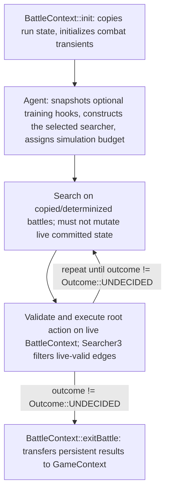

# Combat search

Last verified: 2026-08-05 against the current working tree.

## Purpose

Describe the combat state boundary, action/search flow, hidden-information
handling, and learned combat guidance used by the active executable.

## Current implementation

`BattleContext` is the mutable combat state. It owns player/monster/card state,
action queues, potions, six combat RNG streams, input state, and terminal
`Outcome` (`include/combat/BattleContext.h::BattleContext`).
`BattleContext::executeActions` advances queued effects until input or a
terminal state; `search::Action::execute` applies packed card, potion,
selection, and end-turn choices (`src/combat/BattleContext.cpp::executeActions`;
`src/sim/search/Action.cpp::execute`).

`ScumSearchAgent2::playoutBattle` dispatches combat:

- Searcher2 is the default (`src/sim/search/BattleScumSearcher3.cpp::g_useSearcher3`).
- `STS_SEARCHER3=1` selects `BattleScumSearcher3`.
- `STS_FAIR=1` selects the project-fair commit/research loop independently of
  the searcher (`src/sim/search/ScumSearchAgent2.cpp::playoutBattle`).

In fair mode both Searcher2 and Searcher3 construct a new searcher for each live
combat decision. Searcher2 chooses the most-visited root action and then
validates it against the live battle; Searcher3 chooses the most-visited
live-valid root edge (`ScumSearchAgent2::playoutBattleFair`). In non-fair mode
both implementations can reuse a tree through `advanceRoot`
(`ScumSearchAgent2::playoutBattle`).

Searcher3 samples `HiddenBattleState` particles and applies all six RNG seed
pairs to a copied battle in both fair and non-fair agent paths. `STS_FAIR`
changes per-decision reconstruction versus tree reuse; it does not turn
Searcher3 particle sampling on. Searcher3 caches a `CombatObservation` per
node, expands legal edges, uses PUCT or UCB-like selection, performs
deterministic chain continuation and a rollout/leaf evaluation, then backpropagates
(`src/sim/search/BattleScumSearcher3.cpp::step`, `selectBestEdgePUCT`).
Seeding, belief conditioning, and observation identity follow the canonical
field contract described under "Known limitations"; the composite seed is
`visibleHash ^ agentSeed ^ decisionIndex` with `agentSeed` and `decisionIndex`
assigned per decision by the caller, and `Belief::update` zero-weights
particles whose draw order contradicts the observed pile
(`BattleScumSearcher3::BattleScumSearcher3`; `ScumSearchAgent2::playoutBattleFair`;
`CombatObservation::Belief::update`).

Searcher3 feature-ablation toggles (all parsed by `apps/one_combat.cpp::main`
next to `STS_SEARCHER3`; defaults preserve full behavior): `STS_S3_BELIEF=0`
skips the two `belief.update` calls in `step()` (particles stay uniform),
`STS_S3_PRUNE=0` skips the three `canPruneAsDead` checks, `STS_S3_CHAIN=0`
skips the deterministic chain-compression loop, `STS_S3_LIVE=0` switches the
root-action pick to the most-visited edge with **no live-valid filter** — an
invalid most-visited edge ends the battle exactly like the Searcher2 loop
(`s3PickRootAction`, `ScumSearchAgent2.cpp`; semantics corrected 2026-08-05),
and `STS_S3_CRN=1` calls `warmStartRootCRN` once per fresh searcher (skipped
after `advanceRoot` carries the tree; guarded 2026-08-05). Benchmark §106
(128 seeds, V4 gate stack, fair, 3k sims) measured: removing belief or chain
*improves* win rate (+8.6 / +4.7pp vs the S3 control; S3−belief also beats
the S2 reference with CI excluding zero), enabling CRN *loses* −14.1pp
(CI excludes zero), and the prune toggle is a per-seed no-op in this regime.
The belief particle count is configurable via `STS_S3_PARTICLES` (default 64;
was hardcoded in `ScumSearchAgent2::playoutBattleFair`/`playoutBattle`).
§107 (256 paired seeds vs the §99 S2@3k reference, 45.3%) promoted the
combined variant: **S3−belief−chain is the recommended combat search** —
60.2% (+14.8pp, CI excluding zero) at 3k sims/256 particles, or 57.4%
(+12.1pp) at 1k sims/64 particles (3.1× less compute). Particle count is
flat across 16–256 (§107), and the belief reweighting stays harmful even at
256 particles (E1: −6.2pp vs belief-off at equal count).

### Terminal-leaf run-value bonus (cross-combat setup, opt-in)

Searcher3 terminal `PLAYER_VICTORY` leaves are priced with the native win
model on the post-combat run state via the thread_local
`search::g_terminalBonus` hook (empty = off), consumed only in
`BattleScumSearcher3::evaluateTerminal` (`v += bonus(bc)`). `runFullRunOOC`
arms it per battle when `search::g_useSearcher3` is set (`STS_TERM_WIN=1`):
`termWinArmForBattle` builds one base rich row per fight (future fights
resampled from the act pool via the existing `resampleRemainingActEncounters`,
or zeroed with `STS_TERM_WIN_HIDDEN=zero`), and `termLeafBonus` patches only
the fields `BattleContext::exitBattle` transfers — curHp (+6 Burning Blood
heal), maxHp, gold, potionCount, potion slots, the eight counter relics
(Happy Flower/Incense Burner/Ink Bottle/Inserter/Nunchaku/Pen Nib/Sundial),
Lizard Tail, Neow's Lament — by rich index and returns
`w * g_winNet.predict(row)` (`STS_TERM_WIN_W`, default 100; V_win is P(win)
in [0,1] vs the leaf's hp+50 scale). Per-run parity check prints mismatches
against the full `richFeatureVec` path on a real post-combat copy (hidden
queue features zeroed in both). This is the mechanism for cross-combat setup
decisions — e.g. stalling one turn so the Happy Flower counter ends charged
(2) for the next fight — which the combat-local leaf never priced before.
`STS_TERM_WIN_EVAL=cpsi` swaps the evaluator from the win tree to the C_psi
no-peek next-fight survival model (`bonus = w * P(win of next fight)`, entry
built from the patched rich row via `cpsiEntryFromRich`, current fight's
encounter as the fixed probe encounter — constant within a combat, so only
the state-dependent part orders the leaves): the `cpsictr` mode
(`STS_CPSI_CTR_PROBE=1`) shows C_psi prices every counter relic with the
correct sign (charged counter → lower next-fight death), unlike the win tree
(0 splits on all counter features). Cost: the scalar transformer forward is
~0.2 ms (vectorized 2026-08-05: `#pragma omp simd` on the linear reductions +
weight-row hoisting; per-output math bit-identical) — cpsi-eval measures
~9x the win-tree leaf end-to-end (19.2 vs 1.8 cpu-sec/run at 100 sims, 16
seeds); benchmark at the 1k-sim operating point.
Decision log: `2026-08-05-terminal-leaf-run-value-bonus.md`.

## Important data flow

1. `BattleContext::init` copies run state and initializes combat transients.
2. The agent snapshots optional training hooks, constructs the selected
   searcher, and assigns its simulation budget.
3. Search operates on copied/determinized battles; it must not mutate the live
   committed state before choosing an action.
4. The selected root action is validated and executed on the live
   `BattleContext`; Searcher3 filters for live-valid edges while selecting.
5. Search repeats until `outcome != Outcome::UNDECIDED`.
6. `BattleContext::exitBattle` transfers persistent results back to
   `GameContext`.

Learned guidance is loaded by `apps/one_combat.cpp::main`:

- `STS_POLICY` loads the compact tree prior; with no explicit setting,
  `build/policy_trees_c.txt` is attempted except in `policygen` mode.
- `STS_VNET` loads a separate combat value model and `STS_VNET_ALPHA` controls
  its rollout blend.
- `STS_DIST_VNET` loads the distributional transformer evaluator.
- `STS_PVNET` loads the shared `CombatPVNet`; `STS_PVNET_ALPHA` defaults to
  `1.0` (pure neural leaf) and `STS_PVNET_VALUE_ONLY` disables its policy head.
- `STS_CPUCT` overrides the shared default `g_cPuct=2.5` when a policy or PV
  model is active (`src/sim/search/CombatValueNet.cpp::g_cPuct`).

The tracked joint PVNet is experimental. The recorded July 30 sweep found its policy
head useful and its value head weak; see
[evaluation/current-baselines.md](../evaluation/current-baselines.md) and the
final section of `EXPERIMENTS.md`. All recorded PVNet bot results predate the
2026-08-04 parity fixes (GELU FFN, fixed 14-token layout, full policy-head dot
product; decision log `2026-08-04-combat-pvnet-parity-fixes.md`); the
`pvnetparity` mode (`apps/one_combat.cpp::main`) now verifies C++ inference
against `combat_pvnet_parity.py` to ~1e-6. The 2026-08-05 3k-sim payoff gate
(EXPERIMENTS.md §102) closed the PVNet channel at the recommended operating
point: policy priors hurt at deep search (−7.0pp vs S3 control) and the neural
leaf's within-noise win gain costs 14–18x compute; the A–H architecture sweep
was stopped.

`STS_DIST_VNET` is referenced only from `BattleScumSearcher3.cpp`; loading it
without `STS_SEARCHER3=1` prints a load message but does not make default
Searcher2 use it. `STS_PVNET` is different since 2026-08-05: default
Searcher2 consumes the PVNet **policy head** (priors + PUCT) whenever it is
loaded and not value-only (`BattleScumSearcher2.cpp::computeEdgePriors`,
mirroring S3). Per-searcher semantics therefore differ: in S2 only the policy
head is used (the value/leaf blend `STS_PVNET_ALPHA` is S3-only), and with
`STS_PVNET_VALUE_ONLY=1` the PVNet is fully inert in S2 while S3 keeps the
PUCT-with-zero-priors quirk.

## Invariants and assumptions

- Combat loops continue only while `bc.outcome == Outcome::UNDECIDED`.
- A committed action must be valid for the live battle.
- Project-fair search commits one root action before observing/searching again.
- `Node`, `Edge`, and searcher header-layout changes require rebuilding every
  including translation unit.
- The canonical learned state has 1,766 features; policy edges add 14 action
  features (`src/sim/search/CombatValueNet.cpp::combatFeatureCount`,
  `combatPolicyFeatureCount`). Ordering is a model-interface invariant.
- Two action features come from `Expert` play/obtain weights; the learned policy
  input is therefore not free of hand-authored features
  (`src/sim/search/CombatValueNet.cpp::combatFillActionFeatures`).

## Known limitations

- Searcher2 project-fair determinization changes draw order plus only
  `shuffleRng` and `cardRandomRng`; it is not a complete hidden-state model
  (`src/sim/search/BattleScumSearcher2.cpp::determinize`).
- Searcher3 belief conditioning is conservative: `Belief::update` zero-weights
  particles whose draw order contradicts the observed pile, and `Belief::sample`
  falls back to uniform when all weights are equal or total zero, so a reshuffle
  or insert that contradicts every particle resets the belief
  (`src/sim/search/CombatObservation.cpp::Belief::update`, `sample`).
- `HiddenBattleState::drawPileOrder` is installed by `applyParticle` only when
  the copied pile's size and card multiset match the particle; after tree reuse
  stale particles fall back to a searcher-RNG shuffle
  (`src/sim/search/BattleScumSearcher3.cpp::applyParticle`).
- Composite seeding is implemented with explicit constructor parameters
  (`agentSeed`, `decisionIndex`); both are per-decision assigned by
  `ScumSearchAgent2::playoutBattleFair` and `playoutBattle`, so the advertised
  `visibleHash ^ agentSeed ^ decisionIndex` contract now holds. Members stay
  mutable because the tree-reuse path re-keys via `reseed()`.
- PVNet-only priors: `computeEdgePriors` runs when the separate policy net or a
  PVNet with its policy head enabled (`!STS_PVNET_VALUE_ONLY`) is loaded; the
  PVNet policy head takes precedence when both exist. With
  `STS_PVNET_VALUE_ONLY=1` and no policy net, priors remain zero while
  `selectBestEdgePUCT` still recognizes the PVNet.
- `CombatObservation::operator==` and `visibleHash` share one canonical field
  set (see `CombatObservation.cpp::operator==`); card piles are compared as
  multisets of `CardKey`, so order-insensitive equality is deliberate.
- The deployed win tree has zero sensitivity to persistent counter relics:
  `r26` (Happy Flower), `r30` (Incense Burner), `r31` (Ink Bottle), `r35`
  (Lizard Tail), `r44` (Nunchaku), `r52` (Pen Nib), `r68` (Sundial), `r131`
  (Neow's Lament) are each among `v_win_trees.txt`'s 448 selected features but
  0 of its 1060 trees split on any of them (verified by scanning the tree
  lines for each relic's index in the sel table; `r32` Inserter is not even
  selected). The terminal-leaf bonus therefore prices HP/gold/potions today;
  counter pricing requires a counter-aware terminal model (Stage 3 — generic
  across all counter relics, see the decision log).
- The terminal-leaf bonus runs only under `STS_TERM_WIN=1` with Searcher3 and
  adds ~1 win-tree walk per terminal victory leaf (smoke: +75% cpu at 300
  sims on 16 seeds — tuning target, not a shipped default).
- Guaranteed-death pruning is conservative: `canPruneAsDead` fires only in
  states where the player cannot act; the aggressive `isGuaranteedDead`
  predicate was removed because its soundness for card-selection states was not
  proven (`src/sim/search/BattleScumSearcher3.cpp::canPruneAsDead`).
- Native PV/distribution inference probes a SciPy OpenBLAS path and
  otherwise falls back to scalar math; `STS_OPENBLAS` overrides the probe
  path and the loader accepts either `scipy_cblas_sgemv` or `cblas_sgemv`.
  Set `OPENBLAS_NUM_THREADS=1` when OpenMP-outer-parallel workloads call
  BLAS: OpenBLAS's own pool plus the 24 outer workers oversubscribes the box
  ~2x and runs slower than scalar (EXPERIMENTS.md §102). The active backend
  is printed at load time (`src/sim/search/CombatPVNet.cpp`; `CombatDistValueNet.cpp`).
- The root CRN warm start (`warmStartRootCRN`, `prepareCRNParticles`) was dead
  code in every recorded result — declared/defined but never called; the
  `crnTiebreak` helper is declared and never defined. `STS_S3_CRN=1` now makes
  `search`/`searchToTotal` call it once per fresh searcher (skipped when the
  tree is carried by `advanceRoot`), and the §106 ablation measured it harmful
  (−14.1pp vs the S3 control, CI excluding zero), so it stays off.
- Ablation evidence (§106, 128 seeds, V4 gate stack, fair, 3k sims): belief
  reweighting and chain compression are net-negative on the deployed package
  (removing them wins +8.6 / +4.7pp vs the control), while `canPruneAsDead`
  and the live-valid root filter are per-seed bit-identical no-ops in this
  regime. `STS_S3_BELIEF/PRUNE/CHAIN/LIVE` defaults preserve full behavior.
  §107 promoted **S3−belief−chain** as the recommended (opt-in) combat search
  on the V4 gate stack: 60.2% @3k/256p, 57.4% @1k/64p, both CIs excluding
  zero vs the §99 S2@3k 45.3% reference on 256 paired seeds; see
  `docs/knowledge-base/evaluation/current-baselines.md`.

## Open questions

- Should `CombatObservation` identity include card `uniqueId`/`retain` fields,
  or does the current `CardKey` multiset contract suffice?
- Should conservative player-cannot-act-only pruning be replaced by an
  aggressive predicate once its soundness is proven for all card-selection
  states?
- Should PVNet-only operation with `STS_PVNET_VALUE_ONLY=1` disable PUCT
  recognition instead of leaving zero priors?

## Relevant code

- `include/combat/BattleContext.h::BattleContext`, `Outcome`
- `src/combat/BattleContext.cpp::init`, `executeActions`, `exitBattle`
- `src/sim/search/ScumSearchAgent2.cpp::playoutBattle`, `playoutBattleFair`
- `include/sim/search/BattleScumSearcher2.h::BattleScumSearcher2`
- `include/sim/search/BattleScumSearcher3.h::BattleScumSearcher3`
- `src/sim/search/BattleScumSearcher3.cpp::step`, `computeEdgePriors`,
  `evaluateTerminal`, `g_terminalBonus`
- `apps/one_combat.cpp::termLeafBonus`, `termWinArmForBattle`,
  `termWinDisarm`, `termWinIndices`, `cpsiEntryFromRich`, `cpsiCounterProbeAtState`,
  `cpsiCtrProbeReport`, `cpsictr` mode (STS_TERM_WIN*, STS_CPSI_CTR_PROBE, opt-in)
- `src/sim/search/CombatObservation.cpp::Belief`, `visibleHash`
- `src/sim/search/CombatValueNet.cpp::combatExtractFeatures`
- `src/sim/search/CombatPVNet.cpp::CombatPVNet`
- `apps/one_combat.cpp::main`
