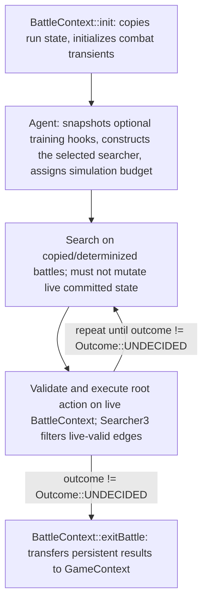

# Combat search

Last verified: 2026-08-11 against the current working tree (per-encounter combat value specialization implemented opt-in: `STS_VNET_PER_ENCOUNTER` dir overlay + `combat_mlp_meta_v1` in-file deltas with `predict(bc)` dispatch, `vnettest --encounter` parity mode — gate pending; covariate-shift mixture retrain `tools/train_value_mixture.py` — mixture = all combatgen + leafdiag train-seed states with separate on-policy/search-leaf holdouts, §137: mixture does NOT improve held-out search-leaf ranking, branch closed, deployed vnet unchanged; frontiergen/leafrelabel frontier-leaf corpus: `BattleContextBinary.h` binary snapshots, 3-site `g_onS3LeafQuery` frontier hook gated to frontiergen via `g_s3LeafQueryAllSites` with `S3LeafDiagnostic::frontierType`/`rolloutSteps`, per-stratum reservoirs + corpus-wide obsHash dedup, terminal-outcome relabeling with the virtual `evaluateTerminal` (+ self-documenting `nonTerminal` column), CRN sibling evals via the searcher's own action enumeration; leafdiag/leafref/rollouttrace unchanged — the extra hook sites fire only under `g_s3LeafQueryAllSites`; §126 vnet default superseded by the §148 7k-tuned model, §133/§134 candidates stay rejected; B1 tactical turn-beam rollout `STS_S3_TURN_ROLLOUT` implemented opt-in, gate pending; S3 forced-move budget pool redirect `STS_S3_POOL_REDIRECT` implemented opt-in, §143 gate pending; multi-select mask canonicalization `STS_MULTISELECT_CANONICAL` implemented opt-in, `cardselect_canonical` test added, gate pending; experimental zero-mean ranking correction `STS_VNET_RANK_CORR` implemented opt-in (`tools/train_rank_correction.py`, additive on the vnet/PVNet leaf + fair-path search-complete clamp, off by default, byte-identical when unset).

Experiment 4 persistent-END_TURN subsection last verified: 2026-08-25.
Isolated Silver backend subsection last verified: 2026-08-27.

## Purpose

Describe the combat state boundary, action/search flow, hidden-information
handling, and learned combat guidance used by the active executable.

## Current implementation

`BattleContext` is the mutable combat state. It owns player/monster/card state,
action queues, potions, six combat RNG streams, input state, and terminal
`Outcome` (`include/combat/BattleContext.h::BattleContext`).
`BattleContext::executeActions` advances queued effects until input or a
terminal state; `search::Action::execute` applies packed card, potion,
selection, and end-turn choices (`src/combat/BattleContext.cpp::executeActions`;
`src/sim/search/Action.cpp::execute`).

`ScumSearchAgent2::playoutBattle` dispatches combat:

- Searcher2 is the default (`src/sim/search/BattleScumSearcher3.cpp::g_useSearcher3`).
- `STS_SEARCHER3=1` selects `BattleScumSearcher3`.
- `STS_SILVER_SEARCH=1` installs the isolated Silver backend and overrides the
  native Searcher2/3 combat decision after normal flag parsing.
- `STS_FAIR=1` selects the project-fair commit/research loop independently of
  the searcher (`src/sim/search/ScumSearchAgent2.cpp::playoutBattle`).

In fair mode both Searcher2 and Searcher3 construct a new searcher for each live
combat decision. Searcher2 chooses the most-visited root action and then
validates it against the live battle; Searcher3 chooses the most-visited
live-valid root edge (`ScumSearchAgent2::playoutBattleFair`). In non-fair mode
both implementations can reuse a tree through `advanceRoot`
(`ScumSearchAgent2::playoutBattle`).

Searcher3 samples `HiddenBattleState` particles and applies all six RNG seed
pairs to a copied battle in both fair and non-fair agent paths. `STS_FAIR`
changes per-decision reconstruction versus tree reuse; it does not turn
Searcher3 particle sampling on. Searcher3 caches a `CombatObservation` per
node, expands legal edges, uses PUCT or UCB-like selection, performs
deterministic chain continuation and a rollout/leaf evaluation, then backpropagates
(`src/sim/search/BattleScumSearcher3.cpp::step`, `selectBestEdgePUCT`).

### Isolated Silver backend

The opt-in Silver backend vendors the pinned combat/search model at upstream
SHA `84ab3ead9d88c01c4be09a6773fb9a947f57d5ff`; it does not share live combat
RNG or mutable `BattleContext` state. `SilverConversion` materializes only the
allowed knowledge boundary, Silver searches privately, and
`SilverSemanticAction` is resolved and revalidated against the live battle
before execution. One stable seed derived from the run's battle identity is
reused for the entire combat; it is not derived from the decision ordinal.

Silver keeps one private search session per battle and attempts an exact child
reroot between decisions. The production cap is 32,768 nodes. The default
`STS_SILVER_REUSE_CAP_MODE=allocated` applies the cap to retained allocation;
experimental `active` applies it to active pool usage. Both modes and every
fallback are recorded in the bestbench sidecar and Silver telemetry. The
completed scaling experiment confirmed that `active` restores cap-blocked
reroots but did not establish a gameplay improvement, so `allocated` remains
the default.

The default-off `STS_SILVER_ADAPTIVE=1` experiment performs an initial 1,000
simulation search, computes the root's top-vs-second visit-share gap, and, when
that gap is strictly below `STS_SILVER_ADAPTIVE_TOP_GAP`, continues the same
private root with 2,700 additional simulations. The returned search count is
therefore 1,000 or exactly 3,700 total; no first search is discarded. The
feature applies at ordinary roots and at each private sequential-selection
subdecision, and is otherwise behavior-neutral when unset. The visit-share
signal and the other recorded root statistics are observation fields only;
they do not alter Silver selection, widening, reuse, evaluator, or OOC policy.

Live sts_ai exposes atomic `GAMBLE`/`EXHAUST_MANY` subsets while Silver uses a
sequential private selection UI. The bridge therefore runs every private
subdecision, including exact reroots, and returns only the final identity-based
subset for live validation. Focused coverage requires a real intermediate
selection, nonzero `selectedBits`, an exact reroot, and inherited visits; an
immediate empty confirmation is not multi-step evidence.

Silver visit-prior scoring uses the exact packed action bits from each already
enumerated vendor root edge; those state-local bits remain the correspondence
token for priors, sorting, rerooting, and private sequential selections. For a
live draw/discard/exhaust selection only, the isolated pile has deliberately
been canonicalized to hide its live vector order, so the selected card identity
is translated back to the live pile index before strict legality validation and
execution. This boundary rule is selected by the pile action surface, not by a
failed legality check; a coincidentally legal wrong index is never accepted.

The default-off Silver leaf observer is a type-free callback in
`SilverBridge.h`. At the exact point where `BattleSearcher` would begin its
`SimpleAgent` rollout, it can receive a wire snapshot plus root, nearest
non-random-parent, and leaf state hashes, search depth, and actions already
applied. The live bridge projects that wire snapshot into a normal live
`BattleContext` and calls the existing `CombatValueNet::predict` path (the
current model format has 751 features); feature extraction and VNet inference
are not duplicated in the isolated namespace. The optional leaf model is a
dedicated instance loaded once before search, and its inference does not emit
the ordinary global VNet trace hook. A shadow callback records the
terminal outcome, exact Silver `evaluateEndState()` utility, rollout action and
turn counts, and steady-clock rollout microseconds. A direct callback may skip
only nonterminal rollouts and supply a value; terminal tree states continue to
use exact terminal evaluation. Sampling is deterministic FNV-1a over isolated
seed/root/parent/leaf/depth and consumes no gameplay RNG. The CSV analyzer is
`tools/analyze_silver_vnet_leaf.py`; it keeps complete run seeds together and
reports sibling ranking, centered error, top-leaf agreement, regret, and an
optional seed-held-out affine calibration.

The separate default-off Silver leaf corpus extends the same rollout-start
observer without changing rollout or selection. It stores JSONL
`silver_leaf_corpus_v1` records whose source of truth is an embedded,
fail-closed `silver_leaf_wire_v1` envelope around `BattleStateWire::kVersion`.
Each record contains the exact leaf, original search root, and nearest
non-random parent decision state; the complete semantic parent action set; and
the incoming-action-to-leaf mapping. Sampling hashes run/combat/decision,
original-root, and parent identity. A selected group buffers all unique leaves
up to a defensive cap and is emitted only if every legal parent action has a
retained mapping. The existing one-sample `SimpleAgent` terminal rollout is
stored as auxiliary raw data.

`silver_leaf_relabel` reloads a selected manifest and runs fresh isolated
Silver searches at 1k/3.7k/10k/25k-A, plus independent 3.7k/10k/25k-B on a
stable 20% group anchor. Sibling leaves share replicate seed identity, and the
same replicate seed is reused across budgets so A budgets are matched prefixes;
25k-B is the independent reference. It emits raw semantic actions, visits,
Qs, child simulations and victories, selection flags, telemetry, and timing
for every leaf and once per parent group. No policy-target transformation is
defined.

Only victorious Silver evaluations contain root-relative effective-gold and
max-HP terms. Changing from the original root to leaf-as-root is therefore not
an unconditional scalar offset when a Q mixes wins and losses. For a fixed
leaf the per-victory correction is
`goldWeight*(effectiveGold(leaf)-effectiveGold(originalRoot)) +
maxHpWeight*(leaf.maxHp-originalRoot.maxHp)`; losses receive zero. Root-action
victory counts are collected with summaries so each corrected action Q adds
this constant multiplied by its empirical victory fraction. The correction is
observational and does not alter search selection. The selector is
`tools/select_silver_leaf_corpus.py`; `tools/analyze_silver_leaf_teacher.py`
compares every A budget with independent 25k-B and applies the preregistered
smallest-passing budget rule.

Runic Dome hides future monster intents from materialization. Looter and
Mugger are the concrete cases that require `DeferredDirectMoveChoice`: their
escape-versus-attack continuation is chosen directly rather than through the
ordinary rolled move interface, so the private Silver model defers that choice
until it has the allowed public input. This is a project-fair adaptation, not
literal pinned-upstream behavior. `assignInformationState` is the other
vendored-model adaptation.

Focused targets are `silver-native-test`, `silver-bridge-test`,
`silver-integration-test`, `runic-dome-lifecycle-test`, and
`combat-knowledge-neutrality-test`. The bridge test asserts live-boundary and
transaction reroot mechanisms, not only final action equality.

CARD_SELECT action enumeration (both searchers) delegates to the canonical
`search::Action::enumerateCardSelectActions`, which implements the full
`isValidAction` contract (hand/discard/draw/exhaust pools per task, EXHUME
excluded from its own selection, CODEX skip=3, and multi-select subsets for
EXHAUST_MANY/GAMBLE). An exhaustive parity test
(`./build/test cardselect_parity`, `apps/test.cpp::testCardSelectParity`)
pins all three enumerators to the validity contract across every
`CardSelectTask` (issues 47/48). `STS_MULTISELECT_MODE=all|single|none`
(default `all`) prunes the multi-select action space to empty+singles+full
(`single`) or empty only (`none`); only `all` matches the parity contract.
`STS_MULTISELECT_CANONICAL=1` (default off, parsed in
`src/sim/search/Action.cpp::multiSelectCanonical` next to the
`STS_MULTISELECT_MODE` parse) collapses bitmask choices that select the same
multiset of identical hand cards (e.g. exhausting Strikes at positions
`{0,1}` vs `{0,2}`), keeping the first-encountered mask; the identity key is
(id, upgradeCount, costForTurn, freeToPlayOnce, specialData) — the same
card equivalence the PLAYER_NORMAL duplicate collapse uses — so upgraded or
temporarily-modified copies stay distinct actions (`./build/test
cardselect_canonical` pins the canonical mode).
The §112 report of a full-subset win-rate regression was **falsified
(§113)**: the "control" enumerator skip-won battles at WARCRY/GAMBLE states
(zero valid edges → UNDECIDED battle break → rewards/advance), so the §112
delta was the removed exploit, not search degradation; `all` is the
deployment default and `single`/`none` are opt-in search-scale knobs. Since
§113, `BattleContext::exitBattle` treats an UNDECIDED outcome as
`PLAYER_LOSS`, so any future enumerator gap costs a loss, never a free win.
Seeding, belief conditioning, and observation identity follow the canonical
field contract described under "Known limitations"; the composite seed is
`visibleHash ^ agentSeed ^ decisionIndex` with `agentSeed` and `decisionIndex`
assigned per decision by the caller, and `Belief::update` zero-weights
particles whose draw order contradicts the observed pile
(`BattleScumSearcher3::BattleScumSearcher3`; `ScumSearchAgent2::playoutBattleFair`;
`CombatObservation::Belief::update`).

### Rollout-usage diagnostics (searchdiag)

Searcher2 keeps per-search rollout-usage counters (`SearchDiagnostics`, member
`BattleScumSearcher2::diag`; `include/sim/search/BattleScumSearcher2.h`) that
count, per simulation: whether the sim ended at a terminal state inside the
tree (`terminalInsideTree`), entered a random rollout (`rolloutCalls`, split
by how it was entered: `rolloutLeafCalls` = newly expanded leaf,
`fairIllegalStoredEdge` = stored edge invalid in this determinization — the
fair fallback path; and by why the rollout stopped: `rolloutTerminated` /
`rolloutDepthCapped` / `rolloutSkippedVNet` / `rolloutNoLegalAction`), or
evaluated a leaf with no legal action (`leafDirectEval`) — fair mode after
filtering invalid stored edges, non-fair mode when deterministic enumeration
yields no legal action (that node is also recorded as a defeat, `outcome = 2`,
in `step()`); plus
`treeActions` (actions executed by explicit tree descent), `maxTreeDepth`,
and `simSeconds` (wall time in the search loops). Invariants per searcher:
`simulations == terminalInsideTree + rolloutCalls + leafDirectEval` and
`rolloutCalls == rolloutLeafCalls + fairIllegalStoredEdge`.
`playoutRandom` returns its action count and sets a `RolloutStop` cause
(`src/sim/search/BattleScumSearcher2.cpp::step`, `playoutRandom`). The
counters are write-only in the search path — they cannot alter search
behavior. The non-fair empty-edge guards (direct leaf eval + defeat marking
in `step()`, soft stop with `rolloutNoLegalAction` in `playoutRandom`)
mirror the fair-mode paths; they are defensive and currently unreachable
(PLAYER_NORMAL always adds END_TURN), but a future enumerator change could
hit them. Regression coverage: `testScumNonFairEmptyEdges` (`apps/test.cpp`,
ctest entry `scum_nonfair_empty_edges`). `Node::outcome` (0 non-terminal, 1 victory, 2 defeat) is recorded at
the in-tree terminal check; terminal nodes are never expanded, so an
`outcome != 0` node has no edges. In fair mode a node terminal in one
determinization can be non-terminal in another world; `step()` clears the
stale outcome when it re-expands such a node, preserving the invariant
(issue #70, regression `scum_convroot_stale_outcome`). Fair @3k measurement
(EXPERIMENTS.md §117, 2026-08-06): the illegal-stored-edge path is ~half of
fair rollouts and grows to 68% of rollout calls at 30k sims (act 1) — a real
tree/determinization mismatch, not noise; obs-keyed descent is falsified
(§114), so structural fixes are constrained.

`collectFrontierStats` walks the stored tree and classifies frontier leaves:
terminal (victory/defeat) versus unexpanded non-terminal nodes, with a
visit-weighted terminal coverage (sum of `simulationCount` over terminal
leaves over all frontier leaves) and a node cap (default 500k) so pathological
trees cannot stall the pass.

The `searchdiag` mode (`one_combat searchdiag nSeeds sims asc out probeEvery
[seedOffset]`) runs full runs and emits, per combat decision:
- rowtype A (every decision, `search::g_onSearchComplete`): the agent search's
  per-decision window (non-fair mode subtracts the previous cumulative since
  one searcher persists per fight; fair mode uses the whole fresh search
  because each decision rebuilds the searcher), cumulative frontier stats, and
  the root's most-visited action, visit share, and value gap to the
  visit runner-up; `maxTreeDepth` is cumulative (deepest explicit path in the
  tree to date);
- rowtype B (every `probeEvery`-th decision): fresh probe searchers at
  budgets {100, 250, 500, 1000, 3000, 10000, 30000} — independent trees per
  stage — with root-decision stability versus the previous stage and versus
  the agent's implied best action (`stableVsPrev`, `stableVsAgent`; -1 = no
  comparison).
Rows A and B share one header (identical column semantics). Per-fight
summaries (outcome, totals) go to a **separate** file `<out>.fights.csv` with
its own header so no rowtype reinterprets columns. The `fair` column records
the regime; `STS_ROLLOUT_DEPTH` is honored and depth-capped rollouts are
counted. Searcher3 is not instrumented; the mode refuses to run under
`STS_SEARCHER3`. (`apps/one_combat.cpp::sdiagMetricsOf`, `sdiagOnSearchComplete`,
`sdiagProbe`, `searchDiag`.) Decision log:
`2026-08-06-searchdiag-rollout-usage.md`. Since 2026-08-06 the mode also
instruments Searcher3 (rowtype A only; probeEvery forced 0 under
`STS_SEARCHER3` — the B-stage probes are S2 machinery): `SearchDiagnostics`
lives in the shared `include/sim/search/SearchDiagnostics.h`,
`BattleScumSearcher3::diag` counts the same rollout-cause split, and
`sdiagMetricsOf3`/`sdiagOnSearchComplete3` emit S3 A-rows (§122).

### Fair-tree structural fix (STS_LIVE_VALID — default ON in the fair-S3 path)

Phase 4: in fair mode, the PUCT-chosen stored edge is often illegal in the
current determinization (measured illegal-stored share of rollouts: S2 ~48%
§117; **S3 58-60%** at fair @3k, §122). `STS_LIVE_VALID` re-selects among
the stored edges valid in THIS world using the same UCB/PUCT scoring
(`BattleScumSearcher2::selectBestValidEdgeToSearch`,
`BattleScumSearcher3::selectBestValidEdgePUCT`) and continues tree descent;
only when no stored edge is valid does the sim fall back to the §117 random
rollout. Narrower than obs-keyed descent (falsified §114): tree structure
and observation identity are untouched. Effect: S2 illegal-share 0.26→0.00,
S3 0.38→0.10 (smoke). Paired gates: S2 @1k +0.4pp (SE 2.2, cpu +5.6%,
§122); **S3−bc @3k +5.5pp (95% CI +5.5 ± 5.1, hp +4.1, cpu +7.9%, §122)
and +5.9pp (95% CI +5.9 ± 1.8, hp +3.1, floor +1.1, cpu +14.6%, §123,
independent block)**. **Default ON in the fair-S3 path since 2026-08-07
(§123; recorded cpu-trade call accepts ~+8-15% cpu for the reproducible
~+5-6pp win); `STS_LIVE_VALID=0` disables.** Scoping: computed in
`apps/one_combat.cpp::main` after the STS_FAIR/STS_SEARCHER3 parse, so only
the explicit `STS_FAIR=1 STS_SEARCHER3=1` regime; S2 fair stays opt-in (S2
@1k neutral, +cpu; S2 @3k pair needed before any S2 flip); non-fair paths
and the `fairgen` datagen mode are unchanged unless the env flag is set
explicitly (datagen keeps the recorded §117 behavior — open question: align
datagen with the deployed fix). Decision log:
`2026-08-06-live-valid-phase4.md`, `2026-08-07-live-valid-promotion.md`.

### On-no-valid-edge expansion (STS_S3_EXPAND, opt-in — falsified)

Phase 6: after live-valid, the residual no-valid-stored-edge fallback (~5.4%
of rollout calls at the deployed point, §124 searchdiag) expands the live
state's legal actions into the tree instead of a random rollout:
`STS_S3_EXPAND=1` (`BattleScumSearcher3::step`, action-keyed, dedup against
stored edges, priors computed on the new edges only via a temp node,
cap `STS_S3_EXPAND_MAX` default 32, PUCT pick via `selectBestValidEdgePUCT`;
requires live-valid semantics — without `g_liveValid` the branch is
 unreachable). Effect: illegal-stored share 0.054→0.00, treeActions +10%
 (searchdiag 6 seeds @3k/64p). **Falsified at the paired gates
 (EXPERIMENTS.md §125, 2026-08-07):** @1k/64p 35.5% vs 37.9% (−2.3pp, CI
 [−2.7,+7.4], 16% discordant) and @3k/64p 44.1% vs 42.6% (+1.5pp, CI
 [−6.6,+3.5], 16% discordant) — mixed null, no consistent signal; the env
 stays default-off.

### Prior-guided rollouts (STS_S3_ROLLOUT_POLICY, opt-in — falsified)

`BattleScumSearcher3::playoutRandom` samples rollout actions from the **GBM
policy prior** (the same distribution PUCT priors come from, via
`computeEdgePriors`) when `STS_S3_ROLLOUT_POLICY=1`, instead of the static
`rolloutWeight` heuristic (ATTACK=8, POWER=3, others=2, END_TURN/POTION=1).
The rollout is therefore never truly uniform — this replaces the
hand-authored bias with the learned prior. Restricted to the GBM policy net
(`g_usePolicyNet && loaded()`, and not shadowed by a PVNet policy head): a
PVNet-head forward per rollout step would cost ~14-18× a sim. Revives the
parked §119 "Phase 3 (policy-guided rollouts)". Default off (behavior
byte-identical when unset). **Falsified at the paired 256-seed gate
(EXPERIMENTS.md §124c, 2026-08-07):** 43.4% vs 50.4% control = **−7.0pp (CI
[−13.7, −0.4]), floor −1.3, HP −6.7 at 2.7× cpu**, 30% discordance
(control-only 47 vs policy-only 29); control reproduced the §126 reference
exactly (50.4%). The prior — trained on older-policy visit distributions —
actively hurts rollouts; line closed per the pre-registered rule, env stays
opt-in. Follow-ups (temperature/mixture) only after a current-stack prior
retrain (winrate-plan §3.4).

### Rollout-leaf estimators (STS_S3_ROLLOUT_K, STS_S3_ROLLOUT_TURN_STOP — opt-in)

Two opt-in Searcher3 rollout-leaf estimators (EXPERIMENTS.md §133, 2026-08-07;
decision log `2026-08-07-rollout-leaf-estimators.md`); both default off and
byte-identical when unset (smoke-proven on 8 seeds):

- **A1 — `STS_S3_ROLLOUT_K=N` (default 1):** run K rollouts from the same
  pre-rollout leaf state and average their outcomes, then backprop the mean
  once as a single visit. Rollout-outcome variance reduction without changing
  PUCT visit counts or tree exploration. Implemented as
  `BattleScumSearcher3::multiRollout` (`src/sim/search/BattleScumSearcher3.cpp`),
  used at both rollout sites in `step()` (the leaf-expansion blend site and
  the fair-illegal-stored-edge fallback). Each rollout runs on its own
  `BattleContext` copy of the pre-rollout state (the caller's `state` is left
  unmutated); the first rollout's actions fill `actionStack` so
  `bestActionSequence` remains replayable.
  **Scoping (audit §134, 2026-08-07):** `multiRollout` copies ONE
  `BattleContext` — including all six simulator RNG streams — for every
  replicate, so the K rollouts are independent *action-policy* samples
  conditional on the *copied* simulator RNG, NOT fully independent environment
  samples. The §133 null verdict therefore applies to this correlated
  same-leaf estimator only, not to variance-reduction schemes in general.
- **A4 — `STS_S3_ROLLOUT_TURN_STOP=N` (default 0):** stop the rollout after
  N completed player turns and let the learned leaf evaluate the non-terminal
  endpoint → `α·VNet(s0) + (1−α)·VNet(s1)` (n-step bootstrap). Turn boundary
  detection: `bc.turn` increments inside the END_TURN action chain
  (`BattleContext::afterMonsterTurns`). Distinct from the falsified §119
  rollout caps, which capped with the pre-vnet heuristic endpoint on
  Searcher2; a trained endpoint is the difference. Early termination is
  terminal-safe (`evaluateTerminal` still wins when the battle ends).

**Gate verdicts (2026-08-07, GCP sts-test, paired 256-seed @1k/64p vs the
§126 control `build/vnet_all_a03_1k.csv` 50.4%, both lines closed):** A1
K-rollouts is NULL at both operating points — K=2 @500 sims (equal rollout
budget) 49.2% (−1.2pp CI [−7.4,+5.1], cpu −59%) and K=2 @1000 sims (equal
tree size) 48.4% (−2.0pp CI [−8.2,+4.7], cpu −21%, +8 combat deaths) — and
the user-requested extreme K=10 @100 sims (equal rollout budget, 10× smaller
tree) is significantly negative (35.5%, **−14.8pp CI [−21.1,−8.2]**, cpu
−81%): tree size dominates, variance reduction does not pay for lost tree
traversals at any tested ratio, and the α0.3 blend's rollout share is not
variance-bound; K=4 not run. A4 one-turn bootstrap is FALSIFIED — turn-stop
N=1 @1k 34.0% (−16.4pp CI [−23.0,−9.4], floor −2.4, HP −10.9, cpu only
−18%): long-horizon terminal grounding through the full rollout is
load-bearing, the second short-rollout falsification (§119), and the
turn-beam follow-up must play across turns. Both env gates stay opt-in
default-off. EXPERIMENTS.md §133 (first entry); decision log
`2026-08-07-rollout-leaf-estimators.md`.

### Tactical turn-beam rollout (STS_S3_TURN_ROLLOUT, opt-in — B1)

The B1 line (archived plan
`docs/archive/research/plans/plan-rollout-experiments-2026-08-07.md` §2, revised
spec per the §134 audit) replaces the per-action random pick at
PLAYER_NORMAL rollout states with a deterministic beam search over
card/potion sequences to END_TURN, scoring only COMPLETE turns after the
monster turn resolves. Implemented 2026-08-08 in
`BattleScumSearcher3::playoutRandom` (`src/sim/search/BattleScumSearcher3.cpp`):
when `g_s3TurnRollout` is set and `state.inputState == PLAYER_NORMAL`, the
beam runs and the weighted-random/prior pick is skipped for that iteration;
all other states (CARD_SELECT etc.) keep the existing pick. Unset or `=0`
is byte-identical pre-B1 behavior (structural-equality smoke on 8 seeds).

- **Beam:** `turnBeamSearch` (file-scope in `BattleScumSearcher3.cpp`) is a
  BFS over card/potion sequences up to hand-size depth (≤ 10,
  `CardManager::MAX_HAND_SIZE`). At every depth each beam state spawns an
  END_TURN candidate (executed on a copy — `Action::execute` runs the monster
  turn too), then expands by executing every valid non-END_TURN action on
  copies. The next level is pruned to `beamWidth` (default 8,
  `STS_S3_TURN_BEAM_WIDTH`) by **simple first-N truncation** (deterministic
  by enumeration order) — there is NO intermediate card-state scoring, per
  the user-approved scorer-(b) design. All candidates are copies of the same
  pre-turn state, so draw order and monster RNG are shared
  (common-random-numbers for free). Sequences that leave PLAYER_NORMAL
  (mid-turn CARD_SELECT from Dual Wield/Exhume/etc.) or lose the battle are
  dropped from the beam; lethal sequences (PLAYER_VICTORY before END_TURN)
  are captured as +1000 candidates at expansion time. `turnBeamSearch` always
  returns at least `{END_TURN}` (the depth-0 candidate guarantees non-empty).
- **Scorer:** `scoreCompleteTurn(pre, post, powersPlayed, potionsUsed)` —
  `S = w1·ΔHP_enemy − w2·ΔHP_player + w3·kills + w4·persistent_setup
  − w5·potion_use`; `post` is the state after the full turn resolved (monster
  turn included; block reset, next hand drawn), which is what lets
  "Defend, Defend, End Turn" rank correctly against a heavy intent without a
  block heuristic. ΔHP_enemy sums per-monster HP reduction; ΔHP_player is the
  player's effective (HP+block) loss clamped ≥ 0; setup = strength+dex+focus
  deltas + powers played; terminal outcomes score ±1000. Weights
  `STS_S3_TURN_SCORE_W1..W5`, defaults 1.0/1.0/50.0/10.0/30.0. The scorer is a
  **hand-authored rollout heuristic** (same class as the existing
  `rolloutWeight`), NOT a learning objective.
- **Multi-turn continuation (mandatory):** the best complete turn (cards +
  END_TURN) is executed on the rollout state and the outer `playoutRandom`
  loop fires again on the next hand — A4 proved one-turn stopping loses
  −16.4pp (§133). `g_s3RolloutTurnStop` (A4) still fires after the beam's
  END_TURN advances `bc.turn`; `g_onRolloutStep` fires after every beam
  action (same contract as the random path).
- **Env:** `STS_S3_TURN_ROLLOUT=1` (opt-in default-off), parsed in
  `apps/one_combat.cpp::main` next to the other S3 rollout gates; the BEST
  stack banner prints `S3-turnBeam=ON/off`. **Gate (2026-08-08, GCP):
  null — line parked.** Paired 256-seed @1k/64p vs `build/vnet_all_a03_1k.csv`
  (50.4%): 46.9% win (−3.5pp, 95% CI [−10.2, +3.1]), floor −0.1, HP end
  −4.0, at 9.3× CPU (383.5 vs 41.2 cpu-s/run); env stays default-off.
  B1c (VNet on final 2–4 beam survivors) parked with the line.
  EXPERIMENTS.md §135b; decision log `2026-08-08-turn-beam-rollout.md`.

### Direct utility-R leaf (same-recipe target ablation, §134 — falsified)

The §132 "target-only" claim (EXPERIMENTS.md §134 audit) was confounded:
`train_vcombat_quantile.py` changed depth/eta/rounds/objective/capacity (9×
150 trees) along with the label. The corrected ablation trains a direct
utility-R GBM through the canonical `train_value_combat.py` recipe
(`VCOMBAT_TARGET=utility_r`, win bonus 50, single `nfeat` ensemble — no
quantile aggregation) on the same `build/vcombat_honest.csv` rows, same
fight split/weights/features/params/early stopping/device, exported via
`export_combat_model.py` to the ordinary tree format and parity-checked with
the asserting `one_combat vnettest`. **Falsified at the pre-registered first
operating point (EXPERIMENTS.md §134, 2026-08-07):** paired 256-seed @1k/64p,
block 126700–126955, full V4 stack, S3−belief−chain/64p, α0.1 (pre-registered
because R sits on the larger 0..~150 terminal scale):
**38.3% vs 50.4% = −12.1pp (95% CI [−18.8,−5.1]), floor −3.0, HP −5.0**;
discordant 83/256. Significantly negative → α0.3 not tested, the then-deployed
`v_combat_honest.txt` @α0.3 stays (§148 later superseded it with the
7k-tuned fair-S3 default); this is the fourth offline≠online
falsification (§124c/§127/§133/§134) and it removes the "only the target
differs" reading of §132. Offline val MAE vs R was 9.73 (the quantile-R got
10.10 on the same rows), so the R-scale regression fits R yet still ranks
tree states worse than the deployed endHp leaf at α0.1. Env stays opt-in;
`VCOMBAT_TARGET` is a trainer-side option only (no runtime switch). Decision
log `2026-08-07-experiment-132-133-audit.md`.

### Covariate-shift mixture retrain (`tools/train_value_mixture.py`, §137 — closed, diagnostic only)

The §135a diagnostics found near-perfect train-vs-search covariate shift
(ROC-AUC 0.9998), so the pre-registered next experiment (EXPERIMENTS.md
§137) trained the end-HP leaf on a MIXTURE of all on-policy combatgen rows
(`build/vcombat_honest.csv`) PLUS actual Searcher3 search-leaf states
(`build/leafdiag_gate_64.csv`, leafdiag train seeds 126700-126747 ONLY) with
SEPARATE on-policy (combatgen fight-group holdout) and search-leaf (leafdiag
train-seed fight-group holdout) validation; leafdiag eval seeds 126748-126763
are held out ENTIRELY (runtime-asserted). `tools/train_value_mixture.py`
keeps the canonical §126 recipe byte-for-byte (same params, same
critical-state weights, same combatgen-derived std>1e-9 feature filter → the
733-feature set of the deployed model, so the training mixture is the only
difference) and reports val RMSE/MAE vs endHp AND vs utility R per regime.
**Verdict: closed — the mixture does NOT improve held-out search-leaf
ranking (pairwise 0.726→0.691, top-1 0.369→0.330, regret 7.43→8.21, all
worse) and hurts the on-policy fit (val RMSE 8.23 vs 7.88 control); no
gameplay gate per the pre-registered rule; the then-deployed
`build/v_combat_honest.txt` @α0.3 stays default (§148 later replaced the
fair-S3 default with `models/v_combat_7k_tuned.txt`).** The mixture model
(`build/v_combat_mix.txt`) is a diagnostic artifact only; `STS_DIAG_VNET2`
can point at it for leafdiag/leafref/rollouttrace diagnostics (never read by
the search). Default single-CSV path of `train_value_combat.py` is
untouched.

### Leaf-state diagnostics (leafdiag / leafref / rollouttrace, 2026-08-08)

The off-by-default `one_combat particle_leaf_probe` diagnostic samples real
Searcher3 frontier-type-0 leaves and writes one row per draw-order variant.
It keeps the visible state, draw-pile multiset, and all six simulator RNG
streams fixed, while permuting only `cards.drawPile`. Because
`CardManager::popFromDrawPile()` removes `drawPile.back()`, serialized order
is back-to-front: next draw first. Every variant, including variant 0, uses
the same locally seeded RNG through `BattleScumSearcher3::diagnosticRollout`;
the search RNG and tree statistics are never consumed or modified. Nonterminal
rows are retained with `terminal=0` for audit and are excluded by the paired
offline trainer when terminal rows are available. The probe adds no runtime
cost unless `STS_PARTICLE_LEAF_PROBE_FILE` is set and the probe mode is run.
Each callback receives a monotonically increasing per-seed `sourceLeafId`; this
identifier, rather than `obsHash`, defines a variant group because distinct
hidden RNG states can share the same visible hash. `uniqueVariantsSampled` records
how many unique permutations bounded sampling found; when K exceeds that sampled
count, the probe emits only the unique rows and the analysis omits unavailable
averaging-curve K values for that group. The offline trainer deduplicates exact
draw orders defensively before metrics and reports draw-pile-size strata.

### Posterior-valid particle sensitivity probe (particle_posterior_probe, Phase 1b, 2026-08-16)

Distinct from the draw-order probe above: instead of artificially permuting
draw order, `one_combat particle_posterior_probe` replays the exact SEMANTIC
pre-rollout action prefix (recorded per action with actual post-action
observations by `BattleScumSearcher3::step` under `g_s3LeafTraceActions`)
under every positive-weight particle of the searcher's CURRENT finite root
belief, using exact hidden-state application that rejects the stale-particle
fallback rather than shuffling. Compatibility requires exact
`CombatObservation` and `Outcome` equality at EVERY intermediate checkpoint
and at the final leaf; accepted worlds are deduplicated by `FullHiddenStateKey`
equality with probability mass aggregated, and each evaluated world is scored
by the isolated `diagnosticRollout` with one per-group CRN seed. Source
groups that needed the fallback shuffle are recorded as
`SOURCE_PARTICLE_FALLBACK` and are scientifically ineligible (not an
implementation failure); failed replay of an exactly-applied source particle
Default `STS_PARTICLE_POSTERIOR_PROBE_K=0` evaluates ALL unique compatible
states; range metrics are flagged as subsampled lower bounds whenever any group
is capped. The corrected Phase-1b primary target holds the source leaf's six
RNG streams fixed for each compatible draw order and averages R=4 common
rollouts; the original full-particle target remains secondary for total
determinization variation. The primary statistic weights source groups
equally; compatible-mass-weighted results are secondary. Validity is relative
to Searcher3's finite belief approximation — never call it an exact Bayesian
posterior. Analysis: `tools/analyze_particle_posterior_probe.py`; corrected
pre-registration in `docs/experiments/ledger-06.md` §176.
The transferred numerical GO/STOP thresholds are recorded in §177 before the
designated scientific run: controlled equal-group fraction(range>5) >=10%,
bootstrap lower bound >5%, and equal-group mean range >=3 for GO; controlled
fraction <5%, bootstrap upper bound <10%, and equal-group mean range <1 for
STOP; otherwise INCONCLUSIVE.

Why the §126 end-HP leaf beats the §134 direct utility-R leaf online despite
fitting its target worse offline is an open diagnostic question (handover
2026-08-08). Three opt-in modes measure how both models behave on ACTUAL
Searcher3 leaf/candidate states instead of training on new labels:

- `search::g_onS3LeafQuery` (`BattleScumSearcher3.h`, thread_local, nullptr by
  default) fires inside `BattleScumSearcher3::step` at the leaf-expansion
  blend site — the same place the learned leaf is blended with the
  multi-rollout outcome, immediately before `backpropagate`. Since 2026-08-08
  it ALSO fires at the fair illegal-stored-edge rollout fallback and the
  depth-cap direct eval, but ONLY when the new `search::g_s3LeafQueryAllSites`
  flag (thread_local, default false) is set — `frontiergen` is the only mode
  that sets it, so leafdiag/leafref/rollouttrace keep the historical
  single-site corpus (see "Frontier-leaf corpus" below for the three
  `S3LeafDiagnostic::frontierType` values). The
  `S3LeafDiagnostic` record carries the pre-rollout leaf state (const
  `BattleContext*`, valid only during the callback), tree depth, the leaf
  state's `visibleHash` (computed fresh — `cur` is the expanded PARENT at
  that point, so `cur->obsHash` predates the committed action and is NOT the
  leaf identity), the learned leaf prediction used by the search (NaN when no
  learned leaf fired), the raw pre-blend rollout outcome, and the blended
  evaluation. Unset = byte-identical behavior (the leaf hash is computed only
  inside the guard). The callback must not mutate the state or consume search
  RNG; the one_combat handlers use their own per-seed RNG.
- `one_combat leafdiag NSEEDS SIMS ASC OUTFILE [SEEDOFFSET]` forces
  `STS_FAIR=1 STS_SEARCHER3=1` and records a per-stratum reservoir (10 strata:
  3 player-HP bands × 3 encounter difficulties + 1 dedicated deep-tree
  stratum, `STS_LEAFDIAG_PER_STRATUM` capacity per seed, default 50,
  `STS_LEAFDIAG_DEEP_DEPTH` threshold, default 20) of leaf states with the
  canonical combat features (combatExtractFeatures), both model predictions
  (deployed `STS_VNET`/default §126 end-HP vnet + a secondary diagnostic model
  via `STS_DIAG_VNET2` — never read by the search), raw/blended rollout evals,
  provenance (seed, fightIdx, decIdx, floor, act, `encounterName`, treeDepth,
  obsHash, nLegalActions, stratum), and per-fight labels (fightWon,
  fightEndHp). `encounterName` is the UPPER_CASE enum NAME
  (`monsterEncounterEnumNames[(int)bc.encounter]`); the canonical feature block
  separately carries the numeric `encounter` and `turn` encodings, so those
  two columns are NOT repeated in the provenance prefix (duplicate column
  names would shadow each other under Python `csv.DictReader`). Sampling is
  deterministic per seed (reservoir RNG seeded from the run seed only), so the
  collected leaf SET is reproducible. Rows are labeled at battle exit via
  guarded state inside `runFullRunOOC` (`g_leafdiagActive`). Do NOT enable the
  probing OOC arms (STS_OOC_ACTION_NN, STS_BOSS_DRAFT, M1/M2 path gates,
  STS_DATAGEN_GATES, …): their inner probe battles fire the leaf hook and
  pollute the dataset. Note: the 10 capture strata do NOT include a dedicated
  model-disagreement / close-decision stratum — the raw |endHp − utilityR|
  difference is dominated by the +50-on-win scale offset, so a raw-difference
  stratum would be nearly constant; disagreement/close-decision subsets are
  instead stratified POST-HOC in `tools/leaf_ranking.py` (every sampled row
  carries both predictions).
- `one_combat leafref INFILE OUTFILE HIGH_BUDGET_SIMS NSEEDSREF ASC
  [REPLAY_SIMS]` reads a leafdiag CSV and, for each recorded seed, replays the
  run deterministically (same policy + REPLAY_SIMS as the leafdiag run — the
  search regenerates the identical leaf states, matched by obsHash), then
  evaluates each recorded leaf with a FRESH high-budget Searcher3
  (`searchToTotal(HIGH_BUDGET_SIMS)`). Within a decision group all reference
  searchers are reseeded (rng + belief + particles) from one per-group CRN
  seed, giving PARTIALLY shared determinization draws — `Belief::initial` and
  `prepareCRNParticles` each `std::shuffle` the draw pile, consuming a
  state-dependent number of RNG draws, so the streams diverge after that
  prefix (partial CRN, not exact noise cancellation). The reference value is
  `root.evaluationSum/root.simulationCount` at the leaf — a high-budget
  Searcher3 estimate, NEVER ground truth (reported as `referenceValue`).
  `g_s3Crn` is left untouched (the CRN here is explicit per-searcher
  reseeding, not the global warm-start path). The reference searcher runs
  with the SAME learned-leaf environment as the leafdiag run (deployed
  `STS_VNET` at the configured alpha), so the reference is NOT model-free —
  the end-HP model is blended into the reference values at the configured
  alpha. Before drawing the central verdict, run the sensitivity checks
  suggested by `tools/leaf_ranking.py` docs: rank against `rawRolloutEval`
  (no leafref file) or produce a model-free reference (run leafref with
  `STS_VNET` pointed at a missing path so the load fails and the vnet stays
  off). Replay config must match the leafdiag run (particles, `STS_VNET`+alpha,
  OOC env arms, ascension); a mismatch shows up as a re-capture WARNING
  (re-captured < recorded leaves) and silently missing join keys.
- `one_combat rollouttrace INFILE OUTFILE NSEEDSREF ASC [REPLAY_SIMS]` — Task
  6: replays recorded decisions, re-captures the recorded leaves, and runs ONE
  search-policy rollout from each leaf inside `BattleScumSearcher3`
  (`search::g_onRolloutStep` fires after every executed rollout action, so the
  state sequence is the actual rollout policy, not a reconstruction). Each row
  is one state of one trajectory with both model predictions; `tools/
  leaf_smoothness.py` computes per-model delta-V statistics. Same
  config-match requirement as leafref (particles, `STS_VNET`+alpha, OOC env
  arms, ascension; a mismatch shows as a re-capture WARNING). The trailing
  `stateHash` column (2026-08-09) is the row state's OWN `visibleHash`
  (`CombatObservation::fromBattleContext(bc).visibleHash()`; equals `obsHash`
  at step 0) — diagnostic-only, added to measure mid-rollout visible-state
  collision frequency per search (rollout-TT / path-reuse viability, §144:
  0.089% exact mid-rollout collision rate → <1% dead end).
- Analysis tools: `tools/leaf_ranking.py` (within-group pairwise ranking
  accuracy, top-1, regret, MAE/RMSE/correlation, stratified by HP band /
  fight outcome / act / difficulty / turn / tree depth / legal-action count /
  model disagreement / OOD flag, deterministic bootstrap CIs),
  `tools/leaf_distribution_shift.py` (per-feature KS + a held-out logistic
  classifier separating combatgen states from Searcher3 leaf states, ROC-AUC;
  `--write-ood` emits per-row ood_prob flags),
  `tools/leaf_split_check.py` (fight-level vs seed-level validation-split
  sensitivity for both targets, §134 recipe), `tools/leaf_smoothness.py`
  (delta-V smoothness/shaping). Env `STS_DIAG_VNET2` loads the secondary
  diagnostic model; `STS_DIAG_VNET2_ALPHA` is reporting-only.

### Frontier-leaf corpus (frontiergen / leafrelabel, 2026-08-08)

The phases-2-3 of the "combat-value targets" plan: capture Searcher3 frontier
leaf states with RESTORABLE `BattleContext` snapshots and relabel them with
empirical terminal-outcome distributions, so the deployed leaf model can be
ranked on actual frontier candidates (phase 4) instead of on-policy
trajectory rows.

- **Hook extension:** `search::g_onS3LeafQuery` fires at the THREE frontier
  sites of `BattleScumSearcher3::step()` — the leaf-expansion blend site
  (`frontierType=0`), the fair illegal-stored-edge rollout fallback
  (`frontierType=1`), and the depth-cap direct eval (`frontierType=2`, where
  `rolloutSteps=0` because no rollout runs). The two extra sites fire ONLY
  under the new `search::g_s3LeafQueryAllSites` flag (thread_local, default
  false), which ONLY `frontiergen` sets — leafdiag/leafref/rollouttrace keep
  their historical single-site corpus (the hook was previously fired at all
  three sites unconditionally, silently changing the leafdiag reservoir
  composition; gated after review). `S3LeafDiagnostic` gained `rolloutSteps`
  (multi-rollout action count) and `frontierType`.
- **Serializer:** `include/combat/BattleContextBinary.h` —
  `sts::serializeBattleContext` / `sts::deserializeBattleContext` (versioned,
  stateless, little-endian; magic `STSBC` + version 1 + total size, then
  field groups: RNG (6 `Random` streams), Player (incl. statusMap/relicBits/
  counters), Monsters (per-monster statuses + `moveHistory` + MonsterGroup
  encounter bits), Cards (hand/piles/stasis + counters; `limbo` skipped),
  Potions, Misc (ascension/outcome/inputState/cardSelectInfo/turn/floorNum/
  encounter/seed). It deliberately SKIPS the transient execution state
  (ActionQueue, CardQueue, curCardQueueItem, endTurnQueued, turnHasEnded,
  skipMonsterTurn, monsterTurnIdx, haveUsedDiscoveryAction,
  undefinedBehaviorEvoked, loopCount, energyWasted, cardsDrawn, miscBits) —
  the hooks fire only at PLAYER_NORMAL/CARD_SELECT decision states where those
  queues are empty and the flags are consumed. The round-trip contract is
  `combatExtractFeatures(original) == combatExtractFeatures(restored)` plus
  RNG-stream equality; verified by the `battlecontext_roundtrip` unit-test
  subcommand (registered in CTest) over seeds 0..3 and encounters
  JAW_WORM/CULTIST/GREMLIN_NOB/SLIME_BOSS after several executed turns.
  The format is bound to the sts_lightspeed version that wrote it: any
  BattleContext layout change requires a version bump or re-collection.
- `one_combat frontiergen NSEEDS SIMS ASC OUTFILE_CSV [SEEDOFFSET] [STAMP]`
  runs the deployed fair-S3 stack (forces `STS_FAIR=1 STS_SEARCHER3=1
  STS_S3_BELIEF=0 STS_S3_CHAIN=0 STS_LIVE_VALID=1` — live-valid is set
  explicitly because datagen is not covered by the parse-time default, §123)
  and writes `OUTFILE_CSV[_STAMP].csv` + `OUTFILE_CSV[_STAMP].bin`. The .bin
  is a flat concatenation of `4-byte little-endian length + blob` where each
  blob is a `serializeBattleContext` snapshot of a captured leaf — and of the
  search's ROOT state (the pre-action decision state whose search produced
  the leaves, captured at search-complete for the sibling pass). CSV columns:
  `seed,fightIdx,decIdx,obsHash,frontierType,treeDepth,budget,turn,floor,
  act,encounterName,curHp,maxHp,isBoss,rolloutLength,policyEntropy,
  binaryOffset,binarySize,duplicateCount`. `binaryOffset` points at the blob
  DATA (after the 4-byte length prefix). Sampling uses 11 per-stratum
  reservoirs (3 hpFrac bands × 3 encounter difficulties + 1 deep-tree stratum
  + 1 boss-only stratum that boss leaves may additionally fill), capacity
  `STS_FRONTIERGEN_PER_STRATUM` (default 200). Dedup is two-level: per seed at
  capture time (first kept, `duplicateCount` incremented, no re-serialized
  blob) AND corpus-wide at flush time under the critical section — a visible
  state already written by an earlier-flushed seed is dropped without
  re-serialization and counted in the run summary, so the corpus holds each
  visible state at most once (the first seed to flush it wins; the kept-row
  provenance is therefore flush-order dependent, but the set of kept
  obsHashes is deterministic). Parent marker rows are NOT corpus-deduped
  (each decision needs its own parent for the sibling pass). Root policy
  entropy (-sum p_i log p_i over root edge visit shares) is computed at
  search-complete and attached to the decision's captured leaves. Parent
  snapshots are indexed in the CSV by marker rows with `frontierType=-1`
  (obsHash = captured root visible hash). Same OOC-arm warning as leafdiag: do NOT enable the probing
  OOC arms — their inner probe battles pollute the corpus.
- `one_combat leafrelabel INFILE_CSV INFILE_BIN OUTFILE_LEAF OUTFILE_SIBLING
  HIGH_BUDGET_SIMS NLEAVES [PARTICLES] [SUBSAMPLE_BUDGET]` deserializes each
  selected leaf (first NLEAVES rows in CSV order), runs a FRESH high-budget
  Searcher3 (`searchToTotal(HIGH_BUDGET_SIMS)`, PARTICLES default 16), and
  records every terminal evaluation — `evaluateTerminal` is now VIRTUAL so
  the `TerminalRecordingSearcher` subclass records (won, endHp) without
  touching `step()`. Output leaf.csv:
  `seed,fightIdx,decIdx,obsHash,frontierType,depth,budget,turn,curHp,maxHp,
  isBoss,pWin,meanHpOnWin,hpQuantile25,hpQuantile50,hpQuantile75,
  totalTerminals,winCount,nonTerminal` where pWin = wins/totalTerminals over
  the empirical terminal-outcome distribution. `totalTerminals` counts ONLY
  terminal evaluations (rollout ends + terminal-in-tree + terminal direct
  evals); sims that end without one (prune-as-dead backpropagations,
  non-terminal depth-cap/rollout-cap evals) are reported in `nonTerminal` =
  budget − totalTerminals (clamped ≥ 0), so totalTerminals need not equal the
  sim budget and the denominator is self-documented. Sibling pass: restore the
  search's ROOT state (frontierType=-1 marker blob), enumerate actions with
  the SEARCHER'S OWN contract (`search::enumerateActionsForNode`, which
  INCLUDES potion actions — the app-level `legalActions` helper omits potions
  and would under-cover the phase-4 ranking set), and evaluate each child with
  the SAME particle set — one `Belief` + CRN particle set built from the
  parent visible state, seeded from one per-group CRN seed
  (`installSharedParticles`, partial CRN like leafref) — at the separate
  SUBSAMPLE_BUDGET (default 3000). Output sibling.csv:
  `seed,fightIdx,decIdx,leafObsHash,siblingObsHash,actionIdx,pWin,meanHpOnWin,
  totalTerminals,modelPred,nonTerminal` where `modelPred` is the deployed leaf
  model's value on the child (PVNet `leafValue` if a PVNet is loaded, else
  the vnet prediction; NaN when no combat value model is loaded) and
  `nonTerminal` = sibling budget − totalTerminals for searched children (0 for
  directly-labeled terminal children). The searcher seeds from (agentSeed=0,
  obsHash, decisionIndex=0), so two runs on identical binary inputs produce
  identical labels (verified: smoke leaf.csv/sibling.csv byte-identical across
  re-runs). Children are deduped by visibleHash; a child that is already
  terminal is labeled directly (totalTerminals=1). Per-particle breakdown
  (`STS_LEAFRELABEL_PARTICLE_BREAKDOWN`) is NOT implemented — the particle id
  is internal to `step()` and the optional column is deferred.
- **Phase-4 analysis:** `tools/leaf_ranking.py --frontier --leaf LEAF.csv
  --sibling SIBLING.csv [--model-col modelPred] [--prob-col P] [--json OUT]`
  groups sibling rows by (seed, fightIdx, decIdx, leafObsHash) and computes
  pairwise ranking accuracy, top-1 accuracy, Spearman, and regret
  (teacherV[bestTeacher] − teacherV[modelBest]) of `modelPred` vs the teacher
  pWin, with deterministic bootstrap CIs over groups, stratified by isBoss /
  turn band / tree depth band / frontierType / HP band / rolloutLength band
  (leaf.csv metadata joined via leafObsHash). Brier/ECE are computed only
  when `--prob-col` names a probability-scale column (the raw leaf-model
  values are on the endHp / 50+HP scale, so Brier/ECE are not meaningful
  without a calibrated probability column). Pre-registered verdict (plan
  phase 4): top-1 ≥ 80% and Spearman ≥ 0.7 weaken the value-quality
  hypothesis; otherwise phases 5-6 are indicated.
- Known limitations: (1) the snapshot skips ActionQueue/CardQueue and the
  transient execution flags — restoring requires the state to be at a player
  decision point, which the three frontier sites guarantee; (2) the RNG
  streams round-trip, but a restored search's RNG consumption depends on the
  particle count used at relabel time, so labels are only reproducible with
  the same particle count; (3) sibling CRN is partial (draw-pile shuffles in
  `Belief::initial` consume a state-dependent RNG prefix), same caveat as
  leafref; (4) the frontiergen regime (S3 −belief −chain + live-valid) is the
  deployed recommendation as of 2026-08-08 — if the recommended config
  changes, frontiergen must be updated to match (the banner prints the forced
  flags).

### Context-adaptive rollout caps (STS_ROLLOUT_CAPS, opt-in — falsified)

`rolloutCapForContext` (`src/sim/search/BattleScumSearcher2.cpp`, Phase 2,
2026-08-06) replaces the single flat rollout cap with per-context caps when
`STS_ROLLOUT_CAPS=1`: boss encounters (`isBossEncounter`), turn 0
(`bc.turn == 0`), and act 2-3 (floors 17..50) cap the random rollout at
`g_rolloutCapBoss`/`g_rolloutCapTurn0`/`g_rolloutCapAct23` (defaults 8 each);
short late-fight states (monsters alive <= `g_rolloutCapLateAlive` = 1) stay
uncapped so decisive rollouts play to terminal. The damage-biased weighted
rollout pick (formerly gated on the flat `g_maxRolloutDepth`) is applied
whenever the context cap is active; leaf evaluation stays the heuristic
`evaluateLeafState` (combat VNet rejected at the gates, §97). Env:
`STS_ROLLOUT_CAPS=1` + `STS_ROLLOUT_CAPS_{BOSS,TURN0,ACT23,LATE_ALIVE}`,
parsed in `apps/one_combat.cpp::main` next to `STS_ROLLOUT_DEPTH`. Unset
behavior is byte-identical (the helper returns the flat `g_maxRolloutDepth`
path). **Falsified at the paired gate (EXPERIMENTS.md §119, 2026-08-06):**
fair @3k searchdiag measured avgRolloutLen 8.76 → 7.15 (−18%) with 27% of
rollout calls capped (BOSS 38%, act2/act3 33/38%), but the 256-seed paired
gate @1k gave flat 22.3% vs caps 16.4% (−5.9pp, 95% CI −5.9 ± 4.5pp,
excludes zero; flips 13 up / 28 down; cpu −7.8%). The heuristic capped-leaf
estimate at depth 8 loses more decision quality than the saved sims gain;
the line is stopped and the env gate stays default-off. Decision log:
`2026-08-06-rollout-caps-phase2.md`.

### Forced-action contraction (default ON in the fair path)

Phase 5: when the live root state has exactly one legal action
(`BattleScumSearcher2::onlyLegalAction`, canonical enumeration on
`*rootState`), the agent commits it directly without searching
(`ScumSearchAgent2::playoutBattleFair`, `playoutBattle`). It is
strictly-forced-only — no multi-step contraction (Searcher3 chain
compression was net-negative, EXPERIMENTS.md §106). **Default ON in the
fair path since 2026-08-06 (§120/§121); `STS_FORCED_MOVE=0` disables.**
Since 2026-08-07 the same shortcut applies to the Searcher3 fair path
(`BattleScumSearcher3::onlyLegalAction`, same live-root canonical
enumeration; the S3 fair path builds a fresh searcher per decision, so the
skip is decision-neutral — confirmed at the §123 paired 256-seed gate:
0/256 per-seed outcome diffs at −8.5% cpu; smaller than S2's −16-18%
because the S3 searcher (incl. particle belief) is constructed before the
check).
Since 2026-08-09 the sims saved by that skip can be reinvested instead of
discarded, when opted in: `STS_S3_POOL_REDIRECT=1` (default off, parsed in
`apps/one_combat.cpp::main` next to `STS_S3_BELIEF`) credits each forced
decision's unspent base sim budget to a per-fight `fightPool` and lets
non-forced decisions spend `baseSims + min(pool, baseSims)` (poolFrac 1.0).
Pure budget redirect — deliberately **no stability-based early stopping**
(the STS_CONV_ROOT stability line was falsified, §118; this isolates the
never-tested forced-move-only sub-case). Unset or `=0` is byte-identical to
the pre-redirect build (8-seed per-seed parity verified; only the wall-time
`sec` column varies). Gate: EXPERIMENTS.md §143.
Fair-path note: forced decisions skip the search, so `g_onSearchComplete` /
`g_onSearchComplete3` (searchdiag A rows) does not fire for them. **Non-fair
path: the standalone flag is a no-op by design** — the persistent searcher
reuses the tree across decisions, so skipping a forced-node search changes
later trees and the shared RNG stream (measured divergent on 3/8 diagnostic
seeds, §121); the non-fair forced shortcut fires only inside the
`g_convRootStop` arm (falsified §118, hang fixed §121 — it clears the
cached winning line after a forced skip, which otherwise left
`stepThroughSolution` looping on an empty action list). Two independent
256-seed fair gates show exact per-seed outcome equality (0/256 diffs each)
at −16 to −18% cpu; decision-neutral by construction, so all historical
fair results remain valid. Decision log:
`2026-08-06-forced-move-phase5.md`.

### Root-stability adaptive search (STS_CONV_ROOT, opt-in)

`BattleScumSearcher2::searchToTotalRootStable` (2026-08-06) searches in
chunks that grow from `g_convRootStart` (250) by `g_convRootGrow` (2.0) up
to a caller-supplied ceiling, checking every `g_convRootCheck` (100) sims
whether the root's most-visited action, visit share (drift >
`g_convRootShare` = 0.05), and windowed mean value (drift > `g_convRootValue`
= 1.0) are stable; it stops once stable for `g_convRootPatience` sims past
`g_convRootMinSims`. Unlike the §22/§102 `g_convergeStop` plateau signal
(inert under fair determinization), this decision-oriented signal fires in
fair play. The agent (`ScumSearchAgent2::playoutBattle`,
`playoutBattleFair`) credits each decision's flat budget to a per-fight
`fightPool` and lets ambiguous decisions escalate to
`min(pool, g_convRootMaxFrac x flat)` (default 3.0), making the arm
budget-neutral; the forced-move shortcut `onlyLegalAction` commits directly
when exactly one legal action exists. Env: `STS_CONV_ROOT=1`,
`STS_CONV_ROOT_{START,GROW,CHECK,SHARE,VALUE,MIN,PATIENCE,MAX_FRAC}`.
A zero-growth config (`STS_CONV_ROOT_START=0` or `STS_CONV_ROOT_GROW<=1.0`)
can never raise the chunk budget, which previously hung the search in an
infinite loop; the loop now forces the full budget instead (issue #54), and
`apps/one_combat.cpp` prints a parse-time warning for such configs.
Provisional 64-seed fair @1k measurement (decision log
`2026-08-06-conv-root-stable-search.md`): MIN=500/PATIENCE=500 gives +3.1pp
win at −9% cpu vs flat (within noise); stop-only loses ~3pp — the
pool-funded escalation is what pays. **Falsified at the paired gate
(EXPERIMENTS.md §118, 2026-08-06):** 256 paired fair seeds @1k give flat
22.3% vs candidate 19.9% (−2.3pp, 95% CI −2.3 ± 4.1pp, 13 up / 19 down;
cpu −11%); the 64-seed win signal did not survive 128 or 256 seeds. The
adaptive line is stopped; the env gate stays opt-in and the built-in
`g_convRootMinSims`/`g_convRootPatience` defaults (250) are unchanged.

Searcher3 feature-ablation toggles (all parsed by `apps/one_combat.cpp::main`
next to `STS_SEARCHER3`): `STS_S3_BELIEF=0` skips the five `belief.update`
call sites in `step()` — four in-step after edge execution plus one after the
internal-node PUCT edge (particles stay uniform). Since issue #58 (2026-08-10)
those sites are ALSO inert by default: `STS_S3_INTERNAL_BELIEF_UPDATE`
defaults to 0 because the default-on update destroyed the root belief within
~60 simulations (all subsequent sampling uniform; no resampling exists).
`STS_S3_PRUNE=0` skips the three `canPruneAsDead` checks, `STS_S3_CHAIN=0`
skips the deterministic chain-compression loop, `STS_S3_LIVE=0` switches the
root-action pick to the most-visited edge with **no live-valid filter** — an
invalid most-visited edge ends the battle exactly like the Searcher2 loop
(`s3PickRootAction`, `ScumSearchAgent2.cpp`; semantics corrected 2026-08-05),
and `STS_S3_CRN=1` calls `warmStartRootCRN` once per fresh searcher (skipped
after `advanceRoot` carries the tree; guarded 2026-08-05). Benchmark §106
(128 seeds, V4 gate stack, fair, 3k sims) measured: removing belief or chain
*improves* win rate (+8.6 / +4.7pp vs the S3 control; S3−belief also beats
the S2 reference with CI excluding zero), enabling CRN *loses* −14.1pp
(CI excludes zero), and the prune toggle is a per-seed no-op in this regime.
The belief particle count is configurable via `STS_S3_PARTICLES` (default 64;
was hardcoded in `ScumSearchAgent2::playoutBattleFair`/`playoutBattle`).
§107 (256 paired seeds vs the §99 S2@3k reference, 45.3%) promoted the
combined variant: **S3−belief−chain was the recommended combat search** —
60.2% (+14.8pp, CI excluding zero) at 3k sims/256 particles, or 57.4%
(+12.1pp) at 1k sims/64 particles (3.1× less compute). Particle count is
flat across 16–256 (§107), and the belief reweighting stays harmful even at
256 particles (E1: −6.2pp vs belief-off at equal count).
**§107/§111/§112 and all S3 arms of §99–§105 are invalidated (§113): the
pre-fix (619c12c) S3 enumerator skip-won battles at WARCRY/GAMBLE
CARD_SELECT states** (zero valid edges → UNDECIDED battle break → rewards +
floor advance; the act-3 boss skip recorded `PLAYER_VICTORY`). The honest
re-baseline on the same 256-seed block with the canonical enumerator (issue
47) + the §113 `exitBattle` guard: **42.6% @3k / 36.3% @1k** vs honest
control S3 9.0% @1k (EXPERIMENTS.md §113, `build/honest_fix_{1k,3k}_256.csv`).
The §107 deltas versus the §99 reference were measured against a skip-inflated
S3 arm; only the Searcher2 numbers (§99, 45.3%) remain honest comparators.

### Terminal-leaf run-value bonus (cross-combat setup, opt-in)

Searcher3 terminal `PLAYER_VICTORY` leaves are priced with the native win
model on the post-combat run state via the thread_local
`search::g_terminalBonus` hook (empty = off), consumed only in
`BattleScumSearcher3::evaluateTerminal` (`v += bonus(bc)`). `runFullRunOOC`
arms it per battle when `search::g_useSearcher3` is set (`STS_TERM_WIN=1`):
`termWinArmForBattle` builds one base rich row per fight (future fights
resampled from the act pool via the existing `resampleRemainingActEncounters`,
or zeroed with `STS_TERM_WIN_HIDDEN=zero`), and `termLeafBonus` patches only
the fields `BattleContext::exitBattle` transfers — curHp (+6 Burning Blood
heal), maxHp, gold, potionCount, potion slots, the eight counter relics
(Happy Flower/Incense Burner/Ink Bottle/Inserter/Nunchaku/Pen Nib/Sundial),
Lizard Tail, Neow's Lament — by rich index and returns
`w * g_winNet.predict(row)` (`STS_TERM_WIN_W`, default 100; V_win is P(win)
in [0,1] vs the leaf's hp+50 scale). Per-run parity check prints mismatches
against the full `richFeatureVec` path on a real post-combat copy (hidden
queue features zeroed in both). This is the mechanism for cross-combat setup
decisions — e.g. stalling one turn so the Happy Flower counter ends charged
(2) for the next fight — which the combat-local leaf never priced before.
**Benchmarked (§116, 256 paired seeds, forced Happy Flower both arms, 1k
sims): null on win rate (37.9% vs 37.5%) and stall behavior (+1.5pp charged
counter, +0.11 turns/battle) at 3.1x cpu cost — the bonus is NOT promoted
and stays opt-in/off**; the deployed win tree is counter-insensitive (§110:
0/1060 splits on any counter feature), so the cross-combat setup signal is
invisible to it. Known defect: `STS_TERM_WIN=1` segfaults intermittently at
12 threads (issue 49, pre-existing, opt-in only).
`STS_TERM_WIN_EVAL=cpsi` swaps the evaluator from the win tree to the C_psi
no-peek next-fight survival model (`bonus = w * P(win of next fight)`, entry
built from the patched rich row via `cpsiEntryFromRich`, current fight's
encounter as the fixed probe encounter — constant within a combat, so only
the state-dependent part orders the leaves): the `cpsictr` mode
(`STS_CPSI_CTR_PROBE=1`) shows C_psi prices every counter relic with the
correct sign (charged counter → lower next-fight death), unlike the win tree
(0 splits on all counter features). Cost: the scalar transformer forward is
~0.2 ms (vectorized 2026-08-05: `#pragma omp simd` on the linear reductions +
weight-row hoisting; per-output math bit-identical) — cpsi-eval measures
~9x the win-tree leaf end-to-end (19.2 vs 1.8 cpu-sec/run at 100 sims, 16
seeds); benchmark at the 1k-sim operating point.
Decision log: `2026-08-05-terminal-leaf-run-value-bonus.md`.

### Offline sibling-particle CRN diagnostic (`s3siblingcrn`, 2026-08-24)

`one_combat s3siblingcrn` reads parent decision snapshots from an existing
`frontiergen` CSV/bin pair and compares fixed-action Monte Carlo estimators.
It selects two or three legal root actions once, before evaluation (policy
prior order when a policy model is loaded, otherwise enumeration order), then
emits one raw row per attempted action evaluation for independent particles,
matched sibling particles, and a separate 128-sample independent reference.

The matched arm copies the same complete `HiddenBattleState` into every
sibling at sample index k: ordered draw pile plus all six simulator RNG
triples. Each action is validated by `Action::isValidAction` before normal
execution. Simulator RNG then advances naturally; it is never reset after the
root action. Rollout-policy randomness is separate and uses a deterministic
seed derived from the composite captured-decision identity
`(source_seed,fight_idx,decision_idx,state_id)`, K, replicate, sample, and
action, but not sampling arm, so siblings do not share artificial policy choices. The helper continues
with Searcher3's current `playoutRandom` and `evaluateLeaf` semantics. It does
not call tree search, allocate PUCT visits, warm root Q, or read `g_s3Crn`.

Raw provenance includes both SHAs, corpus hash, semantic action description,
particle and rollout seeds, particle ID, pre/root-post/final RNG counters,
validity, value, and evaluation coordinates. The composite identity is used
for every aggregation; `state_id` alone is only visible-state provenance.
The producer seed schedule includes the same full identity, so visible-hash
collisions cannot reuse diagnostic streams. `tools/select_s3_crn_states.py`
writes a deterministic manifest using round-robin boss/elite/ordinary encounter
classes, rotating acts within each class and source seeds within each act/class,
with sorted within-group provenance. Formal runs must pass that frozen manifest
instead of taking the first N sorted decisions.

`tools/analyze_s3_sibling_crn.py` reconstructs batch Q values and reports the
preregistered variance, decision, bias, invalidity, and state/action-pair
bootstrap metrics. For every state and K it first intersects the same
replicate IDs that are complete in both arms and for every selected action;
each batch must contain exactly K valid rows and no invalid/extra rows. All
paired metrics use this common replicate set. Pairs with an independent delta
variance at or below `1e-12` are reported as degenerate and excluded from
ratios. Default gameplay is unchanged.

## Important data flow

1. `BattleContext::init` copies run state and initializes combat transients.
2. The agent snapshots optional training hooks, constructs the selected
   searcher, and assigns its simulation budget.
3. Search operates on copied/determinized battles; it must not mutate the live
   committed state before choosing an action.
4. The selected root action is validated and executed on the live
   `BattleContext`; Searcher3 filters for live-valid edges while selecting.
5. Search repeats until `outcome != Outcome::UNDECIDED`.
6. `BattleContext::exitBattle` transfers persistent results back to
   `GameContext`.

Learned guidance is loaded by `apps/one_combat.cpp::main`:

- `STS_POLICY` loads the compact tree prior; with no explicit setting,
  `models/policy_trees_c.txt` is attempted except in `policygen` mode.
- `STS_DATAGEN_GATES=1` (opt-in, §127): `combatgen`/`distgen` run-loop OOC
  decisions route through the same one-ply gate chain as `bestbench`
  (`runCombatGenSeed` → `datagenGateStack` + the card-reward gate), so
  generated combat labels come from the deployed run-level distribution.
  Each gate self-guards on its env flag + model load; unset behavior is
  byte-identical. §127: the gate-stack-distribution vnet retrain was NULL
  vs the deployed model (α optimum shifted 0.3→0.5, no significant winrate
  difference) — the deployed (then-§126) `v_combat_honest.txt` stays (the
  fair-S3 default moved to `models/v_combat_7k_tuned.txt` under §148).
- `STS_VNET` loads a separate combat value model and `STS_VNET_ALPHA` controls
  its rollout blend.
  **Default since 2026-08-07 (EXPERIMENTS.md §126):** in the fair-S3 path
  (after the `STS_FAIR`/`STS_SEARCHER3` parse) an unset `STS_VNET`
  auto-loads `models/v_combat_7k_tuned.txt` (1000 trees, sha256 `ea35b78c…`) at
  `STS_VNET_ALPHA` 0.3 (EXPERIMENTS.md §148, 2026-08-09; it replaced the §126
  804-tree honest model `build/v_combat_honest.txt` as the default — the §126
  promotion record: three significant paired gates +12.5/+12.1/+12.5pp win at
  ~2-2.4× cpu; the §148 cpu-trade call). Any explicit `STS_VNET=…`
  overrides (e.g. `STS_VNET=1` → legacy `build/v_combat_trees.txt` at α0.5;
  `STS_VNET=<missing-path>` → load failure → vnet off). The S2 fair and
  non-fair paths stay env-only. `STS_VNET_COND_BOSS=1`/`STS_VNET_COND_ACT3=1`
  (opt-in) restrict the vnet leaf to rollout-dominant contexts (boss
  encounters, act 3 floors ≥ 34) via `vnetCondAllowed` (S3 `step()` leaf
  capture + `evaluateLeaf`); measured FLAT at both α (boss-only killed the
  benefit, §126) — the unconditional low-α blend is the operating point.
  The model trains on `combatgen` rows from the heuristic-OOC run loop
  (`runCombatGenSeed`), not the gate-stack distribution (transfer measured
  empirically, §126). `fairgen` datagen is not covered by the default (it
  forces its regime after the parse); `combatgen` datagen IS covered.
- `STS_VNET_PER_ENCOUNTER=<dir>` overlays per-encounter specialized models on
  the loaded base (parsed after the STS_VNET / fair-S3 default block).
  `CombatValueNet::loadEncounterModels(dir)` loads `<dir>/<ENUM_NAME>.txt`
  compact-tree files (names from `monsterEncounterEnumNames[]`, produced by
  `train_value_combat_per_encounter.py`), keyed by the encounter enum int, and
  uses `<dir>/_pooled.txt` (when present) as the non-specialized fallback;
  `predict(bc)` dispatches to `encounterModels[(int)bc.encounter]` when a
  specialized model exists and otherwise keeps the base path (a single bool
  test when no per-encounter models are loaded — byte-identical default
  behavior). The same dispatch map is populated in-file by the
  `combat_mlp_meta_v1` per-encounter delta table (`train_value_combat_meta.py`,
  Reptile meta-learned MLP: base weights + per-encounter weight deltas). A
  missing/invalid dir only warns and keeps the pooled base; a partial load is
  rejected wholesale. `one_combat vnettest --encounter <NAME>` checks
  per-encounter parity (in-file delta first, then the
  `STS_VNET_PER_ENCOUNTER` dir). Experimental: per-boss fine-tuning and the
  meta-learner are research arms, NOT promoted to defaults (gate pending).
- `STS_VNET_RANK_CORR=<path>` (experimental, off by default) loads a SMALL
  standalone zero-mean ranking-correction model (`search::g_combatVNetRankCorr`
  / `search::g_useVNetRankCorr`, parsed after the STS_VNET region in
  `apps/one_combat.cpp::main`; missing/invalid path warns and keeps the
  correction off — byte-identical to the uncorrected searcher). Trained by
  `tools/train_rank_correction.py` on group-centered
  `leafref.referenceValue - leafdiag.endHp_pred` residuals (same
  733-feature combat layout as the deployed vnet, shallow XGBoost recipe,
  fight-group split), the correction is ADDED on top of the primary
  vnet/PVNet leaf value in `BattleScumSearcher3::evaluateLeaf` (vnet + PVNet
  branches) and the S3 leaf-blend site in `step()` (where the leafdiag
  `endHp_pred` column comes from), plus
  `BattleScumSearcher2::evaluateLeafState` (vnet branch, terminal and
  non-terminal). Corrections accumulate per search in `rankCorrValues`;
  at search-complete in the fair paths (`ScumSearchAgent2::playoutBattleFair`)
  `clampRankCorrAtRoot()` subtracts the per-search mean correction
  (|mean| > 0.1 threshold) from every root edge's stored mean value — visit
  counts are untouched, so the root action choice is unchanged (pure
  scale-preservation). Non-fair S2 clears the accumulator at `advanceRoot`.
  Diagnostic arm only: no default ON, no promotion without a paired gameplay
  gate; `one_combat vnettest` on the exported compact tree verifies
  inference parity (max|diff| < 0.001).
- `STS_DIST_VNET` loads the distributional transformer evaluator.
- `STS_PVNET` loads the shared `CombatPVNet`; `STS_PVNET_ALPHA` defaults to
  `1.0` (pure neural leaf) and `STS_PVNET_VALUE_ONLY` disables its policy head.
- `STS_PVNET_CACHE=0` disables the S3 visible-state leaf-value cache (default
  on since 2026-08-07, phase 6): `evaluateLeaf` caches PVNet leaf values by
  the state's `visibleHash` at the direct-eval sites (no-legal-action,
  invalid-edge, depth cap — `BattleScumSearcher3::evaluateLeaf`), where
  repeated sims evaluate the same visible state. The depth-cap site
  recomputes the current state's `visibleHash` fresh instead of reusing the
  node's cached `obsHash` (issue #55, 2026-08-10), so the cache key always
  matches the evaluated state. Behavior-preserving (deterministic given
  the visible state); verified identical per-seed outcomes cache-on vs off
  (8 seeds local smoke). The per-expansion blend site (new child state) and
  post-rollout states are effectively unique and not cached.
- `STS_PVNET_COND_TURN=N`, `STS_PVNET_COND_DEPTH=N` (default 0 = off) and
  `STS_PVNET_COND_BOSS=1` (default off) gate the **per-expansion** NN leaf
  (`BattleScumSearcher3::pvnetCondAllowed`): when a condition fails, the sim
  uses the ordinary rollout value only (α=0 for that sim) instead of the
  blend — cheap/easy continuations skip the transformer forward, the NN fires
  for long/unresolved continuations. The direct-eval and post-rollout
  `evaluateLeaf` calls are not gated. Defaults preserve the pre-phase-6
  behavior exactly.
- `STS_CPUCT` overrides the shared default `g_cPuct=2.5` when a policy or PV
  model is active (`src/sim/search/CombatValueNet.cpp::g_cPuct`).

The tracked joint PVNet is experimental. The recorded July 30 sweep found its policy
head useful and its value head weak; see
[evaluation/current-baselines.md](../evaluation/current-baselines.md) and the
final section of `EXPERIMENTS.md`. All recorded PVNet bot results predate the
2026-08-04 parity fixes (GELU FFN, fixed 14-token layout, full policy-head dot
product; decision log `2026-08-04-combat-pvnet-parity-fixes.md`); the
`pvnetparity` mode (`apps/one_combat.cpp::main`) now verifies C++ inference
against `combat_pvnet_parity.py` to ~1e-6. The 2026-08-05 3k-sim payoff gate
(EXPERIMENTS.md §102) closed the PVNet channel at the recommended operating
point: policy priors hurt at deep search (−7.0pp vs S3 control) and the neural
leaf's within-noise win gain costs 14–18x compute; the A–H architecture sweep
was stopped.

`STS_DIST_VNET` is referenced only from `BattleScumSearcher3.cpp`; loading it
without `STS_SEARCHER3=1` prints a load message but does not make default
Searcher2 use it. `STS_PVNET` is different since 2026-08-05: default
Searcher2 consumes the PVNet **policy head** (priors + PUCT) whenever it is
loaded and not value-only (`BattleScumSearcher2.cpp::computeEdgePriors`,
mirroring S3). Per-searcher semantics therefore differ: in S2 only the policy
head is used (the value/leaf blend `STS_PVNET_ALPHA` is S3-only), and with
`STS_PVNET_VALUE_ONLY=1` the PVNet is fully inert in S2. S3 used to keep a
PUCT-with-zero-priors quirk there; since issue #71 (2026-08-10) its PUCT
selection also requires `!g_pvnetValueOnly`, matching S2.

## Invariants and assumptions

- Combat loops continue only while `bc.outcome == Outcome::UNDECIDED`.
- A committed action must be valid for the live battle.
- Project-fair search commits one root action before observing/searching again.
- `Node`, `Edge`, and searcher header-layout changes require rebuilding every
  including translation unit.
- The canonical learned state has 1,766 features; policy edges add 14 action
  features (`src/sim/search/CombatValueNet.cpp::combatFeatureCount`,
  `combatPolicyFeatureCount`). Ordering is a model-interface invariant.
- Since 2026-08-07 (§3.5, winrate plan) the action block appends **8
  multi-select subset-content features** (`aSelectSize`, `aSelTotalCost`,
  `aSelAtk/Skl/Pow`, `aSelUpgraded`, `aSelPlayOrder`, `aSelObtainWeight`) —
  `kNumAction` is now 22, derived from `kActionNames`. They are appended
  AFTER the original 14, so the PVNet action encoder (reads the first 14) and
  old GBM models (model-`nfeat` based) are unaffected; the PVNet branches of
  `computeEdgePriors` (S2/S3) stride by `combatPolicyFeatureCount() -
  combatFeatureCount()` accordingly. GAMBLE/EXHAUST_MANY priors were
  previously uniform across subsets (all select actions encoded identically);
  this fixes the encoding (subset = hand indices; single selects resolve
  hand/discard/exhaust pools by `CardSelectTask`; discovery/codex contribute
  size only).
- Two action features come from `Expert` play/obtain weights; the learned policy
  input is therefore not free of hand-authored features
  (`src/sim/search/CombatValueNet.cpp::combatFillActionFeatures`).

### Persistent END_TURN chance continuations (Experiment 4, opt-in)

`STS_S3_PERSISTENT_ENDTURN_CHANCE=1` preserves `Edge::child` as the single
aggregate action-level value/visit stream used by parent PUCT, but dispatches
eligible executed END_TURN transitions into persistent successor `Node`s keyed
by the complete existing `CombatObservation` equality contract. The outcome is
selected only by the concrete post-action observation produced by the current
simulation particle; outcome Q, prior, and visit counts never select stochastic
results. Backpropagation includes both the conditioned child and aggregate
action container. The default is off, and the treatment is rejected when either
the legacy-topology `STS_S3_STRATEGY_FUSION_DIAG` or the eager
`STS_S3_ENDTURN_MARGINALIZE` treatment is also enabled.

Eligibility uses its own `STS_S3_PERSISTENT_ENDTURN_MAX_PILE` boundary (default
8), independent of the earlier marginalization prototype: pre-action outcome is
`UNDECIDED`, action is END_TURN, draw pile size is at most the configured bound,
and the boundary is not an empty-draw/nonempty-discard immediate reshuffle.
Unlike the rejected eager marginalization prototype, each simulation executes
exactly one normal sampled transition and creates or reuses only that observed
outcome. There is no widening or outcome cap. Process-exit diagnostics report
eligible/ineligible visits, containers, new/reused outcomes, reuse rate, maximum
outcomes, and the final container-size histogram (bins 1 through 7 and 8+).
They also compare each container's pre-action visible hash with its first visit,
using the same hash semantics as existing node observation-stability tracking,
to identify legacy edges that receive multiple visible pre-states. Outcome
children remain keyed by exact full `CombatObservation` equality, not this
diagnostic hash.

## Known limitations

- **Cleanup note (2026-08-08)**: `g_devalueHighHp` (declared in
  `include/sim/search/BattleScumSearcher2.h`, defined in
  `src/sim/search/BattleScumSearcher2.cpp`, checked in
  `evaluateEndState`) is unreachable dead code — no active mode ever sets it
  to true after the `evalcombat`/`evalrun` modes were removed. Its `if` block
  in `evaluateEndState` is always false. Remove it the next time Searcher2 is
  modified for a real change. See decision log
  `2026-08-08-surgical-refactor.md`.
- Searcher2 project-fair determinization changes draw order plus only
  `shuffleRng` and `cardRandomRng`; it is not a complete hidden-state model
  (`src/sim/search/BattleScumSearcher2.cpp::determinize`). Whether it should
  sample all six combat streams like Searcher3's particles (notably `aiRng`
  for future enemy intents and `monsterHpRng` for mid-fight spawn rolls) is an
  open question — see "Open questions" — and the `searchdiag` CSV records the
  regime (`fair` column) so fair rows are never mixed with known-RNG rows.
- Known-RNG Searcher2 whole-run benchmarking currently aborts (pre-existing,
  observed 2026-08-06 at HEAD) at a CARD_SELECT state with
  `cardSelectTask == EXHAUST_MANY`, `pickCount > 0`, and an empty hand: the
  canonical enumerator emits zero valid edges there and the pre-existing
  `assert(false)` in `playoutRandom` fires (`src/sim/search/BattleScumSearcher2.cpp`).
  It reproduces on a pristine build for seeds 0–7 at act-1 floor 13; the
  `STS_FAIR=1` path (the recorded baseline regime) is unaffected. Not yet
  root-caused; see decision log `2026-08-06-searchdiag-rollout-usage.md`.
- Searcher3 belief conditioning has two separate paths. The historical
  `Belief::update` predicate compares an old draw order to a visible pile prefix;
  it remains available for the existing non-fair path when the new experimental
  filter is off, but it is not an exact real-transition posterior test. Since
  issue #58 (2026-08-10), in-search `belief.update` calls are off by default
  (`g_s3InternalBeliefUpdate = false`), so hypothetical MCTS observations never
  condition the root belief. The opt-in `STS_S3_REAL_BELIEF_FILTER=1` path at
  `ScumSearchAgent2` real boundaries copies the pre-action state, installs each
  particle, executes the real action through `Action::execute`/`executeActions`,
  and compares the predicted `CombatObservation` to the real post-state. It
  retains compatible particles with equal normalized weights, reports explicit
  propagation failures, and restores a uniform prior on zero-survivor collapse.
  It does not rejuvenate or duplicate particles. `HiddenBattleState` carries the
  six current RNG seed pairs and counters; compatible transitions propagate all
  of them, so post-transition RNG signatures include counters as well as seeds.
- `STS_S3_REAL_BELIEF_COLLAPSE_FRESH=1` is an opt-in zero-survivor fallback: it discards the old particles and calls `Belief::initial` on the current real state. Collapse diagnostics record predicted-observation concentration and a capped 64/128/256/512 fresh-prior sensitivity probe; this fallback is not a default and is not rejuvenation.
- Each BattleScumSearcher3::step samples one belief particle with replacement via Belief::sampleIndex; equal-weight beliefs are uniform. STS_S3_BELIEF_AUDIT=1 can record per-search particle coverage, sampling concentration, belief initialization CPU, filter CPU, and search CPU. Increasing particle count therefore increases belief construction/filter work, not the number of worlds replayed by each MCTS simulation.
- `HiddenBattleState::drawPileOrder` is installed by `applyParticle` only when
  the copied pile's size and card multiset match the particle; after tree reuse
  stale particles fall back to a searcher-RNG shuffle
  (`src/sim/search/BattleScumSearcher3.cpp::applyParticle`).
- Composite seeding is implemented with explicit constructor parameters
  (`agentSeed`, `decisionIndex`); both are per-decision assigned by
  `ScumSearchAgent2::playoutBattleFair` and `playoutBattle`, so the advertised
  `visibleHash ^ agentSeed ^ decisionIndex` contract now holds. Members stay
  mutable because the tree-reuse path re-keys via `reseed()`.
- PVNet-only priors: `computeEdgePriors` runs when the separate policy net or a
  PVNet with its policy head enabled (`!STS_PVNET_VALUE_ONLY`) is loaded; the
  PVNet policy head takes precedence when both exist. With
  `STS_PVNET_VALUE_ONLY=1` and no policy net, priors remain zero and
  `selectBestEdgePUCT`/`selectBestValidEdgePUCT` no longer recognize the
  PVNet (issue #71, 2026-08-10): PUCT stays off, so selection uses the
  UCB-style explore term instead of the degenerate zero-prior PUCT (all-edge
  tie → always edge 0).
- `CombatObservation::operator==` and `visibleHash` share one canonical field
  set (see `CombatObservation.cpp::operator==`); card piles are compared as
  multisets of `CardKey`, so order-insensitive equality is deliberate.
  Since §114 the identity includes the decision context (`inputState` +
  card-select task/pickCount/flags/offer cards), so a PLAYER_NORMAL state and
  a CARD_SELECT state can never share an identity. §114 measured the
  expansion neutral on 256 seeds @1k (+1.2pp, noise). An observation-keyed
  descent (`Edge{action → child[obsHash]}`) was attempted and **falsified**
  (§114): under particle determinization the post-action observations diverge
  at almost every level, the tree grows linearly with simulations, and the
  fixed budget collapses; the action-keyed tree stays.
- CARD_SELECT multi-select tasks (GAMBLE via Gambler's Brew, EXHAUST_MANY via
  Elixir/Purity) expand to every hand subset (up to 1023 edges) under the
  default `all` mode; policy priors are uniform across subsets because
  `combatFillActionFeatures` encodes multi-select actions identically. §112
  reported this as a −17.2pp win-rate regression vs control at 1k sims/256p;
  **§113 falsified that reading** — the control enumerator skip-won battles
  at WARCRY/GAMBLE states (zero valid edges → UNDECIDED break → rewards), so
  the §112 delta was the removed exploit and `all` stays the deployment
  default; `STS_MULTISELECT_MODE=single|none` remains an opt-in scale knob
  (measured 31.6%/30.5% @1k on the honest block, negative vs `all` 36.3%).
  `STS_MULTISELECT_CANONICAL=1` (opt-in, default off) additionally collapses
  masks that select the same multiset of identical hand cards — a 10-identical-
  card GAMBLE state drops from 1023 to 11 edges, and a 3-Strike/3-Defend/4-
  distinct 10-card hand from 1024 to 256 — concentrating PUCT visits on the
  canonical representatives without dropping any distinct-effect selection.
  The old S3 emitted no valid edges at those states, so pre-fix agents
  effectively never used those potions/cards — and the UNDECIDED break let
  them skip the battle (see the `exitBattle` guard, §113).
- The deployed win tree has zero sensitivity to persistent counter relics:
  `r26` (Happy Flower), `r30` (Incense Burner), `r31` (Ink Bottle), `r35`
  (Lizard Tail), `r44` (Nunchaku), `r52` (Pen Nib), `r68` (Sundial), `r131`
  (Neow's Lament) are each among `v_win_trees.txt`'s 448 selected features but
  0 of its 1060 trees split on any of them (verified by scanning the tree
  lines for each relic's index in the sel table; `r32` Inserter is not even
  selected). The terminal-leaf bonus therefore prices HP/gold/potions today;
  counter pricing requires a counter-aware terminal model (Stage 3 — generic
  across all counter relics, see the decision log).
- The terminal-leaf bonus runs only under `STS_TERM_WIN=1` with Searcher3 and
  adds ~1 win-tree walk per terminal victory leaf (smoke: +75% cpu at 300
  sims on 16 seeds — tuning target, not a shipped default).
- Guaranteed-death pruning is conservative: `canPruneAsDead` fires only in
  states where the player cannot act; the aggressive `isGuaranteedDead`
  predicate was removed because its soundness for card-selection states was not
  proven (`src/sim/search/BattleScumSearcher3.cpp::canPruneAsDead`).
- Native PV/distribution inference probes a SciPy OpenBLAS path and
  otherwise falls back to scalar math; `STS_OPENBLAS` overrides the probe
  path and the loader accepts either `scipy_cblas_sgemv` or `cblas_sgemv`.
  Set `OPENBLAS_NUM_THREADS=1` when OpenMP-outer-parallel workloads call
  BLAS: OpenBLAS's own pool plus the 24 outer workers oversubscribes the box
  ~2x and runs slower than scalar (EXPERIMENTS.md §102). The active backend
  is printed at load time (`src/sim/search/CombatPVNet.cpp`; `CombatDistValueNet.cpp`).
- The root CRN warm start (`warmStartRootCRN`, `prepareCRNParticles`) was dead
  code in every recorded result — declared/defined but never called; the
  `crnTiebreak` helper is declared and never defined. `STS_S3_CRN=1` now makes
  `search`/`searchToTotal` call it once per fresh searcher (skipped when the
  tree is carried by `advanceRoot`), and the §106 ablation measured it harmful
  (−14.1pp vs the S3 control, CI excluding zero), so it stays off.
- `STS_REUSE_ALWAYS_Q` is live since 2026-08-10: `advanceRoot` resets
  `reuseSearchCount` to 0 when it promotes the tree, and
  `search`/`searchToTotal` count searches since the last promotion, so the
  PUCT exploit condition (`reuseSearchCount >= 0`) is true on carried trees
  and Q is used from the first carried search onward (previously the counter
  was never written and the flag was inert; issue 72). Opt-in, default off,
  not yet benchmarked end-to-end.
- Searcher3's Q-gate timing telemetry field `firstQExploitSimulation` is `-1`
  until the first backpropagation that changes the existing
  `bestActionSequence` from empty to non-empty, then records that search call's
  one-based simulation ordinal. This is the actual baseline Q-gate activation
  condition; it is not terminal-win telemetry. The opt-in
  `STS_S3_GATE_TIMING_DIAG` writes this per-search result without changing
  selection, rollout, or RNG. The Always-Q ablation line was stopped after the
  retained timing result showed 99.91% of searches opening by simulation 10;
  no gameplay conclusion is claimed.
- Ablation evidence (§106, 128 seeds, V4 gate stack, fair, 3k sims): belief
  reweighting and chain compression are net-negative on the deployed package
  (removing them wins +8.6 / +4.7pp vs the control), while `canPruneAsDead`
  and the live-valid root filter are per-seed bit-identical no-ops in this
  regime. `STS_S3_BELIEF/PRUNE/CHAIN/LIVE` defaults preserve full behavior.
  §107 promoted **S3−belief−chain** as the recommended (opt-in) combat search
  on the V4 gate stack: 60.2% @3k/256p, 57.4% @1k/64p, both CIs excluding
  zero vs the §99 S2@3k 45.3% reference on 256 paired seeds; **invalidated by
  §113 (battle-skip exploit) — the honest §113 re-baseline is 42.6% @3k /
  36.3% @1k with the canonical enumerator + `exitBattle` guard**; see
  `docs/knowledge-base/evaluation/current-baselines.md`.

## Open questions

- Should `CombatObservation` identity include card `uniqueId`/`retain` fields,
  or does the current `CardKey` multiset contract suffice? (Decision-context
  fields were added 2026-08-05, §114; `uniqueId`/`retain` remain open.)
- Should conservative player-cannot-act-only pruning be replaced by an
  aggressive predicate once its soundness is proven for all card-selection
  states?
- Should PVNet-only operation with `STS_PVNET_VALUE_ONLY=1` disable PUCT
  recognition instead of leaving zero priors? **Resolved 2026-08-10 (issue
  #71):** yes — both S3 PUCT selectors now gate on `!g_pvnetValueOnly`
  (matching S2), so a value-only PVNet leaves selection on the UCB-style
  explore term instead of the degenerate zero-prior PUCT.
- Should Searcher2 fair determinization sample all six combat RNG streams
  (like Searcher3 particles) instead of only `shuffleRng`/`cardRandomRng`?
  Mid-fight hidden rolls that stay concrete today: `aiRng` (future enemy
  intents, `Monster.cpp::getMoveForRoll`; random targets, `Actions.cpp`);
  `monsterHpRng` (mid-fight spawns, e.g. Torch Head; Curl Up, `MonsterSpecific.cpp`).
  `miscRng` (fight-setup group composition) and `potionRng` (rewards path) are
  observed-out-of-combat and moot mid-fight. A change is policy-affecting for
  the fair Searcher2 regime and would need its own paired gate; `searchdiag`
  measures whatever regime is configured.

## Relevant code

- `include/combat/BattleContext.h::BattleContext`, `Outcome`
- `src/combat/BattleContext.cpp::init`, `executeActions`, `exitBattle`
- `src/sim/search/ScumSearchAgent2.cpp::playoutBattle`, `playoutBattleFair`
  (incl. STS_CONV_ROOT pool wiring)
- `include/sim/search/BattleScumSearcher2.h::BattleScumSearcher2`,
  `SearchDiagnostics`, `FrontierStats`
- `include/sim/search/BattleScumSearcher3.h::BattleScumSearcher3`
- `src/sim/search/BattleScumSearcher2.cpp::step`, `playoutRandom`,
  `collectFrontierStats`, `searchToTotalRootStable`, `onlyLegalAction`
- `src/sim/search/BattleScumSearcher3.cpp::step`, `computeEdgePriors`,
  `multiRollout` (STS_S3_ROLLOUT_K), `playoutRandom` (incl.
  STS_S3_ROLLOUT_TURN_STOP, the B1 turn beam `turnBeamSearch`/
  `scoreCompleteTurn` under STS_S3_TURN_ROLLOUT, and `g_onRolloutStep`),
  `evaluateTerminal`, `g_terminalBonus`, `g_onS3LeafQuery` (leafdiag hook at
  the blend site)
- `apps/one_combat.cpp::leafDiag`, `leafRef`, `rolloutTrace` modes;
  `tools/leaf_ranking.py`, `tools/leaf_distribution_shift.py`,
  `tools/leaf_split_check.py`, `tools/leaf_smoothness.py`
- `src/sim/search/Action.cpp::enumerateCardSelectActions` (canonical legal
  CARD_SELECT action set; S2/S3 delegate to it), `Action.cpp::isValidAction`
- `apps/test.cpp::testCardSelectParity` (command `cardselect_parity`)
- `apps/one_combat.cpp::sdiagMetricsOf`, `sdiagOnSearchComplete`, `sdiagProbe`,
  `sdiagFightRow`, `searchDiag` (`searchdiag` mode), `termLeafBonus`,
  `termWinArmForBattle`, `termWinDisarm`, `termWinIndices`,
  `cpsiEntryFromRich`, `cpsiCounterProbeAtState`, `cpsiCtrProbeReport`,
  `cpsictr` mode (STS_TERM_WIN*, STS_CPSI_CTR_PROBE, opt-in)
- `src/sim/search/CombatObservation.cpp::Belief`, `visibleHash`
- `src/sim/search/CombatValueNet.cpp::combatExtractFeatures`
- `src/sim/search/CombatPVNet.cpp::CombatPVNet`
- `apps/one_combat.cpp::main`
