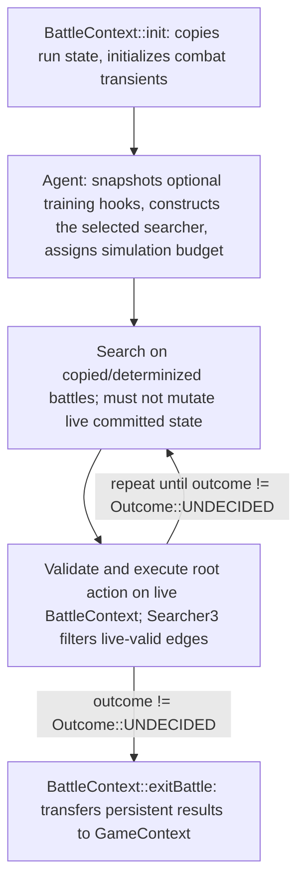

# Combat search

Last verified: 2026-08-04 against the current working tree.

## Purpose

Describe the combat state boundary, action/search flow, hidden-information
handling, and learned combat guidance used by the active executable.

## Current implementation

`BattleContext` is the mutable combat state. It owns player/monster/card state,
action queues, potions, six combat RNG streams, input state, and terminal
`Outcome` (`include/combat/BattleContext.h::BattleContext`).
`BattleContext::executeActions` advances queued effects until input or a
terminal state; `search::Action::execute` applies packed card, potion,
selection, and end-turn choices (`src/combat/BattleContext.cpp::executeActions`;
`src/sim/search/Action.cpp::execute`).

`ScumSearchAgent2::playoutBattle` dispatches combat:

- Searcher2 is the default (`src/sim/search/BattleScumSearcher3.cpp::g_useSearcher3`).
- `STS_SEARCHER3=1` selects `BattleScumSearcher3`.
- `STS_FAIR=1` selects the project-fair commit/research loop independently of
  the searcher (`src/sim/search/ScumSearchAgent2.cpp::playoutBattle`).

In fair mode both Searcher2 and Searcher3 construct a new searcher for each live
combat decision. Searcher2 chooses the most-visited root action and then
validates it against the live battle; Searcher3 chooses the most-visited
live-valid root edge (`ScumSearchAgent2::playoutBattleFair`). In non-fair mode
both implementations can reuse a tree through `advanceRoot`
(`ScumSearchAgent2::playoutBattle`).

Searcher3 samples `HiddenBattleState` particles and applies all six RNG seed
pairs to a copied battle in both fair and non-fair agent paths. `STS_FAIR`
changes per-decision reconstruction versus tree reuse; it does not turn
Searcher3 particle sampling on. Searcher3 caches a `CombatObservation` per
node, expands legal edges, uses PUCT or UCB-like selection, performs
deterministic chain continuation and a rollout/leaf evaluation, then backpropagates
(`src/sim/search/BattleScumSearcher3.cpp::step`, `selectBestEdgePUCT`).
Seeding, belief conditioning, and observation identity follow the canonical
field contract described under "Known limitations"; the composite seed is
`visibleHash ^ agentSeed ^ decisionIndex` with `agentSeed` and `decisionIndex`
assigned per decision by the caller, and `Belief::update` zero-weights
particles whose draw order contradicts the observed pile
(`BattleScumSearcher3::BattleScumSearcher3`; `ScumSearchAgent2::playoutBattleFair`;
`CombatObservation::Belief::update`).

## Important data flow

1. `BattleContext::init` copies run state and initializes combat transients.
2. The agent snapshots optional training hooks, constructs the selected
   searcher, and assigns its simulation budget.
3. Search operates on copied/determinized battles; it must not mutate the live
   committed state before choosing an action.
4. The selected root action is validated and executed on the live
   `BattleContext`; Searcher3 filters for live-valid edges while selecting.
5. Search repeats until `outcome != Outcome::UNDECIDED`.
6. `BattleContext::exitBattle` transfers persistent results back to
   `GameContext`.

Learned guidance is loaded by `apps/one_combat.cpp::main`:

- `STS_POLICY` loads the compact tree prior; with no explicit setting,
  `build/policy_trees_c.txt` is attempted except in `policygen` mode.
- `STS_VNET` loads a separate combat value model and `STS_VNET_ALPHA` controls
  its rollout blend.
- `STS_DIST_VNET` loads the distributional transformer evaluator.
- `STS_PVNET` loads the shared `CombatPVNet`; `STS_PVNET_ALPHA` defaults to
  `1.0` (pure neural leaf) and `STS_PVNET_VALUE_ONLY` disables its policy head.
- `STS_CPUCT` overrides the shared default `g_cPuct=2.5` when a policy or PV
  model is active (`src/sim/search/CombatValueNet.cpp::g_cPuct`).

The tracked joint PVNet is experimental. The recorded July 30 sweep found its policy
head useful and its value head weak; see
[evaluation/current-baselines.md](../evaluation/current-baselines.md) and the
final section of `EXPERIMENTS.md`. All recorded PVNet bot results predate the
2026-08-04 parity fixes (GELU FFN, fixed 14-token layout, full policy-head dot
product; decision log `2026-08-04-combat-pvnet-parity-fixes.md`); the
`pvnetparity` mode (`apps/one_combat.cpp::main`) now verifies C++ inference
against `combat_pvnet_parity.py` to ~1e-6. The 2026-08-05 3k-sim payoff gate
(EXPERIMENTS.md §102) closed the PVNet channel at the recommended operating
point: policy priors hurt at deep search (−7.0pp vs S3 control) and the neural
leaf's within-noise win gain costs 14–18x compute; the A–H architecture sweep
was stopped.

`STS_DIST_VNET` and `STS_PVNET` are referenced only from
`BattleScumSearcher3.cpp`. Loading either model without `STS_SEARCHER3=1`
prints a load message but does not make default Searcher2 use it.

## Invariants and assumptions

- Combat loops continue only while `bc.outcome == Outcome::UNDECIDED`.
- A committed action must be valid for the live battle.
- Project-fair search commits one root action before observing/searching again.
- `Node`, `Edge`, and searcher header-layout changes require rebuilding every
  including translation unit.
- The canonical learned state has 1,766 features; policy edges add 14 action
  features (`src/sim/search/CombatValueNet.cpp::combatFeatureCount`,
  `combatPolicyFeatureCount`). Ordering is a model-interface invariant.
- Two action features come from `Expert` play/obtain weights; the learned policy
  input is therefore not free of hand-authored features
  (`src/sim/search/CombatValueNet.cpp::combatFillActionFeatures`).

## Known limitations

- Searcher2 project-fair determinization changes draw order plus only
  `shuffleRng` and `cardRandomRng`; it is not a complete hidden-state model
  (`src/sim/search/BattleScumSearcher2.cpp::determinize`).
- Searcher3 belief conditioning is conservative: `Belief::update` zero-weights
  particles whose draw order contradicts the observed pile, and `Belief::sample`
  falls back to uniform when all weights are equal or total zero, so a reshuffle
  or insert that contradicts every particle resets the belief
  (`src/sim/search/CombatObservation.cpp::Belief::update`, `sample`).
- `HiddenBattleState::drawPileOrder` is installed by `applyParticle` only when
  the copied pile's size and card multiset match the particle; after tree reuse
  stale particles fall back to a searcher-RNG shuffle
  (`src/sim/search/BattleScumSearcher3.cpp::applyParticle`).
- Composite seeding is implemented with explicit constructor parameters
  (`agentSeed`, `decisionIndex`); both are per-decision assigned by
  `ScumSearchAgent2::playoutBattleFair` and `playoutBattle`, so the advertised
  `visibleHash ^ agentSeed ^ decisionIndex` contract now holds. Members stay
  mutable because the tree-reuse path re-keys via `reseed()`.
- PVNet-only priors: `computeEdgePriors` runs when the separate policy net or a
  PVNet with its policy head enabled (`!STS_PVNET_VALUE_ONLY`) is loaded; the
  PVNet policy head takes precedence when both exist. With
  `STS_PVNET_VALUE_ONLY=1` and no policy net, priors remain zero while
  `selectBestEdgePUCT` still recognizes the PVNet.
- `CombatObservation::operator==` and `visibleHash` share one canonical field
  set (see `CombatObservation.cpp::operator==`); card piles are compared as
  multisets of `CardKey`, so order-insensitive equality is deliberate.
- Guaranteed-death pruning is conservative: `canPruneAsDead` fires only in
  states where the player cannot act; the aggressive `isGuaranteedDead`
  predicate was removed because its soundness for card-selection states was not
  proven (`src/sim/search/BattleScumSearcher3.cpp::canPruneAsDead`).
- Native PV/distribution inference probes a SciPy OpenBLAS path and
  otherwise falls back to scalar math; `STS_OPENBLAS` overrides the probe
  path and the loader accepts either `scipy_cblas_sgemv` or `cblas_sgemv`.
  Set `OPENBLAS_NUM_THREADS=1` when OpenMP-outer-parallel workloads call
  BLAS: OpenBLAS's own pool plus the 24 outer workers oversubscribes the box
  ~2x and runs slower than scalar (EXPERIMENTS.md §102). The active backend
  is printed at load time (`src/sim/search/CombatPVNet.cpp`; `CombatDistValueNet.cpp`).

## Open questions

- Should `CombatObservation` identity include card `uniqueId`/`retain` fields,
  or does the current `CardKey` multiset contract suffice?
- Should conservative player-cannot-act-only pruning be replaced by an
  aggressive predicate once its soundness is proven for all card-selection
  states?
- Should PVNet-only operation with `STS_PVNET_VALUE_ONLY=1` disable PUCT
  recognition instead of leaving zero priors?

## Relevant code

- `include/combat/BattleContext.h::BattleContext`, `Outcome`
- `src/combat/BattleContext.cpp::init`, `executeActions`, `exitBattle`
- `src/sim/search/ScumSearchAgent2.cpp::playoutBattle`, `playoutBattleFair`
- `include/sim/search/BattleScumSearcher2.h::BattleScumSearcher2`
- `include/sim/search/BattleScumSearcher3.h::BattleScumSearcher3`
- `src/sim/search/BattleScumSearcher3.cpp::step`, `computeEdgePriors`
- `src/sim/search/CombatObservation.cpp::Belief`, `visibleHash`
- `src/sim/search/CombatValueNet.cpp::combatExtractFeatures`
- `src/sim/search/CombatPVNet.cpp::CombatPVNet`
- `apps/one_combat.cpp::main`
