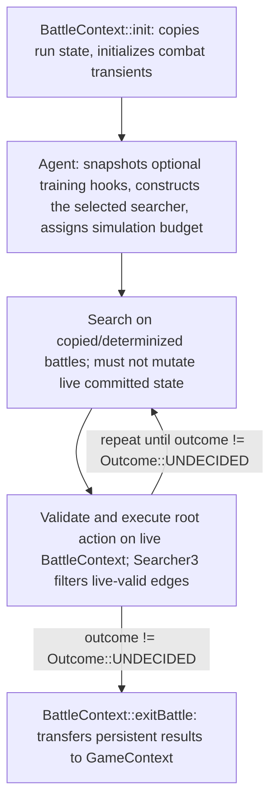

# Combat search

Last verified: 2026-08-07 against the current working tree (winrate wave §124-§126: baseline re-measurement, S3_EXPAND, vnet default).

## Purpose

Describe the combat state boundary, action/search flow, hidden-information
handling, and learned combat guidance used by the active executable.

## Current implementation

`BattleContext` is the mutable combat state. It owns player/monster/card state,
action queues, potions, six combat RNG streams, input state, and terminal
`Outcome` (`include/combat/BattleContext.h::BattleContext`).
`BattleContext::executeActions` advances queued effects until input or a
terminal state; `search::Action::execute` applies packed card, potion,
selection, and end-turn choices (`src/combat/BattleContext.cpp::executeActions`;
`src/sim/search/Action.cpp::execute`).

`ScumSearchAgent2::playoutBattle` dispatches combat:

- Searcher2 is the default (`src/sim/search/BattleScumSearcher3.cpp::g_useSearcher3`).
- `STS_SEARCHER3=1` selects `BattleScumSearcher3`.
- `STS_FAIR=1` selects the project-fair commit/research loop independently of
  the searcher (`src/sim/search/ScumSearchAgent2.cpp::playoutBattle`).

In fair mode both Searcher2 and Searcher3 construct a new searcher for each live
combat decision. Searcher2 chooses the most-visited root action and then
validates it against the live battle; Searcher3 chooses the most-visited
live-valid root edge (`ScumSearchAgent2::playoutBattleFair`). In non-fair mode
both implementations can reuse a tree through `advanceRoot`
(`ScumSearchAgent2::playoutBattle`).

Searcher3 samples `HiddenBattleState` particles and applies all six RNG seed
pairs to a copied battle in both fair and non-fair agent paths. `STS_FAIR`
changes per-decision reconstruction versus tree reuse; it does not turn
Searcher3 particle sampling on. Searcher3 caches a `CombatObservation` per
node, expands legal edges, uses PUCT or UCB-like selection, performs
deterministic chain continuation and a rollout/leaf evaluation, then backpropagates
(`src/sim/search/BattleScumSearcher3.cpp::step`, `selectBestEdgePUCT`).

CARD_SELECT action enumeration (both searchers) delegates to the canonical
`search::Action::enumerateCardSelectActions`, which implements the full
`isValidAction` contract (hand/discard/draw/exhaust pools per task, EXHUME
excluded from its own selection, CODEX skip=3, and multi-select subsets for
EXHAUST_MANY/GAMBLE). An exhaustive parity test
(`./build/test cardselect_parity`, `apps/test.cpp::testCardSelectParity`)
pins all three enumerators to the validity contract across every
`CardSelectTask` (issues 47/48). `STS_MULTISELECT_MODE=all|single|none`
(default `all`) prunes the multi-select action space to empty+singles+full
(`single`) or empty only (`none`); only `all` matches the parity contract.
The §112 report of a full-subset win-rate regression was **falsified
(§113)**: the "control" enumerator skip-won battles at WARCRY/GAMBLE states
(zero valid edges → UNDECIDED battle break → rewards/advance), so the §112
delta was the removed exploit, not search degradation; `all` is the
deployment default and `single`/`none` are opt-in search-scale knobs. Since
§113, `BattleContext::exitBattle` treats an UNDECIDED outcome as
`PLAYER_LOSS`, so any future enumerator gap costs a loss, never a free win.
Seeding, belief conditioning, and observation identity follow the canonical
field contract described under "Known limitations"; the composite seed is
`visibleHash ^ agentSeed ^ decisionIndex` with `agentSeed` and `decisionIndex`
assigned per decision by the caller, and `Belief::update` zero-weights
particles whose draw order contradicts the observed pile
(`BattleScumSearcher3::BattleScumSearcher3`; `ScumSearchAgent2::playoutBattleFair`;
`CombatObservation::Belief::update`).

### Rollout-usage diagnostics (searchdiag)

Searcher2 keeps per-search rollout-usage counters (`SearchDiagnostics`, member
`BattleScumSearcher2::diag`; `include/sim/search/BattleScumSearcher2.h`) that
count, per simulation: whether the sim ended at a terminal state inside the
tree (`terminalInsideTree`), entered a random rollout (`rolloutCalls`, split
by how it was entered: `rolloutLeafCalls` = newly expanded leaf,
`fairIllegalStoredEdge` = stored edge invalid in this determinization — the
fair fallback path; and by why the rollout stopped: `rolloutTerminated` /
`rolloutDepthCapped` / `rolloutSkippedVNet` / `rolloutNoLegalAction`), or
evaluated a fair-play leaf with no legal action (`leafDirectEval`); plus
`treeActions` (actions executed by explicit tree descent), `maxTreeDepth`,
and `simSeconds` (wall time in the search loops). Invariants per searcher:
`simulations == terminalInsideTree + rolloutCalls + leafDirectEval` and
`rolloutCalls == rolloutLeafCalls + fairIllegalStoredEdge`.
`playoutRandom` returns its action count and sets a `RolloutStop` cause
(`src/sim/search/BattleScumSearcher2.cpp::step`, `playoutRandom`). The
counters are write-only in the search path — they cannot alter search
behavior. `Node::outcome` (0 non-terminal, 1 victory, 2 defeat) is recorded at
the in-tree terminal check; terminal nodes are never expanded, so an
`outcome != 0` node has no edges. Fair @3k measurement (EXPERIMENTS.md §117,
2026-08-06): the illegal-stored-edge path is ~half of fair rollouts and
grows to 68% of rollout calls at 30k sims (act 1) — a real
tree/determinization mismatch, not noise; obs-keyed descent is falsified
(§114), so structural fixes are constrained.

`collectFrontierStats` walks the stored tree and classifies frontier leaves:
terminal (victory/defeat) versus unexpanded non-terminal nodes, with a
visit-weighted terminal coverage (sum of `simulationCount` over terminal
leaves over all frontier leaves) and a node cap (default 500k) so pathological
trees cannot stall the pass.

The `searchdiag` mode (`one_combat searchdiag nSeeds sims asc out probeEvery
[seedOffset]`) runs full runs and emits, per combat decision:
- rowtype A (every decision, `search::g_onSearchComplete`): the agent search's
  per-decision window (non-fair mode subtracts the previous cumulative since
  one searcher persists per fight; fair mode uses the whole fresh search
  because each decision rebuilds the searcher), cumulative frontier stats, and
  the root's most-visited action, visit share, and value gap to the
  visit runner-up; `maxTreeDepth` is cumulative (deepest explicit path in the
  tree to date);
- rowtype B (every `probeEvery`-th decision): fresh probe searchers at
  budgets {100, 250, 500, 1000, 3000, 10000, 30000} — independent trees per
  stage — with root-decision stability versus the previous stage and versus
  the agent's implied best action (`stableVsPrev`, `stableVsAgent`; -1 = no
  comparison).
Rows A and B share one header (identical column semantics). Per-fight
summaries (outcome, totals) go to a **separate** file `<out>.fights.csv` with
its own header so no rowtype reinterprets columns. The `fair` column records
the regime; `STS_ROLLOUT_DEPTH` is honored and depth-capped rollouts are
counted. Searcher3 is not instrumented; the mode refuses to run under
`STS_SEARCHER3`. (`apps/one_combat.cpp::sdiagMetricsOf`, `sdiagOnSearchComplete`,
`sdiagProbe`, `searchDiag`.) Decision log:
`2026-08-06-searchdiag-rollout-usage.md`. Since 2026-08-06 the mode also
instruments Searcher3 (rowtype A only; probeEvery forced 0 under
`STS_SEARCHER3` — the B-stage probes are S2 machinery): `SearchDiagnostics`
lives in the shared `include/sim/search/SearchDiagnostics.h`,
`BattleScumSearcher3::diag` counts the same rollout-cause split, and
`sdiagMetricsOf3`/`sdiagOnSearchComplete3` emit S3 A-rows (§122).

### Fair-tree structural fix (STS_LIVE_VALID — default ON in the fair-S3 path)

Phase 4: in fair mode, the PUCT-chosen stored edge is often illegal in the
current determinization (measured illegal-stored share of rollouts: S2 ~48%
§117; **S3 58-60%** at fair @3k, §122). `STS_LIVE_VALID` re-selects among
the stored edges valid in THIS world using the same UCB/PUCT scoring
(`BattleScumSearcher2::selectBestValidEdgeToSearch`,
`BattleScumSearcher3::selectBestValidEdgePUCT`) and continues tree descent;
only when no stored edge is valid does the sim fall back to the §117 random
rollout. Narrower than obs-keyed descent (falsified §114): tree structure
and observation identity are untouched. Effect: S2 illegal-share 0.26→0.00,
S3 0.38→0.10 (smoke). Paired gates: S2 @1k +0.4pp (SE 2.2, cpu +5.6%,
§122); **S3−bc @3k +5.5pp (95% CI +5.5 ± 5.1, hp +4.1, cpu +7.9%, §122)
and +5.9pp (95% CI +5.9 ± 1.8, hp +3.1, floor +1.1, cpu +14.6%, §123,
independent block)**. **Default ON in the fair-S3 path since 2026-08-07
(§123; recorded cpu-trade call accepts ~+8-15% cpu for the reproducible
~+5-6pp win); `STS_LIVE_VALID=0` disables.** Scoping: computed in
`apps/one_combat.cpp::main` after the STS_FAIR/STS_SEARCHER3 parse, so only
the explicit `STS_FAIR=1 STS_SEARCHER3=1` regime; S2 fair stays opt-in (S2
@1k neutral, +cpu; S2 @3k pair needed before any S2 flip); non-fair paths
and the `fairgen` datagen mode are unchanged unless the env flag is set
explicitly (datagen keeps the recorded §117 behavior — open question: align
datagen with the deployed fix). Decision log:
`2026-08-06-live-valid-phase4.md`, `2026-08-07-live-valid-promotion.md`.

### On-no-valid-edge expansion (STS_S3_EXPAND, opt-in — falsified)

Phase 6: after live-valid, the residual no-valid-stored-edge fallback (~5.4%
of rollout calls at the deployed point, §124 searchdiag) expands the live
state's legal actions into the tree instead of a random rollout:
`STS_S3_EXPAND=1` (`BattleScumSearcher3::step`, action-keyed, dedup against
stored edges, priors computed on the new edges only via a temp node,
cap `STS_S3_EXPAND_MAX` default 32, PUCT pick via `selectBestValidEdgePUCT`;
requires live-valid semantics — without `g_liveValid` the branch is
 unreachable). Effect: illegal-stored share 0.054→0.00, treeActions +10%
 (searchdiag 6 seeds @3k/64p). **Falsified at the paired gates
 (EXPERIMENTS.md §125, 2026-08-07):** @1k/64p 35.5% vs 37.9% (−2.3pp, CI
 [−2.7,+7.4], 16% discordant) and @3k/64p 44.1% vs 42.6% (+1.5pp, CI
 [−6.6,+3.5], 16% discordant) — mixed null, no consistent signal; the env
 stays default-off.

### Prior-guided rollouts (STS_S3_ROLLOUT_POLICY, opt-in — falsified)

`BattleScumSearcher3::playoutRandom` samples rollout actions from the **GBM
policy prior** (the same distribution PUCT priors come from, via
`computeEdgePriors`) when `STS_S3_ROLLOUT_POLICY=1`, instead of the static
`rolloutWeight` heuristic (ATTACK=8, POWER=3, others=2, END_TURN/POTION=1).
The rollout is therefore never truly uniform — this replaces the
hand-authored bias with the learned prior. Restricted to the GBM policy net
(`g_usePolicyNet && loaded()`, and not shadowed by a PVNet policy head): a
PVNet-head forward per rollout step would cost ~14-18× a sim. Revives the
parked §119 "Phase 3 (policy-guided rollouts)". Default off (behavior
byte-identical when unset). **Falsified at the paired 256-seed gate
(EXPERIMENTS.md §124c, 2026-08-07):** 43.4% vs 50.4% control = **−7.0pp (CI
[−13.7, −0.4]), floor −1.3, HP −6.7 at 2.7× cpu**, 30% discordance
(control-only 47 vs policy-only 29); control reproduced the §126 reference
exactly (50.4%). The prior — trained on older-policy visit distributions —
actively hurts rollouts; line closed per the pre-registered rule, env stays
opt-in. Follow-ups (temperature/mixture) only after a current-stack prior
retrain (winrate-plan §3.4).

### Context-adaptive rollout caps (STS_ROLLOUT_CAPS, opt-in — falsified)

`rolloutCapForContext` (`src/sim/search/BattleScumSearcher2.cpp`, Phase 2,
2026-08-06) replaces the single flat rollout cap with per-context caps when
`STS_ROLLOUT_CAPS=1`: boss encounters (`isBossEncounter`), turn 0
(`bc.turn == 0`), and act 2-3 (floors 17..50) cap the random rollout at
`g_rolloutCapBoss`/`g_rolloutCapTurn0`/`g_rolloutCapAct23` (defaults 8 each);
short late-fight states (monsters alive <= `g_rolloutCapLateAlive` = 1) stay
uncapped so decisive rollouts play to terminal. The damage-biased weighted
rollout pick (formerly gated on the flat `g_maxRolloutDepth`) is applied
whenever the context cap is active; leaf evaluation stays the heuristic
`evaluateLeafState` (combat VNet rejected at the gates, §97). Env:
`STS_ROLLOUT_CAPS=1` + `STS_ROLLOUT_CAPS_{BOSS,TURN0,ACT23,LATE_ALIVE}`,
parsed in `apps/one_combat.cpp::main` next to `STS_ROLLOUT_DEPTH`. Unset
behavior is byte-identical (the helper returns the flat `g_maxRolloutDepth`
path). **Falsified at the paired gate (EXPERIMENTS.md §119, 2026-08-06):**
fair @3k searchdiag measured avgRolloutLen 8.76 → 7.15 (−18%) with 27% of
rollout calls capped (BOSS 38%, act2/act3 33/38%), but the 256-seed paired
gate @1k gave flat 22.3% vs caps 16.4% (−5.9pp, 95% CI −5.9 ± 4.5pp,
excludes zero; flips 13 up / 28 down; cpu −7.8%). The heuristic capped-leaf
estimate at depth 8 loses more decision quality than the saved sims gain;
the line is stopped and the env gate stays default-off. Decision log:
`2026-08-06-rollout-caps-phase2.md`.

### Forced-action contraction (default ON in the fair path)

Phase 5: when the live root state has exactly one legal action
(`BattleScumSearcher2::onlyLegalAction`, canonical enumeration on
`*rootState`), the agent commits it directly without searching
(`ScumSearchAgent2::playoutBattleFair`, `playoutBattle`). It is
strictly-forced-only — no multi-step contraction (Searcher3 chain
compression was net-negative, EXPERIMENTS.md §106). **Default ON in the
fair path since 2026-08-06 (§120/§121); `STS_FORCED_MOVE=0` disables.**
Since 2026-08-07 the same shortcut applies to the Searcher3 fair path
(`BattleScumSearcher3::onlyLegalAction`, same live-root canonical
enumeration; the S3 fair path builds a fresh searcher per decision, so the
skip is decision-neutral — confirmed at the §123 paired 256-seed gate:
0/256 per-seed outcome diffs at −8.5% cpu; smaller than S2's −16-18%
because the S3 searcher (incl. particle belief) is constructed before the
check).
Fair-path note: forced decisions skip the search, so `g_onSearchComplete` /
`g_onSearchComplete3` (searchdiag A rows) does not fire for them. **Non-fair
path: the standalone flag is a no-op by design** — the persistent searcher
reuses the tree across decisions, so skipping a forced-node search changes
later trees and the shared RNG stream (measured divergent on 3/8 diagnostic
seeds, §121); the non-fair forced shortcut fires only inside the
`g_convRootStop` arm (falsified §118, hang fixed §121 — it clears the
cached winning line after a forced skip, which otherwise left
`stepThroughSolution` looping on an empty action list). Two independent
256-seed fair gates show exact per-seed outcome equality (0/256 diffs each)
at −16 to −18% cpu; decision-neutral by construction, so all historical
fair results remain valid. Decision log:
`2026-08-06-forced-move-phase5.md`.

### Root-stability adaptive search (STS_CONV_ROOT, opt-in)

`BattleScumSearcher2::searchToTotalRootStable` (2026-08-06) searches in
chunks that grow from `g_convRootStart` (250) by `g_convRootGrow` (2.0) up
to a caller-supplied ceiling, checking every `g_convRootCheck` (100) sims
whether the root's most-visited action, visit share (drift >
`g_convRootShare` = 0.05), and windowed mean value (drift > `g_convRootValue`
= 1.0) are stable; it stops once stable for `g_convRootPatience` sims past
`g_convRootMinSims`. Unlike the §22/§102 `g_convergeStop` plateau signal
(inert under fair determinization), this decision-oriented signal fires in
fair play. The agent (`ScumSearchAgent2::playoutBattle`,
`playoutBattleFair`) credits each decision's flat budget to a per-fight
`fightPool` and lets ambiguous decisions escalate to
`min(pool, g_convRootMaxFrac x flat)` (default 3.0), making the arm
budget-neutral; the forced-move shortcut `onlyLegalAction` commits directly
when exactly one legal action exists. Env: `STS_CONV_ROOT=1`,
`STS_CONV_ROOT_{START,GROW,CHECK,SHARE,VALUE,MIN,PATIENCE,MAX_FRAC}`.
Provisional 64-seed fair @1k measurement (decision log
`2026-08-06-conv-root-stable-search.md`): MIN=500/PATIENCE=500 gives +3.1pp
win at −9% cpu vs flat (within noise); stop-only loses ~3pp — the
pool-funded escalation is what pays. **Falsified at the paired gate
(EXPERIMENTS.md §118, 2026-08-06):** 256 paired fair seeds @1k give flat
22.3% vs candidate 19.9% (−2.3pp, 95% CI −2.3 ± 4.1pp, 13 up / 19 down;
cpu −11%); the 64-seed win signal did not survive 128 or 256 seeds. The
adaptive line is stopped; the env gate stays opt-in and the built-in
`g_convRootMinSims`/`g_convRootPatience` defaults (250) are unchanged.

Searcher3 feature-ablation toggles (all parsed by `apps/one_combat.cpp::main`
next to `STS_SEARCHER3`; defaults preserve full behavior): `STS_S3_BELIEF=0`
skips the two `belief.update` calls in `step()` (particles stay uniform),
`STS_S3_PRUNE=0` skips the three `canPruneAsDead` checks, `STS_S3_CHAIN=0`
skips the deterministic chain-compression loop, `STS_S3_LIVE=0` switches the
root-action pick to the most-visited edge with **no live-valid filter** — an
invalid most-visited edge ends the battle exactly like the Searcher2 loop
(`s3PickRootAction`, `ScumSearchAgent2.cpp`; semantics corrected 2026-08-05),
and `STS_S3_CRN=1` calls `warmStartRootCRN` once per fresh searcher (skipped
after `advanceRoot` carries the tree; guarded 2026-08-05). Benchmark §106
(128 seeds, V4 gate stack, fair, 3k sims) measured: removing belief or chain
*improves* win rate (+8.6 / +4.7pp vs the S3 control; S3−belief also beats
the S2 reference with CI excluding zero), enabling CRN *loses* −14.1pp
(CI excludes zero), and the prune toggle is a per-seed no-op in this regime.
The belief particle count is configurable via `STS_S3_PARTICLES` (default 64;
was hardcoded in `ScumSearchAgent2::playoutBattleFair`/`playoutBattle`).
§107 (256 paired seeds vs the §99 S2@3k reference, 45.3%) promoted the
combined variant: **S3−belief−chain was the recommended combat search** —
60.2% (+14.8pp, CI excluding zero) at 3k sims/256 particles, or 57.4%
(+12.1pp) at 1k sims/64 particles (3.1× less compute). Particle count is
flat across 16–256 (§107), and the belief reweighting stays harmful even at
256 particles (E1: −6.2pp vs belief-off at equal count).
**§107/§111/§112 and all S3 arms of §99–§105 are invalidated (§113): the
pre-fix (619c12c) S3 enumerator skip-won battles at WARCRY/GAMBLE
CARD_SELECT states** (zero valid edges → UNDECIDED battle break → rewards +
floor advance; the act-3 boss skip recorded `PLAYER_VICTORY`). The honest
re-baseline on the same 256-seed block with the canonical enumerator (issue
47) + the §113 `exitBattle` guard: **42.6% @3k / 36.3% @1k** vs honest
control S3 9.0% @1k (EXPERIMENTS.md §113, `build/honest_fix_{1k,3k}_256.csv`).
The §107 deltas versus the §99 reference were measured against a skip-inflated
S3 arm; only the Searcher2 numbers (§99, 45.3%) remain honest comparators.

### Terminal-leaf run-value bonus (cross-combat setup, opt-in)

Searcher3 terminal `PLAYER_VICTORY` leaves are priced with the native win
model on the post-combat run state via the thread_local
`search::g_terminalBonus` hook (empty = off), consumed only in
`BattleScumSearcher3::evaluateTerminal` (`v += bonus(bc)`). `runFullRunOOC`
arms it per battle when `search::g_useSearcher3` is set (`STS_TERM_WIN=1`):
`termWinArmForBattle` builds one base rich row per fight (future fights
resampled from the act pool via the existing `resampleRemainingActEncounters`,
or zeroed with `STS_TERM_WIN_HIDDEN=zero`), and `termLeafBonus` patches only
the fields `BattleContext::exitBattle` transfers — curHp (+6 Burning Blood
heal), maxHp, gold, potionCount, potion slots, the eight counter relics
(Happy Flower/Incense Burner/Ink Bottle/Inserter/Nunchaku/Pen Nib/Sundial),
Lizard Tail, Neow's Lament — by rich index and returns
`w * g_winNet.predict(row)` (`STS_TERM_WIN_W`, default 100; V_win is P(win)
in [0,1] vs the leaf's hp+50 scale). Per-run parity check prints mismatches
against the full `richFeatureVec` path on a real post-combat copy (hidden
queue features zeroed in both). This is the mechanism for cross-combat setup
decisions — e.g. stalling one turn so the Happy Flower counter ends charged
(2) for the next fight — which the combat-local leaf never priced before.
**Benchmarked (§116, 256 paired seeds, forced Happy Flower both arms, 1k
sims): null on win rate (37.9% vs 37.5%) and stall behavior (+1.5pp charged
counter, +0.11 turns/battle) at 3.1x cpu cost — the bonus is NOT promoted
and stays opt-in/off**; the deployed win tree is counter-insensitive (§110:
0/1060 splits on any counter feature), so the cross-combat setup signal is
invisible to it. Known defect: `STS_TERM_WIN=1` segfaults intermittently at
12 threads (issue 49, pre-existing, opt-in only).
`STS_TERM_WIN_EVAL=cpsi` swaps the evaluator from the win tree to the C_psi
no-peek next-fight survival model (`bonus = w * P(win of next fight)`, entry
built from the patched rich row via `cpsiEntryFromRich`, current fight's
encounter as the fixed probe encounter — constant within a combat, so only
the state-dependent part orders the leaves): the `cpsictr` mode
(`STS_CPSI_CTR_PROBE=1`) shows C_psi prices every counter relic with the
correct sign (charged counter → lower next-fight death), unlike the win tree
(0 splits on all counter features). Cost: the scalar transformer forward is
~0.2 ms (vectorized 2026-08-05: `#pragma omp simd` on the linear reductions +
weight-row hoisting; per-output math bit-identical) — cpsi-eval measures
~9x the win-tree leaf end-to-end (19.2 vs 1.8 cpu-sec/run at 100 sims, 16
seeds); benchmark at the 1k-sim operating point.
Decision log: `2026-08-05-terminal-leaf-run-value-bonus.md`.

## Important data flow

1. `BattleContext::init` copies run state and initializes combat transients.
2. The agent snapshots optional training hooks, constructs the selected
   searcher, and assigns its simulation budget.
3. Search operates on copied/determinized battles; it must not mutate the live
   committed state before choosing an action.
4. The selected root action is validated and executed on the live
   `BattleContext`; Searcher3 filters for live-valid edges while selecting.
5. Search repeats until `outcome != Outcome::UNDECIDED`.
6. `BattleContext::exitBattle` transfers persistent results back to
   `GameContext`.

Learned guidance is loaded by `apps/one_combat.cpp::main`:

- `STS_POLICY` loads the compact tree prior; with no explicit setting,
  `build/policy_trees_c.txt` is attempted except in `policygen` mode.
- `STS_DATAGEN_GATES=1` (opt-in, §127): `combatgen`/`distgen` run-loop OOC
  decisions route through the same one-ply gate chain as `bestbench`
  (`runCombatGenSeed` → `datagenGateStack` + the card-reward gate), so
  generated combat labels come from the deployed run-level distribution.
  Each gate self-guards on its env flag + model load; unset behavior is
  byte-identical. §127: the gate-stack-distribution vnet retrain was NULL
  vs the deployed model (α optimum shifted 0.3→0.5, no significant winrate
  difference) — the deployed `v_combat_honest.txt` stays.
- `STS_VNET` loads a separate combat value model and `STS_VNET_ALPHA` controls
  its rollout blend.
  **Default since 2026-08-07 (EXPERIMENTS.md §126):** in the fair-S3 path
  (after the `STS_FAIR`/`STS_SEARCHER3` parse) an unset `STS_VNET`
  auto-loads `build/v_combat_honest.txt` (804 trees, sha256 `e69d64cf…`) at
  `STS_VNET_ALPHA` 0.3 — three significant paired gates (+12.5/+12.1/+12.5pp
  win at ~2-2.4× cpu; the §126 cpu-trade call). Any explicit `STS_VNET=…`
  overrides (e.g. `STS_VNET=1` → legacy `build/v_combat_trees.txt` at α0.5;
  `STS_VNET=<missing-path>` → load failure → vnet off). The S2 fair and
  non-fair paths stay env-only. `STS_VNET_COND_BOSS=1`/`STS_VNET_COND_ACT3=1`
  (opt-in) restrict the vnet leaf to rollout-dominant contexts (boss
  encounters, act 3 floors ≥ 34) via `vnetCondAllowed` (S3 `step()` leaf
  capture + `evaluateLeaf`); measured FLAT at both α (boss-only killed the
  benefit, §126) — the unconditional low-α blend is the operating point.
  The model trains on `combatgen` rows from the heuristic-OOC run loop
  (`runCombatGenSeed`), not the gate-stack distribution (transfer measured
  empirically, §126). `fairgen` datagen is not covered by the default (it
  forces its regime after the parse); `combatgen` datagen IS covered.
- `STS_DIST_VNET` loads the distributional transformer evaluator.
- `STS_PVNET` loads the shared `CombatPVNet`; `STS_PVNET_ALPHA` defaults to
  `1.0` (pure neural leaf) and `STS_PVNET_VALUE_ONLY` disables its policy head.
- `STS_PVNET_CACHE=0` disables the S3 visible-state leaf-value cache (default
  on since 2026-08-07, phase 6): `evaluateLeaf` caches PVNet leaf values by the
  node's `obsHash` at the direct-eval sites (no-legal-action, invalid-edge,
  depth cap — `BattleScumSearcher3::evaluateLeaf`), where repeated sims
  evaluate the same visible state. Behavior-preserving (deterministic given
  the visible state); verified identical per-seed outcomes cache-on vs off
  (8 seeds local smoke). The per-expansion blend site (new child state) and
  post-rollout states are effectively unique and not cached.
- `STS_PVNET_COND_TURN=N`, `STS_PVNET_COND_DEPTH=N` (default 0 = off) and
  `STS_PVNET_COND_BOSS=1` (default off) gate the **per-expansion** NN leaf
  (`BattleScumSearcher3::pvnetCondAllowed`): when a condition fails, the sim
  uses the ordinary rollout value only (α=0 for that sim) instead of the
  blend — cheap/easy continuations skip the transformer forward, the NN fires
  for long/unresolved continuations. The direct-eval and post-rollout
  `evaluateLeaf` calls are not gated. Defaults preserve the pre-phase-6
  behavior exactly.
- `STS_CPUCT` overrides the shared default `g_cPuct=2.5` when a policy or PV
  model is active (`src/sim/search/CombatValueNet.cpp::g_cPuct`).

The tracked joint PVNet is experimental. The recorded July 30 sweep found its policy
head useful and its value head weak; see
[evaluation/current-baselines.md](../evaluation/current-baselines.md) and the
final section of `EXPERIMENTS.md`. All recorded PVNet bot results predate the
2026-08-04 parity fixes (GELU FFN, fixed 14-token layout, full policy-head dot
product; decision log `2026-08-04-combat-pvnet-parity-fixes.md`); the
`pvnetparity` mode (`apps/one_combat.cpp::main`) now verifies C++ inference
against `combat_pvnet_parity.py` to ~1e-6. The 2026-08-05 3k-sim payoff gate
(EXPERIMENTS.md §102) closed the PVNet channel at the recommended operating
point: policy priors hurt at deep search (−7.0pp vs S3 control) and the neural
leaf's within-noise win gain costs 14–18x compute; the A–H architecture sweep
was stopped.

`STS_DIST_VNET` is referenced only from `BattleScumSearcher3.cpp`; loading it
without `STS_SEARCHER3=1` prints a load message but does not make default
Searcher2 use it. `STS_PVNET` is different since 2026-08-05: default
Searcher2 consumes the PVNet **policy head** (priors + PUCT) whenever it is
loaded and not value-only (`BattleScumSearcher2.cpp::computeEdgePriors`,
mirroring S3). Per-searcher semantics therefore differ: in S2 only the policy
head is used (the value/leaf blend `STS_PVNET_ALPHA` is S3-only), and with
`STS_PVNET_VALUE_ONLY=1` the PVNet is fully inert in S2 while S3 keeps the
PUCT-with-zero-priors quirk.

## Invariants and assumptions

- Combat loops continue only while `bc.outcome == Outcome::UNDECIDED`.
- A committed action must be valid for the live battle.
- Project-fair search commits one root action before observing/searching again.
- `Node`, `Edge`, and searcher header-layout changes require rebuilding every
  including translation unit.
- The canonical learned state has 1,766 features; policy edges add 14 action
  features (`src/sim/search/CombatValueNet.cpp::combatFeatureCount`,
  `combatPolicyFeatureCount`). Ordering is a model-interface invariant.
- Since 2026-08-07 (§3.5, winrate plan) the action block appends **8
  multi-select subset-content features** (`aSelectSize`, `aSelTotalCost`,
  `aSelAtk/Skl/Pow`, `aSelUpgraded`, `aSelPlayOrder`, `aSelObtainWeight`) —
  `kNumAction` is now 22, derived from `kActionNames`. They are appended
  AFTER the original 14, so the PVNet action encoder (reads the first 14) and
  old GBM models (model-`nfeat` based) are unaffected; the PVNet branches of
  `computeEdgePriors` (S2/S3) stride by `combatPolicyFeatureCount() -
  combatFeatureCount()` accordingly. GAMBLE/EXHAUST_MANY priors were
  previously uniform across subsets (all select actions encoded identically);
  this fixes the encoding (subset = hand indices; single selects resolve
  hand/discard/exhaust pools by `CardSelectTask`; discovery/codex contribute
  size only).
- Two action features come from `Expert` play/obtain weights; the learned policy
  input is therefore not free of hand-authored features
  (`src/sim/search/CombatValueNet.cpp::combatFillActionFeatures`).

## Known limitations

- Searcher2 project-fair determinization changes draw order plus only
  `shuffleRng` and `cardRandomRng`; it is not a complete hidden-state model
  (`src/sim/search/BattleScumSearcher2.cpp::determinize`). Whether it should
  sample all six combat streams like Searcher3's particles (notably `aiRng`
  for future enemy intents and `monsterHpRng` for mid-fight spawn rolls) is an
  open question — see "Open questions" — and the `searchdiag` CSV records the
  regime (`fair` column) so fair rows are never mixed with known-RNG rows.
- Known-RNG Searcher2 whole-run benchmarking currently aborts (pre-existing,
  observed 2026-08-06 at HEAD) at a CARD_SELECT state with
  `cardSelectTask == EXHAUST_MANY`, `pickCount > 0`, and an empty hand: the
  canonical enumerator emits zero valid edges there and the pre-existing
  `assert(false)` in `playoutRandom` fires (`src/sim/search/BattleScumSearcher2.cpp`).
  It reproduces on a pristine build for seeds 0–7 at act-1 floor 13; the
  `STS_FAIR=1` path (the recorded baseline regime) is unaffected. Not yet
  root-caused; see decision log `2026-08-06-searchdiag-rollout-usage.md`.
- Searcher3 belief conditioning is conservative: `Belief::update` zero-weights
  particles whose draw order contradicts the observed pile, and `Belief::sample`
  falls back to uniform when all weights are equal or total zero, so a reshuffle
  or insert that contradicts every particle resets the belief
  (`src/sim/search/CombatObservation.cpp::Belief::update`, `sample`).
- `HiddenBattleState::drawPileOrder` is installed by `applyParticle` only when
  the copied pile's size and card multiset match the particle; after tree reuse
  stale particles fall back to a searcher-RNG shuffle
  (`src/sim/search/BattleScumSearcher3.cpp::applyParticle`).
- Composite seeding is implemented with explicit constructor parameters
  (`agentSeed`, `decisionIndex`); both are per-decision assigned by
  `ScumSearchAgent2::playoutBattleFair` and `playoutBattle`, so the advertised
  `visibleHash ^ agentSeed ^ decisionIndex` contract now holds. Members stay
  mutable because the tree-reuse path re-keys via `reseed()`.
- PVNet-only priors: `computeEdgePriors` runs when the separate policy net or a
  PVNet with its policy head enabled (`!STS_PVNET_VALUE_ONLY`) is loaded; the
  PVNet policy head takes precedence when both exist. With
  `STS_PVNET_VALUE_ONLY=1` and no policy net, priors remain zero while
  `selectBestEdgePUCT` still recognizes the PVNet.
- `CombatObservation::operator==` and `visibleHash` share one canonical field
  set (see `CombatObservation.cpp::operator==`); card piles are compared as
  multisets of `CardKey`, so order-insensitive equality is deliberate.
  Since §114 the identity includes the decision context (`inputState` +
  card-select task/pickCount/flags/offer cards), so a PLAYER_NORMAL state and
  a CARD_SELECT state can never share an identity. §114 measured the
  expansion neutral on 256 seeds @1k (+1.2pp, noise). An observation-keyed
  descent (`Edge{action → child[obsHash]}`) was attempted and **falsified**
  (§114): under particle determinization the post-action observations diverge
  at almost every level, the tree grows linearly with simulations, and the
  fixed budget collapses; the action-keyed tree stays.
- CARD_SELECT multi-select tasks (GAMBLE via Gambler's Brew, EXHAUST_MANY via
  Elixir/Purity) expand to every hand subset (up to 1023 edges) under the
  default `all` mode; policy priors are uniform across subsets because
  `combatFillActionFeatures` encodes multi-select actions identically. §112
  reported this as a −17.2pp win-rate regression vs control at 1k sims/256p;
  **§113 falsified that reading** — the control enumerator skip-won battles
  at WARCRY/GAMBLE states (zero valid edges → UNDECIDED break → rewards), so
  the §112 delta was the removed exploit and `all` stays the deployment
  default; `STS_MULTISELECT_MODE=single|none` remains an opt-in scale knob
  (measured 31.6%/30.5% @1k on the honest block, negative vs `all` 36.3%).
  The old S3 emitted no valid edges at those states, so pre-fix agents
  effectively never used those potions/cards — and the UNDECIDED break let
  them skip the battle (see the `exitBattle` guard, §113).
- The deployed win tree has zero sensitivity to persistent counter relics:
  `r26` (Happy Flower), `r30` (Incense Burner), `r31` (Ink Bottle), `r35`
  (Lizard Tail), `r44` (Nunchaku), `r52` (Pen Nib), `r68` (Sundial), `r131`
  (Neow's Lament) are each among `v_win_trees.txt`'s 448 selected features but
  0 of its 1060 trees split on any of them (verified by scanning the tree
  lines for each relic's index in the sel table; `r32` Inserter is not even
  selected). The terminal-leaf bonus therefore prices HP/gold/potions today;
  counter pricing requires a counter-aware terminal model (Stage 3 — generic
  across all counter relics, see the decision log).
- The terminal-leaf bonus runs only under `STS_TERM_WIN=1` with Searcher3 and
  adds ~1 win-tree walk per terminal victory leaf (smoke: +75% cpu at 300
  sims on 16 seeds — tuning target, not a shipped default).
- Guaranteed-death pruning is conservative: `canPruneAsDead` fires only in
  states where the player cannot act; the aggressive `isGuaranteedDead`
  predicate was removed because its soundness for card-selection states was not
  proven (`src/sim/search/BattleScumSearcher3.cpp::canPruneAsDead`).
- Native PV/distribution inference probes a SciPy OpenBLAS path and
  otherwise falls back to scalar math; `STS_OPENBLAS` overrides the probe
  path and the loader accepts either `scipy_cblas_sgemv` or `cblas_sgemv`.
  Set `OPENBLAS_NUM_THREADS=1` when OpenMP-outer-parallel workloads call
  BLAS: OpenBLAS's own pool plus the 24 outer workers oversubscribes the box
  ~2x and runs slower than scalar (EXPERIMENTS.md §102). The active backend
  is printed at load time (`src/sim/search/CombatPVNet.cpp`; `CombatDistValueNet.cpp`).
- The root CRN warm start (`warmStartRootCRN`, `prepareCRNParticles`) was dead
  code in every recorded result — declared/defined but never called; the
  `crnTiebreak` helper is declared and never defined. `STS_S3_CRN=1` now makes
  `search`/`searchToTotal` call it once per fresh searcher (skipped when the
  tree is carried by `advanceRoot`), and the §106 ablation measured it harmful
  (−14.1pp vs the S3 control, CI excluding zero), so it stays off.
- Ablation evidence (§106, 128 seeds, V4 gate stack, fair, 3k sims): belief
  reweighting and chain compression are net-negative on the deployed package
  (removing them wins +8.6 / +4.7pp vs the control), while `canPruneAsDead`
  and the live-valid root filter are per-seed bit-identical no-ops in this
  regime. `STS_S3_BELIEF/PRUNE/CHAIN/LIVE` defaults preserve full behavior.
  §107 promoted **S3−belief−chain** as the recommended (opt-in) combat search
  on the V4 gate stack: 60.2% @3k/256p, 57.4% @1k/64p, both CIs excluding
  zero vs the §99 S2@3k 45.3% reference on 256 paired seeds; **invalidated by
  §113 (battle-skip exploit) — the honest §113 re-baseline is 42.6% @3k /
  36.3% @1k with the canonical enumerator + `exitBattle` guard**; see
  `docs/knowledge-base/evaluation/current-baselines.md`.

## Open questions

- Should `CombatObservation` identity include card `uniqueId`/`retain` fields,
  or does the current `CardKey` multiset contract suffice? (Decision-context
  fields were added 2026-08-05, §114; `uniqueId`/`retain` remain open.)
- Should conservative player-cannot-act-only pruning be replaced by an
  aggressive predicate once its soundness is proven for all card-selection
  states?
- Should PVNet-only operation with `STS_PVNET_VALUE_ONLY=1` disable PUCT
  recognition instead of leaving zero priors?
- Should Searcher2 fair determinization sample all six combat RNG streams
  (like Searcher3 particles) instead of only `shuffleRng`/`cardRandomRng`?
  Mid-fight hidden rolls that stay concrete today: `aiRng` (future enemy
  intents, `Monster.cpp::getMoveForRoll`; random targets, `Actions.cpp`);
  `monsterHpRng` (mid-fight spawns, e.g. Torch Head; Curl Up, `MonsterSpecific.cpp`).
  `miscRng` (fight-setup group composition) and `potionRng` (rewards path) are
  observed-out-of-combat and moot mid-fight. A change is policy-affecting for
  the fair Searcher2 regime and would need its own paired gate; `searchdiag`
  measures whatever regime is configured.

## Relevant code

- `include/combat/BattleContext.h::BattleContext`, `Outcome`
- `src/combat/BattleContext.cpp::init`, `executeActions`, `exitBattle`
- `src/sim/search/ScumSearchAgent2.cpp::playoutBattle`, `playoutBattleFair`
  (incl. STS_CONV_ROOT pool wiring)
- `include/sim/search/BattleScumSearcher2.h::BattleScumSearcher2`,
  `SearchDiagnostics`, `FrontierStats`
- `include/sim/search/BattleScumSearcher3.h::BattleScumSearcher3`
- `src/sim/search/BattleScumSearcher2.cpp::step`, `playoutRandom`,
  `collectFrontierStats`, `searchToTotalRootStable`, `onlyLegalAction`
- `src/sim/search/BattleScumSearcher3.cpp::step`, `computeEdgePriors`,
  `evaluateTerminal`, `g_terminalBonus`
- `src/sim/search/Action.cpp::enumerateCardSelectActions` (canonical legal
  CARD_SELECT action set; S2/S3 delegate to it), `Action.cpp::isValidAction`
- `apps/test.cpp::testCardSelectParity` (command `cardselect_parity`)
- `apps/one_combat.cpp::sdiagMetricsOf`, `sdiagOnSearchComplete`, `sdiagProbe`,
  `sdiagFightRow`, `searchDiag` (`searchdiag` mode), `termLeafBonus`,
  `termWinArmForBattle`, `termWinDisarm`, `termWinIndices`,
  `cpsiEntryFromRich`, `cpsiCounterProbeAtState`, `cpsiCtrProbeReport`,
  `cpsictr` mode (STS_TERM_WIN*, STS_CPSI_CTR_PROBE, opt-in)
- `src/sim/search/CombatObservation.cpp::Belief`, `visibleHash`
- `src/sim/search/CombatValueNet.cpp::combatExtractFeatures`
- `src/sim/search/CombatPVNet.cpp::CombatPVNet`
- `apps/one_combat.cpp::main`
