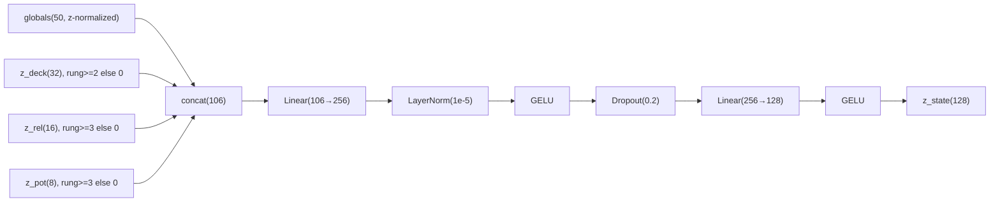

# OOC strategic net V4 — token-based run state (Phase A, round 5)

Last verified: 2026-08-09 against the current working tree (feature-leak audit:
8 genuine leaks removed; bossId confirmed legit; code corrected NGLOB=42;
corrected model trained and gated).

Status: **delivered and recorded** in EXPERIMENTS.md §75 (2026-08-02).
**Code correction** (2026-08-09): bossId re-added to the glob block;
NRAW=36, NGLOB=42, FUSIN=98.
**Corrected model** (NGLOB=42): `selfplay/models/ooc_strategic_tok_honest_v2.native`
(799KB, 40 epochs, val_pol_ce 0.488, policy_top1 0.793, q_top1 0.295).
192-seed gate (S2 fair @1k, margin 1.0): 15.6% win (baseline 21.1%) —
offline→online inversion persists; gate benefit collapsed.
**Honest model** (8 leaks removed, NGLOB=41, bossId incorrectly removed):
trained 2026-08-09, `selfplay/models/ooc_strategic_tok_honest.native`,
sha256 `fabbcb938a…`. 128-seed gate (S2 fair @1k): 22.7% (baseline 21.1%).
See decision log `2026-08-09-v4-feature-leak-audit.md`.
Implements plan items A1 (global token + explicit threshold features), A2
(counted deck tokens), A3 (relic/potion entity tokens), A4 (decision-context
encoding) from `docs/archive/ooc-action-plan-2026-08.md`. Held-out (60 epochs,
rung 4): policy top-1 0.793, val CE 0.486, Q top-1 0.290, Q MAE 16.2. Deployed
paired gate (128 seeds, fair): +3.1pp wins at margin 5.0 (CIs span zero),
floor/HP gains at every margin — **does not beat the V3 flat-vector net
(+7.0pp @ m1, §74), so V3 remains the deployed default and the V4 net is
opt-in behind `STS_OOC_STRATEGIC_TOK_NN`.** Sections 1–8 below are the
normative implementation contract.

## 1. Contract of record

This file is the interface the three tracks implement against:

- **Track A** — `train_strategic_tok.py` (trainer, new file)
- **Track B** — `export_strategic_tok.py` (exporter + parity, new file)
- **Track C** — `apps/ooc_strategic_tok_net.h` (native forward, new file) +
  `apps/one_combat.cpp` (token input builder + gate wiring, edits)

Python (trainer + exporter numpy reference) and C++ must agree bit-for-bit on
the forward math (float32, same op order as far as practical; parity asserts
allow logit < 1e-4, value/Q < 2e-4).

## 2. Inputs — identical in trainer and C++

All built from the existing `strategicgen2` CSV row schema
(`richHeader()` columns between `chosen` and `won`, one_combat.cpp:2792) and,
at inference, from `GameContext` with the same loops as `richRow()` (one_combat.cpp:2810).

### 2.1 Global scalar block — 50 values

The 44 existing state scalars in `richRow()` order:

```
ascension,act,floor,curHp,maxHp,gold,deckSize,potionChance,cardRarityFactor,
blueKey,greenKey,redKey,potionCount,potionCapacity,
bossId,nextEliteId,nextFight0,nextFight1,nextFight2,remElites,remFights,monOffset,eliteOffset,
pvShop,pvRest,pvEvent,pvElite,pvMonster,pvTreasure,
bottledAtkId,bottledSkillId,bottledPowId,
fmDElite,fmDRest,fmDShop,fmDBoss,fmCElite,fmCRest,fmCShop,fmCEvent,fmCMonster,fmCTreasure,
curMapX,curMapY
```

Plus **6 derived threshold features** (exact formulas, identical both sides):

| # | feature | formula |
|---|---------|---------|
| 45 | `hpFrac` | `curHp/maxHp` (0 if maxHp==0) |
| 46 | `missingHp` | `maxHp - curHp` |
| 47 | `freePotionSlot` | `potionCount < potionCapacity ? 1 : 0` |
| 48 | `goldGeRemoval` | `gold >= 75 ? 1 : 0` |
| 49 | `canTakeEliteKey` | `remElites > 0 && !(blueKey && greenKey && redKey) ? 1 : 0` |
| 50 | `bossNear` | `fmDBoss <= 3 ? 1 : 0` |

Thresholds are computed from RAW column values (trainer) / raw `GameContext`
(C++). The whole 50-block is z-normalized with train-row mean/inv (see §4),
computed the same way V3 does for its state block (train rows only).

### 2.2 Deck tokens — counted `(cardId, upgraded, count)`

From the rich `d[372]` (total counts) and `u[372]` (upgraded counts):
for each card id with `d[id] > 0`, up to two tokens:
`(id, upgraded=1, count=u[id])` and `(id, upgraded=0, count=d[id]-u[id])` if count > 0.

- Token feature vector (41 floats): `concat(E_card(id)[32], E_up(upgraded)[8], countF[1])`
  where `countF = min(count,9)/9.0`.
- Token encoder: `GELU(Linear41→32)` → **1-layer single-head self-attention
  (D=32)** over valid tokens only → `mean`-pool over valid tokens → `z_deck(32)`.
- Max 96 tokens; canonical order: ascending `cardId`; for each id the
  `upgraded=1` token first, then `upgraded=0` (matches the §2.2 enumeration;
  attention is order-sensitive only for float parity, so trainer and C++ MUST
  emit the same order — this order was fixed first in the C++ track).

### 2.3 Relic tokens — `(relicId, counter)`

From rich `r[181]` where `r[id] = 1 + (ri.data > 0 ? ri.data : 0)`:
one token per id with `r[id] > 0`.

- Token feature vector (17): `concat(E_rel(id)[16], dataF[1])` where
  `dataF = min(r[id]-1, 9)/9.0`.
- Encoder: `GELU(Linear17→16)`, **mean-pool over valid tokens** (no attention) → `z_rel(16)`.
- Max 64 tokens; canonical ascending `relicId`.

### 2.4 Potion tokens — `(potionId, count)`

From rich `pot[48]`: one token per id with `pot[id] > 0`.

- Token feature vector (9): `concat(E_pot(id)[8], countF[1])`, `countF = min(count,9)/9.0`.
- Encoder: `GELU(Linear9→8)`, **mean-pool over valid tokens** → `z_pot(8)`.
- Max 8 tokens; canonical ascending `potionId`.

### 2.5 Candidate entity embedding (decision context, A4)

Per legal action, derived from `screen` + `strategicCands()` (one_combat.cpp:4812):

| screen | actionType | entity |
|---|---|---|
| REWARDS | CARD | card `cand1` |
| REWARDS | RELIC | relic `cand1` |
| REWARDS | POTION | potion `cand1` |
| SHOP_ROOM | CARD | card `cand1` |
| SHOP_ROOM | RELIC | relic `cand1` |
| SHOP_ROOM | POTION | potion `cand1` |
| CARD_SELECT | any | card `cand1` |
| everything else | | none |

- `entity32(32)`: card → `E_card(cand1)`; relic → `concat(E_rel(cand1)[16], zeros[16])`;
  potion → `concat(E_pot(cand1)[8], zeros[24])`; none → zeros.
- `entityType(4)` one-hot in order `[none, card, relic, potion]`.
- `goldGePrice(1)`: `gold >= cand2 ? 1 : 0` on SHOP_ROOM rows (cand2 = price) and
  REWARDS/GOLD rows (cand1 = gold amount); else 0.
- Entity MLP: `Linear(37→32) -> GELU -> Linear(32→16)` → `e(16)`.

Note: `E_card/E_rel/E_pot` are the SAME tables as the deck/relic/potion tokens
(shared embeddings — the candidate-conditioning synergy of spec A.5.1).

## 3. Network (fixed topology, rung masks zero out inactive groups)

```
globals(50, z-normalized) ─┐
z_deck(32) [rung>=2 else 0] ├→ concat(106) → Linear(106→256) → LayerNorm(eps1e-5)
z_rel(16)  [rung>=3 else 0] │              → GELU → Dropout(0.2) → Linear(256→128) → GELU
z_pot(8)   [rung>=3 else 0] ┘              → z_state(128)
```



Action encoders (unchanged from V3, one new block):
- `bits`: 32 → Linear(32→32) → GELU → Dropout(0.2) → Linear(32→16) → `b(16)` (no final GELU)
- `cats`: 6×`Embedding(512,4)` + `Embedding(16,8)` (actionType) = 32 → Linear(32→32) → GELU → Linear(32→16) → `a(16)` (no final GELU)
- `screen`: `Embedding(16,8)` → `s8(8)`
- `entity` (new, §2.5): `e(16)`; **zeroed when rung < 4** (block is `[1,0,0,0]` type / zeros input AND output zeroed)

Heads on `z = concat(z_state(128), b(16), a(16), s8(8), e(16))` = **184**:
- policy: Linear(184→96) → GELU → Linear(96→1)
- Q:      Linear(184→96) → GELU → Linear(96→1)
- value: per-screen (screens 1..8) Linear(128→64) → GELU → Linear(64→1) on `z_state` only

GELU = tanh approximation (nn.GELU(approximate="tanh"); native tanh formula of
ooc_strategic_net.h:320). Dropout is eval-noop in export/C++.

### Rungs (training ablation ladder, env `STRAT_TOK_RUNG=1..4`)

| rung | groups active | purpose |
|---|---|---|
| 1 | globals+thresholds only | sanity; ~V3-level check |
| 2 | + deck tokens | A2 attribution |
| 3 | + relic + potion tokens | A3 attribution |
| 4 | + entity (A4) | full config |

Rungs 1–3 keep inactive-group pooled outputs and the entity output at exactly
zero (no gradient through them). All rungs share the same topology and losses.

## 4. Training contract (train_strategic_tok.py)

- Dataset: `build/strategic_tierb.csv` (3,057,708 rows / 4,650 seeds, 6.5 GB).
- Grouped 80/20 split by `(seed,decIdx)` (seed 0), same as train_strategic.py.
- Loss: group-CE on `chosen` + `0.5 ·` per-screen value-MSE on chosen rows
  (target `10·won+endHp`) + `STRAT_QLAMBDA(=1.0) ·` Q-MSE on labeled rows
  (target `10·labelWon+labelHp`). Identical to V3 (train_strategic.py:238-288).
- Metrics (identical names to V3): policy_top1, margin, val_pol_ce, value_mae,
  value_mae_screen, q_top1, q_mae, q_mae_screen, q_rmse, q_n.
- Best checkpoint by val_pol_ce. Defaults: epochs 40 (ladder), batch 4096,
  lr 2e-3, clip 1.0, AdamW 2e-4, CUDA default (`device: cuda` print required).
- Early stopping (opt-in, default off): `STRAT_PATIENCE=N` stops after N
  consecutive epochs without a `val_pol_ce` improvement of at least
  `STRAT_MIN_DELTA` (default 1e-4); the best-epoch checkpoint is still saved.
  Pairs with `STRAT_EPOCHS` as the hard ceiling (e.g. 500).
- Best-epoch selection metric (opt-in): `STRAT_SELECT_METRIC=q_top1` selects
  the best checkpoint by Q-head top-1 (maximize) instead of `val_pol_ce`
  (minimize, default). §139: +1.7pp q_top1 at ~−0.3pp policy_top1 on the
  partial 373k-row data (60 epochs).
- Pairwise labelWon ranking term (opt-in, default off): `STRAT_RANK_LAMBDA>0`
  adds `RANK_LAMBDA · mean(relu(RANK_MARGIN − (q_i − q_j)))` over same-group
  labeled pairs with differing labelWon (`RANK_MARGIN` default 1.0,
  `RANK_MAX_PAIRS` default 16 per group per batch). §139: flat at λ=0.1 on
  the partial data (q_top1 +0.1pp).
- Memory: write a group-ordered float16 mmap `OUT_tok_state.bin` of the 482 raw
  columns per row `[glob 44, thr 6, deck 96×3, rel 64×2, pot 8×2]` (chunked CSV
  read, like train_strategic.py:140-179). Global mean/inv from train rows over
  the 50-global block only. Count/data features already scaled 0..1; ids
  embedded.
- Trainer also loads raw `gold,curHp,maxHp,potionCount,potionCapacity,blueKey,
  greenKey,redKey,remElites,fmDBoss` from the CSV (small extra usecols) to
  compute thresholds and `goldGePrice`.
- Checkpoint `OUT.pt` = `{"state_dict", "mean"(50), "inv"(50), "metrics", "rung", "nrows"}`;
  metrics JSON `OUT_metrics.json`.
- Artifacts: `selfplay/models/ooc_strategic_tok{,_rungN}.pt`, `_state.bin` per rung.

## 5. Export format `OOC_STRAT_V4` (binary, row-major float32)

Magic `OOC_STRAT_V4` (12 bytes) then `int32[17]` dims:
`{nGlob=50, nhidden=256, nhidden2=128, nbits=32, deckDim=32, relDim=16, potDim=8,
 maxDeck=96, maxRel=64, maxPot=8, deckTokIn=41, relTokIn=17, potTokIn=9,
 entIn=37, entHid=32, entOut=16, polIn=184}` then blocks in this exact order:

```
globMean[50], globInv[50],
E_card[372×32], E_up[2×8],
deckTokW[32×41], deckTokB[32],
deckQkvW[96×32], deckQkvB[96], deckProjW[32×32], deckProjB[32], deckLnW[32], deckLnB[32],
E_rel[181×16], relTokW[16×17], relTokB[16],
E_pot[48×8],  potTokW[8×9],   potTokB[8],
f0w[256×106], f0b[256], lnW[256], lnB[256], f4w[128×256], f4b[128],
a0w[32×32], a0b[32], a3w[16×32], a3b[16],
cat0w[32×32], cat0b[32], cat3w[16×32], cat3b[16],
catsW[6×512×4], atypeW[16×8], screenW[16×8],
ent0w[32×37], ent0b[32], ent3w[16×32], ent3b[16],
pol0w[96×184], pol0b[96], pol2w[96], pol2b,
vals: 8 × (v0w[64×128], v0b[64], v2w[64], v2b),
q0w[96×184], q0b[96], q2w[96], q2b
```

Loader validates magic, dims, then full-reads each block (ooc_strategic_net.h:55
pattern). Export includes the 32-sample numpy-vs-PyTorch parity check
(export_strategic.py:132-155 pattern) with random token arrays; also export a
self-test path that constructs a random checkpoint from a torch model instance
so the exporter can be tested without Track A's output.

### Forward math (must match in numpy exporter, torch, and C++)

Deck attention (1 head, D=32), over the nDk valid tokens only:
```
qkv = tok @ qkvW^T + qkvB            # [n,96]
scores[i,j] = sum_d q[i,d]*k[j,d] / sqrt(32)
a[i,j] = softmax_j(scores)           # over valid j only
attn_out[i] = sum_j a[i,j]*v[j]
out = LayerNorm(tok + attn_out @ projW^T + projB, eps=1e-5)
z_deck = mean_i out[i]
```
Zero tokens never participate (trainer masks invalid; C++ loops valid).

## 6. C++ integration (Track C, one_combat.cpp edits)

- New file `apps/ooc_strategic_tok_net.h`: `struct OocStrategicTokNet` with
  `load`, `predictValue(state50, screen)`, `predictActionValue(glob50, nDk, dk[96][3], nRl, rl[64][2], nPt, pt[8][2], actionBits, cats[6], actionType, screen, entityType, entityId, goldGePrice)`. Global `g_oocStrategicTokNet`.
- Token builder in one_combat.cpp from `GameContext` (mirror `richRow` loops):
  `struct TokState { float glob[50]; int nDk, nRl, nPt; int dk[96][3]; int rl[64][2]; int pt[8][2]; }`
  built once per decision, reused across actions of that decision.
- Env: `STS_OOC_STRATEGIC_TOK_NN=<path>` loads the V4 net. When loaded, the
  four gates (`oocOnePlyCardRewardPolicy`, `oocOnePlyRestPolicy`,
  `oocOnePlyUpgradeSelectPolicy`, `oocOnePlyEventPolicy`) score with the tok net
  (same margin gate `STS_OOC_STRATEGIC_MARGIN`); V3 (`STS_OOC_STRATEGIC_NN`)
  remains fallback. `STS_OOC_STRATEGIC_Q` no longer applies to the tok path.
- Smoke: `./build/test`, 8 seeds with `STS_OOC_STRATEGIC_TOK_NN` + REST/EVENT=1
  differ from flags-off, gates fire, no crash; `runtrace` sanity.

## 7. Evaluation protocol

- Held-out ladder (Step 2): rungs 1→4, same budget, pick winner by policy top-1
  then q_top1/q_mae (per-screen MAE diagnostic).
- Paired benchmark (Step 3): winner at STRAT_EPOCHS=60, export, then
  `STS_FAIR=1 ./build/one_combat bestbench 1000 128 0 126700` (12 threads) with
  `STS_OOC_STRATEGIC_TOK_NN=<winner> STS_OOC_STRATEGIC_REST=1
  STS_OOC_STRATEGIC_EVENT=1 STS_OOC_STRATEGIC_MARGIN=0.5/1.0/5.0` vs the
  bit-identical baseline `build/tierb_gate_base.csv` (21.1% / 37.5 / 8.6);
  reference arm = EXPERIMENTS.md §74 V3 numbers (36/128 @ m1). Paired metrics
  via `paired_analysis.py`; record as EXPERIMENTS.md §75.

## 8. Scope guards

- No datagen changes; no new C++ datagen modes; V3 untouched and still the
  default. No map-graph encoder (Phase B). No transformer beyond the single
  deck attention layer (Phase B). Event-option costs are NOT in the data, so no
  event-cost threshold (documented limitation).
- Docs updated in the same change: `docs/knowledge-base/architecture/out-of-combat.md`,
  decision log entry `2026-08-02-phase5-round5-token-state-v4.md`, EXPERIMENTS.md §75.
