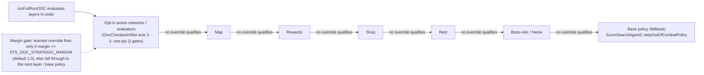

# Out-of-combat policy

Last verified: 2026-09-20 for semantic MCTS, source-prior projection and sampled noncombat outcomes; 2026-09-15 for qualified V2 combat support; 2026-09-14 for opt-in MCTS controls and continuation-limit accounting; 2026-09-10 against the current working tree (semantic OOC
decision coverage and reward continuation).
Previously verified 2026-08-09 (key collection
gated behind STS_COLLECT_KEYS=1, default off; BEST banner includes keys=collect/skip).
Previously verified 2026-08-09 (Act-4 key collection added to every REWARDS handler
and act-3+ rest rooms, now opt-in via the flag).
Previously verified 2026-08-05 (checkpoint-oracle terminal win-GBM +
margin-gate levers added and falsified §111; Wave B regret gate + Q_win
truth-check mode + map-DAG encoder (V6) + Phase F soft-target policy objective
and policy-score gate env added; Phase F falsified §104, label-noise wave §105
null — learned one-ply label line closed).

## Purpose

Describe run-level state/actions, the ordered policy stack used by `bestbench`,
and the boundary between default native inference and opt-in strategic
experiments.

## Current implementation

### Synchronous OOC MCTS substrate

Last verified: 2026-09-14 for search-local preparation, metadata, and exact root shortcuts.

`OocMctsPlanner` is a synchronous generic search core over opaque state
and action IDs. `OocGenerativeModel` supplies complete actions/priors, actual
successor samples, terminal values and injected leaf values in [0,1]. Distinct
decision nodes use PUCT; chance nodes retain independent equal-weight outcome
particles (including duplicate IDs) and reuse stochastic particles uniformly,
never by value. Providers may explicitly mark a transition deterministic; after
its first sample the core reuses that single child instead of widening it. Action Q is the Monte Carlo mean of sampled trajectory values.

Depth counts action transitions (root zero); exact terminals precede model-defined
leaf boundaries, which precede the depth horizon,
and newly expanded downstream nonterminal leaves use the injected evaluator.
The root expands and selects an action in the first simulation. Chance visit N
uses `max(1, ceil(k*N^alpha))` with prospective N starting at one. Defaults are
`cPuct=1.5`, `k=2`, `alpha=0.5`, depth 32. Priors normalize with uniform zero-mass
fallback. Before PUCT, every legal action receives one visit, choosing the
highest-prior unvisited action and then ascending ID. Zero individual priors
cannot suppress actions; cPuct=0 visits all actions once, then exploits Q.
PUCT ties use ascending action ID; final choice uses visits, then Q, then
ID. Each search resets its tree and seeded RNG; providers must preserve IDs and
reset any mutable sampling state for exact replay.

Particles occupy a search-local `deque<DecisionNode>` arena with stable references,
so generating each particle does not require a separate heap allocation. PUCT
computes the parent square root once per selection without changing the numeric
formula or ties. Prospective widening limits use the original formula, cached
through the budget up to 1,048,576 visits; larger visits evaluate it on demand.

For visit-selected roots, a leader locks when its visit count is strictly
greater than every challenger's count plus the remaining budget. Mean-Q
selection never uses this shortcut. Generic planner configuration requires
`model.searchGuaranteedNonAborting()` by default. Explicit
`allowUnqualifiedRootStop=true` permits stopping without that guarantee.
Live OOC MCTS enables this policy by default; `STS_OOC_MCTS_EARLY_STOP=0`
restores the guarantee requirement. A singleton locks after its first completed
simulation for direct planner callers; the live adapter bypasses a validated
singleton root before search.

This is an intentional fallback-policy tradeoff: a later support or continuation
abort would invalidate the full-budget winner, but early stopping can skip that
abort and execute the locked action. `OocGameContextModel` still returns false
for the guarantee; Smoke support and other abort paths are unchanged. Observed
zero aborts do not qualify that contract. Metrics count locked-root stops and
saved simulations separately. See [ADR-0014](../../../decisions/0014-live-ooc-visit-lock-stopping.md).

`OocMctsConfig::observeRootLock` is an opt-in diagnostic that suppresses both
locked-root stopping and the sole-root bypass.

`STS_OOC_MCTS_CHECKPOINT_TRACE=<fresh.jsonl>` instead preserves the live policy
and runs a separate discarded full-budget shadow search from the same root,
history, models and search seed. It requires 2048 visit selection and rejects
combination with the live root-lock observer. It records all action IDs, priors,
visits and Q after 128/256/512/1024/2048 completed shadow simulations, plus
live and shadow action/abort/completed-budget status. Late shadow aborts do not
change the live action. Existing live MCTS CPU and counters exclude the shadow;
process runtime includes it and is not a deployment performance benchmark.
The generic `rootCheckpointSimulations` option only records reached positive,
strictly increasing thresholds; it never disables early stopping itself.
Offline analysis uses visits/Q/ascending-ID tie-breaking, separates singleton
roots and aborts, and reports additional savings against existing live stopping
as well as nominal 2048. Checkpoint stability means stability only at observed
checkpoints, not at every intervening simulation. No rule is deployed by this
diagnostic. `tools/analyze_ooc_root_checkpoints.py` implements the offline report.

The root-lock observer suppresses
locked-root stopping and the sole-root bypass. It records the first
strict visit lock (including a zero-remaining-budget lock), its action and
remaining simulation budget, and wall time from that completed simulation to
search completion/abort. No extra sampling draws are consumed. Mean-Q roots
have no visit-lock observation. Live `STS_OOC_MCTS_ROOT_LOCK_TRACE=<fresh.jsonl>`
enables it and writes one JSON record per searched root with seed/decision,
budget/completed/attempted simulations, lock/action/tail time, full-budget status,
abort reason, final action and the non-aborting guarantee. Existing run CSV
columns and actual early-stop/saved-simulation counters retain their semantics.
Only completed full-budget roots contribute conditional opportunity estimates;
locked roots that later abort remain invalid and must be reported separately.
Even zero observed aborts or matching locked/final actions cannot prove the
provider guarantee. The Smoke-excluded V2 artifact and remaining continuation
abort paths do not qualify the provider guarantee; live stopping uses the explicit
unqualified policy instead.

The focused `ooc_mcts` CTest verifies toy stochastic MDPs and malformed inputs.
`apps/one_combat/ooc_mcts_adapter.{h,cpp}` supplies the
`OocGameContextModel` integration through explicit `one_combat oocmctsselftest`
and the guarded `ooc_mcts_adapter` CTest. The adapter requires loaded native
V4 and win models. `OocStrategicTokNet::predictPolicyLogit` shares the 184-wide
state/action representation with Q, then applies `pol.0 -> GELU -> pol.2`.
Finite logits supply weights `exp((logit - max_logit) / 1.0)`; the core
normalizes them. Q remains unchanged in the live one-ply gates.

Each immutable stored `OocStateId` lazily owns candidate/boundary/uniqueness
metadata and, when needed, policy logits and raw planner priors. The same
candidate ordering and token construction feed the same policy inference.
V4 `prepareState` evaluates deck attention, relic/potion pooling, and state
fusion once per immutable candidate set. Its value-owned 128-float representation
is reused for each action's unchanged entity/action encoding and policy or Q
head. The MCTS prior and the eight token Q-gate loops use this path, including
leaf continuation and ordinary live fallback. Each loop rebuilds after state or
path changes; no cache survives the loop or model reload. Candidate ordering,
Q margins/ties, fallback dispatch and RNG consumption are unchanged. Legacy
single-action inference entry points remain available.
Subsequent queries for the same immutable state reuse cached logits/priors.
A prepared native combat transition computes support and encodings for one
fixed precombat input; each draw retains the native conditional heads and RNG
sequence. Live sampled noncombat successors prepare their own combat input:
encounter, persistent state and RNG can differ between samples of one edge.
Preparations never cross these sampled successors. Exact copied-state offline
fixtures retain the original edge cache for parity checks. No mutable
process-wide cache exists; maps remain detached from the live run.

The adapter owns complete semantic sibling sets from
`enumerateOocSemanticPrimitiveBindings` on rewards, shop, campfire, events,
treasure, boss relics and already-open supported selectors. Unsupported,
incomplete or empty enumeration is a leaf/fallback boundary; it never narrows
the tree to primitive V4 candidates. BATTLE remains a boundary and exact run
loss/victory retain precedence. MAP alone keeps its existing primitive V4
candidate contract (including missing-map and row-14 boundaries).

V4 remains a primitive-trained source-level prior. When the state's unique
semantic source primitives exactly match the complete, duplicate-free V4
candidate set, each source is scored once with the existing policy head and
temperature. Its raw prior weight is divided equally among its semantic children.
For duplicate physical UPGRADE positions, coverage still checks the full
physical set; their logits are averaged within each retained semantic card
class before applying temperature, so extra copies do not increase its prior.
One-to-one actions retain the original prior. Unqualified source coverage,
including REMOVE/TRANSFORM selector roots, yields uniform priors across the
entire sibling set; explicit `STS_OOC_MCTS_PRIOR=uniform` does the same.
Compound target preference is searched, not learned by V4. This adoption does
not imply semantic V4 training or change its artifact/schema.

Root construction requires an explicit `PathHistory`: prior room visits are not
recoverable from `GameContext` and feed both V4 globals and native win features.
The nonempty-history regression verifies both routes against direct evaluation
using the supplied history. Snapshots live in a deque, with detached map copies at root and each native
semantic or primitive successor and branch-local updated `PathHistory`.
Semantic action IDs are state-local ordinals bound to immutable candidates,
which retain canonical semantic keys, source primitives and typed actions. MAP
IDs remain primitive bits. Successors execute transactionally through
`executeOocSemanticAction`; an enumeration/execution disagreement aborts the
whole root without trusting partial visits/Q. Leaves call the native-only
`vStateWinNative` seam: unavailable models or nonfinite/out-of-range values
throw, with no server fallback and no clamping. Leaf feature evaluation
scopes the stored path history and restores the caller's history.

`OocGameContextModel` accepts an optional shared `CombatTransitionSampler`.
The default adapter options retain the offline scaffold contract described here;
opt-in live selection uses the corrected checkpoint contract below.
After the semantic action (or primitive MAP action) and prebattle history update, it captures
`combat_predictor_input_v1` before battle initialization, using the current
`potionKeepValue`. Unsupported states retain the existing BATTLE leaf and native
win-value seam. Death sets PLAYER_LOSS without continuation. Victory applies a
RAW persistent result and calls `regainControl()` once, then updates history
like the live run loop. A resulting second BATTLE remains a leaf. No sampler
preserves the original successor behavior.

`NativeCombatTransitionSampler(path)` is explicit opt-in; its constructor throws
if the requested artifact is absent or incompatible. The versioned
`COMBAT_TRANSITION_RUNTIME_V1` binary contains six frozen source identities,
normalization buffers, class/vocabulary domains and FP32 tensors in lexical
name order. `tools/export_combat_transition_runtime.py` verifies all six source
hashes before deserialization and creates its output exclusively. Four separate
Attention encoders share one native implementation; the signed-HP encoding also
feeds the relic decoder. Learned draws use only the supplied planner RNG.
The support gate retains the qualified precombat envelope and consumption-only
potion closure (explicit Alchemize and Entropic Brew excluded; off-color alone
is allowed, as documented in the [source audit](../behavior/combat-potion-generation.md)),
rejects active unqualified Lizard Tail, and excludes Inserter
because its carrier state has no qualification corpus tokens. One residue per
turn/attack/card/shuffle group reconstructs all related counters. Potion RNG
copies through; misc RNG replays the exact bounded initialization calls,
including rejection, as in #171. The four other battle streams copy through
until native reinitialization. Real artifacts and captured-state parity/smoke
results remain external. The [native adapter evidence](../../experiments/evidence/native_combat_adapter_2026-09-14.md)
qualifies this combat boundary at 1e-4 probability tolerance; it does not qualify
the full planner. `combat_transition_runtime_probe` and
`tools/qualify_combat_transition_runtime.py` perform offline CPU FP32 parity at
fixed max absolute probability tolerance 1e-4; they do not drive gameplay seeds.

The qualified `COMBAT_TRANSITION_RUNTIME_V2` artifact is tracked at `selfplay/models/combat_transition_near_full_except_smoke_v2.native`. Its default survival component is the targeted attention-HPO winner; maxHP, HP, potion and downstream heads remain the frozen near-full checkpoints. Selected component identities, passing qualification and ordered all/TEST cohort hashes are enforced by export/load guards. V2 retains the legacy envelope while supporting shared gold, Writhing, Ritual and Brew trajectories; it excludes initially held Smoke, pre-existing `smokeBombUsed`, and Writhing with Ritual Dagger. Executed support is exactly 505,935/510,030 overall and 51,036/51,441 TEST. V1 behavior above remains unchanged when a V1 artifact is selected.

V2 Brew draws a full-width planner-owned hypothetical native potion RNG on first use, reuses it recursively and retains its advanced RAW state. Unused Brew copies historical potion RNG; other streams follow the existing replay/copy contract. Explicit `ESCAPE` requires matching RAW `smokeBombUsed`, rejects boss escape and uses native `regainControl()` without victory rewards. Generated Smoke/ESCAPE remains possible in a supported Brew trajectory. The probe and `tools/qualify_combat_transition_near_full.py` verify CPU FP32 probabilities, complete RAW sampled states, planner-stream advancement and scalar/prepared parity; unsupported states consume no planner draws. All final slice gates and hard-validity checks pass as reused development evidence in the [final report](../../experiments/evidence/near_full_combat_support_2026-09-14/REPORT.md). V2 uses the same explicit model path; no default MCTS enablement is implied.

The opt-in experimental width-64 strong-WD survival alternative is exported by
`tools/export_combat_transition_survival_deepset.py`. It verifies the exact #217
checkpoint and tracked Attention control, replaces only survival tensors, and
adds `experimentalSurvival` with `qualified:false`. The V2 loader validates its
fixed identity and DeepSets tensor graph; all other components, support rules,
and defaults remain unchanged. Selection uses the existing explicit combat-model
path, not a new default. Retained control qualification metadata does not qualify
the replacement. The non-TEST checker is
`tools/check_combat_transition_survival_deepset.py`; its
[Stage-A evidence](../../experiments/evidence/deepset_survival_online_stage_a_2026-09-17/README.md)
is implementation evidence only. The independently reviewed
[Stage-B speed screen](../../experiments/evidence/deepset_survival_online_stage_b_2026-09-18/README.md)
stopped below the 10% end-to-end CPU improvement threshold; the gameplay-quality
gate did not run. The alternative remains experimental, not a promoted default.

Copied native RNG streams still govern other stochastic OOC transitions. This
adapter resolves the combat boundary only and remains **not a fair stochastic
environment model** or a scientifically qualified full OOC planner.

### Opt-in live OOC MCTS selection

`STS_OOC_MCTS=1` intercepts each nonbattle decision immediately before the
existing `runFullRunOocPolicyStep` chain in `runFullRunOOC`. Startup requires
loaded native V4 policy and native win models plus a compatible
`STS_OOC_MCTS_COMBAT_MODEL`; explicit artifact failures are fatal. Startup also
requires the effective Silver reuse cap to be 32,768; the experimental 131,072
override is rejected. Real combat requires ordinary exact-10k Silver, allocated
reuse, and adaptive-off, preserving the frozen teacher cap contract. The default
is OFF and does not load a combat artifact or run MCTS. Both arms retain the
same normal real combat branch and the same fallback OOC policy chain.

`selectOocMctsAction` constructs detached snapshots and uses the existing PUCT,
progressive widening and depth defaults with `STS_OOC_MCTS_SIMS` (default 512).
For a native simulator graph, set `STS_OOC_MCTS_GRAPH_FILE` to a fresh JSON path
and `STS_OOC_MCTS_GRAPH_DECISION_INDEX` to the zero-based nonbattle decision
index (default 1). The selected search captures up to 4,096 tree nodes after
search, labels them from the native `GameContext` and model action keys,
and writes seed, search seed, root state, candidates, selected action, and
truncation status. Captured game actions carry human-readable map destinations
or semantic reward choices; state summaries carry floor, room, screen, map
position, HP, and gold. Particle edges mark each combat transition sampled by
the CTM with its encounter and sampled outcome. CTM work inside leaf evaluation
does not create a retained edge. Render with `tools/render_ooc_mcts.py --snapshot JSON
--output HTML`. This is an opt-in diagnostic of the ordinary simulator search;
the graph's loss nodes are sampled terminal outcomes, not independently played
games, and their stored HP can retain its precombat value.
Its search seed is `SplitMix64(runSeed XOR SplitMix64(decisionIndex))`, using
explicit unsigned 64-bit arithmetic. The index increments once per actual
nonbattle run-loop decision, including unsupported roots. It consumes no
simulator RNG. Terminal/boundary roots and whole-root support aborts return no
action; completed supported searches must return a legal adapter candidate ID.
A root with one valid, unique semantic candidate returns that current action
without constructing a tree, even though `OocGameContextModel` cannot guarantee
hypothetical continuation support. A later unsupported real decision is handled
at that later root. The bypass reports `trivialRootBypasses` with zero
simulations, attempts, transitions, leaf evaluations, or combat draws. Explicit
root-lock observation and root checkpoints still request search. Roots with
multiple candidates retain whole-root search and abort/fallback behavior.
Snapshots are discarded before
`oocMctsPolicyStep` resolves the retained canonical key against fresh complete
semantic candidates, requires exactly one match, and executes transactionally.
Stale/missing/ambiguous identities execute nothing. An active live action
observer causes fallback before mutation; it is never silently disabled. MAP
continues to resolve fresh primitive bits. If it enters BATTLE, real combat remains pending for the
ordinary next run-loop iteration. No sampled combat result transfers to live
state.

Live leaves never apply `v_win` to unresolved rewards, shops, events, selectors
or battles: rich win features omit those pending contents. `evaluateLeaf` deep
copies the node and applies the existing ordered OOC policy chain until a map
checkpoint or exact terminal, capped at 256 continuation steps by default.
Unresolved exhaustion aborts the whole root to V4 with a dedicated continuation
reason, never a fabricated scalar value. Optional additional-combat horizons use
a 1024-step cap. This is a V4/policy-chain continuation estimate, not a
learned screen-aware value. Branch history, action/combat observers, policy
trace bookkeeping, Silver diagnostics and potion pricing are scoped and restored.
Corpus capture is incompatible with live MCTS.

Supported imagined battles use the frozen surrogate. If the precombat gate or
sample returns unsupported, `OocSearchUnsupported` aborts the **entire root's
search**. Partial Q/visits are discarded and no action is selected; the live
run loop uses its unchanged V4/OOC policy chain for that decision. Unsupported
states receive neither a generic precombat value nor an invented scalar penalty.
Their reason and all completed/attempted search work are retained in diagnostics.
A thread-local guard forbids native combat playout during OOC imagination,
including optional leaf-policy counterfactuals: these also abort the root.
There are no imagined Silver battles. Supported death is exact zero; victory
carries sampled persistent costs and native rewards. Leaf projection resolves
chained supported battles; the stop-after-act boss is an exact win horizon.

Live MCTS requires real ordinary Silver at exactly10,000 simulations, allocated
reuse and no adaptive escalation; per-room budget changes fail. The corpus teacher
was `silver-ordinary-fair-exact10k-combat-transition-runtime16-f0bbd77`; this aligns
actual policy configuration/budget, not teacher/model accuracy. Live noncombat
transitions use planner-owned sampled futures. Fail-closed root fallback may reduce MCTS
ownership substantially, and low ownership is evidence about support, not policy
improvement. The leaf fallback uses the standard bestbench chain options
`restV=false, shopV=true`; other driver configurations are not qualified here.

Live MCTS calls `sampleNoncombatFuture` on a detached copy before every searched
transition and during leaf continuation. It replaces native RNG states using
full-width planner draws while preserving historical counters, and replaces
the hypothetical run seed so native per-floor resets and next-act generation
cannot recover the live future. It shuffles remaining relic/colorless pools,
resamples unseen normal/elite queues with native weights and history rules,
and samples the hidden second Act-3 boss, chest contents and Dead Adventurer's
unsearched reward order. Current map/boss, chest size, public event options,
shop/reward offers, selector targets and completed picks remain fixed.

This covers transform streams (card/misc/Neow), random event effects, Library,
Pandora's Box and other random relic effects, chest/dig rewards, Courier
restocks, room generation and post-combat rewards. Semantic identity remains
the chosen operation/target, never its sampled outcome. Only the fresh semantic
action is executed live, using the live game's own RNG.

The live advisor additionally sets `stopAtMapCheckpoint`: every downstream MAP
state is a true planner leaf, including after the first visit. This prevents a
revisited MAP particle from sampling a room with unreconstructed
event/shop/treasure chance history. Live imports remove currently visible shop,
combat-reward and boss-relic offers from the reconstructed relic pools.
Pity-sensitive event branches whose reward generation depends on private
counter history remain unsupported, including Library, Mushrooms and
Mysterious Sphere. The live v_win leaf evaluates the exact discrete mixture
`E[sigmoid(margin)]` over the native reachable ranges
(`potionChance=-40..100` in steps of 10 and `cardRarityFactor=-40..5`) rather
than applying the link to an expected margin or conditioning on 0/5. The
direct V4 scoring fails closed for real live captures because Java does not
expose an exact pity history. Live MCTS uses an equal public prior instead of a
fabricated midpoint; synthetic parity fixtures may explicitly mark an exact
pity reconstruction. Hypothetical room-chance and pity counters are sampled
from explicit reachable-state priors before a transition; this is a qualified
belief particle, not an exact joint posterior.

Live edges are never marked deterministic merely because their simulator copy
has fixed RNG. Progressive widening samples outcome particles normally, even
when a particular action has a deterministic public effect. Native leaf
features receive sampled hidden queues rather than the real future queue.
`OocAdapterOptions::sampleNoncombat=false` retains exact replay solely for the
offline/native parity seam; live startup always enables sampling and reports
`noncombatOutcomes=sampled`. There is no live known-RNG override.

The live root conditions that sampled support on public metric history before
search: current-act normal/elite consumption from completed combat floors,
acquired or lost relics, observed events, and paid shop removals. A `?` floor
that became a hallway combat is counted from `metricData.damage_taken`, not from
the retained map symbol. Private Java potion/card-rarity counters are not
copied. Historical relic offers that were seen and skipped are not present in
vanilla metrics; the live root therefore fails closed for treasure, Shovel,
Courier-restock, and random-relic event branches unless a complete
`seenRelics` history is supplied.
Live MAP roots are searchable with the explicit room-chance belief prior.
Non-root MAP states remain hard checkpoint leaves, so a search never chooses a
hypothetical room after reaching the checkpoint.

Default PUCT/widening remain `1.5`, `2`, `0.5`, with 512 simulations. Depth counts
searched semantic transitions (primitive transitions on MAP), excluding
policy-chain steps used only to project leaves. Sampling removes the concrete
future-stream leak; it is not a proof of an exact joint hidden-state posterior,
a belief-tree policy, or stronger gameplay quality. Remaining-pool membership
and historical counters are conditioned on native state; chance particles and
leaf policies are still the existing planner approximation. Live checkpoint
continuation preserves the simulator's reward-collection order and uses the
same V4 Q/margin contract for actions it can qualify. The standalone live
advisor cannot call `runFullRunOocPolicyStep(gc, agent, false, true)` directly
because that driver is coupled to simulator-global heuristic fallback
objects. The live continuation now shares the fixed free-reward prefix and
uses the simulator `ScumSearchAgent2` fallback when the V4 margin gate does
not fire; it never substitutes an ungated policy-logit argmax. Full
simulator/live checkpoint parity remains an explicit seam to extract before
claiming complete policy equivalence.

The following `STS_OOC_MCTS_` suffixes configure ON searches. Invalid finite
ranges/enums fail startup; OFF does not parse or apply search overrides. Native
V4 must load for every ON ablation. Boss mode removes `v_win` from leaf
evaluation only; the unchanged fallback policy chain may still load/use it.
Startup emits exact applied
settings in `[ooc-mcts-config]` JSON for artifact validation.

| Suffix | Default | Allowed setting / meaning |
|---|---|---|
| `SIMS` |512|positive integer, fixed completed draws per owned root|
| `PRIOR` |policy|`policy` or `uniform`; all candidates retained|
| `TEMPERATURE` |1|finite positive policy-logit temperature|
| `CPUCT` |1.5|finite nonnegative PUCT exploration multiplier|
| `WIDEN_K` |2|finite positive chance-particle width coefficient|
| `WIDEN_ALPHA` |0.5|finite exponent strictly between0 and1|
| `MAX_DEPTH` |32|integer1..32 searched action transitions|
| `ROOT_SELECTION` |visits|`visits` or `q`; Q selects only visited actions, ties by visits|
| `LEAF_VALUE` |native|`native`; `constant`0.5; or `boss`, the mean across all ten Act1--4 bosses of `0.75*survival + 0.25*survival*winningHpFraction` from the configured combat evaluator|
| `LEAF_COMBATS` |0|0,1,3 additional surrogate combats before resolved checkpoint|
| `LEAF_POLICY` |v4|`v4` or `uniform` among unique supported legal V4 candidates|

Exact terminal0/1 overrides either leaf value. Uniform continuation retains V4
for unsupported/nonunique selectors; all transitions keep the same combat
support gate and native-simulation prohibition. Chance widening caps particles
with `ceil(k*N^alpha)`; action candidates are fully expanded, so this substrate
is not double progressive widening. Root-Q selection changes only the final
choice, not tree allocation. Leaf projection steps do not count toward tree
`MAX_DEPTH`. None of these knobs changes real Silver's budget or parameters.
The boss leaf is evaluated through one shared helper from both ordinary
`leafValue()` and the live resolved-checkpoint branch. It uses no planner or
gameplay RNG, never calls `v_win`, and fails the simulation/root closed if any
boss is outside combat-evaluator support. Each probe preserves the leaf's player
state but uses that encounter's canonical act and boss floor.

The existing trace also writes `.actions.jsonl` decision records with selected
canonical keys, planner IDs, screen/selector, compound status and execution or
fallback reason. Root-lock and checkpoint diagnostics include canonical keys.
Sampled hidden noncombat outcomes are covered by focused independence and
variation tests; this does not establish policy quality or full belief-model qualification.

Optional `STS_OOC_MCTS_TRACE` appends one CSV row per completed run, including
OFF runs when explicitly requested.

`STS_OOC_CPU_PROFILE=1` separately emits `[ooc-cpu-profile]` JSON to stderr at
the full-run trace boundary. Defaults remain off. Thread-local CPU scopes
record calls, inclusive CPU and exclusive CPU after subtracting timed children;
do not sum inclusive buckets. They cover real combat, MCTS, prior preparation
and predictions, V4 state/Q inference inside active scopes, native leaf value,
projection, successors, CTM preparation/resolution and metadata. Native leaf
timing includes feature construction; projection excludes timed child networks.
Counters reset at each report. `processCpuAtReportSec` is cumulative process CPU,
not per-seed CPU in a multi-seed process; use external process CPU timing for
one-seed invocations. These are attribution diagnostics, not production timings.
See the [two historical-seed profile](../../experiments/evidence/ooc_cpu_profile_2026-09-18/README.md)
for scope details, workload reconciliation and measured overhead limitations.

The CSV trace records
decision/ownership/fallback
counts, simulations, all sampled action transitions, combat-surrogate calls,
leaf evaluations, maximum search depth, search wall/thread CPU seconds and
ordinary real combat count. It also records imagined combat totals, unsupported
root support-abort counts and discarded completed simulations, total simulation
attempts, pending/battle/map leaf counts, projection steps,
particle creation/revisits, deterministic revisits and summed searched depth.
Appending to a trace with an incompatible header fails; use a fresh path when
changing trace schema. Historical readers default absent shortcut columns to zero.
Additional columns count trivial-root bypasses, locked-root stops, saved
simulations, immutable metadata/prior builds, prepared searched combat edges,
and searched combat-edge sampling attempts. `preparedCombats` includes supported
and unsupported preparations; `combatEdgeSamples` excludes combat samples made
only in leaf continuation. Native supported preparations run four encoders,
while unsupported preparations run none.
A `.support.jsonl` companion reconciles actual unsupported-combat reasons per
seed, plus separate `continuation_reasons`/`continuation_limit_aborts`. CSV
`continuationLimitAborts` counts unresolved continuation bounds, not combat calls.
`mctsSupportAborts=unsupportedCombats+continuationLimitAborts`, while
`imaginedCombats=combatSurrogateSamples+unsupportedCombats`.
OFF ownership/fallback/search counts are zero;
the decision count still covers actual nonbattle iterations. For ON, `simulations=configuredBudget*(owned-trivialRootBypasses)+discardedSimulations-savedSimulations` and
`simulationAttempts=simulations+mctsSupportAborts`. Search timing
includes adapter construction/destruction and unsupported-root checks, and
excludes execution of the selected live primitive. The `bestbench` `sec` field
is per-run steady-clock elapsed time, so wall time is the matching denominator.
Focused adapter tests cover search isolation, indexed determinism, exact live
primitive execution, pending real combat and unchanged fallback dispatch;
`ooc_mcts_live_startup` covers startup failure contracts. This opt-in seam does
not by itself qualify deployment or an exact hidden-information belief model.


## Semantic OOC decisions

`OocSemanticAction` is the opt-in OOC MCTS action representation above the primitive
`GameAction` interface (`include/sim/search/OocSemanticAction.h`,
`src/sim/search/OocSemanticAction.cpp`). It does not replace the deployed
policy chain, model inputs, trained artifacts, or fallback choices. The
architecture decision is [ADR-0013](../../../decisions/0013-ooc-semantic-decision-boundaries.md).

Effects and sources have explicit append-only numeric IDs. `UPGRADE_CARD=0`
and `CAMPFIRE_SMITH=0` remain stable. Keys retain schema version 1 and the
original literal Smith key, for example:

```text
ooc:v1:effect=0:source=0:card=25:misc=0:upgraded=0:bottle=-1:occurrence=0
```

Typed variant payloads distinguish deck cards, source-plus-card transactions,
selector picks, reward entities/groups, shop entities/prices, event options,
and boss relics. Deck identity includes card ID, misc, upgrade state, bottle
slot and equivalent-card occurrence. Generated selector candidates have their
own revealed-card identity. Reward card groups use a sorted visible card
multiset plus occurrence; rewards and shop entities resolve by semantic content
and occurrence, with Sapphire pairing and shop price represented where
relevant. Primitive bits and live UI indices are execution diagnostics, never
persisted semantic target identity.

`enumerateOocSemanticActions` returns `supported`, `complete`, `error` and
canonically ordered actions. Consumers must check completeness before treating
the result as the complete legal action space. MAP, BATTLE and INVALID screens
are unsupported; disabled Match and Keep and malformed selector states cannot
be presented as complete supported decisions.

A compound may combine a source option with one target only when its complete
candidate set is public before the source click and that click reveals no new
information needed to choose. Smith, Peace Pipe and shop removal satisfy this
rule. Execution resolves the source against the current state, executes the
normal primitive, checks the expected selector, resolves the target again
against that live selector, and checks the final boundary. Shop removal also
validates the current service price; purchases remain one-step actions even
when a relic purchase opens a subsequent selector.

The event mapping describes selector metadata, not event effects. These are
single-target compounds; unlisted legal options remain `EVENT_CHOICE(event,
option)`. A mapped option also falls back to its source choice when its
transaction preconditions do not hold, including insufficient gold or Wing
Statue damage that would kill the player. Costs below are ascension below 15 / at least 15 when different.

| Event enum | Option | Target effect | Source cost |
|---|---:|---|---|
| `OMINOUS_FORGE` | 0 | Upgrade | None |
| `ANCIENT_WRITING` | 0 | Remove | None |
| `OLD_BEGGAR` | 0 | Remove | 75 gold |
| `DESIGNER_IN_SPIRE` | 0 | Upgrade | 40/50 gold |
| `DESIGNER_IN_SPIRE` | 2 | Remove | 60/75 gold |
| `DESIGNER_IN_SPIRE` | 4 | Remove, then automatic random upgrade | 90/110 gold |
| `DUPLICATOR` | 0 | Duplicate | None |
| `LIVING_WALL` | 0 / 1 / 2 | Remove / transform / upgrade | None |
| `PURIFIER` | 0 | Remove | None |
| `THE_CLERIC` | 1 | Remove | 50/75 gold |
| `TRANSMORGRIFIER` | 0 | Transform | None |
| `UPGRADE_SHRINE` | 0 | Upgrade | None |
| `WING_STATUE` | 0 | Remove | `damagePlayer(7)` |

Removal and ordinary transform candidates must be transformable and unbottled;
upgrade candidates must be upgradeable; Duplicator permits all deck cards.
The primitive implementation determines costs, automatic outcomes and RNG.
Designer option 4's random upgrade is an outcome, not target identity.
`NOTE_FOR_YOURSELF` remains a source choice because it obtains a card and
applies obtain effects before constructing the removal candidates.

Already-open selectors expose one currently legal semantic pick. Upgrade,
remove, transform, transform-upgrade, duplicate, obtain, bottle and Bonfire
Spirits sacrifice selectors are represented. Multi-select picks carry the
selector type and required/completed counts and re-enumerate live candidates
after each pick; no card-subset cross-product is constructed. Astrolabe is
first a boss-relic choice, then sequential transform-upgrade picks. Augmenter
option 1 is first an event choice, then two transform picks. Library Read is
first an event choice without generated IDs, then TAKE_CARD actions for the
revealed OBTAIN candidates. Wheel and other random event choices likewise
contain no predicted outcome.

For remove, upgrade, transform and transform-upgrade choices, the OOC MCTS
adapter searches one representative of each equivalent deck card. It retains
the first available physical occurrence and its full semantic key for live
execution. The shared semantic enumerator still exposes every occurrence.
This is search-level semantic/stochastic equivalence, not byte-for-byte
`GameContext` identity: removing different identical occurrences may leave a
different master-deck order. OOC futures are re-determinized and treat these
copies as effectively permutation-invariant.
Multi-card selectors re-enumerate after each pick, so a second copy remains
available on the next decision without searching equivalent branches now.
The live advisor checks that every omitted selector position matches the
retained choice's search equivalence key while preserving the full physical
action-set check before scoring.

Rewards enumerate all available card, relic, gold, potion and key actions
together, plus their distinct skip/leave choices. `CARD(group,5)` skips one
card group; with Singing Bowl it is represented as `SINGING_BOWL` because the
primitive grants the Bowl effect. `LEAVE_REWARDS` maps to reward `SKIP` and
leaves the entire screen. Taking a Sapphire-paired relic consumes that key
choice, and taking Sapphire consumes its paired relic. Treasure `OPEN_CHEST`
ends at the revealed reward screen; it does not choose a generated reward.

Reward-origin relic acquisition preserves its remaining reward container and
leave continuation. A bottle or other selector returns to those rewards; a
relic opening child rewards returns after leaving the child screen. Nested
continuations restore each level. This primitive correction applies to all
callers (`GameAction.cpp::executeRewardsAction`). `Deck::removeSelected`
removes the sorted original indices from highest to lowest so descending or
permuted player picks remove the intended cards; transform outcomes still
follow the original player pick order. These are primitive correctness fixes;
semantic coverage itself introduces no default policy or model change.

Execution is transactional: copy `GameContext`, deep-copy its shared `Map`,
execute through legal primitive paths, and commit only after all required
boundaries pass. Other owned state is value-copied. Repository-generated
continuation callbacks use their context argument and value captures; the
transaction guarantee assumes those callbacks, not arbitrary externally
supplied closures mutating external objects. Semantic execution fails closed
when the global `g_onGameActionExecute` observer is active, because observable
callbacks cannot be rolled back with the copied game state. Failure leaves the caller's game
state unchanged and returns a useful error. Successful primitive bits are
returned separately for diagnostics.

## Semantic data/model adoption boundary

The maintained replacement workflow is
[OOC label pipeline preparation](../operations/ooc-label-pipeline.md), with
`tools/ooc_pipeline_contract.py` owning `ooc_pipeline_v1` provenance and the
whole-combat corpus validator. That validator expects the exact 1,766-feature
battle-start schema and post-battle diagnostics; it is not a semantic-action
row validator. Current K-budget manifests still bind primitive action bits and
semantic descriptions to replayed sibling sets. None of these schemas is
silently migrated by the semantic module. The separate semantic pilot uses
`ooc_semantic_manifest_v1` / `ooc_semantic_action_v1`, validated by
`tools/ooc_semantic_pipeline_contract.py`; its capture/replay and bounded
continuation contract is documented in the maintained OOC pipeline page.

The semantic pilot enumerates complete semantic sibling sets, persists the
canonical key and typed action payload, and executes each through the semantic
executor. Primitive diagnostics accompany a row but cannot replace semantic
identity. Decisions after Library/chest/relic reveals and each multi-select
pick remain separate live decision groups. Producer replay and validation bind
the semantic schema, exact candidate coverage, producer/executable identity
and frozen combat teacher before accepting rows. Stale, ambiguous, unsupported
or incomplete actions fail closed. The pilot does not establish a new model
encoder or authorize replacement-corpus scaling.

The future direct-Q and factorized trainers must consume the same semantic
rows, splits and representation, preserving the maintained source-decision
sibling/future grouping, teacher provenance, requested/actual budget schedule,
validity and quarantine contracts. Model encoders/exporters and any opt-in
runtime scorer must agree on those new action features; models trained on
primitive bits cannot be fed compound actions. Semantic corpus scaling,
training-schema migration, retraining and deployment remain separate work;
obsolete `strategicgen` paths are not expanded for coverage.

## Offline whole-Act encounter-distribution evaluator

`one_combat oocv4h1rollout` is an offline-only audit of the Act-1 floor-8,
decision-11 V4 card-reward state. `oocv4h1rolloutall` applies the same machinery
to every eligible OOC decision in the frozen source replay. Both modes replay the source state with the frozen
V4 stack, then evaluates each legal sibling over seeded
lightweight rollouts that uniformly sample legal OOC/map actions, skip rewards,
and pass through battles. It then runs the requested ordinary Silver root
budget for every observed action/rollout/encounter occurrence cell, preserving
the full battle-entry snapshot for that occurrence rather than collapsing
observations by encounter identity. The combat cells are
evaluated in parallel with OpenMP; set `OMP_NUM_THREADS` to choose the worker
count. The pass-through marks
each reached battle as a virtual victory with unchanged HP and calls the
canonical `BattleContext::exitBattle`; it is intentionally not a combat
surrogate and does not query `vStateWin` until the separate Silver cells.
Common rollout seeds are shared across sibling actions, and combat seeds are
shared across sibling actions for the same rollout/encounter occurrence. The
mode writes the requested CSV plus `.json` and `.report.txt` summaries and
has a deterministic `--self-test` canary. Run seed-driven commands through
`tools/seed_guard.sh`; this mode has one source seed, so its rollout count is
not mistaken for a multi-seed sweep by the local 128-seed guard.

`GameContext` owns run RNG streams, deck, relics, potions, map, resources,
act/floor, and the active `ScreenState`
(`include/game/GameContext.h::GameContext`). Legal strategic actions are packed
`search::GameAction` values enumerated and executed by
`GameAction::getAllActionsInState` and `GameAction::execute`
(`src/sim/search/GameAction.cpp`).

`ScumSearchAgent2::stepOutOfCombatPolicy` is the reusable heuristic policy.
The active whole-run research policy is the ordered branch chain in
`apps/one_combat/run_driver.cpp::runFullRunOOC`. Under current defaults it uses:

- native `models/v_rich_trees.txt` floor value for card and shop scoring;
- native `models/v_win_trees.txt` win value for rest/upgrade decisions;
- card skip threshold `-0.5`;
- heuristic map routing;
- value-based shop planning;
- heuristic/base handling for remaining screens unless an opt-in layer owns
  them.

The policy chain remains owned by `runFullRunOOC` in
`apps/one_combat/run_driver.{h,cpp}`; its live action-selection
implementations are isolated in `apps/one_combat/ooc_policy.{h,cpp}`. The
run-driver boundary uses concrete seams for retained training validity,
combat-budget/potion budgeting, VNet disconnect, and the retained
counterfactual draft hooks; it does not introduce a generic run context or
callback registry. The module owns checkpoint action ranking, the one-ply card/rest/upgrade/event/
shop/treasure/boss-relic/map gates, the server/native fallback family, map-route
search, and their candidate encodings. Model loading, `buildTokState`, model /
transport feature seams, diagnostics, counterfactual evaluators, and the
retained command/mode dispatch remain in `apps/one_combat.cpp`; the ordered
whole-run loop is in `apps/one_combat/run_driver.cpp`.

`apps/one_combat.cpp::main` enables native OOC unless `STS_NATIVE_OOC=0`.
Failure to load the floor model terminates startup; failure to load the default
win model does not. If the win model is unavailable, win-rest helpers fall back
to server requests even while native OOC is enabled. The generic
`[native OOC floor/win GBMs ON]` banner prints only when BOTH models loaded
(`g_floorNet.ok && g_winNet.ok`); otherwise the path-specific
`[native V_win NOT loaded; win-rest helpers will use v_server fallback]` line
prints instead. `WinNet::load` (`apps/one_combat.cpp`) also rejects
truncated/malformed compact tree files — stream-state checks after `ntrees` and
after every node read, `ntrees < 1` rejection, a per-tree final-node-must-be-a-
leaf check, and a trailing-data probe — instead of silently loading a partial
model with `ok=true` (silent constant predictions). With the tracked win
artifact present, `v_server.py` is not a default `bestbench` dependency; it
remains an optional localhost bridge for legacy and experimental endpoints.

Native shop planning also handles the follow-up card-removal screen in
process: `nativeShopPlan` and `vQueryRemove` score candidate removals with the
deployed floor model, so native `bestbench` does not connect to `v_server.py`
merely because a shop removal is selected. Server-backed modes retain their
existing queries. The socket bridge uses a bounded connect wait, so an
explicitly server-dependent path fails fast when localhost:5555 is unavailable
instead of stalling the whole run.

A successfully loaded `STS_OOC_CHECKPOINT_NN=<path>` enables the compact native
checkpoint-distilled action network in acts 1–3 before ordinary policy layers
(`apps/ooc_checkpoint_net.h::OocCheckpointNet`;
`apps/one_combat/ooc_policy.cpp::oocActionNNPolicy`). A successfully loaded
`STS_OOC_STRATEGIC_NN=<path>` enables the Phase-5 one-ply card-reward gate.
Since round 3 (`OOC_STRAT_V3`), each legal reward action is scored **directly
with the Q(s,a) head** on the pre-decision state
(`OocStrategicNet::predictActionValue` — no clones or successor states), and
the best action is executed only when its margin over the runner-up reaches
`STS_OOC_STRATEGIC_MARGIN` (default 1.0); otherwise the heuristic card policy
runs. `STS_OOC_STRATEGIC_Q=0` restores the round-1/2 behaviour of scoring
copied successor states with the value head of the successor screen
(`predictValue(state, screen)`), the path used by the §70–§73 V2 gates. Since
round 4 (`§74`) the same Q gate also covers campfires and events via
`STS_OOC_STRATEGIC_REST=1` (`oocOnePlyRestPolicy` on REST_ROOM plus
`oocOnePlyUpgradeSelectPolicy` on the smith's CARD_SELECT/UPGRADE targets) and
`STS_OOC_STRATEGIC_EVENT=1` (`oocOnePlyEventPolicy` on EVENT_SCREEN options,
incl. Neow) — both default **off**, so the card-only configuration stays
reproducible. Round 6 (`§76`) added the remaining screens:
`STS_OOC_STRATEGIC_SHOP=1` (`oocOnePlyShopPolicy`), `STS_OOC_STRATEGIC_TREASURE=1`
(`oocOnePlyTreasurePolicy`), `STS_OOC_STRATEGIC_BOSS_RELIC=1`
(`oocOnePlyBossRelicPolicy`) — all default **off**. The Q
head is trained on Tier-B one-ply counterfactual labels (`strategicgen2`;
`apps/one_combat.cpp::runStrategicGenSeed2`). No model is deployed by default:
the one-ply branches are opt-in only
(`apps/ooc_strategic_net.h::OocStrategicNet`;
`apps/one_combat/ooc_policy.cpp::oocOnePlyCardRewardPolicy`,
`oocOnePlyRestPolicy`, `oocOnePlyEventPolicy`, `oocOnePlyShopPolicy`,
`oocOnePlyTreasurePolicy`, `oocOnePlyBossRelicPolicy`). Historical gates: §70
pooled-head regression (−10.9pp at margin 1.0), §71 per-seed-neutral per-screen
heads, §73 Q-head result, §74 cards+rest+event +7.0pp (event gate the main
contributor; CIs span zero), §76 full coverage +18.8pp at margins 0.5/1.0
(statistically established; boss relic + treasure gates carry the bulk). Other
opt-in owners include
card, path, event, boss-relic/Neow, and all-OOC checkpoint evaluator flags
parsed in `apps/one_combat.cpp::main`.

Since round 5 (§75), a token-based state net (`OOC_STRAT_V4`) exists alongside
V3: `STS_OOC_STRATEGIC_TOK_NN=<path>` loads `apps/ooc_strategic_tok_net.h::OocStrategicTokNet`,
and the four one-ply gates score with it when loaded (V3 stays the fallback).
Its input is built by `apps/one_combat.cpp::buildTokState` (50 globals — 44
richRow scalars + 6 derived thresholds hpFrac/missingHp/freePotionSlot/
goldGeRemoval/canTakeEliteKey/bossNear — plus canonical counted deck tokens
`(id, upgraded, count)`, relic tokens `(id, counter)`, potion tokens
`(id, count)`; exact contract in
`docs/knowledge-base/architecture/ooc-strategic-v4.md`) and per-action
candidate entity embeddings via `tokEntity`. Training/export:
`train_strategic_tok.py` (rung-masked ablation trainer on the existing §73
CSV, no new datagen; the 482-col group-ordered fp16 state file is uploaded to
GPU VRAM once and rows are gathered on-device with a CPU-mmap fallback on OOM;
the 8 per-screen value/quantile heads run as full-batch GEMMs + gather instead
of masked per-head writes — math-identical, see the 2026-08-03 decision-log
entries; `STRAT_TOK_COMPILE=1` (default ON) wraps the net in `torch.compile`
(mode="default", Triton fusion, ~2x step; needs CPython dev headers;
`torch._dynamo.config.suppress_errors` falls back to eager if compilation
fails; `reduce-overhead` CUDA graphs are NOT usable — capture rejects the
masked entity `index_put_`)),
`export_strategic_tok.py`, `strategic_tok_net.py`.
Deployment parity hooks: exporter numpy-vs-PyTorch asserts and
`STS_OOC_STRATEGIC_TOK_CHECK=1` (first gated decision per run compares the 44
globals against `richFeatureVec`; zero mismatches across §75 benchmark runs).
§75 verdict: held-out ranking beats V3 (policy top-1 0.793 vs 0.784) and the
gate is directionally win-positive at margin 5.0 (+3.1pp, CIs span zero), but
V3's +7.0pp @ m1 is not beaten — **V3 remains the deployed default; the V4
net is opt-in**.

## Wave B regret gate (2026-08-04, opt-in)

`STS_OOC_STRATEGIC_GATE=regret` (default **off**) replaces the margin rule
`best − second ≥ m` with the regret rule **Qmax(s) − Q(a_heur) > ε** for every
one-ply gate (`oocOnePlyCardRewardPolicy` … `oocOnePlyBossRelicPolicy`,
`oocOnePlyMapPolicy`) and the M2 route search (`oocMapRouteSearchPolicy`);
`STS_OOC_STRATEGIC_GATE_EPS` (default 0.03) sets ε. `a_heur` is the action the
**live fallback chain of the screen** would take (the code path that would run
if the gate returned false — for SHOP that is `shopVPolicy` under bestbench,
for cards `serverCardRewardPolicy`, for rest/upgrade the win-rate layers, else
`ScumSearchAgent2::stepOutOfCombatPolicy`, with the `eventV`/`bossRelicV`/
`pathV` opt-in layers mirrored when their flags are set), identified by the
datagen-proven successor-fingerprint match
(`regretGateChoose` + `stratFingerprint`, one_combat.cpp:5844): the per-screen
heuristic runner (`regretHeurCardReward` / `regretHeurRest` /
`regretHeurUpgrade` / `regretHeurEvent` / `regretHeurShop` /
`regretHeurBossRelic` / `regretHeurMap`, SHOP gated on the run's `shopV` flag
via `t_shopV`) runs on a pre-state
copy (map detached, agent RNG stream copied so RNG-consuming heuristics
match), and the legal action whose successor fingerprint equals the
heuristic's is `a_heur`. When `Qmax − Q(a_heur) > ε` the Q-max action runs;
otherwise `a_heur` itself runs (the gate acts, so the heuristic layer is not
re-entered). When `a_heur` is unidentifiable — RNG-tied divergence, multi-step
heuristics, indistinguishable successors — the decision **falls back to the
margin rule** (`regretGateTail`). Implementation is shared via
`regretGateChoose`/`regretGateTail` (defined after `stratFingerprint`);
policies keep the margin path byte-identical when the flag is off (verified:
margin-mode runs reproduce the pre-change binary's results on the recorded
block). Q-consistency: `tools/analysis/check_vwin_calibration.py --ckpt <trainer.pt> <csv>`
adds a Wave-B truth-check mode that predicts the V5 Q_win head (torch
checkpoint, export parity-checked to ~1e-5 logit) on terminal
(`labelBootstrap==0`, chosen) rows instead of the win trees — run with the
pre- and post-recalibration checkpoints to test bootstrap-bias propagation
into the head.

## Map-DAG encoder (V6, 5.3.2 — falsified 2026-08-04, opt-in)

`OOC_STRAT_V6` artifacts (V5 layout + a reverse-DAG map encoder + a
zero-init 96→168 residual adapter) let `oocOnePlyMapPolicy` score MAP
candidates with downstream route information: node = room/row/col/burning
embeddings, bottom-up sweep rows 14→0 with mean+max child messages, readout
pools the chosen child's subtree (roots when `curMapNodeY < 0`). Training
inputs come from `one_combat mapbatch` tables joined per (seed, act) —
**no new datagen**: the tierb MAP-screen rows already carry per-child
counterfactual labels. Trainer knobs: 3rd CLI arg / `STRAT_MAPS_CSV`,
`STRAT_FREEZE_BASE=1` (train only `map_*`), `STRAT_INIT_PT` (seed the frozen
base from a prior checkpoint); exporter writes the V6 magic and numpy-parity
checks the graph path; C++ gains `OocStrategicNet::predictMapActionValue`
(+`mapnntest` parity mode). E1 (frozen `ooc_strategic_qwin_cal.pt` base,
40 epochs): val_pol_ce 0.426, q_top1_map 0.506 — offline gain, but the
recorded-block A/B is neutral-to-negative at every probability-point margin
(§100): the MAP gate itself costs ~12pp on the base at m0.01, and the encoder
does not close it. **Verdict: the encoder lever is falsified on the current
K=3 labels (§62 lesson repeats); V6 stays opt-in and undeployed; the
heuristic pathing and the map-gate-off stack remain the deployed config.**
Caution: a killed trainer can leave a byte-size-valid but corrupt
`_state.bin` — verify frozen-model metrics against the source run before
reusing it.

## Phase F search distillation (5.7.1 + 5.7.2 — falsified 2026-08-04, opt-in)

`STS_OOC_STRATEGIC_SCORE=policy` (default `q`) switches the one-ply gates'
score source from the Q_win head to the **policy head** for V5/V6 artifacts:
`oocStrategicScore` returns `sigmoid(predictPolicyLogit(state, bits, cats,
actionType, screen))` (the raw logit is sigmoided to the probability scale,
so the probability-point `STS_OOC_STRATEGIC_MARGIN` semantics apply
unchanged) instead of `predictActionValue`. The token-net path and the V6
map-encoder path are untouched; the margin/regret tail (`regretGateTail`) is
shared, and with the env unset the gates stay byte-identical (verified on the
recorded block). The trained policy head itself is produced with the
soft-target distillation loss in `train_strategic.py`: `STRAT_DIST_LAMBDA`
(0.5) + `STRAT_DIST_TAU` (1.0) blend the one-hot `chosen` CE with
`CE(softmax(labelWon/τ))` per decision group — `(1−λ)·CE(one-hot) +
λ·CE(softmax(labelWon/τ))` — plus a held-out `dist_top1` metric (policy
argmax vs label argmax). λ=0 reproduces the pre-change numbers exactly.
**Verdict (§104): falsified on the current K=3 labels** — the tie-dominated
`labelWon` caps the ranking signal (dist_top1 ≈ behavior's 38% agreement),
the distilled policy flattens the logits (margin 18.6 → ~1.2), and every
policy-score gate arm loses to the Q-gate and to the V3 reference on the
recorded block. Both knobs stay opt-in; `q` remains the default. The
label-noise follow-up (§105, 2026-08-05) is also null: futures=2 variance
reduction (matched 500-seed control; the labelWon value grid collapses from
55 to 126k distinct values) and the trainer-side denoising knobs
(`STRAT_DIST_MARGIN_EPS`, `STRAT_DIST_SPREAD_W`, `STRAT_DIST_TERM_W` —
defaults byte-parity with the §104 numbers) move neither `dist_top1` nor
`q_top1`; the one-ply label **ranking** itself is the transfer ceiling.
K=6 deep targets (5.7.1b) are not run for that reason (truncation is the
weak lever per the §105 L0 probe).

## Checkpoint-oracle live-policy levers (2026-08-05, opt-in, falsified)

`STS_ACT_FIGHT_PROBE_TERM_WIN=w` adds a terminal pricing term to the capped
all-OOC checkpoint objective (`apps/one_combat.cpp::checkpointedActFightUtility`):
on the final scored checkpoint, each option's post-fight branch state is
priced by the native win GBM (`g_winNet.predict(richFeatureVec(local))`,
P(win) units, scale-compatible with the HP-safety sigmoid) and blended by `w`.
`STS_ACT_FIGHT_PROBE_MARGIN=m` gates the oracle
(`apps/one_combat.cpp::actFightProbeAllOocPolicy`): it overrides a decision
only when `best − second ≥ m`, else control falls through to the ordinary
policy stack. Both default off; unset behavior is byte-identical. §111
falsifies both as a live full-run policy on the §107 stack: the ungated oracle
lost 0/13 paired seeds and the m=0.15 arm −4.50 (SE 2.33) at n=62; the
HP-safety/win argmax replaces the margin-gated one-ply Q stack on every gated
decision and is net-negative, and the terminal term cannot rescue it. The
oracle machinery remains an offline teacher/ranker tool (§66k/§66l/§67).

## Strategic model design (semi-Markov decomposition)

The stable design target for learned run-level decisions, adopted as the
Phase-5 architecture and recorded in `docs/knowledge-base/decisions/2026-08-02-semi-markov-strategic-model.md`:

- **Combat is a temporally extended transition.** The strategic model acts
  only at run-level decision points (card reward, map node, shop purchase,
  rest/upgrade/lift/toke/recall, event option, relic/potion pick); one
  transition may span an entire stochastic combat. This separation is the
  core design bet and the reason strategic learning never mixes per-tick
  combat actions into its policy.
- **Run value is the common language.** A single run-value model
  `V(s_t) = P(run victory | s_t)` prices HP, potions, gold, and upgrades
  consistently across all screens. Screen-specific decision heads share
  that value signal rather than learning independent resource pricing.
- **Action-conditioned scoring, not fixed output heads.** Legal actions are
  heterogeneous and variable in number; the policy encodes the run state
  once, encodes each legal candidate by type, and scores
  `logit(s,a) = f(z_state, z_action, z_state ⊙ z_action)` over the legal
  set. Skip is a real learned action token.
- **Hidden-information boundary.** The model may see only what the player
  sees: no future card rewards, no unknown shop contents, no exact future
  encounter identity beyond the known pool, no event outcomes before
  selection, no hidden RNG state. Strategic rollouts must sample unknown
  outcomes from conditional distributions, never copy the true future seed
  — the C++ tree search uses the game RNG state, so this boundary is an
  explicit implementation requirement, not an agent-API assumption
  (see `docs/knowledge-base/behavior/determinism-and-rng.md`).
- **Deployment contract: margin-gated overrides.** Greedy un-gated NN
  overrides of heuristic decisions are a recorded failure mode (§66m, §70,
  §73 margin 0). Any learned override path fires only when the candidate's
  margin over the runner-up reaches a threshold
  (`STS_OOC_STRATEGIC_MARGIN`), else the heuristic policy runs.
- **Representation roadmap.** The spec targets token-based run state
  (counted deck tokens, relic/potion entity tokens, map DAG graph
  encoding, decision-context encoding) and distributional value heads.
  The token-based state (V4, round 5) is delivered and recorded (§75):
  counted deck/relic/potion tokens through a single-head deck attention,
  thresholds, and candidate entity embeddings — trained on the existing
  Tier-B CSV with no new datagen. It improves held-out ranking (policy
  top-1 0.793 vs 0.784) but its deployed one-ply gate (+3.1pp @ m5) does
  not beat the V3 flat-vector net (+7.0pp @ m1), so V3 stays deployed and
  the V4 net is opt-in behind `STS_OOC_STRATEGIC_TOK_NN`. The current
  deployment still uses per-screen scalar value heads; distributional
  heads and the map DAG remain future work. The original roadmap is historical;
  current priorities are routed
  through `docs/knowledge-base/evaluation/current-research.md`.

## Important data flow

1. `GameAction::getAllActionsInState` defines legal actions for the active
   screen.
2. `runFullRunOOC` evaluates opt-in action networks/evaluators first, then map,
   rewards, shop, rest, boss-relic/Neow, and finally the base policy.
   When `STS_COLLECT_KEYS=1` (default off), every REWARDS handler takes the
   emerald (burning elite) / sapphire (chest) key via `RT::KEY` right after
   gold/relic/potion, and every act-3+ rest room takes the ruby key (RECALL,
   rest action 2) before any heal/smith layer; without key collection Act 4
   (`THE_HEART`) is unreachable.
   Sites: `apps/one_combat.cpp` REWARDS chains + `restWinPolicy`,
   `src/sim/search/ScumSearchAgent2.cpp::stepRewardsPolicy` and its REST_ROOM
   case, `src/sim/search/SimpleAgent.cpp::stepRestScreen`.
3. Native rich state is built numerically by `richFeatureVec(gc, path)`; the
   driver overload supplies the current thread-local path or an empty path.
   CSV remains in `richRow`/`vFeatCsv` for datasets and server compatibility.
   All row operands are integral; the parity regression compares every float
   byte against legacy CSV parsing, including integers beyond float precision.
   Current server-side
   raw layout has 1,017 values, including full card/relic/potion counts,
   forward-map summaries, and map position (`apps/one_combat.cpp::vFeatCsv`;
   `v_server.py::RAW`).
4. Native tree models map artifact feature names to raw rich indices through
   `richIdxMap` at load time and store final raw indices in split nodes.
   `CompactTreeNet` stores nodes contiguously with root offsets and an end
   sentinel; child indices remain relative to their tree. Traversal, float
   thresholds/leaves, sequential double accumulation, and logistic/clamping
   operations retain their original order. Models score state or copied
   post-action states.
5. Counterfactual evaluators copy `GameContext`, apply a legal action, detach
   shared map state when mutation is possible, and simulate or predict future
   checkpoints.



## Invariants and assumptions

- `GameAction` is distinct from combat `Action` and acts on `GameContext`.
- Native/server feature ordering must match the `vFeatCsv` producer.
- Counterfactual map mutation requires a detached `Map` because
  `GameContext::map` is a `std::shared_ptr<Map>`.
- Candidate policy validity requires evidence that the intended model loaded
  and actually owned the relevant branch.
- The default operating configuration keeps floor value for card/shop and win
  value for rest;
  unified V_win card/shop attempts are recorded regressions, not an invariant
  of future designs (`EXPERIMENTS.md` entries 49–50).

## Known limitations

- The strategic policy is an ordered integration function, not one composable
  policy object. Adding an earlier branch can silently bypass later behavior.
- `bestBench`'s `BEST stack` banner is emitted from parsed flags and load
  messages (skip threshold, rest/win layer, shop-V, path mode, native OOC,
  searcher, threads, model paths) but still omits some experimental layers; it
  is not a complete provenance record.
- The generic native-OOC startup message does not prove `g_winNet` loaded; a
  missing win tree can silently reintroduce server calls on win-rest screens.
- `v_server.py` documents the implemented 1,017-value `RAW` layout and links
  `apps/one_combat.cpp::vFeatCsv` as the schema owner.
- `OocCheckpointNet::load` and `OocStrategicNet::load` validate header/dims and
  every payload read; truncated files fail load (issue 08, closed).
- `runtrace` is not a wrapper around `runFullRunOOC`: it prints a diagnostic
  header, skips server-only draft logging when no server is reachable, but still
  omits some fallthrough policy layers and its event/treasure scores are
  diagnostic (`apps/one_combat.cpp::runTraceRun`, `tr_logDraft`).
- Model-driven pathing with the old forward-map-blind win model was a recorded
  regression; heuristic pathing remains the operating baseline.
- Python cannot issue card-by-card combat actions.
- The fast predicted checkpoint evaluator compounds approximate transition
  error and is not in the default policy; historical results are in
  `EXPERIMENTS.md` §66j.
- `STS_OOC_STRATEGIC_TRACE=<csv>` is the deployment-aligned gate trace;
  `tools/analyze_strategic_trace.py` consumes it strictly and reports
  per-screen fire rates, margins, and outcome summaries. The outcome split is
  decision-level because final run outcomes repeat on each decision row.

## Open questions

- Which policy layers should move out of `one_combat.cpp` into a stable owner?
- How should action-conditioned card/shop/path targets replace observational
  state-value counterfactuals?
- Should native model formats include checksums and complete payload-read
  validation?

## Relevant code

- `include/game/GameContext.h::GameContext`, `ScreenState`
- `src/game/GameContext.cpp::transitionToMapNode`, `enterBattle`, `afterBattle`
- `include/sim/search/GameAction.h::GameAction`
- `src/sim/search/GameAction.cpp::getAllActionsInState`, `execute`
- `src/sim/search/ScumSearchAgent2.cpp::stepOutOfCombatPolicy`
- `apps/one_combat/run_driver.cpp::runFullRunOOC`,
  `apps/one_combat.cpp::vFeatCsv`, `richIdxMap`, `main`,
  `oocOnePlyCardRewardPolicy`, `runStrategicGenSeed`, `runStrategicGenSeed2`,
  `strategicGen2`, `buildTokState`, `tokEntity`
- `apps/ooc_checkpoint_net.h::OocCheckpointNet`
- `apps/ooc_strategic_net.h::OocStrategicNet`
- `apps/ooc_strategic_tok_net.h::OocStrategicTokNet` (V4 token net, opt-in)
- `train_strategic.py`, `export_strategic.py`, `v_server.py::H.handle`, `RAW`
- `train_strategic_tok.py`, `export_strategic_tok.py`, `strategic_tok_net.py`
- `docs/knowledge-base/architecture/ooc-strategic-v4.md` — V4 token-state contract
- `docs/knowledge-base/evaluation/current-research.md` — current research routing
- `docs/knowledge-base/decisions/2026-08-02-semi-markov-strategic-model.md`
- `bindings/slaythespire.cpp::PYBIND11_MODULE`
