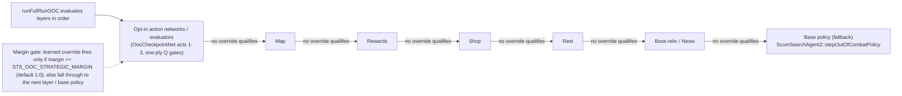

# Out-of-combat policy

Last verified: 2026-08-02 against the current working tree (Phase-5 round 5;
semi-Markov design record added).

## Purpose

Describe run-level state/actions, the ordered policy stack used by `bestbench`,
and the boundary between default native inference and opt-in strategic
experiments.

## Current implementation

`GameContext` owns run RNG streams, deck, relics, potions, map, resources,
act/floor, and the active `ScreenState`
(`include/game/GameContext.h::GameContext`). Legal strategic actions are packed
`search::GameAction` values enumerated and executed by
`GameAction::getAllActionsInState` and `GameAction::execute`
(`src/sim/search/GameAction.cpp`).

`ScumSearchAgent2::stepOutOfCombatPolicy` is the reusable heuristic policy.
The active whole-run research policy is the ordered branch chain in
`apps/one_combat.cpp::runFullRunOOC`. Under current defaults it uses:

- native `build/v_rich_trees.txt` floor value for card and shop scoring;
- native `build/v_win_trees.txt` win value for rest/upgrade decisions;
- card skip threshold `-0.5`;
- heuristic map routing;
- value-based shop planning;
- heuristic/base handling for remaining screens unless an opt-in layer owns
  them.

`apps/one_combat.cpp::main` enables native OOC unless `STS_NATIVE_OOC=0`.
Failure to load the floor model terminates startup; failure to load the default
win model does not. If the win model is unavailable, win-rest helpers fall back
to server requests even while native OOC is enabled, and the generic
`[native OOC floor/win GBMs ON]` message is still printed. Confirm the
path-specific win-model load message. With the tracked win artifact present,
`v_server.py` is not a default `bestbench` dependency; it remains an optional
localhost bridge for legacy and experimental endpoints.

A successfully loaded `STS_OOC_CHECKPOINT_NN=<path>` enables the compact native
checkpoint-distilled action network in acts 1–3 before ordinary policy layers
(`apps/ooc_checkpoint_net.h::OocCheckpointNet`;
`apps/one_combat.cpp::oocActionNNPolicy`). A successfully loaded
`STS_OOC_STRATEGIC_NN=<path>` enables the Phase-5 one-ply card-reward gate.
Since round 3 (`OOC_STRAT_V3`), each legal reward action is scored **directly
with the Q(s,a) head** on the pre-decision state
(`OocStrategicNet::predictActionValue` — no clones or successor states), and
the best action is executed only when its margin over the runner-up reaches
`STS_OOC_STRATEGIC_MARGIN` (default 1.0); otherwise the heuristic card policy
runs. `STS_OOC_STRATEGIC_Q=0` restores the round-1/2 behaviour of scoring
copied successor states with the value head of the successor screen
(`predictValue(state, screen)`), the path used by the §70–§73 V2 gates. Since
round 4 (`§74`) the same Q gate also covers campfires and events via
`STS_OOC_STRATEGIC_REST=1` (`oocOnePlyRestPolicy` on REST_ROOM plus
`oocOnePlyUpgradeSelectPolicy` on the smith's CARD_SELECT/UPGRADE targets) and
`STS_OOC_STRATEGIC_EVENT=1` (`oocOnePlyEventPolicy` on EVENT_SCREEN options,
incl. Neow) — both default **off**, so the card-only configuration stays
reproducible. Round 6 (`§76`) added the remaining screens:
`STS_OOC_STRATEGIC_SHOP=1` (`oocOnePlyShopPolicy`), `STS_OOC_STRATEGIC_TREASURE=1`
(`oocOnePlyTreasurePolicy`), `STS_OOC_STRATEGIC_BOSS_RELIC=1`
(`oocOnePlyBossRelicPolicy`) — all default **off**. The Q
head is trained on Tier-B one-ply counterfactual labels (`strategicgen2`;
`apps/one_combat.cpp::runStrategicGenSeed2`). No model is deployed by default:
the one-ply branches are opt-in only
(`apps/ooc_strategic_net.h::OocStrategicNet`;
`apps/one_combat.cpp::oocOnePlyCardRewardPolicy`,
`oocOnePlyRestPolicy`, `oocOnePlyEventPolicy`, `oocOnePlyShopPolicy`,
`oocOnePlyTreasurePolicy`, `oocOnePlyBossRelicPolicy`). Historical gates: §70
pooled-head regression (−10.9pp at margin 1.0), §71 per-seed-neutral per-screen
heads, §73 Q-head result, §74 cards+rest+event +7.0pp (event gate the main
contributor; CIs span zero), §76 full coverage +18.8pp at margins 0.5/1.0
(statistically established; boss relic + treasure gates carry the bulk). Other
opt-in owners include
card, path, event, boss-relic/Neow, and all-OOC checkpoint evaluator flags
parsed in `apps/one_combat.cpp::main`.

Since round 5 (§75), a token-based state net (`OOC_STRAT_V4`) exists alongside
V3: `STS_OOC_STRATEGIC_TOK_NN=<path>` loads `apps/ooc_strategic_tok_net.h::OocStrategicTokNet`,
and the four one-ply gates score with it when loaded (V3 stays the fallback).
Its input is built by `apps/one_combat.cpp::buildTokState` (50 globals — 44
richRow scalars + 6 derived thresholds hpFrac/missingHp/freePotionSlot/
goldGeRemoval/canTakeEliteKey/bossNear — plus canonical counted deck tokens
`(id, upgraded, count)`, relic tokens `(id, counter)`, potion tokens
`(id, count)`; exact contract in
`docs/knowledge-base/architecture/ooc-strategic-v4.md`) and per-action
candidate entity embeddings via `tokEntity`. Training/export:
`train_strategic_tok.py` (rung-masked ablation trainer on the existing §73
CSV, no new datagen; the 482-col group-ordered fp16 state file is uploaded to
GPU VRAM once and rows are gathered on-device with a CPU-mmap fallback on OOM;
the 8 per-screen value/quantile heads run as full-batch GEMMs + gather instead
of masked per-head writes — math-identical, see the 2026-08-03 decision-log
entries; `STRAT_TOK_COMPILE=1` (default ON) wraps the net in `torch.compile`
(mode="default", Triton fusion, ~2x step; needs CPython dev headers;
`torch._dynamo.config.suppress_errors` falls back to eager if compilation
fails; `reduce-overhead` CUDA graphs are NOT usable — capture rejects the
masked entity `index_put_`)),
`export_strategic_tok.py`, `strategic_tok_net.py`.
Deployment parity hooks: exporter numpy-vs-PyTorch asserts and
`STS_OOC_STRATEGIC_TOK_CHECK=1` (first gated decision per run compares the 44
globals against `richFeatureVec`; zero mismatches across §75 benchmark runs).
§75 verdict: held-out ranking beats V3 (policy top-1 0.793 vs 0.784) and the
gate is directionally win-positive at margin 5.0 (+3.1pp, CIs span zero), but
V3's +7.0pp @ m1 is not beaten — **V3 remains the deployed default; the V4
net is opt-in**.

## Strategic model design (semi-Markov decomposition)

The stable design target for learned run-level decisions, adopted as the
Phase-5 architecture and recorded in `docs/knowledge-base/decisions/2026-08-02-semi-markov-strategic-model.md`:

- **Combat is a temporally extended transition.** The strategic model acts
  only at run-level decision points (card reward, map node, shop purchase,
  rest/upgrade/lift/toke/recall, event option, relic/potion pick); one
  transition may span an entire stochastic combat. This separation is the
  core design bet and the reason strategic learning never mixes per-tick
  combat actions into its policy.
- **Run value is the common language.** A single run-value model
  `V(s_t) = P(run victory | s_t)` prices HP, potions, gold, and upgrades
  consistently across all screens. Screen-specific decision heads share
  that value signal rather than learning independent resource pricing.
- **Action-conditioned scoring, not fixed output heads.** Legal actions are
  heterogeneous and variable in number; the policy encodes the run state
  once, encodes each legal candidate by type, and scores
  `logit(s,a) = f(z_state, z_action, z_state ⊙ z_action)` over the legal
  set. Skip is a real learned action token.
- **Hidden-information boundary.** The model may see only what the player
  sees: no future card rewards, no unknown shop contents, no exact future
  encounter identity beyond the known pool, no event outcomes before
  selection, no hidden RNG state. Strategic rollouts must sample unknown
  outcomes from conditional distributions, never copy the true future seed
  — the C++ tree search uses the game RNG state, so this boundary is an
  explicit implementation requirement, not an agent-API assumption
  (see `docs/knowledge-base/behavior/determinism-and-rng.md`).
- **Deployment contract: margin-gated overrides.** Greedy un-gated NN
  overrides of heuristic decisions are a recorded failure mode (§66m, §70,
  §73 margin 0). Any learned override path fires only when the candidate's
  margin over the runner-up reaches a threshold
  (`STS_OOC_STRATEGIC_MARGIN`), else the heuristic policy runs.
- **Representation roadmap.** The spec targets token-based run state
  (counted deck tokens, relic/potion entity tokens, map DAG graph
  encoding, decision-context encoding) and distributional value heads.
  The token-based state (V4, round 5) is delivered and recorded (§75):
  counted deck/relic/potion tokens through a single-head deck attention,
  thresholds, and candidate entity embeddings — trained on the existing
  Tier-B CSV with no new datagen. It improves held-out ranking (policy
  top-1 0.793 vs 0.784) but its deployed one-ply gate (+3.1pp @ m5) does
  not beat the V3 flat-vector net (+7.0pp @ m1), so V3 stays deployed and
  the V4 net is opt-in behind `STS_OOC_STRATEGIC_TOK_NN`. The current
  deployment still uses per-screen scalar value heads; distributional
  heads and the map DAG remain future work. The full spec and remaining
  phases are the active plan in `docs/archive/ooc-action-plan-2026-08.md`.

## Important data flow

1. `GameAction::getAllActionsInState` defines legal actions for the active
   screen.
2. `runFullRunOOC` evaluates opt-in action networks/evaluators first, then map,
   rewards, shop, rest, boss-relic/Neow, and finally the base policy.
3. Rich state is serialized by `vFeatCsv`/`richFeatureVec`. Current server-side
   raw layout has 1,017 values, including full card/relic/potion counts,
   forward-map summaries, and map position (`apps/one_combat.cpp::vFeatCsv`;
   `v_server.py::RAW`).
4. Native tree models map artifact feature names to raw rich indices through
   `richIdxMap` and score state or copied post-action states.
5. Counterfactual evaluators copy `GameContext`, apply a legal action, detach
   shared map state when mutation is possible, and simulate or predict future
   checkpoints.

## Invariants and assumptions

- `GameAction` is distinct from combat `Action` and acts on `GameContext`.
- Native/server feature ordering must match the `vFeatCsv` producer.
- Counterfactual map mutation requires a detached `Map` because
  `GameContext::map` is a `std::shared_ptr<Map>`.
- Candidate policy validity requires evidence that the intended model loaded
  and actually owned the relevant branch.
- The default operating configuration keeps floor value for card/shop and win
  value for rest;
  unified V_win card/shop attempts are recorded regressions, not an invariant
  of future designs (`EXPERIMENTS.md` entries 49–50).

## Known limitations

- The strategic policy is an ordered integration function, not one composable
  policy object. Adding an earlier branch can silently bypass later behavior.
- `bestBench`'s `BEST stack` banner is emitted from parsed flags and load
  messages (skip threshold, rest/win layer, shop-V, path mode, native OOC,
  searcher, threads, model paths) but still omits some experimental layers; it
  is not a complete provenance record.
- The generic native-OOC startup message does not prove `g_winNet` loaded; a
  missing win tree can silently reintroduce server calls on win-rest screens.
- `v_server.py` documents the implemented 1,017-value `RAW` layout and links
  `apps/one_combat.cpp::vFeatCsv` as the schema owner.
- `OocCheckpointNet::load` and `OocStrategicNet::load` validate header/dims and
  every payload read; truncated files fail load (issue 08, closed).
- `runtrace` is not a wrapper around `runFullRunOOC`: it prints a diagnostic
  header, skips server-only draft logging when no server is reachable, but still
  omits some fallthrough policy layers and its event/treasure scores are
  diagnostic (`apps/one_combat.cpp::runTraceRun`, `tr_logDraft`).
- Model-driven pathing with the old forward-map-blind win model was a recorded
  regression; heuristic pathing remains the operating baseline.
- Python cannot issue card-by-card combat actions.
- The fast predicted checkpoint evaluator compounds approximate transition
  error and is not in the default policy; historical results are in
  `EXPERIMENTS.md` §66j.

## Open questions

- Which policy layers should move out of `one_combat.cpp` into a stable owner?
- How should action-conditioned card/shop/path targets replace observational
  state-value counterfactuals?
- Should native model formats include checksums and complete payload-read
  validation?

## Relevant code

- `include/game/GameContext.h::GameContext`, `ScreenState`
- `src/game/GameContext.cpp::transitionToMapNode`, `enterBattle`, `afterBattle`
- `include/sim/search/GameAction.h::GameAction`
- `src/sim/search/GameAction.cpp::getAllActionsInState`, `execute`
- `src/sim/search/ScumSearchAgent2.cpp::stepOutOfCombatPolicy`
- `apps/one_combat.cpp::runFullRunOOC`, `vFeatCsv`, `richIdxMap`, `main`,
  `oocOnePlyCardRewardPolicy`, `runStrategicGenSeed`, `runStrategicGenSeed2`,
  `strategicGen2`, `buildTokState`, `tokEntity`
- `apps/ooc_checkpoint_net.h::OocCheckpointNet`
- `apps/ooc_strategic_net.h::OocStrategicNet`
- `apps/ooc_strategic_tok_net.h::OocStrategicTokNet` (V4 token net, opt-in)
- `train_strategic.py`, `export_strategic.py`, `v_server.py::H.handle`, `RAW`
- `train_strategic_tok.py`, `export_strategic_tok.py`, `strategic_tok_net.py`
- `docs/knowledge-base/architecture/ooc-strategic-v4.md` — V4 token-state contract
- `docs/archive/ooc-action-plan-2026-08.md` — active strategic-model plan
- `docs/knowledge-base/decisions/2026-08-02-semi-markov-strategic-model.md`
- `bindings/slaythespire.cpp::PYBIND11_MODULE`
