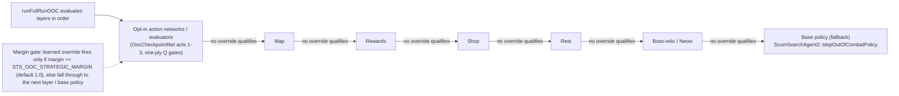

# Out-of-combat policy

Last verified: 2026-08-11 against the current working tree (tracked native
floor/win trees relocated from `build/` to `models/`).
Previously verified 2026-08-09 (key collection
gated behind STS_COLLECT_KEYS=1, default off; BEST banner includes keys=collect/skip).
Previously verified 2026-08-09 (Act-4 key collection added to every REWARDS handler
and act-3+ rest rooms, now opt-in via the flag).
Previously verified 2026-08-05 (checkpoint-oracle terminal win-GBM +
margin-gate levers added and falsified §111; Wave B regret gate + Q_win
truth-check mode + map-DAG encoder (V6) + Phase F soft-target policy objective
and policy-score gate env added; Phase F falsified §104, label-noise wave §105
null — learned one-ply label line closed).

## Purpose

Describe run-level state/actions, the ordered policy stack used by `bestbench`,
and the boundary between default native inference and opt-in strategic
experiments.

## Current implementation

`GameContext` owns run RNG streams, deck, relics, potions, map, resources,
act/floor, and the active `ScreenState`
(`include/game/GameContext.h::GameContext`). Legal strategic actions are packed
`search::GameAction` values enumerated and executed by
`GameAction::getAllActionsInState` and `GameAction::execute`
(`src/sim/search/GameAction.cpp`).

`ScumSearchAgent2::stepOutOfCombatPolicy` is the reusable heuristic policy.
The active whole-run research policy is the ordered branch chain in
`apps/one_combat.cpp::runFullRunOOC`. Under current defaults it uses:

- native `models/v_rich_trees.txt` floor value for card and shop scoring;
- native `models/v_win_trees.txt` win value for rest/upgrade decisions;
- card skip threshold `-0.5`;
- heuristic map routing;
- value-based shop planning;
- heuristic/base handling for remaining screens unless an opt-in layer owns
  them.

`apps/one_combat.cpp::main` enables native OOC unless `STS_NATIVE_OOC=0`.
Failure to load the floor model terminates startup; failure to load the default
win model does not. If the win model is unavailable, win-rest helpers fall back
to server requests even while native OOC is enabled. The generic
`[native OOC floor/win GBMs ON]` banner prints only when BOTH models loaded
(`g_floorNet.ok && g_winNet.ok`); otherwise the path-specific
`[native V_win NOT loaded; win-rest helpers will use v_server fallback]` line
prints instead. `WinNet::load` (`apps/one_combat.cpp`) also rejects
truncated/malformed compact tree files — stream-state checks after `ntrees` and
after every node read, `ntrees < 1` rejection, a per-tree final-node-must-be-a-
leaf check, and a trailing-data probe — instead of silently loading a partial
model with `ok=true` (silent constant predictions). With the tracked win
artifact present, `v_server.py` is not a default `bestbench` dependency; it
remains an optional localhost bridge for legacy and experimental endpoints.

A successfully loaded `STS_OOC_CHECKPOINT_NN=<path>` enables the compact native
checkpoint-distilled action network in acts 1–3 before ordinary policy layers
(`apps/ooc_checkpoint_net.h::OocCheckpointNet`;
`apps/one_combat.cpp::oocActionNNPolicy`). A successfully loaded
`STS_OOC_STRATEGIC_NN=<path>` enables the Phase-5 one-ply card-reward gate.
Since round 3 (`OOC_STRAT_V3`), each legal reward action is scored **directly
with the Q(s,a) head** on the pre-decision state
(`OocStrategicNet::predictActionValue` — no clones or successor states), and
the best action is executed only when its margin over the runner-up reaches
`STS_OOC_STRATEGIC_MARGIN` (default 1.0); otherwise the heuristic card policy
runs. `STS_OOC_STRATEGIC_Q=0` restores the round-1/2 behaviour of scoring
copied successor states with the value head of the successor screen
(`predictValue(state, screen)`), the path used by the §70–§73 V2 gates. Since
round 4 (`§74`) the same Q gate also covers campfires and events via
`STS_OOC_STRATEGIC_REST=1` (`oocOnePlyRestPolicy` on REST_ROOM plus
`oocOnePlyUpgradeSelectPolicy` on the smith's CARD_SELECT/UPGRADE targets) and
`STS_OOC_STRATEGIC_EVENT=1` (`oocOnePlyEventPolicy` on EVENT_SCREEN options,
incl. Neow) — both default **off**, so the card-only configuration stays
reproducible. Round 6 (`§76`) added the remaining screens:
`STS_OOC_STRATEGIC_SHOP=1` (`oocOnePlyShopPolicy`), `STS_OOC_STRATEGIC_TREASURE=1`
(`oocOnePlyTreasurePolicy`), `STS_OOC_STRATEGIC_BOSS_RELIC=1`
(`oocOnePlyBossRelicPolicy`) — all default **off**. The Q
head is trained on Tier-B one-ply counterfactual labels (`strategicgen2`;
`apps/one_combat.cpp::runStrategicGenSeed2`). No model is deployed by default:
the one-ply branches are opt-in only
(`apps/ooc_strategic_net.h::OocStrategicNet`;
`apps/one_combat.cpp::oocOnePlyCardRewardPolicy`,
`oocOnePlyRestPolicy`, `oocOnePlyEventPolicy`, `oocOnePlyShopPolicy`,
`oocOnePlyTreasurePolicy`, `oocOnePlyBossRelicPolicy`). Historical gates: §70
pooled-head regression (−10.9pp at margin 1.0), §71 per-seed-neutral per-screen
heads, §73 Q-head result, §74 cards+rest+event +7.0pp (event gate the main
contributor; CIs span zero), §76 full coverage +18.8pp at margins 0.5/1.0
(statistically established; boss relic + treasure gates carry the bulk). Other
opt-in owners include
card, path, event, boss-relic/Neow, and all-OOC checkpoint evaluator flags
parsed in `apps/one_combat.cpp::main`.

Since round 5 (§75), a token-based state net (`OOC_STRAT_V4`) exists alongside
V3: `STS_OOC_STRATEGIC_TOK_NN=<path>` loads `apps/ooc_strategic_tok_net.h::OocStrategicTokNet`,
and the four one-ply gates score with it when loaded (V3 stays the fallback).
Its input is built by `apps/one_combat.cpp::buildTokState` (50 globals — 44
richRow scalars + 6 derived thresholds hpFrac/missingHp/freePotionSlot/
goldGeRemoval/canTakeEliteKey/bossNear — plus canonical counted deck tokens
`(id, upgraded, count)`, relic tokens `(id, counter)`, potion tokens
`(id, count)`; exact contract in
`docs/knowledge-base/architecture/ooc-strategic-v4.md`) and per-action
candidate entity embeddings via `tokEntity`. Training/export:
`train_strategic_tok.py` (rung-masked ablation trainer on the existing §73
CSV, no new datagen; the 482-col group-ordered fp16 state file is uploaded to
GPU VRAM once and rows are gathered on-device with a CPU-mmap fallback on OOM;
the 8 per-screen value/quantile heads run as full-batch GEMMs + gather instead
of masked per-head writes — math-identical, see the 2026-08-03 decision-log
entries; `STRAT_TOK_COMPILE=1` (default ON) wraps the net in `torch.compile`
(mode="default", Triton fusion, ~2x step; needs CPython dev headers;
`torch._dynamo.config.suppress_errors` falls back to eager if compilation
fails; `reduce-overhead` CUDA graphs are NOT usable — capture rejects the
masked entity `index_put_`)),
`export_strategic_tok.py`, `strategic_tok_net.py`.
Deployment parity hooks: exporter numpy-vs-PyTorch asserts and
`STS_OOC_STRATEGIC_TOK_CHECK=1` (first gated decision per run compares the 44
globals against `richFeatureVec`; zero mismatches across §75 benchmark runs).
§75 verdict: held-out ranking beats V3 (policy top-1 0.793 vs 0.784) and the
gate is directionally win-positive at margin 5.0 (+3.1pp, CIs span zero), but
V3's +7.0pp @ m1 is not beaten — **V3 remains the deployed default; the V4
net is opt-in**.

## Wave B regret gate (2026-08-04, opt-in)

`STS_OOC_STRATEGIC_GATE=regret` (default **off**) replaces the margin rule
`best − second ≥ m` with the regret rule **Qmax(s) − Q(a_heur) > ε** for every
one-ply gate (`oocOnePlyCardRewardPolicy` … `oocOnePlyBossRelicPolicy`,
`oocOnePlyMapPolicy`) and the M2 route search (`oocMapRouteSearchPolicy`);
`STS_OOC_STRATEGIC_GATE_EPS` (default 0.03) sets ε. `a_heur` is the action the
**live fallback chain of the screen** would take (the code path that would run
if the gate returned false — for SHOP that is `shopVPolicy` under bestbench,
for cards `serverCardRewardPolicy`, for rest/upgrade the win-rate layers, else
`ScumSearchAgent2::stepOutOfCombatPolicy`, with the `eventV`/`bossRelicV`/
`pathV` opt-in layers mirrored when their flags are set), identified by the
datagen-proven successor-fingerprint match
(`regretGateChoose` + `stratFingerprint`, one_combat.cpp:5844): the per-screen
heuristic runner (`regretHeurCardReward` / `regretHeurRest` /
`regretHeurUpgrade` / `regretHeurEvent` / `regretHeurShop` /
`regretHeurBossRelic` / `regretHeurMap`, SHOP gated on the run's `shopV` flag
via `t_shopV`) runs on a pre-state
copy (map detached, agent RNG stream copied so RNG-consuming heuristics
match), and the legal action whose successor fingerprint equals the
heuristic's is `a_heur`. When `Qmax − Q(a_heur) > ε` the Q-max action runs;
otherwise `a_heur` itself runs (the gate acts, so the heuristic layer is not
re-entered). When `a_heur` is unidentifiable — RNG-tied divergence, multi-step
heuristics, indistinguishable successors — the decision **falls back to the
margin rule** (`regretGateTail`). Implementation is shared via
`regretGateChoose`/`regretGateTail` (defined after `stratFingerprint`);
policies keep the margin path byte-identical when the flag is off (verified:
margin-mode runs reproduce the pre-change binary's results on the recorded
block). Q-consistency: `tools/analysis/check_vwin_calibration.py --ckpt <trainer.pt> <csv>`
adds a Wave-B truth-check mode that predicts the V5 Q_win head (torch
checkpoint, export parity-checked to ~1e-5 logit) on terminal
(`labelBootstrap==0`, chosen) rows instead of the win trees — run with the
pre- and post-recalibration checkpoints to test bootstrap-bias propagation
into the head.

## Map-DAG encoder (V6, 5.3.2 — falsified 2026-08-04, opt-in)

`OOC_STRAT_V6` artifacts (V5 layout + a reverse-DAG map encoder + a
zero-init 96→168 residual adapter) let `oocOnePlyMapPolicy` score MAP
candidates with downstream route information: node = room/row/col/burning
embeddings, bottom-up sweep rows 14→0 with mean+max child messages, readout
pools the chosen child's subtree (roots when `curMapNodeY < 0`). Training
inputs come from `one_combat mapbatch` tables joined per (seed, act) —
**no new datagen**: the tierb MAP-screen rows already carry per-child
counterfactual labels. Trainer knobs: 3rd CLI arg / `STRAT_MAPS_CSV`,
`STRAT_FREEZE_BASE=1` (train only `map_*`), `STRAT_INIT_PT` (seed the frozen
base from a prior checkpoint); exporter writes the V6 magic and numpy-parity
checks the graph path; C++ gains `OocStrategicNet::predictMapActionValue`
(+`mapnntest` parity mode). E1 (frozen `ooc_strategic_qwin_cal.pt` base,
40 epochs): val_pol_ce 0.426, q_top1_map 0.506 — offline gain, but the
recorded-block A/B is neutral-to-negative at every probability-point margin
(§100): the MAP gate itself costs ~12pp on the base at m0.01, and the encoder
does not close it. **Verdict: the encoder lever is falsified on the current
K=3 labels (§62 lesson repeats); V6 stays opt-in and undeployed; the
heuristic pathing and the map-gate-off stack remain the deployed config.**
Caution: a killed trainer can leave a byte-size-valid but corrupt
`_state.bin` — verify frozen-model metrics against the source run before
reusing it.

## Phase F search distillation (5.7.1 + 5.7.2 — falsified 2026-08-04, opt-in)

`STS_OOC_STRATEGIC_SCORE=policy` (default `q`) switches the one-ply gates'
score source from the Q_win head to the **policy head** for V5/V6 artifacts:
`oocStrategicScore` returns `sigmoid(predictPolicyLogit(state, bits, cats,
actionType, screen))` (the raw logit is sigmoided to the probability scale,
so the probability-point `STS_OOC_STRATEGIC_MARGIN` semantics apply
unchanged) instead of `predictActionValue`. The token-net path and the V6
map-encoder path are untouched; the margin/regret tail (`regretGateTail`) is
shared, and with the env unset the gates stay byte-identical (verified on the
recorded block). The trained policy head itself is produced with the
soft-target distillation loss in `train_strategic.py`: `STRAT_DIST_LAMBDA`
(0.5) + `STRAT_DIST_TAU` (1.0) blend the one-hot `chosen` CE with
`CE(softmax(labelWon/τ))` per decision group — `(1−λ)·CE(one-hot) +
λ·CE(softmax(labelWon/τ))` — plus a held-out `dist_top1` metric (policy
argmax vs label argmax). λ=0 reproduces the pre-change numbers exactly.
**Verdict (§104): falsified on the current K=3 labels** — the tie-dominated
`labelWon` caps the ranking signal (dist_top1 ≈ behavior's 38% agreement),
the distilled policy flattens the logits (margin 18.6 → ~1.2), and every
policy-score gate arm loses to the Q-gate and to the V3 reference on the
recorded block. Both knobs stay opt-in; `q` remains the default. The
label-noise follow-up (§105, 2026-08-05) is also null: futures=2 variance
reduction (matched 500-seed control; the labelWon value grid collapses from
55 to 126k distinct values) and the trainer-side denoising knobs
(`STRAT_DIST_MARGIN_EPS`, `STRAT_DIST_SPREAD_W`, `STRAT_DIST_TERM_W` —
defaults byte-parity with the §104 numbers) move neither `dist_top1` nor
`q_top1`; the one-ply label **ranking** itself is the transfer ceiling.
K=6 deep targets (5.7.1b) are not run for that reason (truncation is the
weak lever per the §105 L0 probe).

## Checkpoint-oracle live-policy levers (2026-08-05, opt-in, falsified)

`STS_ACT_FIGHT_PROBE_TERM_WIN=w` adds a terminal pricing term to the capped
all-OOC checkpoint objective (`apps/one_combat.cpp::checkpointedActFightUtility`):
on the final scored checkpoint, each option's post-fight branch state is
priced by the native win GBM (`g_winNet.predict(richFeatureVec(local))`,
P(win) units, scale-compatible with the HP-safety sigmoid) and blended by `w`.
`STS_ACT_FIGHT_PROBE_MARGIN=m` gates the oracle
(`apps/one_combat.cpp::actFightProbeAllOocPolicy`): it overrides a decision
only when `best − second ≥ m`, else control falls through to the ordinary
policy stack. Both default off; unset behavior is byte-identical. §111
falsifies both as a live full-run policy on the §107 stack: the ungated oracle
lost 0/13 paired seeds and the m=0.15 arm −4.50 (SE 2.33) at n=62; the
HP-safety/win argmax replaces the margin-gated one-ply Q stack on every gated
decision and is net-negative, and the terminal term cannot rescue it. The
oracle machinery remains an offline teacher/ranker tool (§66k/§66l/§67).

## Strategic model design (semi-Markov decomposition)

The stable design target for learned run-level decisions, adopted as the
Phase-5 architecture and recorded in `docs/knowledge-base/decisions/2026-08-02-semi-markov-strategic-model.md`:

- **Combat is a temporally extended transition.** The strategic model acts
  only at run-level decision points (card reward, map node, shop purchase,
  rest/upgrade/lift/toke/recall, event option, relic/potion pick); one
  transition may span an entire stochastic combat. This separation is the
  core design bet and the reason strategic learning never mixes per-tick
  combat actions into its policy.
- **Run value is the common language.** A single run-value model
  `V(s_t) = P(run victory | s_t)` prices HP, potions, gold, and upgrades
  consistently across all screens. Screen-specific decision heads share
  that value signal rather than learning independent resource pricing.
- **Action-conditioned scoring, not fixed output heads.** Legal actions are
  heterogeneous and variable in number; the policy encodes the run state
  once, encodes each legal candidate by type, and scores
  `logit(s,a) = f(z_state, z_action, z_state ⊙ z_action)` over the legal
  set. Skip is a real learned action token.
- **Hidden-information boundary.** The model may see only what the player
  sees: no future card rewards, no unknown shop contents, no exact future
  encounter identity beyond the known pool, no event outcomes before
  selection, no hidden RNG state. Strategic rollouts must sample unknown
  outcomes from conditional distributions, never copy the true future seed
  — the C++ tree search uses the game RNG state, so this boundary is an
  explicit implementation requirement, not an agent-API assumption
  (see `docs/knowledge-base/behavior/determinism-and-rng.md`).
- **Deployment contract: margin-gated overrides.** Greedy un-gated NN
  overrides of heuristic decisions are a recorded failure mode (§66m, §70,
  §73 margin 0). Any learned override path fires only when the candidate's
  margin over the runner-up reaches a threshold
  (`STS_OOC_STRATEGIC_MARGIN`), else the heuristic policy runs.
- **Representation roadmap.** The spec targets token-based run state
  (counted deck tokens, relic/potion entity tokens, map DAG graph
  encoding, decision-context encoding) and distributional value heads.
  The token-based state (V4, round 5) is delivered and recorded (§75):
  counted deck/relic/potion tokens through a single-head deck attention,
  thresholds, and candidate entity embeddings — trained on the existing
  Tier-B CSV with no new datagen. It improves held-out ranking (policy
  top-1 0.793 vs 0.784) but its deployed one-ply gate (+3.1pp @ m5) does
  not beat the V3 flat-vector net (+7.0pp @ m1), so V3 stays deployed and
  the V4 net is opt-in behind `STS_OOC_STRATEGIC_TOK_NN`. The current
  deployment still uses per-screen scalar value heads; distributional
  heads and the map DAG remain future work. The original roadmap is archived
  in `docs/archive/ooc-action-plan-2026-08.md`; current priorities are routed
  through `docs/knowledge-base/evaluation/current-research.md`.

## Important data flow

1. `GameAction::getAllActionsInState` defines legal actions for the active
   screen.
2. `runFullRunOOC` evaluates opt-in action networks/evaluators first, then map,
   rewards, shop, rest, boss-relic/Neow, and finally the base policy.
   When `STS_COLLECT_KEYS=1` (default off), every REWARDS handler takes the
   emerald (burning elite) / sapphire (chest) key via `RT::KEY` right after
   gold/relic/potion, and every act-3+ rest room takes the ruby key (RECALL,
   rest action 2) before any heal/smith layer; without key collection Act 4
   (`THE_HEART`) is unreachable.
   Sites: `apps/one_combat.cpp` REWARDS chains + `restWinPolicy`,
   `src/sim/search/ScumSearchAgent2.cpp::stepRewardsPolicy` and its REST_ROOM
   case, `src/sim/search/SimpleAgent.cpp::stepRestScreen`.
3. Rich state is serialized by `vFeatCsv`/`richFeatureVec`. Current server-side
   raw layout has 1,017 values, including full card/relic/potion counts,
   forward-map summaries, and map position (`apps/one_combat.cpp::vFeatCsv`;
   `v_server.py::RAW`).
4. Native tree models map artifact feature names to raw rich indices through
   `richIdxMap` and score state or copied post-action states.
5. Counterfactual evaluators copy `GameContext`, apply a legal action, detach
   shared map state when mutation is possible, and simulate or predict future
   checkpoints.

## Invariants and assumptions

- `GameAction` is distinct from combat `Action` and acts on `GameContext`.
- Native/server feature ordering must match the `vFeatCsv` producer.
- Counterfactual map mutation requires a detached `Map` because
  `GameContext::map` is a `std::shared_ptr<Map>`.
- Candidate policy validity requires evidence that the intended model loaded
  and actually owned the relevant branch.
- The default operating configuration keeps floor value for card/shop and win
  value for rest;
  unified V_win card/shop attempts are recorded regressions, not an invariant
  of future designs (`EXPERIMENTS.md` entries 49–50).

## Known limitations

- The strategic policy is an ordered integration function, not one composable
  policy object. Adding an earlier branch can silently bypass later behavior.
- `bestBench`'s `BEST stack` banner is emitted from parsed flags and load
  messages (skip threshold, rest/win layer, shop-V, path mode, native OOC,
  searcher, threads, model paths) but still omits some experimental layers; it
  is not a complete provenance record.
- The generic native-OOC startup message does not prove `g_winNet` loaded; a
  missing win tree can silently reintroduce server calls on win-rest screens.
- `v_server.py` documents the implemented 1,017-value `RAW` layout and links
  `apps/one_combat.cpp::vFeatCsv` as the schema owner.
- `OocCheckpointNet::load` and `OocStrategicNet::load` validate header/dims and
  every payload read; truncated files fail load (issue 08, closed).
- `runtrace` is not a wrapper around `runFullRunOOC`: it prints a diagnostic
  header, skips server-only draft logging when no server is reachable, but still
  omits some fallthrough policy layers and its event/treasure scores are
  diagnostic (`apps/one_combat.cpp::runTraceRun`, `tr_logDraft`).
- Model-driven pathing with the old forward-map-blind win model was a recorded
  regression; heuristic pathing remains the operating baseline.
- Python cannot issue card-by-card combat actions.
- The fast predicted checkpoint evaluator compounds approximate transition
  error and is not in the default policy; historical results are in
  `EXPERIMENTS.md` §66j.
- `STS_OOC_STRATEGIC_TRACE=<csv>` is the deployment-aligned gate trace;
  `tools/analyze_strategic_trace.py` consumes it strictly and reports
  per-screen fire rates, margins, and outcome summaries. The outcome split is
  decision-level because final run outcomes repeat on each decision row.

## Open questions

- Which policy layers should move out of `one_combat.cpp` into a stable owner?
- How should action-conditioned card/shop/path targets replace observational
  state-value counterfactuals?
- Should native model formats include checksums and complete payload-read
  validation?

## Relevant code

- `include/game/GameContext.h::GameContext`, `ScreenState`
- `src/game/GameContext.cpp::transitionToMapNode`, `enterBattle`, `afterBattle`
- `include/sim/search/GameAction.h::GameAction`
- `src/sim/search/GameAction.cpp::getAllActionsInState`, `execute`
- `src/sim/search/ScumSearchAgent2.cpp::stepOutOfCombatPolicy`
- `apps/one_combat.cpp::runFullRunOOC`, `vFeatCsv`, `richIdxMap`, `main`,
  `oocOnePlyCardRewardPolicy`, `runStrategicGenSeed`, `runStrategicGenSeed2`,
  `strategicGen2`, `buildTokState`, `tokEntity`
- `apps/ooc_checkpoint_net.h::OocCheckpointNet`
- `apps/ooc_strategic_net.h::OocStrategicNet`
- `apps/ooc_strategic_tok_net.h::OocStrategicTokNet` (V4 token net, opt-in)
- `train_strategic.py`, `export_strategic.py`, `v_server.py::H.handle`, `RAW`
- `train_strategic_tok.py`, `export_strategic_tok.py`, `strategic_tok_net.py`
- `docs/knowledge-base/architecture/ooc-strategic-v4.md` — V4 token-state contract
- `docs/archive/ooc-action-plan-2026-08.md` — historical strategic-model plan
- `docs/knowledge-base/evaluation/current-research.md` — current research routing
- `docs/knowledge-base/decisions/2026-08-02-semi-markov-strategic-model.md`
- `bindings/slaythespire.cpp::PYBIND11_MODULE`
