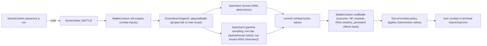

# Architecture overview

Last verified: 2026-08-02 against commit `67320b3` and the current working tree.

## Purpose

Orient contributors to the runtime state boundaries, integration entry points,
and repository ownership without duplicating subsystem detail.

## Current implementation

The simulator has two state domains. `sts::GameContext` owns the complete run
and active `ScreenState` (`include/game/GameContext.h::GameContext`). When a
battle screen is reached, `ScumSearchAgent2::playout` or the integration driver
creates a `BattleContext`, calls `BattleContext::init`, runs combat, and calls
`BattleContext::exitBattle` to transfer persistent results back
(`src/sim/search/ScumSearchAgent2.cpp::playout`;
`src/combat/BattleContext.cpp::init`, `exitBattle`).

Run-level choices use packed `search::GameAction`; combat choices use the
separate packed `search::Action` (`include/sim/search/GameAction.h::GameAction`;
`include/sim/search/Action.h::Action`). The Python module exposes run-level
`GameContext` and agents but not `BattleContext` or combat `Action`
(`bindings/slaythespire.cpp::PYBIND11_MODULE`).

`apps/one_combat.cpp::main` is the active integration workbench. It parses
environment flags, loads models, and dispatches benchmarks, data generators,
tracing, and counterfactual evaluators. Core simulator behavior remains under
`src/game`, `src/combat`, and `src/sim` (`CMakeLists.txt::sts_lightspeed_SOURCES`).

| Location | Current ownership |
| --- | --- |
| `include/`, `src/` | Simulator, search, agents, and native model readers. |
| `apps/` | Executable entry points and OOC checkpoint inference. |
| `bindings/` | Run-level pybind11 API. |
| root `train_*.py`, `export_*.py` | Executable trainers and serializers. |
| `v_server.py` | Optional localhost inference bridge. |
| `selfplay/` | Generation, retraining, paired gates, and snapshots. |
| tracked `build/*` models | Default and experimental model artifacts mixed with ignored build output. |

## Important data flow

1. `GameContext` advances a run until `ScreenState::BATTLE`.
2. `BattleContext::init` copies combat inputs and initializes transient state.
3. `ScumSearchAgent2::playoutBattle` selects the project-fair or tree-reuse
   path and Searcher2/Searcher3, then commits combat `Action` values. Searcher3's
   non-fair path is a particle/reuse hybrid, not known-RNG Searcher2.
4. `BattleContext::exitBattle` transfers outcome, HP, rewards, RNG streams, and
   persistent effects back to the run.
5. Out-of-combat policy applies `GameAction` values until the next combat or
   terminal `GameOutcome`.
6. `one_combat` modes optionally log state/action/outcome rows for training or
   aggregate whole-run results.

Detailed flows are in [combat search](combat-search.md),
[out-of-combat policy](out-of-combat.md), and
[training and inference](training-and-inference.md).

## Invariants and assumptions

- Combat and run actions are different types operating on different states.
- Release execution does not universally reject invalid packed actions;
  callers must enumerate or validate legal actions first
  (`src/sim/search/Action.cpp::isValidAction`;
  `src/sim/search/GameAction.cpp::isValidAction`).
- Combat loops use `BattleContext::outcome`, not `isBattleOver`.
- Combat control remains C++-only unless bindings are deliberately extended.
- The contents of `build/` are mixed: tracked model artifacts coexist with
  ignored CMake outputs (`.gitignore`; `git ls-files build`).

## Known limitations

- `one_combat.cpp` centralizes many policy and experiment layers. **Inference:**
  it functions as a research workbench rather than a stable library boundary;
  the repository contains no explicit decision record for that intent.
- `runFullRunOOC` does not have one standalone policy object; its ordered branch
  chain determines inference precedence (`apps/one_combat.cpp::runFullRunOOC`).
- There is no automatic test suite registered in CMake.

## Open questions

- What long-term boundary should separate simulator, deployed policy, and
  experimental evaluator code currently co-located in `one_combat.cpp`?
- Should the Python API ever expose combat state/actions, or remain run-level?

## Relevant code

- `include/game/GameContext.h::GameContext`, `ScreenState`
- `include/combat/BattleContext.h::BattleContext`, `Outcome`
- `src/combat/BattleContext.cpp::init`, `exitBattle`
- `src/sim/search/ScumSearchAgent2.cpp::playout`, `playoutBattle`
- `include/sim/search/GameAction.h::GameAction`
- `include/sim/search/Action.h::Action`
- `apps/one_combat.cpp::main`, `runFullRunOOC`
- `bindings/slaythespire.cpp::PYBIND11_MODULE`
- `CMakeLists.txt`
