# Architecture overview

Last verified: 2026-09-24 for value-type combat actions, the one_combat translation-unit split and the Searcher3 removal; 2026-09-10 against the current working tree.

## Purpose

Orient contributors to the runtime state boundaries, integration entry points,
and repository ownership without duplicating subsystem detail.

## Current implementation

The simulator has two state domains. `sts::GameContext` owns the complete run
and active `ScreenState` (`include/game/GameContext.h::GameContext`). When a
battle screen is reached, `ScumSearchAgent2::playout` or the integration driver
creates a `BattleContext`, calls `BattleContext::init`, runs combat, and calls
`BattleContext::exitBattle` to transfer persistent results back
(`src/sim/search/ScumSearchAgent2.cpp::playout`;
`src/combat/BattleContext.cpp::init`, `exitBattle`).

Run-level choices use packed `search::GameAction`; combat choices use the
separate packed `search::Action` (`include/sim/search/GameAction.h::GameAction`;
`include/sim/search/Action.h::Action`). The Python module exposes run-level
`GameContext` and agents but not `BattleContext` or combat `Action`
(`bindings/slaythespire.cpp::PYBIND11_MODULE`).

`apps/one_combat.cpp::main` is the active integration workbench. It parses
environment flags, loads models, and dispatches benchmarks, data generators,
tracing, and counterfactual evaluators. The larger mode bodies (run tracing,
semantic pilot, combat datasets, OOC factor/budget evaluators, strategic and
counterfactual generators) are separate translation units under
`apps/one_combat/` that share driver state through
`apps/one_combat/driver_shared.h`. The self-contained `vnettest` offline
diagnostic lives in `apps/combat_model_diagnostics.cpp`. Core simulator behavior remains under
`src/game`, `src/combat`, and `src/sim` (`CMakeLists.txt::sts_lightspeed_SOURCES`).

Combat actions (`include/combat/Actions.h`) are plain values: a
`CombatActionType` tag plus a trivially copyable parameter struct
(`ActData_*`) whose `operator()` performs the action. Queued actions compare
with `operator==` and a `BattleContext` copies its action queue with memcpy.
This is the first step toward running Silver's search directly on this
engine; `Actions::` factory signatures are unchanged.

The retained E2c RAW/POST capture contract is isolated in
`apps/one_combat/e2c_capture.{h,cpp}`. The module owns capture state, row
serialization, accounting, the temporary RAW observer scope, canonical RAW
projection, and the retained run-win parity checks. The extracted
`apps/one_combat/run_driver.cpp::runFullRunOOC` remains the orchestration owner:
it starts/finishes E2c around the shared training-integrity predicate and
delegates the real battle exit and reward-screen boundaries to the module.

| Location | Current ownership |
| --- | --- |
| `include/`, `src/` | Simulator, search, agents, and native model readers. |
| `apps/` | Executable entry points and OOC checkpoint inference. `apps/one_combat/` owns the integration driver's run loop, shared run-feature schema, compact-tree reader, E2c capture lifecycle, and extracted diagnostic modules. |
| `bindings/` | Run-level pybind11 API. |
| root `train_*.py`, `export_*.py` | Executable trainers and serializers. |
| `v_server.py` | Optional localhost inference bridge. |
| `selfplay/` | Generation, retraining, paired gates, and snapshots. |
| tracked `build/*` models | Default and experimental model artifacts mixed with ignored build output. |

## Important data flow

1. `GameContext` advances a run until `ScreenState::BATTLE`.
2. `ScumSearchAgent2::playoutBattle` hands the combat to the installed Silver
   backend, which runs `BattleContext::init`, searches, and commits combat
   `Action` values. Silver is the only combat searcher (ADR-0020).
4. `BattleContext::exitBattle` transfers outcome, HP, rewards, RNG streams, and
   persistent effects back to the run. When E2c capture is enabled,
   `e2c_capture` temporarily arms its RAW observer only around this real exit;
   POST is sampled from the rewards screen after non-card rewards are drained.
5. Out-of-combat policy applies `GameAction` values until the next combat or
   terminal `GameOutcome`.
6. `one_combat` modes optionally log state/action/outcome rows for training or
   aggregate whole-run results.

```mermaid
flowchart LR
    GC["GameContext advances a run"] -->|until| BATTLE["ScreenState::BATTLE"]
    BATTLE --> INIT["BattleContext::init (copies combat inputs)"]
    INIT --> CHOICE["ScumSearchAgent2::playoutBattle (project-fair or tree-reuse)"]
    CHOICE --> SILVER["Silver backend (only combat searcher)"]
    SILVER --> COMMIT["commit combat Action values"]
    COMMIT --> EXIT["BattleContext::exitBattle (outcome, HP, rewards, RNG streams, persistent effects back)"]
    EXIT --> OOC["Out-of-combat policy applies GameAction values"]
    OOC --> NEXT["next combat or terminal GameOutcome"]
```

Detailed flows are in [combat search](combat-search.md),
[out-of-combat policy](out-of-combat.md), and
[training and inference](training-and-inference.md).

## Invariants and assumptions

- Combat and run actions are different types operating on different states.
- Release execution does not universally reject invalid packed actions;
  callers must enumerate or validate legal actions first
  (`src/sim/search/Action.cpp::isValidAction`;
  `src/sim/search/GameAction.cpp::isValidAction`).
- Combat loops use `BattleContext::outcome`, not `isBattleOver`.
- E2c copied/counterfactual exits do not produce capture rows; the production
  RAW observer is armed only by `exitBattleWithE2cRawCapture` for the live
  driver exit.
- Combat control remains C++-only unless bindings are deliberately extended.
- The contents of `build/` are mixed: tracked model artifacts coexist with
  ignored CMake outputs (`.gitignore`; `git ls-files build`).

## Known limitations

- `one_combat.cpp` centralizes many policy and experiment layers. **Inference:**
  it functions as a research workbench rather than a stable library boundary;
  the repository contains no explicit decision record for that intent.
- `runFullRunOOC` is the canonical ordered integration loop in
  `apps/one_combat/run_driver.{h,cpp}`, while its live OOC action-policy
  implementations are isolated in `apps/one_combat/ooc_policy.{h,cpp}`. Model
  loading, token-state construction, fallback/diagnostic policy layers, and
  command/mode dispatch remain in `one_combat.cpp`.
- There is no automatic test suite registered in CMake.

## Open questions

- What long-term boundary should separate simulator, deployed policy, and
  experimental evaluator code currently co-located in `one_combat.cpp`?
- Should the Python API ever expose combat state/actions, or remain run-level?

## Relevant code

- `include/game/GameContext.h::GameContext`, `ScreenState`
- `include/combat/BattleContext.h::BattleContext`, `Outcome`
- `src/combat/BattleContext.cpp::init`, `exitBattle`
- `src/sim/search/ScumSearchAgent2.cpp::playout`, `playoutBattle`
- `include/sim/search/GameAction.h::GameAction`
- `include/sim/search/Action.h::Action`
- `apps/one_combat.cpp::main`, `apps/one_combat/run_driver.cpp::runFullRunOOC`
- `apps/one_combat/e2c_capture.{h,cpp}` — retained E2c RAW/POST lifecycle, canonical projection, and run-win parity
- `apps/one_combat/ooc_policy.{h,cpp}` — live OOC action/checkpoint/one-ply/map policies
- `apps/one_combat/run_features.{h,cpp}` — path history, forward-map features, rich schema, and feature index map
- `apps/one_combat/compact_tree.{h,cpp}` — compact tree declaration and loader/predictor
- `apps/combat_model_diagnostics.cpp::runCombatModelDiagnosticMode`
- `bindings/slaythespire.cpp::PYBIND11_MODULE`
- `CMakeLists.txt`
