# Training and inference

Last verified: 2026-09-24 for the Searcher2/3 removals; 2026-09-14 for potion-generation support; 2026-09-13 for relic legality, nested potion decoders, frozen composition, attention precision and padding; 2026-09-10 for
the semantic-branch trainer adapter and root trainer audit.

## Purpose

Document dataset producers, feature/group contracts, trainer/export paths, and
runtime model-loading interfaces without treating experimental artifacts as
active defaults merely because they are present.

## Current implementation

The learning pipeline is executable scripts rather than an installed Python
package:

1. `one_combat` modes emit run, combat, policy-edge, strategic-action, paired,
   or oracle CSV rows (`apps/one_combat.cpp::main`).
2. Root `train_*.py` programs fit XGBoost, scikit-learn, or PyTorch models.
3. `export_*.py` programs and trainer export blocks write JSON, compact tree
   text, native neural text/binary, TorchScript, or checkpoints.
4. `one_combat` loads compact artifacts in-process; optional experiments query
   `v_server.py` over localhost.
5. Model predictions supply combat priors/leaves or score run states/actions.

```mermaid
flowchart LR
    A["one_combat modes"] -->|"emit run, combat, policy-edge, strategic-action, paired, or oracle CSV rows"| B["CSV datasets"]
    B -->|"fit XGBoost, scikit-learn, or PyTorch models"| C["root train_*.py programs"]
    C -->|"export"| D["export_*.py programs and trainer export blocks"]
    D -->|"write"| E["JSON / compact tree text / native neural text-binary / TorchScript / checkpoints"]
    E -->|"load compact artifacts in-process"| F["one_combat"]
    E -.->|"optional localhost inference"| G["v_server.py"]
    G -.->|"serve predictions over localhost"| F
    F -->|"predictions supply"| H["combat priors / leaves or score run states / actions"]
```

The offline `tools/combat_transition_attention_ablation.py` training and refit
loops trim trailing CARD and RELIC padding per batch before device transfer.
`tools/combat_transition_surrogate.py::_torch_inputs(trim_padding=True)` keeps
through the last valid column of each input mask; an all-padding entity block
has width zero. GLOBAL and all five POTION tokens remain present. Phase-2
relic labels and target masks use exactly the input RELIC width, and an active
target beyond that width is rejected. Validation, TEST, and generic prediction
retain fixed widths; DeepSets training retains its existing default path.
This changes computation only, with no architecture, support, loss, optimizer,
or research conclusion change. Padding removal can change dropout RNG
consumption, so trained checkpoints need not be identical. Forward/core,
loss, and gradient parity are checked with dropout disabled in
`tools/test_combat_transition_attention_ablation.py`.

Attention selection training and final TRAIN+VALIDATION refit accept
`fit --training-precision fp32|amp-fp16` (default `fp32`). CUDA availability
alone never enables AMP. Explicit `amp-fp16` requires an available CUDA device
and uses CUDA float16 autocast for forward/loss, GradScaler with initial scale
16,384, gradient unscale before the existing norm clip of 1.0, then scaler
step/update. AdamW, batches/order, dropout, losses, and epoch selection are
unchanged. Validation, TEST, metrics, and latency evaluation remain FP32.
Evidence `protocol` and checkpoint `trainingProtocol` record precision, AMP
dtype, scaler enabled/initial scale, unscale-before-clipping, and evaluation
precision without changing model schema. Recovery requires matching protocol;
historical checkpoints without this metadata are treated as FP32.

AMP changes floating-point training dynamics: it promises neither bitwise
parity, identical selected epochs/checkpoints, nor proven equal model quality.
The accepted bounded six-epoch TRAIN/VALIDATION probe establishes only absence
of obvious degradation. FP32 remains historical reproduction mode; future
scientific candidate/control comparisons must use the same training precision.
The [bounded CUDA confirmation](../../experiments/evidence/attention_amp_confirmation_2026-09-13.md)
checks optimizer-step speed and memory, not scientific quality.

`tools/combat_transition_frozen_composition.py` is an offline inference-only
diagnostic on the frozen attention checkpoints: A retains Phase-2, B replaces
only survival with point-control, and C optionally masks potion support on
certified inputs. It does not call `fit`. Certification retains Ironclad
eligibility and excludes explicit Alchemize
and Entropic Brew. Off-color cards alone do not invalidate consumption-only
support: audited combat random pools exclude Alchemize. See the
[potion-generation contract](../behavior/combat-potion-generation.md). The native
basis and historical measured applicability are in the
[frozen-composition evidence](../../experiments/evidence/frozen_survival_potion_2026-09-13.md).
Uncertified inputs retain B's probabilities. Masked log-softmax fails on
nonfinite logits; unavailable slots copy through, and sampled potion count
comes from slots. Draws select only positive-mass classes, avoiding residual
roundoff assigned to forbidden identities. Each encoder keeps its own frozen
normalization buffers; evaluation remains FP32 at historical fixed widths.
This adapter does not qualify native transitions or RNG continuation.

`tools/combat_transition_relic_legality.py` constrains persistent post counters
from the native RAW write-back set, rather than relying on observed delta
classes. Cyclic counters use native periods, Neow's Lament decrements once,
Lizard Tail cannot recharge (Mark of the Bloom also prevents consumption),
Omamori decrements only in Writhing Mass, and healing-relic data copies through.
Unknown or invalid pre domains require future Silver fallback; global support
is unchanged. The helper normalizes only legal classes and rejects empty mass.
It does not enforce joint reachability of multiple relic counters.

`tools/combat_transition_potion_decoder.py` is an offline prospective experiment:
`prepare` freezes a deterministic source split nested in original TRAIN and
its recipe before `fit`. A ten-epoch FP32 attention point-control encoder sees
nested TRAIN only; its normalization and parameters remain frozen during
validation-selected decoder training and TRAIN+VALIDATION refitting. The small
independent and joint decoders use the same 133-wide feature tensor: detached
state, max-HP class embedding, post-HP fraction and flattened embeddings for
all five potion/slot entries. Both have the same width-64 hidden MLP; output
layers emit five Bernoulli logits or 32 categorical logits. The independent
mask probabilities are products of all five Bernoulli terms before both arms
apply the identical row-legality mask and renormalize. Consumption masks cannot create
or move potion identities. HOLDOUT scoring follows frozen epoch selection;
teacher-forced and ancestral results are recorded separately. Historical
point-control survival remains separate in composition. `fit` requires a clean
frozen SHA with recorded independent review and refuses to overwrite an
existing encoder/selection artifact; it does not authenticate reviewer approval.
The reviewed exact-SHA fit is recorded in the
[potion decoder fit evidence](../../experiments/evidence/potion_decoder_fit_2026-09-13.md).
Protocol and native counter table:
[potion decoder evidence](../../experiments/evidence/potion_decoder_v1_2026-09-13.md).

Representative current producers are `datagen3`, `oocnextgen`,
and the August 1 `strategicgen` mode. `strategicgen` records one rich-state row
per LEGAL action at each OOC decision with screen/action metadata, structured
candidate fields, a `chosen` flag, and terminal run labels
(`apps/one_combat.cpp::runStrategicGenSeed`, `strategicGen`); the `chosen`
flag is detected by successor-fingerprint matching against the executed policy
action.

The opt-in `combatevalgen` mode is the V1 pre-combat signed combat-evaluator
producer. It captures the canonical 1,017-value `GameContext` rich vector and
encounter ID before `BattleContext` initialization, then records terminal HP
and Silver's shared non-minion enemy-HP aggregate before `exitBattle`. Only
genuine wins and player deaths are label-valid; escapes, unresolved or
turn-cap results, simulator-health failures, and other non-death losses are
quarantined. Awakened One deaths remain in survival training but are marked
ambiguous and excluded from loss-severity training. The companion
`tools/combat_evaluator_contract.py`, `tools/train_combat_evaluator.py`, and
`tools/combat_evaluator.py` provide fail-closed validation, deterministic
source-seed grouping, three XGBoost heads, and offline inference. The
`combat_evaluator_v1` data manifest is authoritative: it binds the CSV hash,
producer and executable hashes, exact frozen Silver teacher, seed block,
feature/order hash, row counts, and quarantined-source count; trainer and
inference reject contract drift. Metrics exclude invalid rows, report split
valid/win/death/ambiguous counts, and classify sparse loss tests as
`INCONCLUSIVE_LOW_POWER`. This is offline V1 tooling only and is not
integrated into combat search.

`tools/train_combat_evaluator_semantic_branch.py` is the separate frozen
semantic-confirmation training adapter. It consumes exactly the 64 validated
`combat_evaluator_semantic_branch_v1` sidecar manifests from the 1,024-source
confirmation cohort, rejects producer/count/package-hash drift, and reuses
`stable_split`, the V1 three-head XGBoost recipe, and one-CPU-thread training.
The adapter derives encounter one-hot columns and variance filtering from
TRAIN only, excludes semantic/provenance/terminal-label columns, and reports
held-out metrics, source-seed clustered bootstrap uncertainty, source-macro
views, input-alias noise, descriptive slices, and batch-1 latency. It is an
offline predictive-feasibility experiment only: it does not regenerate
labels, invoke Silver or the simulator, export a runtime artifact, or replace
Silver in gameplay. The bulk corpus, model outputs, and prediction CSV remain
external evidence rather than tracked repository artifacts.

`tools/analyze_combat_evaluator_silver_gate.py` is the follow-on offline
decision-level analysis adapter. It joins the frozen semantic sibling rows,
combat sidecars, and held-out predictions by complete H=1 branch identity;
reports ungated model ranking and target-mismatch diagnostics; searches only
the preregistered validation margin/survival grid; and evaluates one frozen
gate on TEST with source-seed bootstrap intervals and safety/catastrophic
slices. It never fits a model, invokes Silver/the simulator, or mixes
predictor scores with Silver `qProduct` values. The gate is whole-decision:
accepted decisions use the predictor ranking for every sibling, while rejected
decisions use Silver for every sibling. Its automatic gate label is explicitly
provisional and cannot emit the scientific `TARGET MISMATCH` outcome; the
coordinator records that interpretation from the reported target diagnostics.

The prepared next-generation OOC workflow is documented in
[`operations/ooc-label-pipeline.md`](../operations/ooc-label-pipeline.md).
`tools/ooc_pipeline_contract.py` validates a fail-closed frozen-combat-teacher
and corpus manifest and parses arbitrary per-fight budget schedules/H plans;
`tools/train_whole_combat_surrogate.py` fits seed-grouped XGBoost survival and
winning-only conditional-HP models from a future one-row-per-fight corpus.
These tools do not freeze a teacher, generate data, or authorize runtime
surrogate use.

`wholecombatgen` emits one canonical 1,766-feature row per completed fight. It
captures the first `g_onCombatDecision` callback and labels the row after
`BattleContext::exitBattle` returns: the post-`afterBattle`, reward-screen-entry
`GameContext`, not the earlier RAW persistent-transfer hook. Its teacher
JSON is checked against the checkout, executable, exact ordinary Silver 10k
configuration, environment, and loaded-artifact hashes before CSV creation.

Representative model families:

- run values: `train_value_rich.py`, `train_winrate.py`; the retained
  `one_combat carddump` mode is the sole repository producer of
  `build/card_meta.csv`, which `train_value_rich.py` and three other tracked
  trainers read synchronously;
- paired/action OOC: `train_rest_cf.py`, `train_card_cf.py`,
  `train_path_cf.py`, `train_ooc_next_action.py`, `train_ooc_checkpoint.py`;
  future-fight card collection uses
  `STS_FUTURE_FIGHT_BIN=<fresh one_combat binary> bash selfplay/run_future_fight_collection.sh N_RUNS SEED_OFFSET [TAG]`;
  the script's legacy binary default is `./one_combat.elf`, and older card-CF
  CSVs predate the probe-column schema. Unseen combat/boss targets are censored
  when `branchFutureComplete=0`; an unseen elite is unsupervised rather than a
  failure;
- strategic run-level: `train_strategic.py` (joint policy + value heads,
  Tier-A `chosen` labels; exported by `export_strategic.py`);
- combat value: `train_value_combat.py` (XGBoost, hyperparameter-tuned defaults §148: max_depth 8, eta 0.03, subsample 0.54, colsample_bytree 0.81, min_child_weight 82, reg_alpha 1.8, gamma 4.4, 2000 rounds, 40 early stop); entity, meta-MLP, and distribution variants;

Retired trainer entry points: `tools/train_deepsets_mcts.py` was an unlaunched,
closed DeepSets MCTS-leaf experiment, and `train_value_combat_mlp.py` was an
unlaunched flat sparse-MLP trainer with an invalid validation target. Their
historical evidence remains in the experiment ledger and decision log. This
does not retire `combat_deepsets_v1` or `combat_mlp_sparse_v1` runtime support:
`train_combat_deepsets.py` and `train_value_combat_nn.py`, respectively, remain
the tracked producers for those formats.

**Per-encounter specialization (experimental, gate pending, 2026-08-09):**
two independent arms feed the same runtime dispatch map
(`CombatValueNet::encounterModels`, keyed by `MonsterEncounter` enum int):

- `train_value_combat_per_encounter.py` continues the pooled XGBoost model on
  each boss's own rows (`xgb.train(..., xgb_model=pooled_bst,
  num_boost_round=N, early_stopping_rounds=10)`; same feature columns as the
  pooled model's `feature_names`, fight-group split, critical-state weights and
  QuantileDMatrix recipe as the pooled trainer). Exports compact-tree text as
  `<ENUM_NAME>.txt` plus the pooled baseline as `_pooled.txt` and a
  per-encounter validation CSV for `vnettest --encounter`. `PER_ENC_CONSERVATIVE=1`
  switches to the tail-encounter recipe (15 rounds, `reg_alpha`/`gamma`
  bumped) for sparse encounters. `export_combat_model.py --per-encounter <dir>`
  converts a directory of per-encounter `.json` models to `.txt` without
  retraining.
- `train_value_combat_meta.py` implements Reptile meta-learning for a small
  dense MLP (NFEAT→128→64→1, **ReLU** — the native `combat_mlp_v1` C++ path is
  ReLU, so the plan's "GELU" wording is deliberately not followed to keep
  inference parity) targeting tail encounters with sparse rows. Outer loop:
  sample B encounters, K inner SGD steps per encounter from a clone of the
  meta weights, then θ ← θ + ε·(θ′_e − θ)/B. Offline adaptation produces
  per-encounter weight deltas vs the base weights (no online gradient descent
  at inference). Exports `combat_mlp_meta_v1`: the base MLP in the dense
  `combat_mlp_v1` layout (`x_mean`/`x_invstd`, raw weights — the C++ dense
  path normalizes at predict time, so the trainer applies the identical
  standardization with no clipping) followed by
  `n_encounter_deltas` / per-encounter `dw1..db3` blocks. The C++ loader
  reconstructs adapted weights as base + delta and stores them as
  self-contained per-encounter `CombatValueNet` instances (~940KB per adapted
  encounter).

The canonical combat-value trainer (`train_value_combat.py`) selects its
label with `VCOMBAT_TARGET`:
- `endhp` (default, unset behaves identically to the pre-option recipe):
  regress the fight's end HP — the deployed §126 objective;
- `utility_r`: regress the terminal utility R = 0 on a loss (abandoned
  fights with positive current HP still get 0) and
  `VCOMBAT_WIN_BONUS` + endHp on a win (`VCOMBAT_WIN_BONUS`, default 50).

Rows, fight-group split (`GroupShuffleSplit` test_size 0.15 / random_state 0
on `seed*1000+fightIdx`), critical-state weights, feature filtering
(`std > 1e-9`), XGBoost parameters (depth 8, eta 0.05, 1500 rounds, 40 early
stop), and device selection (`STS_XGB_DEVICE`, else nvidia-smi probe) are
identical between targets — the selected label is the ONLY recipe difference.
The trainer reports validation RMSE/MAE against BOTH endHp and utility R and
writes a sidecar `<model>_metrics.json` (target, win bonus, row/fight counts,
split seed, feature names, params, best iteration, validation metrics).
Offline regression error is a diagnostic only: the dataset holds on-policy
trajectory states, not counterfactual siblings, so it cannot establish MCTS
action-ranking quality (EXPERIMENTS.md §134: a same-recipe direct-R model
fits R well offline yet was significantly negative at the α0.1 gate).
The §132 quantile-R trainers were retired after their online gate was
significantly negative at every tested alpha. They were not target-only
variants of the canonical recipe: they changed
depth/eta/rounds/objective/capacity (9×150 trees) as well as the label; see
EXPERIMENTS.md §134 audit. The historical implementations remain available in
Git history.
- combat policy/joint: `train_policy.py`, `train_policy_entity.py`,
  `train_combat_pvnet.py::PolicyValueNet`.

Runtime interfaces and their default/experimental status are summarized in
[evaluation/current-baselines.md](../evaluation/current-baselines.md).

## Important data flow

### Silver leaf teacher comparison

`silver_leaf_features` reads only manifest-selected rows from the preserved
`silver_leaf_corpus_v1` JSONL and projects each stored leaf `BattleStateWire`
through the live Silver adapter into the canonical rich CombatValueNet feature
vector. `tools/train_silver_leaf_models.py` then joins those features to
existing valid 10k-A and 25k-A relabel rows. Every sibling group with a 25k-B
row is reserved as test-only before the remaining complete groups are split
deterministically into train and validation. Both XGBoost arms share the exact
feature columns, rows, split, uniform weighting, recipe, and evaluation; only
the A-replicate target budget differs. The output is an offline model/teacher
comparison and does not establish gameplay improvement.

The selected M10 booster from that comparison is deployed experimentally as
`models/silver_leaf_m10_10k.txt`. The export retains rounds 0 through 500
(`best_iteration + 1`) from the exact preserved XGBoost artifact and uses the
ordinary `CombatValueNet` compact-tree loader; it does not add XGBoost to the
runtime. `tools/analyze_silver_leaf_deployment.py` compares M10 and the current
combat VNet on the untouched 25k-B groups and writes strict native-parity rows.
The model remains default-off behind `STS_SILVER_VNET_LEAF_MODEL` plus
`STS_SILVER_VNET_LEAF_DIRECT`; its small gameplay gate does not authorize
promotion.

### Silver parent-action policy experiment

`silver_parent_policy_features` restores each complete valid 25k-A parent from
the preserved `BattleStateWire`, enumerates the pinned Silver root actions
without running a simulation, lowers each semantic identity through the live
bridge, and emits `combatPolicyFeatureNames` /
`combatExtractPolicyFeatures` rows. Teacher, restored, and emitted fingerprint
sets must match exactly; duplicate, missing, extra, incompatible, or partially
labelled action sets fail closed.

`tools/train_silver_parent_policy.py` reserves every parent with an independent
25k-B row before splitting or matrix construction. It trains one deterministic
XGBoost squared-error model on
`Q_25kA(s,a) - mean_b Q_25kA(s,b)`, retaining raw corrected Q and visits only
as diagnostics. The untouched 25k-B parents compare the model with the exact
current Silver root-edge ordering and the 1k-A, 10k-A, and 25k-A teachers. This
pipeline is offline-only and does not install scores into Silver selection.

### Silver forced-action target audit

`silver_forced_action_audit` is a diagnostic-only target-validity boundary. It
consumes 32 exact root snapshots selected as two deterministic hash-ranked
roots from each of 16 source gameplay seeds, enumerates every legal semantic
action, and records one frozen 10k Teacher-A search plus two disjoint
forced-action estimators. L uses eight independently rematerialized action
executions with 5k continuation simulations; J uses eight different executions
with 10k continuations. Every sibling shares the replicate RNG identity for
common-random-number pairing, while each replicate rematerializes and executes
the root action afresh. Consequently an immediate stochastic action outcome is
resampled rather than frozen before its continuation.

The `silver_forced_action_target_v2` rows retain each original-root-corrected
raw value, semantic
action, stochastic classification, immediate RNG-counter transition,
continuation RNG identity and budget, root/snapshot hashes, utility definition,
evaluator configuration, executable/Silver SHAs, and Teacher-A Q/visit data.
Snapshot-producer and audit-evaluator Git SHAs are recorded separately and may
differ; this permits a frozen root population to survive a diagnostic-only
evaluator repair without silently recollecting different gameplay states.
The immediate action and continuation deliberately share one Silver RNG stream;
the row records the common identity plus the pre-action and continuation-start
counters rather than claiming two independent streams. A separate historical-
regression mode evaluates known harmful roots without adding them to primary
population statistics.
If a forced action terminates combat immediately, its exact terminal utility is
recorded with `terminal_after_action=true` and zero continuation simulations.
For both terminal and nonterminal actions, gold/max-HP changes caused before
the fresh continuation root are translated back to the original root and
applied only in proportion to victorious outcomes. Rows retain the raw
victory count, full victory-baseline correction, and applied correction;
nonterminal replicates must consume their complete 5k or 10k budget.
`tools/analyze_silver_forced_action_audit.py` derives root-centered continuous
advantages and pairwise margins and evaluates L only against untouched J. Its
primary confidence interval and ranking interval resample source gameplay
seeds, not roots. The classification is fail closed unless independent-J
regret and pairwise ranking improve, no new high-regret tail appears, maximum
regret does not worsen, and roots containing stochastic actions do not regress
on average in either selector regret or stochastic-involving pairwise ranking.
Deterministic-only pairwise results are reported separately. A population with
no stochastic roots or no independently ordered stochastic-involving pairs is
classified `FORCED_ACTION_TARGET_DETERMINISTIC_ONLY`; it cannot authorize a
global ranker or prior. This experiment does not train a model, create a policy prior,
modify live Silver selection, or authorize gameplay.

### Phase-A policy/value cost diagnostic

`apps/silver_policy_value_phase_a.cpp` is a bounded, diagnostic-only contract
probe for a prospective `PLAYER_NORMAL` policy-plus-value input. It consumes
an existing `silver_leaf_corpus_v1`, redacts interpreter/provenance fields (and
latent intent details when intents are hidden), restores the visible wire
through the live adapter, and emits separate parent-policy and actual
`PLAYER_NORMAL` rollout-leaf value records. Parent-policy records enumerate
exact pinned-Silver legal actions with semantic identities; leaf-value records
label that same leaf and never substitute a parent or first-child utility. The
canonical policy layout is 1,788 features total: 1,766 state features plus 22
action features. The prospective shared model input appends the exact isolated
Silver root reference scalars (effective gold and max HP), giving a 1,768-wide
state input. The output enumerates known projection omissions explicitly; it is
not a claim that the canonical vector is a lossless representation of every
visible wire field.

The optional teacher label is the existing Silver terminal utility from
`BattleSearcher::evaluateEndState`, including its current root-relative
reference context and weights. The original root snapshot remains available as
teacher-only provenance, while the two derived root scalars are part of the
model-visible input. The executable benchmarks actual supported
`PLAYER_NORMAL` leaves with a fixed-weight native CPU model: `1768 -> 64 ->
64`, `64 -> 1`, and `[64,22] -> 32 -> 1`, encoding state once and scoring all
legal siblings. It also measures full-search rollout calls and wall time by
input state in the same guarded source run, so the break-even estimate uses the
actual supported leaf denominator rather than a corpus-only proxy.
The clean baseline must have corpus/VNet observers unset, and the candidate
timing must include the live-to-Silver conversion or explicitly target a
future direct-Silver extractor. The corrected 2026-09-16 measurement included
that conversion and found the candidate slower than clean Silver rollouts at
both 100-simulation and 1k operating points; the earlier observer-contaminated
feasibility estimate is withdrawn. Neither corpus conversion nor benchmarking
changes training, gameplay, model loading, search selection, or utility
semantics. Any cost classification is a hardware/configuration-specific
feasibility diagnostic, not runtime qualification.

The bounded stage follow-up on the same fixture measured 1.242 microseconds for
live conversion, 40.944 microseconds for feature/vector preparation, 72.158
microseconds for the shared encoder plus value head, and 4.212 microseconds for
action scoring. Because the neural stage alone is about 24.2 times the clean
rollout mean, a Silver-native compact representation is not a viable
conversion-only remedy for this exact model boundary. See the linked Phase-A
evidence packet for the raw receipt and provenance.

A parity-preserving sparse first-layer screen then reduced the fixed model-plus-
action computation from 78.019 to 6.377 microseconds per call by transposing
the weights and skipping zero state inputs (mean 39 nonzero inputs). Maximum
absolute parity errors were below `5e-10`, but 6.377 microseconds is still
about 2.14 clean rollout-equivalents. The per-leaf throughput path is therefore
closed at **`PV_SPARSE_NOT_FEASIBLE_PER_LEAF`**; do not add adapter/native-state
optimization without a new hypothesis. Root-only learned guidance is a
separate architectural direction. See the
[sparse evaluator evidence](../../experiments/evidence/silver_sparse_evaluator_2026-09-17.md).

### Combat schema

`src/sim/search/CombatValueNet.cpp` is the canonical producer:

- `combatFeatureCount()` returns 1,766 state features;
- `combatPolicyFeatureCount()` returns 1,788 total features;
- the final 22 are produced by `combatPolicyFeatureNames` and
  `combatFillActionFeatures`.

State blocks are 26 base scalars, 24 powers, 128 relic flags, four 371-card zone
multisets, 2 enemy aggregates, 45 monster-slot values, 44 potion values, 5
context fields, and 8 relic counters. Policy rows add card/potion/end/select
flags, card properties, target HP, and `Expert` play/obtain values. The
historical v1 schema is in Git history, but its composite-RNG provenance
statement is not current truth.

`ScumSearchAgent2` exposes the thread-local `g_onCombatDecision` hook
(`include/sim/search/ScumSearchAgent2.h`); the Silver backend calls it at each
live decision. The Searcher3 `fairgen` producer (ADR-0019) and the Searcher2
`combatgen`/`fightgen`/`policygen`/`distgen`/`datagen`/`datagen2`/`causalgen`
producers (ADR-0020) were removed; their existing CSVs remain readable by the
offline training scripts.

### Run/OOC schema

`apps/one_combat.cpp::vFeatCsv` is the rich-state producer and
`v_server.py::RAW` is the implemented 1,017-value consumer layout. Native floor
and win trees select named subsets and map them with `richIdxMap`.
Action-conditioned datasets append screen/action/candidate fields defined by
their specific producer; consumers must use headers, not old comments.

### Grouping and leakage

Correlated samples remain together:

- run values split by seed (`train_winrate.py::GroupShuffleSplit`);
- combat value splits by fight (`train_value_combat.py::group`);
- policy splits by complete decision group (`train_policy.py::group`);
- OOC checkpoint training splits `(seed, decisionIdx)` groups
  (`train_ooc_checkpoint.py::groups`).

Changing a grouping key is a schema/evaluation change and requires documented
leakage analysis.

### Runtime loading

`apps/one_combat.cpp::main` owns environment parsing and load messages. Native
OOC floor/win models are default. Separate combat value, distributional value,
PVNet, and policy models are selected with `STS_VNET`, `STS_DIST_VNET`,
`STS_PVNET`, and `STS_POLICY`. `STS_VNET_RANK_CORR=<path>` (experimental,
parsed after the STS_VNET region) additionally loads the zero-mean ranking-
correction model into `search::g_combatVNetRankCorr` /
`search::g_useVNetRankCorr`; a missing/invalid path only warns. `STS_VNET_PER_ENCOUNTER=<dir>` (parsed after the
STS_VNET block) calls
`CombatValueNet::loadEncounterModels(dir)`: per-encounter compact-tree files
named `<ENUM_NAME>.txt` load into `encounterModels`, `<dir>/_pooled.txt` (when
present) replaces the base fallback, and `predict(bc)` dispatches to
`encounterModels[(int)bc.encounter]` when present. A missing/invalid dir warns
and keeps the pooled base; partial loads are rejected wholesale. The same map
is populated in-file by `combat_mlp_meta_v1` deltas. Default behavior is
unchanged (single bool test when no per-encounter models are loaded).
`one_combat vnettest --encounter <NAME>` checks per-encounter parity against a
per-encounter validation CSV (in-file delta first, then the
`STS_VNET_PER_ENCOUNTER` dir). Optional server models are selected through
`v_server.py` environment variables. Current tracked artifact hashes are listed
only in [current baselines](../evaluation/current-baselines.md).
`one_combat` no longer loads the V_combat, compact policy, PVNet or DistVNet
models for play (ADR-0020); only the parity tools use these libraries.

## Invariants and assumptions

- Feature name, order, normalization, and categorical interpretation are part of
  the model interface, even when column counts do not change.
- Metadata such as seed must not become a learned hidden-RNG feature.
- Training/export/native inference changes require parity on the same trained
  artifact and inputs. `one_combat vnettest` (since 2026-08-07) is an
  asserting parity check: it requires the model and CSV to open, the header to
  be exactly the canonical combat features followed by `pyPred`, rejects
  empty/malformed/short/extra-column rows, requires every feature and `pyPred`
  cell to be a complete finite numeric token (trailing junk and NaN/Inf are
  rejected — a NaN `pyPred` previously compared as in-tolerance because every
  |diff| was NaN), rejects a feature whose value overflows the native float
  feature vector (finite doubles beyond float range become Inf on conversion),
  rejects a non-finite native prediction or prediction difference (a malformed
  model can predict Inf/NaN, which `std::max` would silently ignore and
  compare as in-tolerance), rejects non-finite or negative tolerance arguments,
  and returns nonzero when max|diff| exceeds the absolute tolerance argument
  (default 0.001) (`apps/one_combat.cpp::main`). Regression coverage:
  `tools/verify/vnettest_selftest.py --self-test` (CTest `vnettest_selftest`) asserts that a
  non-finite native prediction (MLP whose finite tokens overflow float in the
  hidden layer), a float-overflow feature, and out-of-tolerance evidence all
  exit nonzero while clean parity evidence exits 0.
- CombatPVNet native inference must match the trainer's fixed 14-token layout
  (GLOBAL, scalar, 4 zone bags, relic, potion, encounter, 5 monster slots;
  empty zones, absent relics/potions, and dead monsters are zero tokens) and
  GELU transformer FFN; verified by the `pvnetparity` mode
  (`apps/one_combat.cpp`) against `combat_pvnet_parity.py` (~1e-6 across
  encoder, policy head, and value heads). `CombatPVNet::load` rejects
  `entityDim > 256` and `numHeads` that do not divide `entityDim`.
- A successful benchmark requires observable load messages and evidence the
  selected branch used the model.
- File suffix can select serializer behavior; training temporaries must
  preserve the intended XGBoost format (`EXPERIMENTS.md` entry 49).
- Combat policy inputs currently include hand-authored Expert features.
- Per-encounter specialization (2026-08-09, experimental): each per-encounter
  tree model holds a full copy of the pooled tree set (~2000 trees), so 10
  bosses ≈ 10× the base model's memory; the meta-MLP path adds ~940KB per
  adapted encounter (shared `sel[]`/trees storage is a follow-up if the arm
  survives its gate).

## Known limitations

- **Off-policy generalization (discovered §148):** the training dataset holds
  on-policy pre-action snapshots from the teacher policy, but MCTS evaluates
  counterfactual states outside that distribution. Offline metrics (RMSE,
  R²) are near-identical between models that differ by 10pp in actual win
  rate. Stronger regularization (min_child_weight 82, L1 α=1.8, γ=4.4,
  subsample 0.54) improves off-policy generalization without measurably
  changing on-policy fit. This is a training-recipe lever, not a data lever:
  adding search-leaf states to the training mixture with the same endHp
  objective did NOT improve ranking (§137). Future training work should
  optimize for leaf-state ranking metrics directly rather than on-policy
  RMSE.
- `pyproject.toml` and `uv.lock` now define locked default, analysis, ML, and
  research dependency groups. Worktrees can reuse the locked analysis
  environment through `tools/agent/bootstrap_python.sh`; GPU training still
  requires recording the selected extra and runtime/device provenance. On the
  historical 2026-08-08 machine the working training environment was the repo
  venv (`.venv/bin/python`, torch
  2.5.1+cu121 with CUDA); the system `python3` (which the plan's commands and
  the automated verification harness invoke) had no torch, so on 2026-08-08
  the venv's torch 2.5.1+cu121 stack (torch, torchgen, functorch, triton,
  nvidia-* cu12 libs, and torch deps filelock/fsspec/jinja2/markupsafe/
  mpmath/networkx/sympy) was copied into the user site
  (`~/.local/lib/python3.12/site-packages`) so plain `python3` trains and
  exports identically to `.venv/bin/python` (verified with the §136 2-epoch
  smoke under `python3`). The venv remains the canonical environment; the
  user-site copy is a provisioning mirror, not a separate install.
- `parity_test.py` fails loudly when its binary or checkpoint is missing and
  resolves the binary via `STS_PARITY_BIN` or `build/parity_test`, but it does
  not yet load weights into the trained model; real trained-model parity is
  unexercised.
- Historical `fairgen` (Searcher3) datasets produced before the 2026-08-02
  seeding fix used default-zero per-decision seeds, and some predate the mode
  forcing the fair regime; read their provenance from the recorded invocation
  artifacts.
- `v_server.py` documents the implemented 1,017-value `RAW` layout with
  `apps/one_combat.cpp::vFeatCsv` as the schema owner.
- `OocCheckpointNet::load` and `OocStrategicNet::load` check every payload read
  (issue 08, closed).
- `strategicgen` has a maintained contract since 2026-08-02: every legal action
  is logged with structured candidate fields (`actionType`, `c1..c3`,
  `cand1..c3` resolved per screen) and a `chosen` flag; only chosen rows carry
  the terminal labels (Tier A). Its trainer is `train_strategic.py`, exported
  by `export_strategic.py` to `OOC_STRAT_V2` for
  `apps/ooc_strategic_net.h::OocStrategicNet`. The net has a shared state
  encoder, one policy head, and one value head per screen (screens 1..8),
  so `predictValue(state, screen)` selects the head. No model is deployed by
  default; the one-ply consumer (`STS_OOC_STRATEGIC_NN`) is opt-in and the
  first two rounds were gate regressions/neutral (EXPERIMENTS.md §70–71).
  Training runs on CUDA by default (`train_strategic.py` prints `device:` at
  startup; CPU is opt-in via `STRAT_DEVICE=cpu`).
- Since 2026-08-02 (Phase-5 round 3), `strategicgen2` appends Tier-B one-ply
  counterfactual labels: `labelWon,labelHp,labelFloor,labelBootstrap` after the
  terminal columns. Per sampled decision (`STRATEGIC_SAMPLE_ALL=1` labels every
  decision; otherwise a uniform reservoir of `STRATEGIC_SAMPLES_PER_RUN`
  decisions), every legal action is applied to a detached pre-decision copy and
  the branch continues with the deployed-default OOC policy through
  `STRATEGIC_BRANCH_FIGHTS` battles at `STRATEGIC_BRANCH_SIMS` sims each
  (comma list, §67b cheap-sims + `STS_VNET` combat value net pattern), then
  expected floor/P(win) are bootstrapped from the native trees. Branches of one
  decision share a branch seed (common random numbers); `STRATEGIC_BRANCH_FUTURES`
  averages over extra seeds per action.
- `train_strategic.py` (round 3) adds a Q(s,a) head
  `Linear(168,96)→GELU(tanh approximation)→Linear(96,1)` on the same concat as
  the policy head. The trainer uses the same tanh-approximate GELU as
  `export_strategic.py` and the native forward for every V3 activation, and
  aborts with component diagnostics on a non-finite loss rather than masking
  the batch with a zero loss,
  trained on `10·labelWon+labelHp` of every labeled row (loss
  `CE + 0.5·value_MSE + STRAT_QLAMBDA·Q_MSE`, default λ=1.0). For multi-GB
  CSVs the state block is read in pandas chunks, standardized on train rows
  only, and written once to a group-ordered float16 file
  (`OUT + "_state.bin"`, reused when its byte size matches
  `nrows·1017·2`); training reads contiguous mmap slices, so datasets of many
  millions of rows train on a modest-RAM machine.
- `export_strategic.py` round-3 format is `OOC_STRAT_V3`: value heads are
  written block-major (`0.weight`×8, `0.bias`×8, `2.weight`×8, `2.bias`×8)
  matching the C++ loader order, followed by the Q head
  (`q.0.weight/bias`, `q.2.weight/bias`). The V2 exporter wrote value heads
  per-head-interleaved, so in the deployed `OOC_STRAT_V2` artifact only head 0
  (TREASURE) was aligned in C++ while heads 1–7 were misaligned — the §71 and
  §73 gate diagnostics on the V2 artifact measure that (partly garbage)
  deployment; the trainer-side per-screen MAE table (§71) is unaffected.
  `OocStrategicNet::predictActionValue(state, bits, cats, actionType, screen)`
  evaluates the Q head for one action; the one-ply gates
  (`oocOnePlyCardRewardPolicy`, and since round 4 `oocOnePlyRestPolicy` +
  `oocOnePlyUpgradeSelectPolicy` under `STS_OOC_STRATEGIC_REST=1`,
  `oocOnePlyEventPolicy` under `STS_OOC_STRATEGIC_EVENT=1` — both default off)
  score legal actions with Q directly (no successor clones) behind
  `STS_OOC_STRATEGIC_MARGIN`; `STS_OOC_STRATEGIC_Q=0`
  restores the V2 successor-`predictValue` scoring path.
- `train_strategic_tok.py` (V4 token-state, Phase A round 5) trains the
  `strategic_tok_net.py::Net` architecture from `strategicgen2` Tier-B CSVs.
  Architecture and training contract: `docs/knowledge-base/architecture/ooc-strategic-v4.md`.
  The state block is 482 raw float16 columns per row (50 globals, 96 deck slots
  ×3, 64 relic slots ×2, 8 potion slots ×2), written once to a group-ordered
  `OUT_tok_state.bin` (fingerprinted; reused on match). Global mean/inv are
  computed from train rows only and applied per batch. On CUDA, the entire
  state is uploaded to GPU VRAM once (~2.9 GB for 3.06M rows) and rows are
  gathered on-device; falls back to CPU mmap on OOM. `torch.compile`
  (mode="default", Triton fusion) is enabled by default on CUDA
  (`STRAT_TOK_COMPILE=1`), giving ~2.15× speedup over eager
  (2026-08-03 decision log).
- **Convergence** (40 epochs, full 3.06M-row Tier-B dataset, CUDA/compiled):
  val_pol_ce 0.6018@1 → 0.5128@10 → 0.5031@20 → 0.4962@30 → 0.4924@40.
  The last 10 epochs (30→40) buy only 0.0038 CE — within run-to-run noise
  (~0.002 CE from non-deterministic `scatter_add_` atomics). Best checkpoint
  (val_pol_ce 0.4917) occurs at an intermediate epoch.
- **`STRAT_PATIENCE`** (default `6` since 2026-08-09, was `0` = disabled):
  stops training after N consecutive epochs without a `SELECT_METRIC`
  improvement of at least `STRAT_MIN_DELTA` (1e-4). Best-epoch checkpoint
  is always restored. On the full dataset this saves ~20–25% wall time
  (stops around epoch 30–36). On smaller datasets where the model hasn't
  converged, PATIENCE correctly does not trigger. Set `STRAT_PATIENCE=0`
  to restore the old unlimited-epochs behavior. Both strategic trainers accept
  `STRAT_SELECT_METRIC=val_pol_ce` (default, minimize) or `q_top1` (maximize)
  for best-checkpoint selection; this does not establish either metric as an
  online gameplay proxy.
- Tracked artifacts under `build/` coexist with ignored build output; path
  location does not indicate whether an artifact was generated, deployed, or
  benchmarked.

### Deployment-aligned strategic metrics

`strategic_metrics.py` contains non-training metrics for gate-fire curves,
override quality, fallback-relative label/predicted advantage, and model versus
fallback regret. `tools/analyze_strategic_metrics.py` consumes a prediction
CSV (`screen,margin,fired,modelIdx,fallbackIdx,bestIdx,predQ,labelQ`) and works
on existing checkpoint/dataset prediction pairs without retraining. Its
`--self-test` uses synthetic groups; it is intentionally separate from the
ordinary policy CE/Q error reports.

### Deployment VNet query distribution diagnostics

The `STS_VNET_QUERY_LOG` producer was removed with Searcher2 (ADR-0020).
`tools/vnet_distribution_shift.py` still compares existing deployment and
`combatgen` CSVs.

## Open questions

- Which generated schemas should receive machine-readable version metadata and
  automated producer/consumer checks?
- What parity harness should replace the incomplete distribution-model script?
- How should current artifact versions be named and pinned beyond path names?
- Does the Tier-A terminal-only label give the strategic policy head a usable
  ranking signal, or is a Tier-B one-ply counterfactual label required
  (`finishOocCounterfactual` machinery exists)? Evidence so far: §70 gate
  regression with a pooled value head; §71 per-screen heads made the card gate
  per-seed neutral and showed value MAE is strong on REST/SHOP/TREASURE
  (0.6–1.0) and weak on REWARDS/EVENT (2.1–5.2), pointing the Tier-B need at
  card rewards and events specifically. Round 3 collected Tier-B labels
  (§73); the Q-head gate result decides whether the one-ply Q ranking is
  usable.

## Relevant code

- `apps/one_combat.cpp::main` (`carddump` dispatch), `strategicGen`,
  `strategicGen2`, `vFeatCsv`
- `include/sim/search/ScumSearchAgent2.h` data-generation hooks
- `src/sim/search/CombatValueNet.cpp::combatFeatureNames`,
  `combatExtractFeatures`, `combatFillActionFeatures`
- `train_winrate.py`, `train_value_combat.py`, `train_policy.py`
- `train_combat_pvnet.py::PolicyValueNet`
- `train_ooc_checkpoint.py`; `export_ooc_checkpoint.py`
- `train_strategic.py`; `export_strategic.py`; `apps/ooc_strategic_net.h`
- `train_strategic_tok.py`; `strategic_tok_net.py`; `export_strategic_tok.py`; `apps/ooc_strategic_tok_net.h`
- `v_server.py::H.handle`, `RAW`
- `selfplay/loop.sh`
- `parity_test.py`; `apps/parity_test.cpp`
