# Training and inference

Last verified: 2026-08-08 against the current working tree (leafdiag/leafref/rollouttrace leaf-state diagnostic producers + `STS_DIAG_VNET2`; VCOMBAT_TARGET, asserting `vnettest`, §134 direct-R ablation unchanged; `.venv` training-environment note added; system-`python3` torch provisioning note added).

## Purpose

Document dataset producers, feature/group contracts, trainer/export paths, and
runtime model-loading interfaces without treating experimental artifacts as
active defaults merely because they are present.

## Current implementation

The learning pipeline is executable scripts rather than an installed Python
package:

1. `one_combat` modes emit run, combat, policy-edge, strategic-action, paired,
   or oracle CSV rows (`apps/one_combat.cpp::main`).
2. Root `train_*.py` programs fit XGBoost, scikit-learn, or PyTorch models.
3. `export_*.py` programs and trainer export blocks write JSON, compact tree
   text, native neural text/binary, TorchScript, or checkpoints.
4. `one_combat` loads compact artifacts in-process; optional experiments query
   `v_server.py` over localhost.
5. Model predictions supply combat priors/leaves or score run states/actions.

```mermaid
flowchart LR
    A["one_combat modes"] -->|"emit run, combat, policy-edge, strategic-action, paired, or oracle CSV rows"| B["CSV datasets"]
    B -->|"fit XGBoost, scikit-learn, or PyTorch models"| C["root train_*.py programs"]
    C -->|"export"| D["export_*.py programs and trainer export blocks"]
    D -->|"write"| E["JSON / compact tree text / native neural text-binary / TorchScript / checkpoints"]
    E -->|"load compact artifacts in-process"| F["one_combat"]
    E -.->|"optional localhost inference"| G["v_server.py"]
    G -.->|"serve predictions over localhost"| F
    F -->|"predictions supply"| H["combat priors / leaves or score run states / actions"]
```

Representative producers are `datagen3`, `fightgen`, `fairgen`, `oocnextgen`,
and the August 1 `strategicgen` mode. `strategicgen` records one rich-state row
per LEGAL action at each OOC decision with screen/action metadata, structured
candidate fields, a `chosen` flag, and terminal run labels
(`apps/one_combat.cpp::runStrategicGenSeed`, `strategicGen`); the `chosen`
flag is detected by successor-fingerprint matching against the executed policy
action.

Representative model families:

- run values: `train_value_rich.py`, `train_winrate.py`;
- paired/action OOC: `train_rest_cf.py`, `train_card_cf.py`,
  `train_path_cf.py`, `train_ooc_next_action.py`, `train_ooc_checkpoint.py`;
- strategic run-level: `train_strategic.py` (joint policy + value heads,
  Tier-A `chosen` labels; exported by `export_strategic.py`);
- combat value: `train_value_combat.py`, entity/MLP/distribution variants;

The canonical combat-value trainer (`train_value_combat.py`) selects its
label with `VCOMBAT_TARGET`:
- `endhp` (default, unset behaves identically to the pre-option recipe):
  regress the fight's end HP — the deployed §126 objective;
- `utility_r`: regress the terminal utility R = 0 on a loss (abandoned
  fights with positive current HP still get 0) and
  `VCOMBAT_WIN_BONUS` + endHp on a win (`VCOMBAT_WIN_BONUS`, default 50).

Rows, fight-group split (`GroupShuffleSplit` test_size 0.15 / random_state 0
on `seed*1000+fightIdx`), critical-state weights, feature filtering
(`std > 1e-9`), XGBoost parameters (depth 8, eta 0.05, 1500 rounds, 40 early
stop), and device selection (`STS_XGB_DEVICE`, else nvidia-smi probe) are
identical between targets — the selected label is the ONLY recipe difference.
The trainer reports validation RMSE/MAE against BOTH endHp and utility R and
writes a sidecar `<model>_metrics.json` (target, win bonus, row/fight counts,
split seed, feature names, params, best iteration, validation metrics).
Offline regression error is a diagnostic only: the dataset holds on-policy
trajectory states, not counterfactual siblings, so it cannot establish MCTS
action-ranking quality (EXPERIMENTS.md §134: a same-recipe direct-R model
fits R well offline yet was significantly negative at the α0.1 gate).
`train_vcombat_quantile.py` / `train_export_vcombat_quantile.py` (the §132
quantile-R scripts) are NOT target-only variants of the canonical recipe —
they change depth/eta/rounds/objective/capacity (9×150 trees) as well as the
label; see EXPERIMENTS.md §134 audit.
- combat policy/joint: `train_policy.py`, `train_policy_entity.py`,
  `train_combat_pvnet.py::PolicyValueNet`.

Runtime interfaces and their default/experimental status are summarized in
[evaluation/current-baselines.md](../evaluation/current-baselines.md).

## Important data flow

### Combat schema

`src/sim/search/CombatValueNet.cpp` is the canonical producer:

- `combatFeatureCount()` returns 1,766 state features;
- `combatPolicyFeatureCount()` returns 1,780 total features;
- the final 14 are produced by `combatPolicyFeatureNames` and
  `combatFillActionFeatures`.

State blocks are 26 base scalars, 24 powers, 128 relic flags, four 371-card zone
multisets, 2 enemy aggregates, 45 monster-slot values, 44 potion values, 5
context fields, and 8 relic counters. Policy rows add card/potion/end/select
flags, card properties, target HP, and `Expert` play/obtain values. The archived
v1 schema is retained at `docs/archive/fair-play-dataset-schema-v1.md`, but its
composite-RNG provenance statement is not current truth.

`ScumSearchAgent2` exposes thread-local `g_onCombatDecision`,
`g_onSearchComplete`, and `g_onSearchComplete3` hooks
(`include/sim/search/ScumSearchAgent2.h`). `fairgen` forces the project-fair
Searcher3 regime itself (`search::g_fairPlay` and `search::g_useSearcher3` are
set in its dispatch branch and a message is printed), so its Searcher3 policy
rows are produced even without `STS_FAIR=1 STS_SEARCHER3=1`; the env vars still
gate other modes. `fightgen` installs Searcher2 hooks and omits Searcher3 policy
rows if Searcher3 is forced (`apps/one_combat.cpp::fairGen`,
`runFairGenSeed`, fight-generation callbacks).

The 2026-08-08 leaf-state diagnostic producers (`one_combat leafdiag`,
`leafref`, `rollouttrace`) record ACTUAL Searcher3 leaf/query states instead of
on-policy pre-action snapshots — the leaf states that the learned leaf value
actually scores. `BattleScumSearcher3::step` fires the thread-local
`search::g_onS3LeafQuery` hook at the leaf-expansion blend site
(`S3LeafDiagnostic`; see `combat-search.md` "Leaf-state diagnostics"); the
`leafdiag` mode reservoir-samples those states with canonical combat features
(`combatFeatureNames()`), both model predictions (deployed `STS_VNET`/default
end-HP vnet + `STS_DIAG_VNET2` secondary — never read by the search), and
raw/blended rollout evals; `leafref` replays the recorded decisions and writes
CRN-paired high-budget reference values (an approximation, never ground truth;
the reference searcher runs with the same deployed `STS_VNET`/alpha as the
leafdiag run, so the reference is NOT model-free — see `combat-search.md`);
`rollouttrace` writes actual search-policy rollout state sequences
(`search::g_onRolloutStep`). The leafdiag CSV provenance carries the encounter
as its UPPER_CASE enum NAME (`encounterName` column); the numeric `encounter`
and `turn` encodings live in the canonical feature block only (no duplicate
columns). Analysis scripts: `tools/leaf_ranking.py`,
`tools/leaf_distribution_shift.py` (combatgen-vs-search-leaf covariate shift,
ROC-AUC + `--write-ood` flags), `tools/leaf_split_check.py` (fight-level vs
seed-level validation-split sensitivity, §134 recipe), `tools/leaf_smoothness.py`
(delta-V shaping diagnostics).

### Run/OOC schema

`apps/one_combat.cpp::vFeatCsv` is the rich-state producer and
`v_server.py::RAW` is the implemented 1,017-value consumer layout. Native floor
and win trees select named subsets and map them with `richIdxMap`.
Action-conditioned datasets append screen/action/candidate fields defined by
their specific producer; consumers must use headers, not old comments.

### Grouping and leakage

Correlated samples remain together:

- run values split by seed (`train_winrate.py::GroupShuffleSplit`);
- combat value splits by fight (`train_value_combat.py::group`);
- policy splits by complete decision group (`train_policy.py::group`);
- OOC checkpoint training splits `(seed, decisionIdx)` groups
  (`train_ooc_checkpoint.py::groups`).

Changing a grouping key is a schema/evaluation change and requires documented
leakage analysis.

### Runtime loading

`apps/one_combat.cpp::main` owns environment parsing and load messages. Native
OOC floor/win models are default. Separate combat value, distributional value,
PVNet, and policy models are selected with `STS_VNET`, `STS_DIST_VNET`,
`STS_PVNET`, and `STS_POLICY`. `STS_DIAG_VNET2` loads a SECOND combat value
model used only by the leafdiag/leafref/rollouttrace diagnostics (never by the
search); a failed secondary load is non-fatal and the diagnostic CSVs report
NaN for its predictions. Optional server models are selected through
`v_server.py` environment variables. Current tracked artifact hashes are listed
only in [current baselines](../evaluation/current-baselines.md).
The distributional and PV models are consumed only by Searcher3; a successful
startup load is not evidence of use under default Searcher2.

## Invariants and assumptions

- Feature name, order, normalization, and categorical interpretation are part of
  the model interface, even when column counts do not change.
- Metadata such as seed must not become a learned hidden-RNG feature.
- Training/export/native inference changes require parity on the same trained
  artifact and inputs. `one_combat vnettest` (since 2026-08-07) is an
  asserting parity check: it requires the model and CSV to open, the header to
  be exactly the canonical combat features followed by `pyPred`, rejects
  empty/malformed/short/extra-column rows, requires every feature and `pyPred`
  cell to be a complete finite numeric token (trailing junk and NaN/Inf are
  rejected — a NaN `pyPred` previously compared as in-tolerance because every
  |diff| was NaN), rejects a feature whose value overflows the native float
  feature vector (finite doubles beyond float range become Inf on conversion),
  rejects a non-finite native prediction or prediction difference (a malformed
  model can predict Inf/NaN, which `std::max` would silently ignore and
  compare as in-tolerance), rejects non-finite or negative tolerance arguments,
  and returns nonzero when max|diff| exceeds the absolute tolerance argument
  (default 0.001) (`apps/one_combat.cpp::main`). Regression coverage:
  `vnettest_selftest.py --self-test` (CTest `vnettest_selftest`) asserts that a
  non-finite native prediction (MLP whose finite tokens overflow float in the
  hidden layer), a float-overflow feature, and out-of-tolerance evidence all
  exit nonzero while clean parity evidence exits 0.
- CombatPVNet native inference must match the trainer's fixed 14-token layout
  (GLOBAL, scalar, 4 zone bags, relic, potion, encounter, 5 monster slots;
  empty zones, absent relics/potions, and dead monsters are zero tokens) and
  GELU transformer FFN; verified by the `pvnetparity` mode
  (`apps/one_combat.cpp`) against `combat_pvnet_parity.py` (~1e-6 across
  encoder, policy head, and value heads). `CombatPVNet::load` rejects
  `entityDim > 256` and `numHeads` that do not divide `entityDim`.
- A successful benchmark requires observable load messages and evidence the
  selected branch used the model.
- File suffix can select serializer behavior; self-play training temporaries
  must preserve the intended XGBoost format (`EXPERIMENTS.md` entry 49).
- Combat policy inputs currently include hand-authored Expert features.

## Known limitations

- No dependency lock or environment definition exists. Scripts import NumPy,
  pandas, XGBoost, scikit-learn, and sometimes PyTorch. On this machine the
  working training environment is the repo venv (`.venv/bin/python`, torch
  2.5.1+cu121 with CUDA); the system `python3` (which the plan's commands and
  the automated verification harness invoke) had no torch, so on 2026-08-08
  the venv's torch 2.5.1+cu121 stack (torch, torchgen, functorch, triton,
  nvidia-* cu12 libs, and torch deps filelock/fsspec/jinja2/markupsafe/
  mpmath/networkx/sympy) was copied into the user site
  (`~/.local/lib/python3.12/site-packages`) so plain `python3` trains and
  exports identically to `.venv/bin/python` (verified with the §136 2-epoch
  smoke under `python3`). The venv remains the canonical environment; the
  user-site copy is a provisioning mirror, not a separate install.
- `parity_test.py` fails loudly when its binary or checkpoint is missing and
  resolves the binary via `STS_PARITY_BIN` or `build/parity_test`, but it does
  not yet load weights into the trained model; real trained-model parity is
  unexercised.
- Searcher3 composite seeding is implemented with explicit per-decision
  `agentSeed`/`decisionIndex` constructor parameters
  (`BattleScumSearcher3::BattleScumSearcher3`); datasets produced before the
  2026-08-02 fix used default-zero values.
- The `fairgen` mode forces the fair Searcher3 regime itself now; datasets
  recorded before that fix may have been produced without it, so historical
  provenance must be read from the archived invocation records.
- `v_server.py` documents the implemented 1,017-value `RAW` layout with
  `apps/one_combat.cpp::vFeatCsv` as the schema owner.
- `OocCheckpointNet::load` and `OocStrategicNet::load` check every payload read
  (issue 08, closed).
- `strategicgen` has a maintained contract since 2026-08-02: every legal action
  is logged with structured candidate fields (`actionType`, `c1..c3`,
  `cand1..c3` resolved per screen) and a `chosen` flag; only chosen rows carry
  the terminal labels (Tier A). Its trainer is `train_strategic.py`, exported
  by `export_strategic.py` to `OOC_STRAT_V2` for
  `apps/ooc_strategic_net.h::OocStrategicNet`. The net has a shared state
  encoder, one policy head, and one value head per screen (screens 1..8),
  so `predictValue(state, screen)` selects the head. No model is deployed by
  default; the one-ply consumer (`STS_OOC_STRATEGIC_NN`) is opt-in and the
  first two rounds were gate regressions/neutral (EXPERIMENTS.md §70–71).
  Training runs on CUDA by default (`train_strategic.py` prints `device:` at
  startup; CPU is opt-in via `STRAT_DEVICE=cpu`).
- Since 2026-08-02 (Phase-5 round 3), `strategicgen2` appends Tier-B one-ply
  counterfactual labels: `labelWon,labelHp,labelFloor,labelBootstrap` after the
  terminal columns. Per sampled decision (`STRATEGIC_SAMPLE_ALL=1` labels every
  decision; otherwise a uniform reservoir of `STRATEGIC_SAMPLES_PER_RUN`
  decisions), every legal action is applied to a detached pre-decision copy and
  the branch continues with the deployed-default OOC policy through
  `STRATEGIC_BRANCH_FIGHTS` battles at `STRATEGIC_BRANCH_SIMS` sims each
  (comma list, §67b cheap-sims + `STS_VNET` combat value net pattern), then
  expected floor/P(win) are bootstrapped from the native trees. Branches of one
  decision share a branch seed (common random numbers); `STRATEGIC_BRANCH_FUTURES`
  averages over extra seeds per action.
- `train_strategic.py` (round 3) adds a Q(s,a) head
  `Linear(168,96)→GELU→Linear(96,1)` on the same concat as the policy head,
  trained on `10·labelWon+labelHp` of every labeled row (loss
  `CE + 0.5·value_MSE + STRAT_QLAMBDA·Q_MSE`, default λ=1.0). For multi-GB
  CSVs the state block is read in pandas chunks, standardized on train rows
  only, and written once to a group-ordered float16 file
  (`OUT + "_state.bin"`, reused when its byte size matches
  `nrows·1017·2`); training reads contiguous mmap slices, so datasets of many
  millions of rows train on a modest-RAM machine.
- `export_strategic.py` round-3 format is `OOC_STRAT_V3`: value heads are
  written block-major (`0.weight`×8, `0.bias`×8, `2.weight`×8, `2.bias`×8)
  matching the C++ loader order, followed by the Q head
  (`q.0.weight/bias`, `q.2.weight/bias`). The V2 exporter wrote value heads
  per-head-interleaved, so in the deployed `OOC_STRAT_V2` artifact only head 0
  (TREASURE) was aligned in C++ while heads 1–7 were misaligned — the §71 and
  §73 gate diagnostics on the V2 artifact measure that (partly garbage)
  deployment; the trainer-side per-screen MAE table (§71) is unaffected.
  `OocStrategicNet::predictActionValue(state, bits, cats, actionType, screen)`
  evaluates the Q head for one action; the one-ply gates
  (`oocOnePlyCardRewardPolicy`, and since round 4 `oocOnePlyRestPolicy` +
  `oocOnePlyUpgradeSelectPolicy` under `STS_OOC_STRATEGIC_REST=1`,
  `oocOnePlyEventPolicy` under `STS_OOC_STRATEGIC_EVENT=1` — both default off)
  score legal actions with Q directly (no successor clones) behind
  `STS_OOC_STRATEGIC_MARGIN`; `STS_OOC_STRATEGIC_Q=0`
  restores the V2 successor-`predictValue` scoring path.
- Tracked artifacts under `build/` coexist with ignored build output; path
  location does not indicate whether an artifact was generated, deployed, or
  benchmarked.

## Open questions

- Which generated schemas should receive machine-readable version metadata and
  automated producer/consumer checks?
- What parity harness should replace the incomplete distribution-model script?
- How should current artifact versions be named and pinned beyond path names?
- Does the Tier-A terminal-only label give the strategic policy head a usable
  ranking signal, or is a Tier-B one-ply counterfactual label required
  (`finishOocCounterfactual` machinery exists)? Evidence so far: §70 gate
  regression with a pooled value head; §71 per-screen heads made the card gate
  per-seed neutral and showed value MAE is strong on REST/SHOP/TREASURE
  (0.6–1.0) and weak on REWARDS/EVENT (2.1–5.2), pointing the Tier-B need at
  card rewards and events specifically. Round 3 collected Tier-B labels
  (§73); the Q-head gate result decides whether the one-ply Q ranking is
  usable.

## Relevant code

- `apps/one_combat.cpp::main`, `fairGen`, `fightGen`, `strategicGen`,
  `strategicGen2`, `leafDiag`, `leafRef`, `rolloutTrace`, `vFeatCsv`
- `include/sim/search/ScumSearchAgent2.h` data-generation hooks
- `include/sim/search/BattleScumSearcher3.h::S3LeafDiagnostic`, `g_onS3LeafQuery`,
  `g_onRolloutStep`
- `src/sim/search/CombatValueNet.cpp::combatFeatureNames`,
  `combatExtractFeatures`, `combatFillActionFeatures`
- `tools/leaf_ranking.py`, `tools/leaf_distribution_shift.py`,
  `tools/leaf_split_check.py`, `tools/leaf_smoothness.py`
- `train_winrate.py`, `train_value_combat.py`, `train_policy.py`
- `train_combat_pvnet.py::PolicyValueNet`
- `train_ooc_checkpoint.py`; `export_ooc_checkpoint.py`
- `train_strategic.py`; `export_strategic.py`; `apps/ooc_strategic_net.h`
- `v_server.py::H.handle`, `RAW`
- `selfplay/loop.sh`
- `parity_test.py`; `apps/parity_test.cpp`
