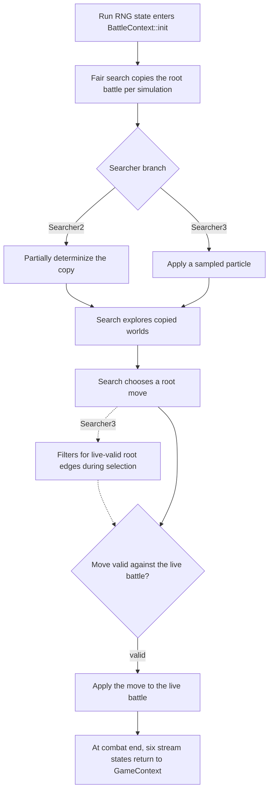

# Determinism and RNG

Last verified: 2026-08-02 against commit `6f7159f` and the current working tree (hidden-information boundary audit, plan 5.6.4 / spec §A.14).

## Purpose

Document RNG ownership, project-fair determinization, copy boundaries, and the
known gaps that prevent claims of complete hidden-information modeling or
bit-reproducible whole-run evaluation.

## Current implementation

`GameContext` owns separate RNG streams for AI choices, cards, events,
merchants, monsters, potions, relics, shuffling, treasure, and other domains
(`include/game/GameContext.h::GameContext`). `BattleContext` carries six
combat-relevant streams: AI, card-random, misc, monster-HP, potion, and shuffle
(`include/combat/BattleContext.h::BattleContext`).

`BattleContext::init` copies `gc.miscRng` and `gc.potionRng` and re-derives the
AI, card-random, monster-HP and shuffle streams from the public
`Random(gc.seed + gc.floorNum)`; `BattleContext::exitBattle` copies the six
resulting stream states back to `GameContext`
(`src/combat/BattleContext.cpp::init`, `exitBattle`). Search operates on battle
copies, while the selected action is committed to the live battle.

`STS_FAIR=1` calls `ScumSearchAgent2::playoutBattleFair`. With default
Searcher2, each simulation shuffles the draw pile and replaces only shuffle and
card-random RNG. With `STS_SEARCHER3=1`, each sampled `HiddenBattleState`
contains all six seed pairs and a draw order
(`src/sim/search/BattleScumSearcher2.cpp::determinize`;
`src/sim/search/BattleScumSearcher3.cpp::applyParticle`). Searcher3 samples and
applies particle RNG seeds even when `STS_FAIR` is off; its non-fair agent path
reuses the tree. Both fair paths commit one root action and create a new
searcher for the next observed decision.

## Important data flow

1. Run RNG state enters `BattleContext::init`.
2. A fair search copies the root battle for each simulation.
3. Searcher2 partially determinizes the copy; Searcher3 applies a sampled
   particle.
4. Search explores copied worlds and chooses a root move.
5. The agent validates that move against the live battle and applies it if
   valid; Searcher3 filters for live-valid root edges during selection.
6. At combat end, six stream states return to `GameContext`.

Searcher3 intends to seed its `std::mt19937_64` from visible observation,
`agentSeed`, and `decisionIndex`. The constructor now takes both values as
explicit parameters and computes the composite seed at construction;
`ScumSearchAgent2::playoutBattleFair` passes `bc.seed` plus an incrementing
decision index per decision, and the tree-reuse path re-keys via `reseed()`
after `advanceRoot` (`BattleScumSearcher3::BattleScumSearcher3`;
`ScumSearchAgent2::playoutBattleFair`, `playoutBattle`).

## Invariants and assumptions

- Project-fair and known-RNG results are different regimes.
- “Fair” is a repository mode label, not proof that all player-hidden state is
  modeled.
- Search determinizations mutate copies, not the committed live battle.
- A copied `GameContext` shares `map`; detach before counterfactual mutation.
- Per-seed benchmark CSVs must be aligned by seed because parallel completion
  order is nondeterministic.
- Strategic datagen modes reproduce bit-identically across separate
  invocations (verified 2026-08-02 for `strategicgen2`, `fairgen`, and
  `oocnextgen` on 2-3 seeds with the build2 `one_combat` binary): branch RNG
  derives only from public values (run seed, decision index, future index)
  plus the copied stream states, and branches never feed back into the live
  run.
- Event option effects are sampled after the player's choice
  (`GameContext::chooseEventOption`); `setupEvent` pre-rolls only the offer
  draws the real game also rolls at event generation. The one-ply Q gates
  therefore see no event outcome before selection.
- Reproducibility records include revision, seed block, simulation count,
  ascension, searcher, all `STS_*` behavior flags, thread count, model paths and
  hashes, and observed load messages.

## Known limitations

- Strategic counterfactual branches built in `apps/one_combat.cpp`
  (`detachedCounterfactualCopy` + `finishOocCounterfactual`,
  `runStrategicGenSeed2`, `runDataGen2Seed`, `runPathCounterfactualSeed`,
  `runOocNextCombatSeed`) continue from a full copy of the live
  `GameContext`, i.e. from the true future stream state: the branch
  experiences the exact future encounters, event outcomes, shop contents and
  treasure the live run will. Only the `actFightProbe*` paths resample the
  hidden encounter queues (`resampleRemainingActEncounters`, conditional pool
  with the game's no-repeat rule; the act boss is deliberately not resampled
  because this repo treats it as public). This is a known §A.14 leak
  ("do not copy the true future seed and then optimize against it"), flagged
  in the decision log, not fixed.
- The strategic model features (`apps/one_combat.cpp::richRow`,
  `buildTokState`) include the exact next-encounter identities
  (`nextFight0..2`, `nextEliteId`) at every decision; the player only knows
  the pool. Same §A.14 leak class; flagged, not fixed.
- The one-ply Q gates (`oocOnePly*Policy`) score `predictActionValue` on the
  pre-decision state only, so they do not determinize hidden outcomes. The
  `STS_OOC_STRATEGIC_Q=0` V2 fallback instead executes the action on a probe
  copy and scores the successor, which contains the true post-choice draw
  (event outcomes, chest contents).
- `ScumSearchAgent2::stepOutOfCombatPolicy` reads the hidden pre-rolled
  `gc.info.chestSize` for the CURSED_KEY treasure open/skip choice; a player
  cannot see chest size before opening. Flagged; not fixed (policy change
  with benchmark impact).
- Searcher2 leaves four combat RNG streams concrete under `STS_FAIR=1`.
- Searcher3's stored `HiddenBattleState::drawPileOrder` is installed by
  `applyParticle` only when the copied pile's size and card multiset match the
  particle; after tree reuse, stale particles fall back to a searcher-RNG
  shuffle (`src/sim/search/BattleScumSearcher3.cpp::applyParticle`).
- `Belief::update` zero-weights particles that contradict the observed pile,
  and `Belief::sample` falls back to uniform when all weights are equal or
  total zero, so an observation that contradicts every particle resets the
  belief (`src/sim/search/CombatObservation.cpp`). Searcher3's in-search
  `belief.update` calls are off by default since issue #58 (2026-08-10): the
  default-on internal update destroyed the root belief within ~60 sims;
  `STS_S3_INTERNAL_BELIEF_UPDATE=1` restores the historical behavior.
- `CombatObservation::operator==` and `visibleHash` share one canonical field
  set; card piles compare as `CardKey` multisets, so order-insensitive equality
  is deliberate and equal observations hash equally.
- `search::g_potionKeepValue` is thread-local because `runFullRunOOC`
  computes it per fight while fair benchmark seeds execute concurrently. A
  process-global value caused cross-seed contamination and non-reproducible
  outcomes; the declaration/definition are in
  `include/sim/search/BattleScumSearcher2.h` and
  `src/sim/search/BattleScumSearcher2.cpp`. A repeated 8-seed, 1k-sim,
  12-thread check matched outcomes, floors, HP, and death fields after the fix.
- Historical repeated fair multi-thread runs were not bit-identical
  (`EXPERIMENTS.md` entries 66e, 66j). Since commit `63d8b89` the recorded
  divergence does not reproduce: fair Searcher2/Searcher3 and known-RNG runs
  replay bit-identically across separate invocations and thread counts
  (1/8/12) on this machine (`EXPERIMENTS.md` §69). **Inference:** the
  historical cause was stale `BattleContext` state under `schedule(dynamic)`
  reuse, fixed in `da8c902`'s `BattleContext::init` reset block.
  `tools/verify/check_replay.py` probes repeated-seed CSV equality; `sec` legitimately
  differs between runs.
- The self-play baseline cache includes the fixed native floor/win artifacts in
  its key and treats deterministic outcomes as an assumption, not a proof
  (`selfplay/loop.sh::baseline_cache_key`).
- `ScreenStateInfo` sentinel initialization and `BattleContext::init` resets
  reduce stale-copy behavior but do not establish whole-run determinism.

## Open questions

- Which hidden variables belong in the project-fair model for each searcher?
- Does bit-identity hold across compilers, sanitizer builds, and other
  machines (verified only for gcc 13 / `-O3` / Linux/WSL so far)?
- Should the act boss identity be hidden (spec §A.14 lists exact encounter
  identity) or stay public as this repo currently treats it?
- Should the strategic features/counterfactual branches sample event, shop
  and treasure outcomes from conditional distributions instead of the true
  stream continuation?

## Relevant code

- `include/game/GameContext.h::GameContext`, `ScreenStateInfo`
- `src/game/GameContext.cpp::GameContext`
- `include/combat/BattleContext.h::BattleContext`
- `src/combat/BattleContext.cpp::init`, `exitBattle`
- `src/sim/search/BattleScumSearcher2.cpp::determinize`
- `include/sim/search/CombatObservation.h::CombatObservation`,
  `HiddenBattleState`, `Belief`
- `src/sim/search/CombatObservation.cpp::visibleHash`, `operator==`,
  `Belief::update`, `sample`
- `src/sim/search/BattleScumSearcher3.cpp::BattleScumSearcher3`, `applyParticle`
- `src/sim/search/ScumSearchAgent2.cpp::playoutBattleFair`
- `src/sim/search/ScumSearchAgent2.cpp::stepOutOfCombatPolicy` (TREASURE_ROOM chest-size read)
- `src/sim/search/GameAction.cpp::getAllActionsInState`, `getValidEventSelectBits`
- `src/game/GameContext.cpp::setupEvent`, `chooseEventOption`
- `apps/one_combat.cpp::detachedCounterfactualCopy`, `finishOocCounterfactual`,
  `runStrategicGenSeed2`, `resampleRemainingActEncounters`, `richRow`, `buildTokState`
- `selfplay/loop.sh::baseline_cache_key`

The optional `g_onBattleExitRaw` observer is instrumentation at the native
RAW persistent-transfer boundary. It receives the same synchronized combat
RNG streams that `exitBattle` writes to `GameContext` and does not alter RNG,
continuation, or reward behavior when unset.
