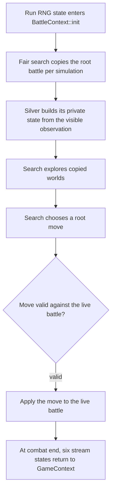

# Determinism and RNG

Last verified: 2026-09-24 for Silver-only combat (ADR-0020) and the Searcher3 removal; 2026-09-20 for live OOC MCTS hypothetical noncombat futures; 2026-09-14 for supported-v1 RNG continuation;
2026-08-02 against commit `6f7159f` and the current working tree (hidden-information boundary audit, plan 5.6.4 / spec §A.14).

## Purpose

Document RNG ownership, project-fair determinization, copy boundaries, and the
known gaps that prevent claims of complete hidden-information modeling or
bit-reproducible whole-run evaluation.

## Current implementation

`GameContext` owns separate RNG streams for AI choices, cards, events,
merchants, monsters, potions, relics, shuffling, treasure, and other domains
(`include/game/GameContext.h::GameContext`). `BattleContext` carries six
combat-relevant streams: AI, card-random, misc, monster-HP, potion, and shuffle
(`include/combat/BattleContext.h::BattleContext`).

`BattleContext::init` copies `gc.miscRng` and `gc.potionRng` and re-derives the
AI, card-random, monster-HP and shuffle streams from the public
`Random(gc.seed + gc.floorNum)`; `BattleContext::exitBattle` copies the six
resulting stream states back to `GameContext`
(`src/combat/BattleContext.cpp::init`, `exitBattle`). Search operates on battle
copies, while the selected action is committed to the live battle.

For the current supported-v1 whole-combat surrogate, no learned RNG head is
needed. `potionRng` is unchanged because Entropic Brew is the sole live combat
consumer and is excluded. Every live `miscRng` draw occurs in monster
initialization; its public call schedule is determined by encounter, including
helper calls and temporary candidate construction. Replaying that schedule
from pre.miscRng with native bounded-rejection semantics reconstructs exact
post counter and seeds. Later summons use AI RNG. The audit reproduces all
510,030 frozen misc states, including all 413,799 supported states.

Native `setCounter` advances one raw step per boolean draw and does not rewind.
It matches all inherited-stream corpus states, but cannot generally replay
bounded `random(int)` rejection or untracked raw calls. Use the deterministic
bounded initialization closure, not an assumed one-step-per-counter theorem.
The required misc counter delta is derived from encounter; potion delta is
zero. See [the exact continuation evidence](../../experiments/evidence/combat_rng_continuation_2026-09-14.md)
and [current research](../evaluation/current-research.md).

All battles recreate AI/card-random/monster-HP/shuffle even at the same floor.
Current normal controller paths contain no reachable same-floor successor:
Colosseum is disabled and its handler is a TODO, event combats return to
rewards/map, and the A20 second boss increments floor. Corpus source ordering
confirms zero same-floor pairs among 485,031 consecutive fights. Card-random
and shuffle OOC consumers after combat run after normal floor or boss-treasure
reset (including Pandora's Box). Their RAW post values need no generated state
for normal supported continuation; exact six-stream RAW snapshot synthesis is
a different contract. Re-audit any new chain/controller or combat RNG consumer.
Runtime surrogate integration and multi-fight qualification remain pending.

Combat search is Silver only (ADR-0020). Silver converts the visible state into
its private representation and owns its chance randomness from a stable
per-battle seed (see [combat-search.md](../architecture/combat-search.md)); it
never reads the live battle's hidden RNG streams. Searcher2 (partial
determinization) and Searcher3 (particles) were removed.

Live opt-in OOC MCTS separately samples unknown native futures in
`apps/one_combat/ooc_mcts_adapter.cpp::sampleNoncombatFuture`. Before search
transitions and leaf continuation, detached copies receive planner-owned RNG
states and a hypothetical run seed, shuffled remaining relic/colorless pools,
conditional unseen encounter queues, and unrevealed chest/event contents.
Revealed offers, current map/boss and selector progress stay fixed. Hypothetical
states are never committed to the live game. Random successors are chance
particles, not deterministic cached edges; CTM preparation is specific to each
sampled precombat state. The exact-replay adapter option exists for offline
fixtures and is never selected by live MCTS configuration.

This removes knowledge of the real future draws from this MCTS transition
path. It does not qualify the exact joint posterior over all hidden native
state or remove limitations of other counterfactual pipelines below. V4 priors
already omit hidden encounter identities; native leaf features now consume
sampled encounter queues.

## Important data flow

1. Run RNG state enters `BattleContext::init`.
2. A fair search copies the root battle for each simulation.
3. Silver builds its private state from the visible observation.
4. Search explores copied worlds and chooses a root move.
5. The agent validates that move against the live battle and applies it if
   valid.
6. At combat end, six stream states return to `GameContext`.

## Invariants and assumptions

- Project-fair and known-RNG results are different regimes.
- “Fair” is a repository mode label, not proof that all player-hidden state is
  modeled.
- Search determinizations mutate copies, not the committed live battle.
- A copied `GameContext` shares `map`; detach before counterfactual mutation.
- Per-seed benchmark CSVs must be aligned by seed because parallel completion
  order is nondeterministic.
- Strategic datagen modes reproduce bit-identically across separate
  invocations (verified 2026-08-02 for `strategicgen2`, `fairgen`, and
  `oocnextgen` on 2-3 seeds with the build2 `one_combat` binary): branch RNG
  derives only from public values (run seed, decision index, future index)
  plus the copied stream states, and branches never feed back into the live
  run.
- Event option effects are sampled after the player's choice
  (`GameContext::chooseEventOption`); `setupEvent` pre-rolls only the offer
  draws the real game also rolls at event generation. The one-ply Q gates
  therefore see no event outcome before selection.
- Reproducibility records include revision, seed block, simulation count,
  ascension, searcher, all `STS_*` behavior flags, thread count, model paths and
  hashes, and observed load messages.

## Known limitations

- Strategic counterfactual branches built in `apps/one_combat.cpp`
  (`detachedCounterfactualCopy` + `finishOocCounterfactual`,
  `runStrategicGenSeed2`, `runDataGen2Seed`, `runPathCounterfactualSeed`,
  `runOocNextCombatSeed`) continue from a full copy of the live
  `GameContext`, i.e. from the true future stream state: the branch
  experiences the exact future encounters, event outcomes, shop contents and
  treasure the live run will. Only the `actFightProbe*` paths resample the
  hidden encounter queues (`resampleRemainingActEncounters`, conditional pool
  with the game's no-repeat rule; the act boss is deliberately not resampled
  because this repo treats it as public). This is a known §A.14 leak
  ("do not copy the true future seed and then optimize against it"), flagged
  in the decision log, not fixed.
- Native rich features (`apps/one_combat/run_features.cpp`) include exact
  next-encounter identities (`nextFight0..2`, `nextEliteId`). Live MCTS feeds
  them sampled queues; other copied-state consumers retain the hidden-future
  limitation. V4 `buildTokStatePure` omits these hidden fields.
- The one-ply Q gates (`oocOnePly*Policy`) score `predictActionValue` on the
  pre-decision state only, so they do not determinize hidden outcomes. The
  `STS_OOC_STRATEGIC_Q=0` V2 fallback instead executes the action on a probe
  copy and scores the successor, which contains the true post-choice draw
  (event outcomes, chest contents).
- `ScumSearchAgent2::stepOutOfCombatPolicy` reads
  `gc.info.chestSize` for the CURSED_KEY treasure open/skip choice. Chest
  size is treated as visible by the sampled OOC contract; contents (gold/tier
  and relic identity) are sampled before opening.
- `CombatObservation::operator==` and `visibleHash` share one canonical field
  set; card piles compare as `CardKey` multisets, so order-insensitive equality
  is deliberate and equal observations hash equally.
- Historical repeated fair multi-thread runs were not bit-identical
  (`EXPERIMENTS.md` entries 66e, 66j). Since commit `63d8b89` the recorded
  divergence did not reproduce: fair Searcher2/Searcher3 and known-RNG runs
  replay bit-identically across separate invocations and thread counts
  (1/8/12) on this machine (`EXPERIMENTS.md` §69). **Inference:** the
  historical cause was stale `BattleContext` state under `schedule(dynamic)`
  reuse, fixed in `da8c902`'s `BattleContext::init` reset block.
  `tools/verify/check_replay.py` probes repeated-seed CSV equality; `sec` legitimately
  differs between runs.
- The self-play baseline cache includes the fixed native floor/win artifacts in
  its key and treats deterministic outcomes as an assumption, not a proof
  (`selfplay/loop.sh::baseline_cache_key`).
- `ScreenStateInfo` sentinel initialization and `BattleContext::init` resets
  reduce stale-copy behavior but do not establish whole-run determinism.

## Open questions

- Which hidden variables belong in the project-fair model for each searcher?
- Does bit-identity hold across compilers, sanitizer builds, and other
  machines (verified only for gcc 13 / `-O3` / Linux/WSL so far)?
- Should the act boss identity be hidden (spec §A.14 lists exact encounter
  identity) or stay public as this repo currently treats it?
- Should the strategic features/counterfactual branches sample event, shop
  and treasure outcomes from conditional distributions instead of the true
  stream continuation?

## Relevant code

- `include/game/GameContext.h::GameContext`, `ScreenStateInfo`
- `src/game/GameContext.cpp::GameContext`
- `include/combat/BattleContext.h::BattleContext`
- `src/combat/BattleContext.cpp::init`, `exitBattle`
- `include/sim/search/CombatObservation.h::CombatObservation`
- `src/sim/search/CombatObservation.cpp::visibleHash`, `operator==`
- `src/sim/search/ScumSearchAgent2.cpp::stepOutOfCombatPolicy` (TREASURE_ROOM chest-size read)
- `src/sim/search/GameAction.cpp::getAllActionsInState`, `getValidEventSelectBits`
- `src/game/GameContext.cpp::setupEvent`, `chooseEventOption`
- `apps/one_combat.cpp::detachedCounterfactualCopy`, `finishOocCounterfactual`,
  `runStrategicGenSeed2`, `resampleRemainingActEncounters`, `richRow`, `buildTokState`
- `selfplay/loop.sh::baseline_cache_key`

The optional `g_onBattleExitRaw` observer is instrumentation at the native
RAW persistent-transfer boundary. It receives the same synchronized combat
RNG streams that `exitBattle` writes to `GameContext` and does not alter RNG,
continuation, or reward behavior when unset.
