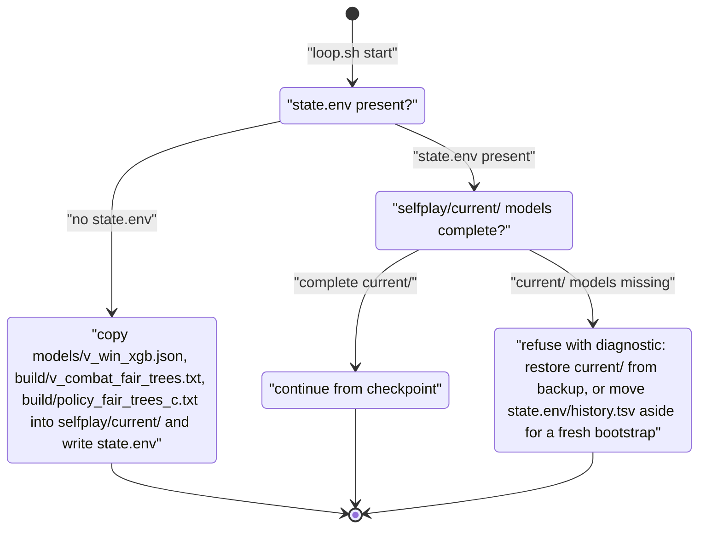

# Self-play loop

Last verified: 2026-08-11 against the current working tree (tracked V_win
bootstrap source relocated to `models/v_win_xgb.json`; the two other first-run
sources stay ignored `build/` files).

## Purpose

Document the resumable self-play, retraining, and paired-gating implementation,
its checked-in snapshots, and the bootstrap/gating behavior that must hold for a
valid launch or meta promotion.

## Current implementation

`selfplay/loop.sh` is the authoritative controller. It creates local buffer,
model, candidate, log, current, and gate directories; resumes from
`selfplay/state.env`; generates run/combat/policy/rest data; retrains due arms;
and performs adaptive paired gates.

Implemented arms are independent:

- meta: V_win and optional paired rest action model;
- combat value: candidate value with the loop's current policy;
- combat policy: candidate policy with the loop's current value.

If value and policy qualify together, policy promotion is deferred so it can be
tested against the new value baseline. The script header describes this
arm-independent promotion.

The meta arm runs server-backed: `META_POLICY_ENV` adds `STS_NATIVE_OOC=0` to
the floor/win policy env, so meta datagen and meta gates exercise the V_win/rest
models in `v_server.py` (candidate models during gates) instead of the fixed
native trees. Combat datagen and value/policy gates keep native OOC with the
deployed stack (`selfplay/loop.sh::META_POLICY_ENV`, meta gate block). Native-
OOC gate batches (baseline/value/policy) skip `start_server` entirely — only the
server-backed meta arm starts it (`selfplay/loop.sh::needs_server`, Issue 82).

Bootstrap is an explicit three-branch state machine (Issues 11/30):

- fresh: no `state.env` — copies first-run sources
  `models/v_win_xgb.json`, `build/v_combat_fair_trees.txt`,
  `build/policy_fair_trees_c.txt` into `selfplay/current/` and writes state;
- resume: `state.env` plus complete `selfplay/current/` — continues from the
  checkpoint;
- repair: `state.env` exists but `selfplay/current/` models are missing —
  refuses to run with a diagnostic (restore `current/` from backup, or move
  `state.env`/`history.tsv` aside for a fresh bootstrap).

The executable is `$BIN`, default `./build/one_combat`, overridable via
`ONE_COMBAT_BIN` or `STS_BIN`; a stale root `./one_combat.elf` is not the built
binary and is never invoked. The loop exits early if `$BIN` is missing or not
executable.

Runtime defaults include 1,000 runs/iteration, 400 live-policy simulations, 300
meta simulations, 1,000 teacher simulations, 600 gate simulations, two-iteration
meta/value/policy cadence, and a 500-seed adaptive cap. The checked-in
`selfplay/config.env` is only a partial snapshot: it records iteration-era
values but omits several current script variables such as `POLICY_SIMS` and
`VALUE_RETRAIN_EVERY`.

## Important data flow

1. Bootstrap branches (fresh/resume/repair) decide whether to seed
   `selfplay/current/` and `state.env`/history, continue, or refuse (see above).
2. Meta generation writes run outcomes using server-backed V_win/rest; combat
   generation uses the stronger `POLICY_SIMS` teacher and aligned value/policy
   callbacks; a subset of meta runs can emit paired rest-vs-smith continuations.
3. Replay windows are assembled by arm. Meta, combat, rest, and policy have
   separate window sizes.
4. Trainers create candidates under `selfplay/cand/` and model history under
   `selfplay/models/`.
5. `run_gate_batch` invokes `"$BIN" bestbench` on common held-out seeds and
   appends per-seed CSVs.
6. `gate_stats` compares `floor + 100*WIN_WEIGHT*won` and calculates
   `mean ± GATE_Z*SE`.
7. Qualifying artifacts are copied through temporary names into
   `selfplay/current/`; state/history advance only after successful phases.
8. `selfplay/status.sh` reads snapshots, markers, and gate progress for a
   dashboard.

```mermaid
flowchart LR
    S1["1. Bootstrap: fresh / resume / repair"]
    S2["2. Datagen: meta via server V_win/rest; combat via POLICY_SIMS teacher"]
    S3["3. Replay windows per arm"]
    S4["4. Trainers write selfplay/cand/ + selfplay/models/"]
    S5["5. run_gate_batch: $BIN bestbench on held-out seeds"]
    S6["6. gate_stats: floor + 100*WIN_WEIGHT*won; mean +/- GATE_Z*SE"]
    S7["7. Copy qualifying artifacts into selfplay/current/"]
    S8["8. status.sh dashboard"]
    S1 --> S2
    S2 --> S3
    S3 --> S4
    S4 --> S5
    S5 --> S6
    S6 --> S7
    S7 --> S8
```

Resume markers store a target and collision-free next seed; interrupted CSVs
are counted by distinct seed and resumed beyond the observed maximum
(`selfplay/loop.sh::done_for_target`, `marker_next_seed`, `seed_stats`).

## Invariants and assumptions

- Candidate and baseline arms use common seeds and the same gate budget.
- Equality at the configured margin does not promote. A negative value margin is
  a latency allowance only: `loop.sh` honors a negative `VALUE_MARGIN` solely
  when `VALUE_MARGIN_LATENCY=1` and otherwise clamps it to `PROMOTE_MARGIN`
  (Issue 14).
- Promotion is allowed only on the final hard-cap gate look; intermediate
  "promote" signals are advisory and downgraded to `continue`. Early rejection
  stays decisive. This is the multiplicity guard against repeated adaptive
  looks (Issue 15).
- Baseline outcomes are assumed deterministic for a fixed `$BIN`, model stack,
  policy mode, and evaluation config; the assumption is not re-verified on every
  cache hit. The cache key hashes `$BIN`, current models, the fixed native trees
  `models/v_rich_trees.txt` + `models/v_win_trees.txt`, `v_server.py`, and the
  active `STS_*` environment (Issue 13). Python dependency versions are
  deliberately omitted.
- The meta arm's candidate validity requires server use: with `STS_NATIVE_OOC=0`
  the fixed native trees are bypassed and every V_win/rest decision is served by
  `v_server.py`. Liveness is checked by polling the port; there is no per-decision
  trace proof yet.
- Generated buffers may be ignored, large, append/resume-safe, and expensive;
  absence from git is not authorization to delete them.
- `selfplay/config.env` and `state.env` describe snapshots, not universal
  defaults or proof of a running process. `state.env` with an incomplete
  `selfplay/current/` is a repair case, not a resume case.
- Exact PIDs are used when stopping the Python server; broad process patterns
  are unsafe.

## Resolved discrepancies (2026-08-02)

These were blocking before the 2026-08-02 fixes and are now resolved in
`selfplay/loop.sh`:

- **Meta arm bypass (Issue 01).** `FLOOR_POLICY_ENV`/`WIN_POLICY_ENV` did not
  set `STS_NATIVE_OOC=0`, so `one_combat` used the fixed native trees and the
  candidate V_win/rest models never owned a decision. Now
  `META_POLICY_ENV` adds `STS_NATIVE_OOC=0` and is used for meta datagen and
  meta gates; `start_server` port-liveness failure fails the batch. Residual
  gap: liveness proves the server is up, not that every intended decision went
  through it (see Known limitations).
- **Non-runnable snapshot (Issue 11).** The loop invoked `./one_combat.elf`
  while CMake produces `build/one_combat`, and a stale `state.env` silently
  skipped the first-run copy branch. Now all invocations use `$BIN` and the
  bootstrap state machine either resumes (state + complete `current/`) or
  refuses with repair instructions. The checked-in `state.env` alone is still
  not resumable state — the loop now says so instead of silently running.
- **Baseline cache provenance (Issue 13).** `baseline_cache_key` now hashes
  `$BIN`, current models, `models/v_rich_trees.txt` + `models/v_win_trees.txt`,
  `v_server.py`, and both policy envs; the "deterministic" comment now states it
  is an assumption. Python dependency versions remain omitted (pip freeze is too
  expensive per key evaluation).
- **`VALUE_MARGIN` (Issue 14).** The negative margin is now conditional on
  `VALUE_MARGIN_LATENCY=1`; without it, a negative value is clamped to
  `PROMOTE_MARGIN` with a warning.
- **Gate multiplicity (Issue 15).** Promotion now happens only at the final
  hard-cap look; earlier promote signals are advisory. `GATE_LOOKS` is recorded
  in the gate progress state.

## Known limitations

- Server liveness is a port probe only; there is no per-decision trace or query
  count proving the candidate model owns each V_win/rest decision. Startup
  output (`[native OOC floor/win GBMs ON]` absent) and the new meta env are
  indirect evidence.
- The multiplicity guard costs power: a promotable candidate always pays the
  full `GATE_SEEDS` budget; no alpha-spending method recovers early promotion.
  `GATE_Z=2.58` is nominal per look, not a proven 99% sequential guarantee.
- `POLICY_WINDOW=1` is the checked-in local snapshot. Historical memory-failure
  thresholds were not reproduced in this workspace.
- The loop depends on Bash, Python training packages, and a runnable `$BIN`;
  the inference server is required only by the server-backed meta arm
  (`STS_NATIVE_OOC=0`), never by native-OOC gate batches (Issue 82). Only
  `$BIN` and the first-run model sources are validated up front.
- There is no checked-in end-to-end test for bootstrap, resume, candidate-use,
  or atomic multi-arm promotion.
- The checked-in `config.env` still records `VALUE_MARGIN=-0.5` without
  `VALUE_MARGIN_LATENCY=1`; it is a snapshot that predates the latency gate.

## Open questions

- Should a per-decision query log (server side or trace) be required to prove
  candidate model use, rather than port liveness plus env inspection?
- Should alpha-spending style boundaries (e.g., O'Brien-Fleming) replace
  hard-cap-only promotion to recover early-stop power?
- Should Python dependency fingerprints (e.g., a pinned `requirements.txt`
  hash) join `v_server.py` in the baseline cache key?
- The checked-in `state.env` (iteration 10, seed offset 1008002) is stale
  relative to the artifacts present in some checkouts; is that snapshot worth
  repairing or should it be reset deliberately?

## Relevant code

- `selfplay/loop.sh::start_server`, `needs_server`, `cenv_files`, `gate_stats`,
  `baseline_cache_key`, `run_gate_batch`, bootstrap state machine,
  multiplicity guard
- `selfplay/status.sh`
- `selfplay/config.env`; `selfplay/state.env`; `selfplay/meta_mode.env`
- `apps/one_combat.cpp::main`, `bestBench`, `runFullRunOOC`,
  `vQueryRestCounterfactual`, `vQueryHealWin`, `vQueryUpgradeWin`
- `v_server.py`
- `train_winrate.py`, `train_rest_cf.py`, `train_value_combat.py`,
  `train_policy.py`
- `EXPERIMENTS.md` entries 37–55
