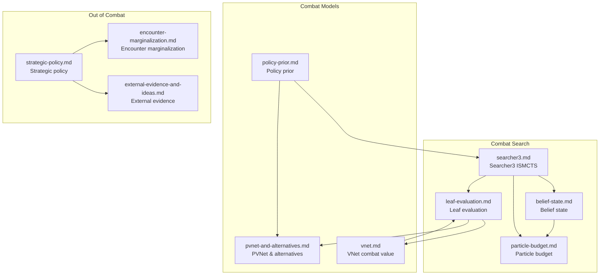

# Research knowledge graph

Last verified: 2026-09-04 against the current working tree.

## Purpose

This directory holds maintained topic-oriented research synthesis. Each page
answers a specific scientific question: what the current evidence says, which
hypotheses were rejected, which remain open, and where to find the supporting
chronological evidence.

## Relationship to other documentation

| Source | Role |
| --- | --- |
| [`EXPERIMENTS.md`](../../../EXPERIMENTS.md) + shards | Chronological evidence — what happened and when |
| Here (research graph) | Current scientific understanding per topic |
| [`evaluation/current-research.md`](../evaluation/current-research.md) | Global active/parked/closed research **routing** |
| [`evaluation/current-baselines.md`](../evaluation/current-baselines.md) | Qualified executable configurations |
| [Architecture pages](../architecture/) | Implementation contracts |
| [Decision records](../../../decisions/README.md) | Stable evidence-backed rationale; destination for new durable decisions |
| Git history | Historical session decisions, only when explicit provenance is required |

Do **not** duplicate the global research-status tracker here. This graph answers
"what do we currently know about this topic?" while `current-research.md`
answers "what should we work on next?"

## Topic map

- [Searcher3 ISMCTS](combat-search/searcher3.md) — overall Searcher3 story and current regime
- [Belief state](combat-search/belief-state.md) — belief maintenance, filtering, collapse
- [Particle budget](combat-search/particle-budget.md) — particle-count sensitivity
- [Leaf evaluation](combat-search/leaf-evaluation.md) — rollout, VNet, utility alternatives
- [VNet combat value](combat-models/vnet.md) — VNet evolution and deployment
- [Policy prior](combat-models/policy-prior.md) — GBM policy prior and v2
- [PVNet & alternatives](combat-models/pvnet-and-alternatives.md) — neural shared nets
- [Strategic policy](ooc/strategic-policy.md) — OOC learned policy evolution
- [Encounter marginalization](ooc/encounter-marginalization.md) — M0/M1 strategic labels
- [External evidence and ideas](ooc/external-evidence-and-ideas.md) — benchmarks, expert play, literature, ranked OOC candidates
- [Variance reduction](ooc/variance-reduction.md) — rollout noise sources, CRN coupling, unbiased estimators (#883)

## Evidence labels

- **Inference** — evidence supports but does not establish causality.
- **Unverified** — a document or artifact reports but was not reproduced.
- **Open question** — the repository does not settle the issue.
