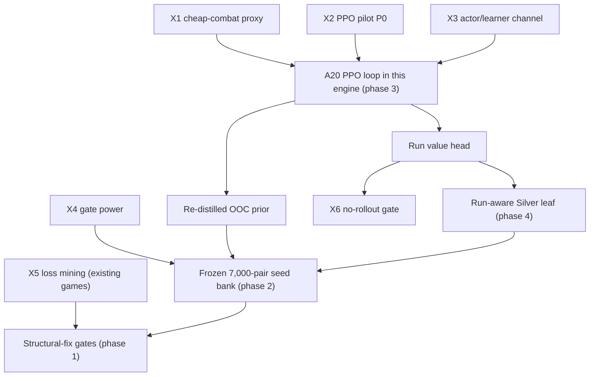

# One-year roadmap to the A20 Heart kill (2026-11 to 2027-10)

Last verified: 2026-10-31 against main `6c96c25` (ledger through §728, ADRs through 0063). Research and design only:
no gameplay seeds were run for this page.

## Purpose / research question

Philipp asked (2026-10-31) how to approach the project with a full team and one year. The budget is not unlimited:
about **200 CPU cores** (the cloud worker pool, ~48 four-CPU containers), **one RTX 3060 Ti (8 GB)** and **32 GB
RAM** on Philipp's PC, and **12 months**. This page re-scopes a first "unlimited compute" sketch (exact engine first,
1000× throughput, one transformer for the whole run, AlphaZero/Stochastic MuZero without rollouts, imitation
bootstrap, evaluation infrastructure) against what the repository has already measured, estimates costs from
measured numbers, ranks the phases by expected Heart-kill gain per unit of compute, and names the cheapest first
experiments with decision rules.

This page is a plan. Every experiment it names needs its own pre-registration, the seed-run guard and Philipp's
explicit authorization (larger runs, worker counts, defaults). The external benchmark picture and the ten
2026-10-26 ideas are in [External evidence and ideas](ooc/external-evidence-and-ideas.md); this page does not repeat
them.

Labels: **Measured** = a cited ledger entry or artifact; **Inference** = reasoning on this page; **Assumption** =
a planning number to be checked by the first experiments.

## Current conclusion

1. **Compute is not the binding constraint any more; signal is.** At measured costs, one year of 200 cores buys
   roughly 4 million production-strength A20 games or several hundred million cheap-combat games (table below).
   Every recent dead end failed on signal, not cost: the value chooser lost −15.0 pp because value gaps of 0.01-0.02
   overrode a confident policy (§727); outcome labels could not rank siblings (§685, rho 0.49); act values failed
   their gates (§725); AZ gen 2 changed ~3% of choices for +0.6 pp (§621, NOT_SHOWN), and the gen-3 prior was negative offline (§643).
2. **What moved the Heart rate were structural fixes and the PPO-trained prior,** not value heads or search
   variants: flexible keys +6.1 pp (§691), the Incense Burner term at Shield and Spear +5.9 pp (§724), the calibrated
   leaf M0 +2.15 pp (§661), map-only search +4.8 pp Act-4 arrival (§683), the Act-4 strong replay +2.4 pp (§682, inconclusive, adopted by Philipp's call), and before
   that heart1/student as the prior (+23-25 pp Act-3 clears, §486/§488). heart1 is the one demonstrated route to a
   strong run policy: PPO on ~0.66M games, ~6-7k core-hours, with only ~1/21 of its games at A20.
3. **Therefore the year should be spent on (a) a loss-mining and structural-fix pipeline, (b) much larger standard
   gates, (c) our own A20 PPO loop in this engine, and (d) run-aware combat leaves fed by that loop's value head.**
   "One monolithic network", "no rollouts" and Stochastic MuZero are deferred behind explicit gates; human imitation
   and leagues are dropped.

## The first sketch, re-scoped

| Sketch item | Verdict on this budget | Repository evidence |
| --- | --- | --- |
| 1. Make the engine exact first (months 0-3, thousands of replayed runs) | **Re-scope to a background track on the PC.** It does not gate the other work. | The game JAR exists only on the PC, so differential tests cannot use the cloud cores. The one-step parity probe (#651) found real bugs at a low step rate (canary 2: 260 matching, 30 mismatching steps through Act 2, most of them representation or export issues), each fixed as a default-on flag ([differential correctness](../evaluation/differential-correctness.md)). Simulator exactness changes live transfer, not the simulated Heart rate we gate on. |
| 2. 1000× throughput, batched GPU inference | **Drop GPU batching; keep targeted CPU speed-ups.** | The GPU sits on the PC, the cores in cloud containers: actors cannot share a GPU batch. Combat CPU is already profiled (MLP prior 54%, playouts 83%; #780 and #789 gave 1.27-1.54× and −11..−15%). The dead ends did not die of cost (point 1 above). |
| 3. One network for combat and OOC | **Keep two nets, share the target.** A shared run-state encoder is fine for OOC (heart1 already is one); the combat prior must stay a µs-scale MLP. | heart1 costs ~30 ms per call natively, student_sel d64 ~0.8 ms; OOC MCTS makes ~500 prior calls per decision. The Silver prior is called inside every playout step. What should be shared is the value target (P(Heart kill)), which the Incense term showed pays inside combat (§724). |
| 4. AlphaZero / Stochastic MuZero without rollouts | **MuZero dropped** (we have an exact simulator; a learned model only adds error). **"No rollouts" deferred** until a value head beats rollout3 at sibling ranking. **Search-distillation loops deprioritised.** | Every value head so far ranks siblings at or below X2-B/rollout3 (§641-§649, §700, §715); Gumbel roots lost (§635 −11.4 pp, §693 NOT_SHOWN); the CRN particle search lost (§680); search changes ~6.5% of decisions; AZ gen 2 NOT_SHOWN (§621), gen-3 prior negative offline (§643). |
| 5. Imitation bootstrap, league | **Imitation of our own best policy: already done** (student_sel). **Human imitation: drop** (§694 −2.1 pp, §696 −0.7 pp, NOT_SHOWN). **League: drop** (single-player game, no opponent to overfit to). | — |
| 6. Evaluation as infrastructure | **Keep, rank high.** 200 cores make 1-pp gates affordable. | Paired SD per pair ≈ 0.42-0.46 (§691: ±2.6 pp at 1,024 pairs; §727: ±2.3 pp at 1,536). AIVAT cut SD only to 0.80× (§698), so sample size is the lever. |
| 7. Team split | Not applicable: threads, at most two implementation/research threads at once unless Philipp asks. | Project instructions. |

## Measured costs and the yearly budget

Per-game CPU, A20, from the 2026-10-31 rollout-cost measurement (no ledger entry; main `593db4f`, v3 build,
4-CPU cloud, smoke-size n; raw `/mnt/project-files/rollout-cost/summary.txt`) and the §727 records:

| Configuration | Core-seconds per game | Heart kills seen | Source |
| --- | ---: | --- | --- |
| Production default (map-only OOC MCTS + production Silver) | ~826 (0.23 core-h) | ~25-27% (§691, §727 arm A) | §727 arm A, mean over 1,536 games (§685's older ≈ 310 core-h per 1,024-seed A/B implies ~540 s) |
| student_sel alone + production Silver | 251 mean (X1, 2,048 games; smoke 237) | 461/2,048 | X1 arms RP/FP |
| student_sel + flat Silver 1,000 | 19.5 (X1, 2,048 games; smoke 13.7) | 298/2,048 | X1 arms R1000/F1000 |
| student_sel + flat Silver 200 | 3.0 (X1, 2,048 games; smoke 5.6) | 162/2,048 | X1 arms R200/F200 |
| Full CTM rollout from an act start to game end (no real combat; per act start, not per game) | 0.014-0.037 | pessimistic (act-1 leaf 0.10 vs real) | arm CTM, §663 |
| Full OOC MCTS on every screen (old default) | 971 (830 of it OOC search) | 1 game | arm M |

**Assumption:** 50% effective utilisation (container resets every 2-3 h, ~3× container speed spread, idle tails;
project memory 10-23/10-31). Then one year gives about **0.9M core-hours**:

| Use | Games per year at 0.9M core-h | Per day (200 cores, 50%) |
| --- | ---: | ---: |
| Production-strength games (826 s) | ~3.9M | ~10k |
| Silver-1,000 self-play games (19.5 s measured in X1 + ~3 s policy forward with a heart1-size net) | ~144M | ~380k |
| Silver-200 self-play games (3.0 s measured in X1 + ~3 s policy forward) | ~540M | ~1.4M |

Gate cost (Inference, from SD ≈ 0.44 per pair): half-width ±2.6 pp needs 1,024 pairs (~470 core-h, ~5 h); ±1.3 pp
needs 4,096 pairs (~1,900 core-h, ~19 h); ±1.0 pp needs ~7,000 pairs (~3,200 core-h, ~1.3 days). Forty 1-pp gates cost
~130k core-h, about 14% of the year.

GPU (Measured, project memory): student_sel and its variants train on the 3060 Ti; heart1-size (dim 256, 4 layers,
~4-5M parameters) fine-tunes fit; the PC runs one GPU job at a time. **Inference:** a PPO learner for a heart1-size
net is GPU-feasible; silverbot's trainer ran at ~11-13 min per 256-game iteration on the PC including simulation.

The binding constraints are therefore (Inference): the **cloud→PC data channel** for any learner on the GPU (the
share has a 10 GB / 50,000-file quota), **sequential review and decision bandwidth**, and **whether cheap combat is a
valid proxy** for production combat (experiment X1: VALID at flat Silver 1,000 for an OOC policy effect, see below).

## Phases ranked by expected Heart-kill gain per compute

Gains are **Inference** ranges for planning; the decision rules below decide.

| Rank | Phase | Expected gain | Compute | Why this rank |
| ---: | --- | --- | --- | --- |
| 1 | **Loss mining + structural fixes** (key/counter/phase rules, missing state in leaves, rule bugs) | +4 to +8 pp over the year, in 1-6 pp steps | Low: offline mining, then ~0.5-3k core-h per gate | Highest historical yield per core-hour (§691, §724, §661, §683, §682). Deaths given arrival: act 2 25%, act 3 40%, act 4 43% vs Baalorlord 14/9/10% ([external evidence](ooc/external-evidence-and-ideas.md#where-the-gap-is)). |
| 2 | **Bigger standard gates** (4,096-7,000 pairs, frozen seed bank) | 0 pp directly; makes 1-2 pp changes visible and stops false negatives | ~2-3k core-h per gate | Many plausible effects are 1-3 pp (§707: most leading-sibling gaps < 2 pp), below today's ~4 pp detection limit. |
| 3 | **A20 PPO fine-tune of the run policy in this engine** (heart1 recipe: outcome-driven, value baseline, init from heart1/student_sel, cheap combat if X1 passes) | 0 to +8 pp | Medium: ~5-20k core-h per million games + GPU | The only method that produced the current prior; heart1 saw ~5% A20 games, in its own engine with other rules; the distilled student was trained on keys-off acts 1-3 data and agreed with heart1 only 61-73% in key/Act-4 states (2026-10-17 audit), so the prior has never been optimised for this objective (Inference). Search distillation (AZ gens) had nothing to teach (§621, §643). |
| 4 | **Run-aware combat leaf** (Silver's end-of-fight score replaced or corrected by a post-fight run value from phase 3's value head) | 0 to +5 pp | Low-medium: fight replays (`fightreplay`, `expertfights`, act4replay) | The single combat term that priced a future state won +5.9 pp (§724). Combat itself costs HP from act 2 on (§711: act-2 elites +5.4, act-3 bosses +5.2 HP vs expert on his states); budget does not help (§716, §718), Silver is near-optimal on last turns (§654), so the lever is what the fight leaves for later. §721's teacher check blocks today's V_A4 (max HP wrong sign, 1-3 HP unresolved), so this waits for a better value head. |
| 5 | **Boss and act-2 elite planning** (better playout policy in bosses, distribution-following chance re-picks) | 0 to +3 pp | Medium | Trees plan about one round; bosses get 70-88% of simulated actions from playouts (§706); prior playouts are the only budget lever that paid (§681, ADR-0056). |
| 6 | **Engine exactness** (headless JAR differential fuzzing on the PC, live canary) | ~0 pp simulated; protects live play | PC only | See sketch item 1. |
| 7 | **Throughput engineering** | Multiplier on 3-5 only if X1 forces production-strength self-play | Engineering time | Not binding at Silver-1,000 self-play. |
| 8 | **Deferred behind gates:** single shared network, no-rollout search, value head as decider | Negative until gated | — | §727, §712, §685, §725, §715. |

## Year outline

- **Quarter 1 (Nov-Jan): instruments.** X1-X5 below; frozen 7,000-pair seed bank and gate tool; loss-mining
  report; first two structural-fix gates; PPO pilot P0 (X2).
- **Quarter 2 (Feb-Apr): own PPO loop.** If X1-X3 pass: A20 PPO in this engine with the actor/learner channel,
  production-strength A/B every ~1M games, re-distil the OOC MCTS prior from the PPO policy. Structural-fix gates
  continue in the second thread.
- **Quarter 3 (May-Jul): shared value into combat.** PPO value head through §721's teacher check, then a run-aware
  Silver leaf on S&S, act-3 bosses and act-2 elites; boss playout-policy work if phase 4 stalls.
- **Quarter 4 (Aug-Oct): consolidation.** Second PPO round from the combined stack, live verification with the
  canary, ablations of everything adopted during the year at 7,000 pairs, ADRs for the new defaults.

## Cheapest first experiments and decision rules

| # | Experiment | Cost | Decision rule |
| --- | --- | --- | --- |
| X1 | **Cheap-combat proxy validity**: **done 2026-11-01 (§739), VALID at Silver 1,000, INCONCLUSIVE at Silver 200** ([RESULT](../../experiments/evidence/cheap_combat_proxy_20261031/RESULT.md), [PREREG](../../experiments/evidence/cheap_combat_proxy_20261031/PREREG.md)). §691's flexible-vs-rigid keys contrast on its 1,024 seeds, student_sel alone out of combat: production (same runner) +5.76 pp, flat Silver 1,000 +4.49 pp [+2.34, +6.64] (DiD −1.27 [−4.39, +1.95]), Silver 200 +2.34 pp [+0.49, +4.20] (DiD −3.42 [−6.45, −0.39]). Silver 1,000 has about the same power per pair at 1/13 of the CPU (≈ 12× cheaper per unit of power). One OOC effect only: licenses cheap combat for ranking OOC policy changes, with production confirmation before a default. | 12.8 core-h cheap arms + 143 core-h control | Used: PPO self-play and OOC screens may run at flat Silver 1,000; Silver 200 at most a coarse pre-screen. |
| X2 | **PPO pilot P0** in silverbot's own engine (already designed, project memory 2026-10-25): 60 A20-only iterations from `heart1.pt` on the PC, 1,000 paired their-engine seeds at 1,000 sims vs heart1. | ~150 core-h + ~12-15 h GPU slot | **GO** (build our own loop, Q2) if ΔHeart ≥ +2 pp with CI > 0, or Act-4 CI > 0 and ΔHeart ≥ 0. **STOP** phase 3 if ΔHeart ≤ 0. **Superseded 2026-11-01** by an our-engine pilot after X1 ([A20 PPO plan](a20-ppo-plan.md)). |
| X3 | **Actor/learner channel.** Cloud actors write only seed + action indices + per-decision log-probs; the PC replays them deterministically to rebuild states and features. Measure bytes per game, replay ms per game on the PC and byte identity. | Smoke seeds only; one thread-day | **Use it** if < 5 KB per game, < 50 ms replay per game and 100% identity. Otherwise train small nets (d64) on cloud CPUs and keep the GPU for distillation. |
| X4 | **Gate power from existing data.** Paired SD per pair and per-act from §661/§676/§683/§691/§727 records; choose the standard gate size per expected effect. **Done 2026-11-01 (§740, [loss mining](a20-loss-mining.md#x5-loss-clusters-on-15363-games-2026-11-01)):** 12 near-null pairs of 5 campaigns, Heart SD 0.421 per pair (act 2 / 3 / 4: 0.262 / 0.436 / 0.464); ±1.0 / ±1.5 pp need 6,821 / 3,032 pairs; late-diverging (combat-only) changes 0.34-0.39. | Offline, no seeds | Adopt the size giving ±1.0-1.5 pp half-width for changes whose plausible effect is ≤ 3 pp; keep 1,024 pairs only for screens expected ≥ 5 pp. |
| X5 | **Loss mining.** Cluster the existing A20 deaths (tens of thousands of games on the campaign shares and data branches) by encounter × act × entry HP × deck/relic signature; for the top clusters, matched fight replays (`fightreplay`, `expertfights`) at production and at flat 40k to separate deck from play. **Offline part done 2026-11-01 (§740, 15,363 games):** one candidate, Awakened One (8.3% of runs, bound +1.0 to +3.1 pp); every other boss/elite ≤ +0.84 pp; its 40k replay (§TBD, 304 entries) is NOT_PLANNING_LIMITED: −1.2 pp [−2.9, +0.3] per fight at 7.5× CPU, so Awakened One is deck/state-limited. | Offline + a few hundred core-h of replays on used seeds | A cluster becomes a pre-registered gate if it covers ≥ 2% of runs and a replay or counterfactual bound shows ≥ +1 pp Heart-kill potential. |
| X6 | **No-rollout gate** (runs when phase 3 has a value head). Score the head on §644/§703 common-seed sibling sets against rollout3 + X2-B with M0 (§715 baselines). | Offline | Start a no-rollout search A/B only if sibling ranking beats rollout3 + M0 with CI > 0 and §705-style monotonicity holds; else the value head is used only as a level/calibration and combat-leaf input. |
| X7 | **Headless JAR differential fuzzing feasibility** on the PC: does the pinned `desktop-1.0.jar` step combats headlessly through the existing parity probe? | PC only, no cloud | Run a continuous fuzzer if ≥ 1,000 compared steps per hour; otherwise keep the live canary at low cadence (paused by Philipp since 2026-10-23). |

## Important data flow

1. Loss mining and gate power use only existing records.
2. Structural fixes, PPO checkpoints and combat leaves all pass through the same frozen paired gate.
3. The PPO value head feeds the combat leaf and, only after X6, any rollout replacement.

## Invariants and assumptions

- Fair information only (ADR-0002); known-RNG results are not targets.
- Every seed-driving command goes through the seed-run guard; larger runs need Philipp's typed go and frozen
  provenance; worker counts come from him.
- Net swaps follow the AZ rule: paired A20 win at matched CPU (B wall ≤ 1.10× A).
- Train every combat net with the `STS_ACTIVE_POWER_FEATURES` value it is deployed with.
- **Assumption:** the 200 cores are the existing cloud worker pool; the GPU and 32 GB RAM are Philipp's PC.

## Known limitations

- The student_sel-alone costs are X1's (2,048 games per combat setting): the cheap walls come from one local
  container, the production ones from 8 worker containers whose speed varies up to ~3×, so cross-setting ratios are
  approximate. The other costs in the table come from smoke-size samples or §727.
- X1 validated cheap combat on one OOC effect (keys, mostly an act-1 chest choice); deck-building effects whose value
  depends on fight skill are untested.
- Gain ranges are planning estimates, not forecasts.
- PPO in this engine has no trainer yet; silverbot's `rl_train.py` targets its own engine.

## Open questions

- Does PPO at A20 with ~25% Heart kills need a denser reward (act-end values, floor) to learn in 1M games, and does
  that reintroduce the label problems of §719-§725?
- Can the actor/learner loop run asynchronously across container resets without losing on-policy-ness, or should it
  use an off-policy objective (advantage-weighted regression on logged games)?
- How much of the act-3/act-4 conversion gap is combat skill vs deck (the §711 split stops at act 2 on the primary)?

## Relevant sources

- Ledger: §486, §488, §569, §621, §635, §643, §654, §661, §680-§685, §691, §693, §694, §696, §698, §700, §703,
  §705-§707, §711, §712, §715-§718, §721, §724-§728 in `docs/experiments/ledger-06.md`.
- [External evidence and ideas](ooc/external-evidence-and-ideas.md), [variance reduction](ooc/variance-reduction.md),
  [current research](../evaluation/current-research.md), [current baselines](../evaluation/current-baselines.md).
- ADR-0043, ADR-0047, ADR-0056, ADR-0057, ADR-0060, ADR-0061, ADR-0063 in `decisions/`.
