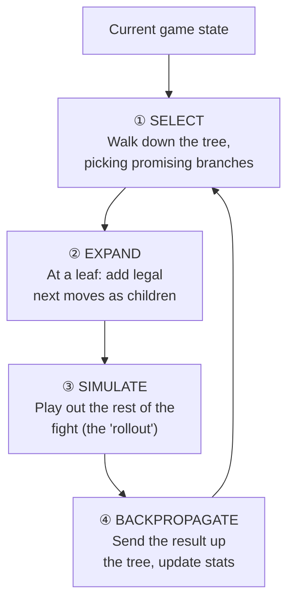
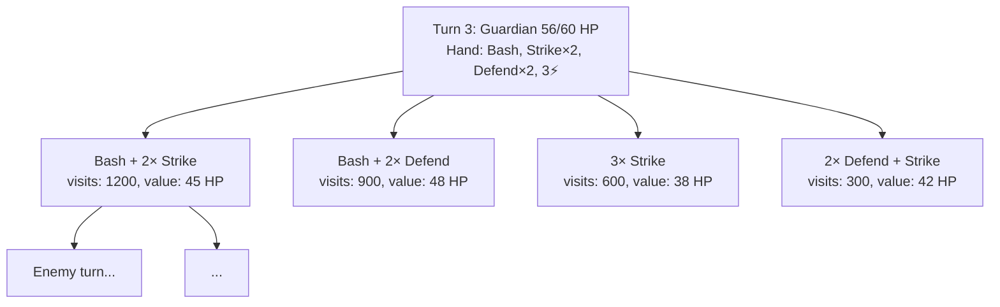
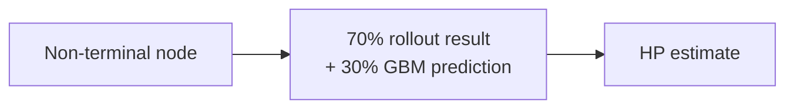

# How the AI fights

## The problem

Ironclad, turn 3 against the Guardian. Hand: **Bash**, **Strike**, **Strike**, **Defend**, **Defend**. 3 energy.

Options: Bash + 2 Strikes? Bash + 2 Defends? 3 Strikes? Something else?

The AI decides by simulating outcomes rather than using intuition.

## Monte Carlo Tree Search (MCTS)

- **Monte Carlo** = try random things many times, count results
- **Tree** = branching structure of choices and consequences
- **Search** = explore the tree to find the best path

MCTS sends out thousands of "scouts" that walk possible futures and report back. But it's smarter than random sampling — it does four steps repeatedly:

### ① SELECT — picking a path

Starting at the root (current game state), the AI descends the tree using a formula called **PUCT** (Predictor + Upper Confidence bounds for Trees). It balances:

- **Exploitation:** branches with good results so far
- **Exploration:** branches that haven't been tried much

A **policy prior** — a separate GBM trained on millions of past combat turns — provides a starting bias: "Bash is probably better than Strike here." This is the "P" in PUCT. It guides exploration without locking out alternatives.

### ② EXPAND — growing the tree

At a leaf (a state not yet explored), the AI adds all legal next moves as children. This covers the game's full card selection rules — exhaust choices, Gambler's Brew discards, multi-enemy targeting, multi-select subsets.

### ③ SIMULATE — the rollout

The AI plays out the rest of the fight using weighted random moves:

- Attack cards: weight 8
- Power cards: weight 3
- Other cards: weight 2
- End turn / potions: weight 1

The rollout returns the player's HP at the end of the fight (0 if dead).

### ④ BACKPROPAGATE — updating the tree

The rollout result propagates back up. Every node visited on the way down updates its **visit count** (+1) and **average value** (rolling update). Future SELECT steps use these updated statistics.

### Decision

After all simulations (1,000–3,000), the AI picks the root child with the **most visits** — not the highest average value. Visit count is more stable.

## The value leaf: shortcutting rollouts

Simulating to the end of every fight is expensive. For non-terminal nodes (fight still in progress), the AI blends:

The **GBM** (combat value net, V_combat) predicts end-of-fight HP from the current state. It's a collection of 1,000 decision trees, each asking questions like "enemy HP < 50%?" or "Demon Form active?" or "how much block?" It was trained on ~288,000 combat states from ~16,000 simulated fights.

The blend is **α = 0.3** (30% GBM weight). Higher α values (0.5, 0.7) performed worse — the GBM is noisy, so it's used sparingly to stabilize rollouts rather than replace them.

Terminal nodes (fight already won or lost) don't use the GBM — the result is exact.

### V_combat specs

- 1,000 trees, max depth 8 per tree
- 733 input features (HP, enemy HP, status effects, card counts, etc.)
- A few MB as a text file
- ~0.0002 seconds per prediction

Hyperparameters (tree depth, learning rate, subsampling, regularization) were tuned by Optuna, an automated search tool that tried thousands of combinations. The tuned model is about 11 percentage points better than default XGBoost settings.

## Hidden information: particle sampling

The AI doesn't know the draw pile order. It handles this by running MCTS across **64 different shuffled draw orders** (particles) simultaneously. This is IS-MCTS (Information Set MCTS). Actions are evaluated by their average outcome across all particles.

A practical fix: when descending the tree, stored edges from earlier simulations might be illegal in the current particle's draw order ("play Bash" when Bash isn't in hand). The **live-valid** check re-verifies each edge against the current draw order and re-selects among valid edges. This alone added about 5 percentage points to the win rate.

### Particle configuration

The current best setup disables belief conditioning and chain continuation (`STS_S3_BELIEF=0`, `STS_S3_CHAIN=0`) — both hurt performance. The 64 particles alone provide sufficient hidden-information handling.

## Forced-move contraction

When only one legal action exists (e.g., hand is empty, or all cards cost more than remaining energy), the AI skips the search entirely and commits the move. This is decision-neutral (verified by paired testing) and saves ~16–18% CPU.

## Summary

1. Build a tree of possible action sequences
2. Run 1,000–3,000 simulations: select → expand → rollout → backpropagate
3. Blend rollout results with GBM predictions for non-terminal nodes
4. Average across 64 draw orders to handle hidden information
5. Pick the most-visited root action

---

**Next:** [How the AI makes run decisions →](run-decisions.md)
