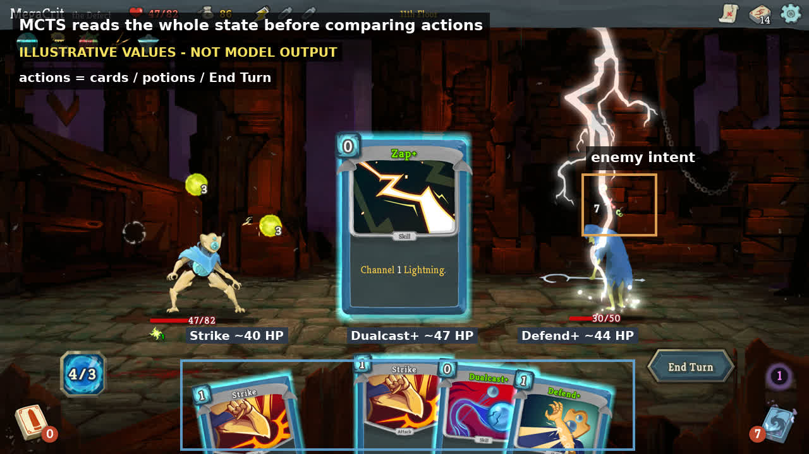
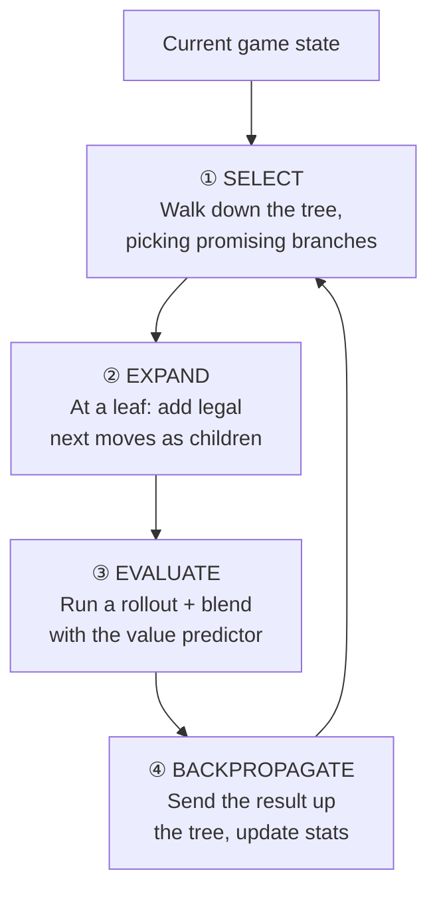
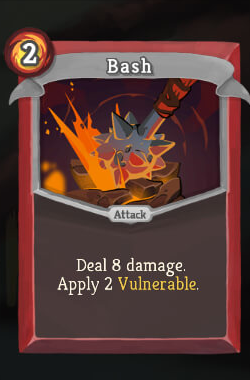
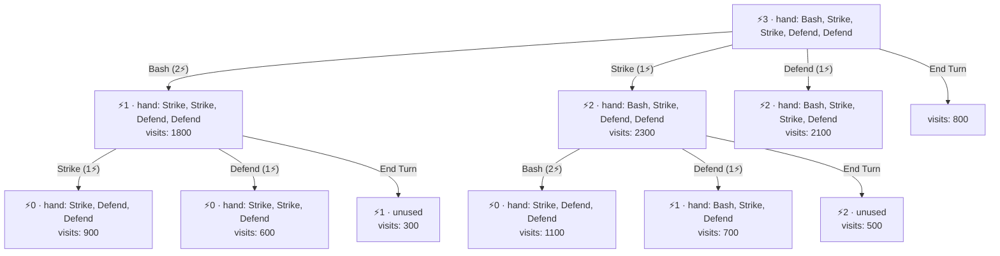

# How the AI fights

## The problem

Ironclad, turn 3 against the Guardian. Hand: **Bash**, **Strike**, **Strike**, **Defend**, **Defend**. 3 energy.

Options: Bash + 2 Strikes? Bash + 2 Defends? 3 Strikes? Something else?

The AI decides by simulating outcomes rather than using intuition.

### What the search sees

*The blue outline marks the hand; the orange outline marks the enemy intent. The HP labels are invented, plausible teaching values — **not output from this project's model**. The hand is only part of the action set: potion use and End Turn are also legal actions, as shown in the image legend.*

The search does not assign one permanent score to a card such as Bash. It evaluates **actions and action sequences**: for example, playing Bash now may change the enemy's Vulnerable state, which changes the value of later attacks. The value estimate belongs to the resulting state or branch.

## Monte Carlo Tree Search (MCTS)

- **Monte Carlo** = try random things many times, count results
- **Tree** = branching structure of choices and consequences
- **Search** = explore the tree to find the best path

MCTS sends out thousands of "scouts" that walk possible futures and report back. But it's smarter than random sampling — it does four steps repeatedly:

### ① SELECT — picking a path

Starting at the root (current game state), the AI descends the tree using a formula called **PUCT** (Predictor + Upper Confidence bounds for Trees). It balances:

- **Exploitation:** branches with good results so far
- **Exploration:** branches that haven't been tried much

A **policy prior** — a separate GBM trained on millions of past combat turns — provides a starting bias: "Bash is probably better than Strike here." This is the "P" in PUCT. It guides exploration without locking out alternatives.

Bash is a useful example because its effect is not just its immediate 8 damage: it also applies Vulnerable. MCTS evaluates that effect in the successor states and in later action sequences. It does not treat the card image or its printed damage as the final value of playing it.

### ② EXPAND — growing the tree

At a leaf (a state not yet explored), the AI adds all legal next moves as children. The action set can include:

- playing a card, including choosing its target;
- using a potion;
- selecting cards for effects such as Gambler's Brew or an exhaust action; and
- ending the turn.

This covers the game's full card-selection rules — exhaust choices, Gambler's Brew discards, multi-enemy targeting, and multi-select subsets.

### ③ EVALUATE — rollout blended with prediction

After expanding, the AI evaluates the new leaf in two parts:

1. **Rollout:** play out the rest of the fight using weighted random moves (attack weight 8, power 3, other 2, end turn/potions 1). The rollout returns the player's HP at fight end (0 if dead).
2. **GBM prediction:** the combat-value net (V_combat) predicts the end-of-fight HP from the current state without simulating further.

These are blended: **α × GBM prediction + (1−α) × rollout result**. With α = 0.3, the blend is 30% prediction, 70% rollout. The GBM stabilizes noisy rollouts; the rollout keeps the estimate grounded.

### ④ BACKPROPAGATE — updating the tree

The blended evaluation result propagates back up. Every node visited on the way down updates its **visit count** (+1) and **average value** (rolling update). Future SELECT steps use these updated statistics.

### Decision

After all simulations (1,000–3,000), the AI picks the root child with the **most visits** — not the highest average value. Visit count is more stable.

## The value leaf: the GBM model

The GBM (V_combat) that provides the prediction in step ③ is a collection of 1,000 decision trees, each asking questions like "enemy HP < 50%?" or "Demon Form active?" or "how much block?" It was trained on ~1.58 million combat states from ~87,000 simulated fights.

Terminal nodes (fight already won or lost) skip the blend — the result is exact, no prediction needed. The blend ratio α = 0.3 was chosen empirically; higher α values (0.5, 0.7) performed worse because the GBM is noisy and works best as a stabilizer, not a replacement for rollouts.

### V_combat specs

- 1,000 trees, max depth 8 per tree
- 751 input features (HP, enemy HP, status effects, card counts, etc.)
- A few MB as a text file
- ~0.0002 seconds per prediction

Hyperparameters (tree depth, learning rate, subsampling, regularization) were tuned by Optuna, an automated search tool that tried thousands of combinations. The tuned model is about 11 percentage points better than the previously deployed model at the same tree count.

## Hidden information: particle sampling

The AI doesn't know the draw pile order. It handles this by running MCTS across **64 different shuffled draw orders** (particles) simultaneously. This is IS-MCTS (Information Set MCTS). Actions are evaluated by their average outcome across all particles.

A practical fix: when descending the tree, stored edges from earlier simulations might be illegal in the current particle's draw order ("play Bash" when Bash isn't in hand). The **live-valid** check re-verifies each edge against the current draw order and re-selects among valid edges. This alone added about 5 percentage points to the win rate.

### Particle configuration

The current best setup disables belief conditioning and chain continuation (internal config flags `STS_S3_BELIEF=0`, `STS_S3_CHAIN=0`) — both hurt performance. The 64 particles alone provide sufficient hidden-information handling.

## Forced-move contraction

When only one legal action exists (e.g., hand is empty, or all cards cost more than remaining energy), the AI skips the search entirely and commits the move. This is decision-neutral (verified by paired testing) and saves ~8.5% CPU on Searcher3 (16–18% on the simpler Searcher2 variant).

## Summary

1. Build a tree of possible action sequences
2. Run 1,000–3,000 simulations: select → expand → evaluate (rollout + GBM blend) → backpropagate
3. Average across 64 draw orders to handle hidden information
4. Pick the most-visited root action

---

**Next:** [How the AI makes run decisions →](run-decisions.md)
