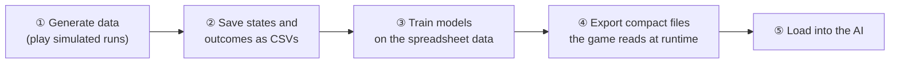
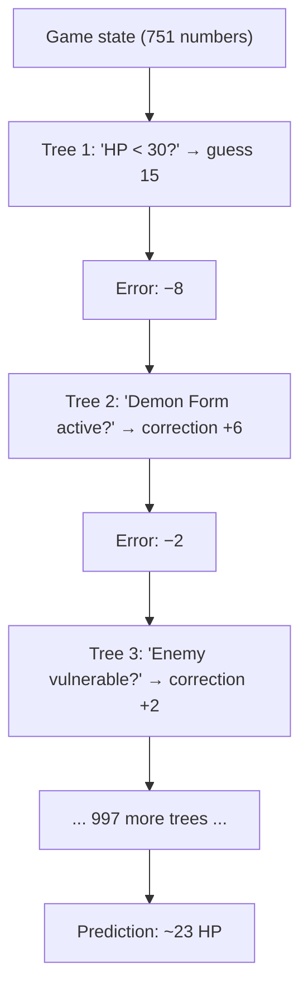
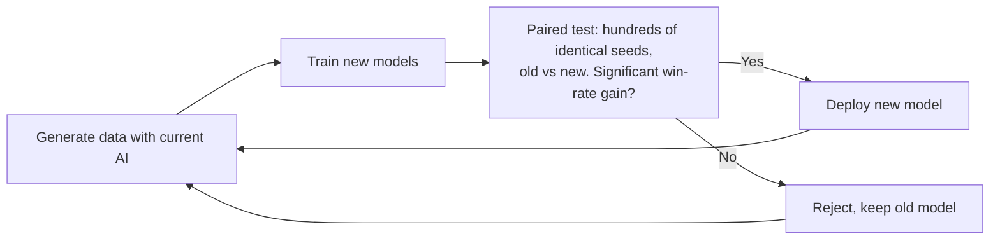

# How the models learned

The models were trained on data from millions of simulated fights and runs, not programmed by hand.

## Pipeline



## Step 1: Data generation

The simulator runs fights and full runs at high speed (thousands per hour), recording state snapshots and outcomes:

**Combat data:** Per turn — player HP, enemy HP, status effects, cards in hand, draw pile. Label: final HP of the fight (or 0 on loss).

```
PlayerHP=68, EnemyHP=42, PlayerBlock=12, Turn=3,
HasVulnerable=1, StrikeCount=3, BashInHand=1, ...
→ Final HP = 31
```

**Run data:** Per map decision — run state, all legal actions, which action was taken, final run outcome (win/loss, floor reached).

```
HP=56, Floor=23, DeckSize=18, HasCorruption=1,
Offered: Offering, Bloodletting, Rampage
→ Chose: Offering, RunWon=1
```

The generator uses the current AI at a low simulation budget (1,000 sims/decision) to stay fast.

## Step 2: Training GBMs

Several models are **gradient boosted machines** (GBMs), trained with XGBoost. A GBM builds decision trees sequentially:



Each new tree focuses on the examples the previous trees got wrong. After ~1,000 trees, adding more doesn't help.

### GBM models

| Model | Predicts | Training data | Size |
|-------|----------|---------------|------|
| **V_combat** | End-of-fight HP | 1.58M combat states, 87K fights | 1,000 trees |
| **V_rich** (floor value) | Run quality at each floor | Millions of run states | ~1,000 trees |
| **V_win** (win value) | Chance of winning the run | Millions of run states | ~1,000 trees |
| **Policy prior** | Which card to play next | Millions of combat turns | ~1,000 trees |

V_combat was hyperparameter-tuned: Optuna tried thousands of (tree depth, learning rate, subsampling, regularization) combinations. The tuned settings: max_depth 8, learning rate 0.03, subsample 0.54, colsample_bytree 0.81, min_child_weight 82, reg_alpha 1.8, gamma 4.4, 2,000 rounds with early stopping at 40. The tuned model is about 11 percentage points better than the previously deployed model at the same tree count.

## Step 3: Training the neural network

The strategic network is a feed-forward network with several layers:

```
Input (~40 numbers + tokenized cards/relics)
  → Layers (linear + activation, repeated)
  → Output (one Q-value per action)
```

Training is supervised learning:

1. Show the network a run state and all available actions
2. Compare its scores against the "correct" answer (the action the heuristic AI actually took, since that's our baseline policy)
3. Adjust the weights to make the correct action score higher
4. Repeat across ~3 million training examples (4,650 simulated runs)

Training takes tens of minutes on a GPU. The model is compact (tens of thousands of parameters, ~800 KB exported) and runs inline in the C++ executable with negligible overhead.

## Step 4: Export

**GBMs → compact tree text (`.txt`):** Each tree is a sequence of "if feature X < threshold, go left; else go right. Leaf value = Y."

**Neural network → native binary (`.native`):** Weights and biases packed into a small file.

Every export is parity-tested: the Python training code and C++ inference code must produce identical outputs for the same inputs.

## Step 5: Deployment

Exported files live in `build/` and `selfplay/models/`. Startup messages show what loaded:

```
[native OOC floor/win GBMs ON]
[Combat vnet loaded: build/v_combat_7k_tuned.txt (1000 trees, alpha=0.30)]
[OOC strategic tok net loaded: selfplay/models/ooc_strategic_tok_final.native]
```

## Self-play loop



New models must pass a paired gate before replacing the deployed model. This has rejected many ideas — most changes are neutral or negative, and the loop catches them.

---

**Previous:** [How the AI makes run decisions ←](run-decisions.md) | **Next:** [A complete run →](putting-it-together.md)
