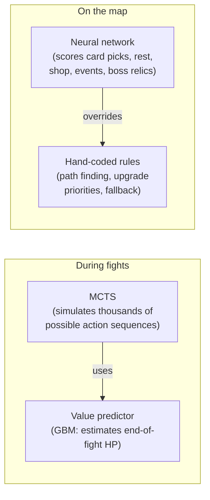

# How the Slay the Spire AI Works

An explanation of the AI that plays Slay the Spire in this project. It assumes
you know the game, but not the math or machine learning. The short version is:
the AI tries many plausible lines in combat, and uses learned estimates to
choose some of the decisions between combats.

## Pages

| Page | Topic |
|------|-------|
| [How the AI fights](how-combat-works.md) | Monte Carlo Tree Search and the combat-value model |
| [How the AI makes run decisions](run-decisions.md) | Out-of-combat choices: card rewards, rest, shop, events, path |
| [How the models learned](how-models-learn.md) | Training pipeline: data generation, GBM training, neural network training |
| [A complete run](putting-it-together.md) | Walk through one run, decision point by decision point |
| [Glossary](glossary.md) | Definitions of all technical terms |

## In 30 seconds

The AI has two decision makers. They do not share a search tree, but they do
share the run state: HP, deck, relics, map position, gold, and keys.

**Combat:** Each turn, the AI runs 1,000–3,000 simulations of "what if I play
these cards?" through a tree search. A GBM (gradient boosted machine —
essentially a large decision flowchart) estimates how much HP remains at the end
of the fight so the search does not have to simulate all the way to the end
every time.

**Map:** Between fights, hand-coded rules are the normal fallback. An optional
neural network scores each available choice; when its top pick is confidently
ahead, it overrides the rules. Otherwise the rules stay in charge.

## A useful mental model

Think of the AI as a player who can pause the game:

- in a fight, it plays thousands of short "what if?" versions of the next few
  turns and remembers which first move led to the best results;
- at a reward, shop, or campfire, it asks a learned scorer and a rule-based
  scorer what the choice is worth for the run;
- it does not know the future draw pile. Fair-play mode checks several possible
  shuffles instead of pretending it knows the exact one.

The numbers in the pages below are measurements of particular configurations,
not promises that every run or every model version behaves the same way. See
the [current baselines](../docs/knowledge-base/evaluation/current-baselines.md)
for the exact benchmark context.

## Model summary

| Type | Analogy | Predicts | Size |
|------|---------|----------|------|
| **GBM** | Many small flowcharts, each checking conditions like "HP < 30?" or "has Corruption?" | Future HP, win chance, good next moves | ~1,000 trees, a few MB |
| **Neural network** | Formula with ~40+ inputs and hundreds of thousands of parameters | Q-values for run decisions | ~800 KB exported |

Both models load inline in the executable; the combined model files total a few megabytes.

## Current performance

Measured at 1,000 simulations/decision, 32 seeds, using the currently
recommended fair-play stack with its opt-in run-level gate. The A5–A20 numbers
include the Heart fight (Act 4). Act-3-only was measured only at A0:

| Ascension | Full run (Act 3+4) | Act-3 only |
|-----------|---------------------|-------------|
| A0 | 22% | 31% |
| A5 | 13% | — |
| A10 | 13% | — |
| A15 | 9% | — |
| A20 | 0% | — |

At 3,000 simulations, a previous fair-play stack reached roughly 44–47% A0
Act-3. That is a historical comparison, not a measurement of the exact current
stack.

Top human players win roughly 40–60% of A20 Heart runs.

The AI sees only what a player sees — draw pile order and some event randomness
are hidden and sampled probabilistically. The default executable uses the
faster Searcher2; the fair-play configuration described on the combat page uses
the more explicit particle-based Searcher3.

---

**Start here:** [How the AI fights →](how-combat-works.md)
