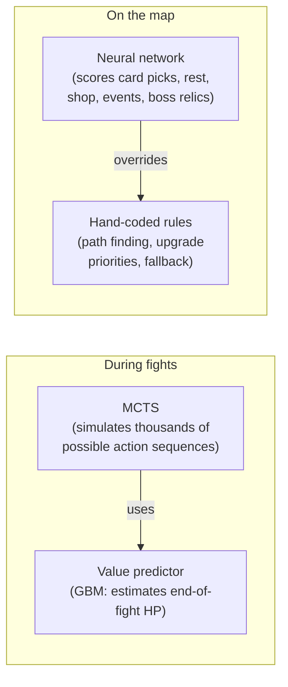

# How the Slay the Spire AI Works

An explanation of the AI that plays Slay the Spire in this project. Assumes you know the game and have basic IT knowledge (algorithms, data, what "training a model" means). No machine learning background needed.

## Pages

| Page | Topic |
|------|-------|
| [How the AI fights](how-combat-works.md) | Monte Carlo Tree Search and the combat-value model |
| [How the AI makes run decisions](run-decisions.md) | Out-of-combat choices: card rewards, rest, shop, events, path |
| [How the models learned](how-models-learn.md) | Training pipeline: data generation, GBM training, neural network training |
| [A complete run](putting-it-together.md) | Walk through one run, decision point by decision point |
| [Glossary](glossary.md) | Definitions of all technical terms |

## In 30 seconds

The AI has two systems that don't directly talk to each other — they share the game state:

**Combat:** Each turn, the AI runs 1,000–3,000 simulations of "what if I play these cards?" through a tree search. A GBM (gradient boosted machine — essentially a large decision flowchart) estimates how much HP remains at the end of the fight so the search doesn't have to simulate all the way to the end every time.

**Map:** Between fights, a small neural network scores each available choice. If its top pick beats the runner-up by enough margin, it overrides the hand-coded rules. Otherwise the heuristic handles it.

## Model summary

| Type | Analogy | Predicts | Size |
|------|---------|----------|------|
| **GBM** | Flowchart with ~1,000 branches, each checking conditions like "HP < 30?" or "has Corruption?" | Future HP, win chance, good next moves | ~1,000 trees, a few MB |
| **Neural network** | Formula with ~50 inputs and a few thousand adjustable parameters | Q-values for run decisions | Tiny (~50 inputs, 3 layers) |

Both models combined would fit on a floppy disk. No large language models here.

## Current performance

| Ascension | Act-3 win rate | Act-4 (Heart) win rate |
|-----------|---------------|------------------------|
| A0 | 31% | 22% |
| A5 | 13% | — |
| A10 | 13% | — |
| A15 | 9% | — |
| A20 | 0% | — |

Measured at 1,000 simulations/decision, 32 seeds. At 3,000 simulations on larger seed blocks, A0 Act-3 reaches 45–55%. Top human players win ~80–90% of A20 Heart runs.

The AI sees only what a player sees — draw pile order and event RNG are hidden and sampled probabilistically.

---

**Start here:** [How the AI fights →](how-combat-works.md)
