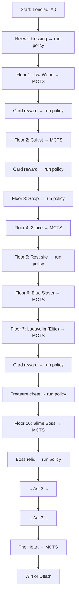
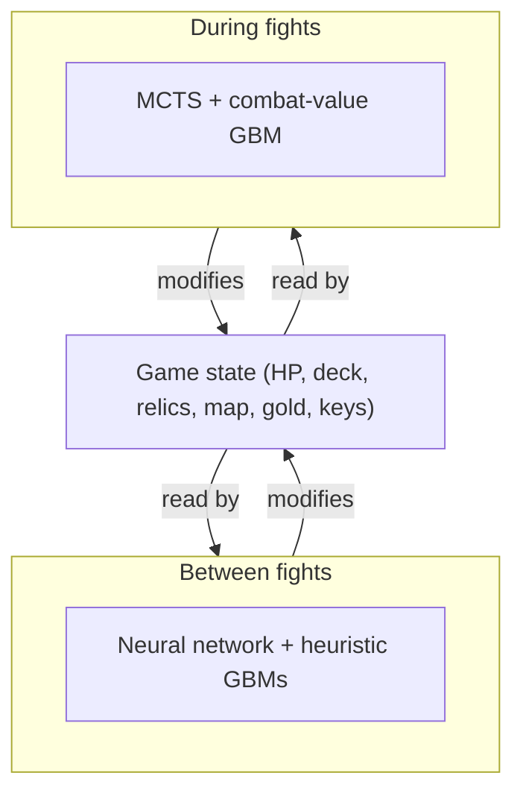

# A complete run

One full run from Neow to the Heart, showing which system handles each decision.

## Decision points

The labels below describe which code path is capable of making a decision. The
learned run-level network is opt-in; when it is off, the heuristic GBMs and
hand-coded rules make the choice.

### Combat (MCTS)

Every turn of every fight:

1. Build or reuse the tree from the current state
2. Run 1,000–3,000 simulations: select → expand → rollout/GBM blend → backpropagate
3. In fair Searcher3 mode, average across 64 draw-order particles
4. Pick most-visited root action

The tree is carried between decisions within a fight when still valid (consistent draw/boss state) and within the allowed reuse limit; nothing carries between fights.

### Card reward (NN + heuristic)

After each non-boss fight:

1. Floor-value GBM scores each card
2. If enabled, the neural network also scores each card
3. NN's top pick beats runner-up by ≥ 1.0 → use NN pick
4. Otherwise use GBM pick (skip if all below −0.5)

### Rest site (NN + heuristic)

Options: Rest (heal 30%), Smith (upgrade), Recall (Act 3, Ruby key).

Win-chance GBM scores rest vs. upgrade. The optional NN can override if
confident. Key collection is automatic when eligible in the current default.

### Shop (NN + heuristic)

Floor-value GBM scores each card/relic/potion/removal. NN can override buy/skip decisions. The AI works within its gold budget, picking the best combination.

### Treasure chest (NN + heuristic)

Binary: take relic or skip. Sapphire Key collection is automatic when eligible.

### Boss relic (NN + heuristic)

Pick 1 of 3 (or skip). Among the most impactful decisions in a run. NN evaluates each option against the current deck and run state.

## System boundaries

Combat and run decisions are separate code paths, connected only through game state:

## Act 4

The current default collects keys and can fight the Heart. `STS_COLLECT_KEYS=0`
can disable that behavior:
- Emerald key: from a burning elite
- Sapphire key: from a chest (skip the relic)
- Ruby key: Recall at an Act 3 campfire

After the Act 3 boss: Shield & Spear, then the Heart. The Heart makes the run
substantially harder. The current 32-seed A0 reference is 21.9% for the full
Act-3+4 run versus 31.2% when stopping after Act 3 at 1,000 simulations; see
[current baselines](../docs/knowledge-base/evaluation/current-baselines.md).

---

**Previous:** [How the models learned ←](how-models-learn.md) | **Next:** [Glossary →](glossary.md)
