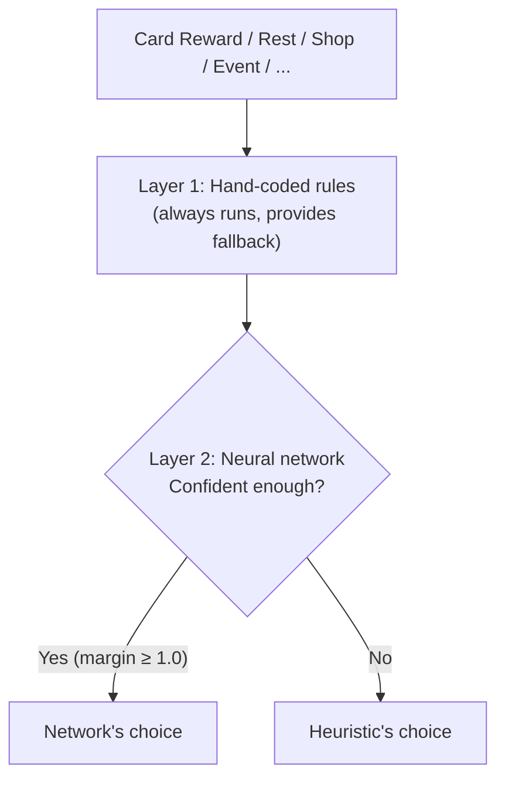

# How the AI makes run decisions

Out-of-combat (OOC) decisions: card rewards, rest sites, shops, events, treasure chests, boss relics, and path choice.

## The two-layer architecture

**Layer 1** is hand-coded: floor-value GBM for card scoring, win-chance GBM for rest decisions, heuristic path routing.

**Layer 2** is a learned neural network. For each available action, it predicts a **Q-value** — an estimate of how good the run will be after taking that action. If the best action's Q-value beats the second-best by at least 1.0, the network's choice is used. Otherwise the heuristic handles it.

This gating architecture keeps the heuristic as a floor — the learned model only intervenes when confident.

## What the network sees

### Global features (~40 numbers)
Current HP, max HP, gold, floor, act, deck size, strike/defend counts, boss relic status, key collection flags, etc.

### Tokenized entities
Each card: (identity, upgraded, count). Each relic: (identity, counter). Each potion: (identity, count).

### Per-action details
For a card reward: the offered card's identity, cost, type, upgrades. For a shop: the item being considered. For an event: which option. For a boss relic: which relic.

The network represents cards, relics, and potions as **tokens** — small learned vectors of numbers that capture their identity. These are processed alongside the global features through several feed-forward layers to produce one Q-value per action. The network has hundreds of thousands of parameters and was trained on ~3 million action rows (~724,000 decisions).

## Where the network operates

| Screen | Enabled | Example |
|--------|---------|---------|
| Card reward | ✅ | Pick this card or skip? |
| Rest site | ✅ | Rest vs. Smith vs. Recall? |
| Event | ✅ | Take the curse for gold? |
| Shop | ✅ | Buy this relic or save? |
| Treasure chest | ✅ | Take relic or skip (Sapphire Key)? |
| Boss relic | ✅ | Runic Dome or Cursed Key? |

All screens use the same margin rule (≥ 1.0) and the same network.

## Path choice

Path choice uses a separate system: a floor-value GBM scores each floor on the map, and the AI finds the route with the best sequence of floors (considering elites, campfires, shops, and burning elites for the emerald key).

## The heuristic fallback

When the network doesn't fire (or when running without it):

| Screen | Rule |
|--------|------|
| Card reward | Floor-value GBM scores each card. Pick highest; skip if all below −0.5 |
| Rest site | Win-chance GBM: rest if healing raises P(win) more than the best upgrade would |
| Shop | Shop-value GBM evaluates purchases against gold budget |
| Events | Per-event hand-coded rules |
| Boss relic | Hand-coded `Expert` ordering (opt-in: V_win GBM) |

The floor-value GBM and win-chance GBM are separate from the combat GBM — they predict run-level outcomes, not fight outcomes.

## Example

After a hallway fight in Act 2, the reward screen offers: **Offering**, **Bloodletting**, **Rampage**.

The heuristic (floor-value GBM) scores:
- Offering: 8.2 (rare, draw + energy)
- Bloodletting: 3.5 (HP-for-energy, situational)
- Rampage: 1.8 (scales slowly, weak at this point)

Heuristic picks Offering.

The neural network scores:
- Offering Q-value: 52.3
- Bloodletting Q-value: 45.7
- Skip Q-value: 40.1

Margin: 52.3 − 45.7 = **6.6** (≥ 1.0). Network picks Offering. Same result here, but the network can disagree with the heuristic in closer calls.

## Limitations

- The network evaluates choices one at a time — it doesn't plan sequences. A card pick is scored by "how good will the run be after adding this?" not "what synergies will this enable three floors from now?"
- It has hundreds of thousands of parameters, trained on ~3 million action rows (~724,000 decisions). It learns broad patterns, not specific card interactions.
- On the current combat configuration, the gating step adds about 12 percentage points to Act-3 win rate (measured on 128 paired seeds; an earlier 32-seed sample suggested a penalty, but the larger paired test reversed that finding). The gates are essential for Act 4 and show no Act-3 penalty at adequate sample sizes.

---

**Previous:** [How the AI fights ←](how-combat-works.md) | **Next:** [How the models learned →](how-models-learn.md)
